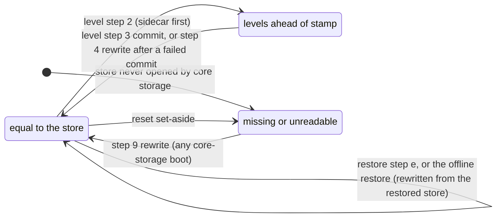
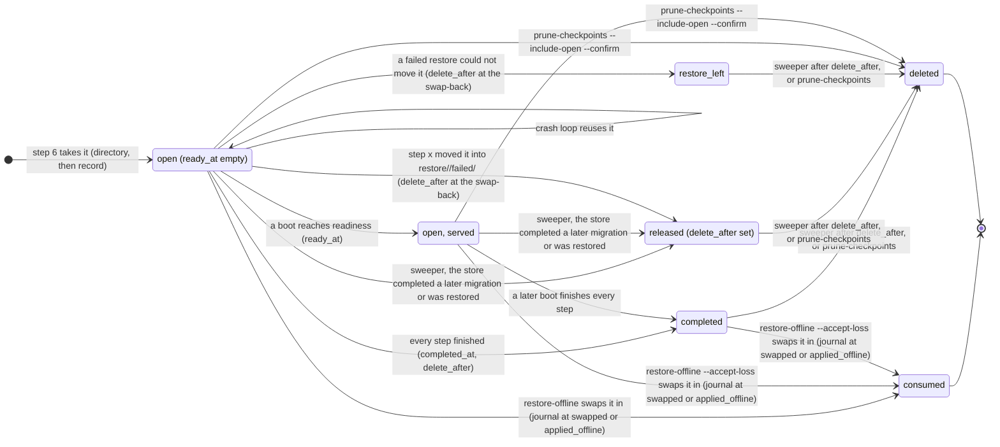
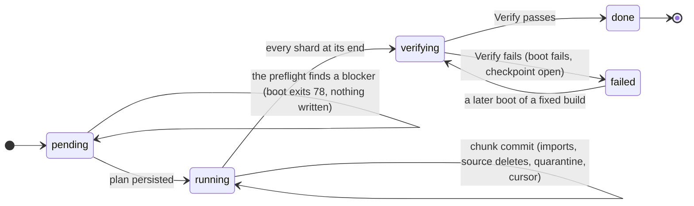

<!-- file: docs/specs/platform-core/05-storage.md -->
<!-- version: 1.13.5 -->
<!-- guid: 940ce8be-6f86-4450-b43a-77bf78827b12 -->
<!-- last-edited: 2026-11-04 -->

# 05 — Storage (`storage`, `storage/index`, `storage/datamigrate`)

Evidence commit `748fd787a`; every `path:line` below is at that commit. Raw inputs:
[`raw/05-storage.md`](../../plans/platform-core/raw/05-storage.md) (engines, 258 key families,
migrations, backup), [`raw/04-database-store.md`](../../plans/platform-core/raw/04-database-store.md)
(`database.Store`), [`raw/12-cross-cutting.md`](../../plans/platform-core/raw/12-cross-cutting.md),
[`raw/02-import-graph-hotspots.md`](../../plans/platform-core/raw/02-import-graph-hotspots.md),
[`raw/08-prior-art.md`](../../plans/platform-core/raw/08-prior-art.md). Names, layers and rules
(R1–R8) are from [03-architecture](03-architecture.md): `storage` and `storage/index` are **L1**;
`storage/keys` (pure tuple-key functions) and `storage/codec` (generic value codecs) are **L0**
leaves that import nothing from core (03 §3.3, MOD3-9; the typed keyspace helper that names both a
codec and a `Keyspace` is therefore `storage.Typed`, not a `codec` type, §5S.3.3); `storage/datamigrate` and its runner `core/internal/storagemigrate` are **L4** (they import
`tasks`; R4 bridge rule). Task-system names (`tasks.Definition`, `tasks.Parallelism`, checkpoints,
preview) are normative in [05-tasks](05-tasks.md). This file owns storage **mechanisms**: claims, the
one ownership table of ABO's families (§5S.9.1), migrations, the store guard and its sidecars, the
pre-migration checkpoint and the offline restore (§5S.3.12), and the R2 **cutover** (§5S.3.13):
importers, quarantine, the level step, compaction and checkpoint retention. Boot **order** is
[06](06-app-sdk.md) §6.5.1's one phase table (R2-8); §5S.4 describes storage's own steps and names the
phase each runs in. Release content (R0–R3), the flip order and the release checklists are **policy**
owned by [09](09-abo-on-core.md), which references these mechanisms.

**One-way migration, no compatibility (owner decisions D10–D12).** ABO's history reaches core in one
cutover release, **R2**. Each core service that persists state declares a **store interface** in its SDK
package and ships one **native implementation** over its own `c/<subsystem>/` keyspace; there are no
legacy implementations. In R2 a books-owned **cutover step** per subsystem decodes HEAD's rows, writes
them through that subsystem's **importer** and deletes them, in one batch per chunk, so core still holds
no ABO key name or row format (03 R1). A row that does not decode is **quarantined**, never dropped in
silence, except a user, API-key or OAuth-identity row, which **stops the upgrade** before the level step
with a report naming the row (D13; §5S.3.13 "Cutover blockers"). Before the first step runs the boot takes
the **pre-migration checkpoint** (the store and the state files), and a **level step** makes every older
build refuse the store before the first row moves. Every checkpoint is deleted automatically 7 days after
it stops being needed (D12 (d), §5S.3.12). Rollback is an
**offline restore** of that checkpoint, or of an off-host archive, plus the previous binary; whatever was
written after the upgrade is lost (§5S.3.12). Books' domain families (about 240 of the 258) stay where
HEAD stores them, as books' claims, because moving them buys nothing. R0 changes no store; R1 opens the
store under core storage and writes only `c/storage/` bookkeeping, which HEAD ignores, so R1's rollback
is still a binary swap; R3 deletes books' HEAD-style steps and HEAD-format readers behind one upgrade
floor (§5S.3.5).

## 5S.0 Decisions in one table

Decision IDs carry a `D-S` prefix so they never read as 09's releases R0–R3 or the cutover steps M1–M8.

| # | Decision | Section |
|---|---|---|
| D-S1 | **One system-of-record Pebble DB per install**, opened only by the kernel at the absolute path `core.storage.path` (never under the state directory by construction). Holders get a `storage.Keyspace` (`m/<module>/`, `c/<subsystem>/`) and, for data written before core existed, a `LegacyRange` over their own claims. Holding the handle *is* the permission — for reads as well as writes. No core subsystem ever holds a `LegacyRange`, and there are no storage grants. | §5S.3.1, §5S.3.4, §5S.4 |
| D-S2 | Access outside the handle's keyspace or claims is **refused** (`ErrOutsideKeyspace`), never logged-and-allowed, from R1 on; `core.storage.claims.mode=shadow` stays only as an emergency dial that logs and counts a violation and allows it, and nothing is persisted. In core and module keyspaces every `Serialized` sub-prefix is checked (R6-1): a `Set` or `Delete` there without an `Expect` on its key, and every `DeleteRange` there, is refused (`ErrBlindWrite`). **A legacy claim is never checked that way (A-3):** after R2 the claims hold only books' domain families, which books' own code writes with HEAD's lock discipline, and no core service stages into them. | §5S.3.2, §5S.3.4, §5S.9.4 |
| D-S3 | ABO's 258 key families are **books' claims** in one normative table (§5S.9.1). No claim ever changes owner. Up to R1 every family is `ClaimReadWrite`; from R2 the families of the core services (identity, config and secrets, task runs, the system log, integration instances, AI jobs, provider holds, import roots, the search dirty set) are `ClaimRetired`: the cutover drains them and nothing writes them again (the settings blob, which M2 rewrites and M6 deletes, only from R3). Claims are prefix or exact key; same-owner nesting is legal and the longest match selects the claim; cross-owner nesting needs an explicit `Except`; any other overlap fails boot. | §5S.3.4, §5S.9.1 |
| D-S4 | **Store interfaces with native implementations, plus importers.** Each core service that persists state declares its store interface in its SDK package with one native implementation over `c/<subsystem>/`, and, where R2 feeds it HEAD's data, an **importer**: a staging interface over that native store. There is no `legacy` package, no app-supplied store, no routed store and no `backends` ledger. | §5S.3.11, §5S.3.13 |
| D-S5 | **One-way cutover in R2.** One ordered list of `BootBlocking` steps behind the checkpoint (M1–M8). Books decodes HEAD's rows and stages them through the importers, one batch per chunk; every ID that books' rows reference is kept; a row that does not decode, or that an importer refuses, is quarantined under `c/storage/quarantine/` and reported in health, except an unconvertible user, API-key or OAuth-identity row or an account merge in progress, which stops the upgrade before the level step (D13); the level step runs before the first row moves; M8 then rewrites the whole store into a fresh directory, so no file of the live store keeps a deleted row. | §5S.3.13 |
| D-S6 | **What is reset rather than migrated (D12 (b)).** Web sessions, invites and one-time tokens, provider throttle and quota holds, the full-text index and its dirty set. Migrated: users, roles, API keys (by hash, so `abk_` tokens keep working), OAuth identities, the invite allow-list, settings and secrets, open and finished task runs with their clocks and stamps, AI jobs, integration instances, the webhook rule, import roots and the system log. The ABS families (`abs_sess:` and the rest) stay books' and are not touched (D12 (c)). | §5S.9.1, §5S.9.2 |
| D-S7 | Versioned migrations are **per keyspace, forward-only, one atomic batch per step** — except books' HEAD-style legacy steps 1..`LegacyCap`, which keep their idempotent, non-atomic form, run **first**, on books' own claims (R2-4, DATA4-19), and are deleted in R3 behind the one upgrade floor (02 N14). All pending steps of all owners run in **one DAG**. **One checkpoint per upgrade attempt**, taken before anything is written, reused only by later boots of the same uncompleted attempt on the same store (install marker + store generation; DATA3-1). A store short of the floor is refused at boot before any write (exit 78); nothing checks a floor before a binary is applied. | §5S.3.5, §5S.3.12, §5S.4 |
| D-S8 | Anything too large for one batch is a **data migration** (`storage/datamigrate`): a `tasks.Parallelism`, a persisted shard plan (exact resume), a compatibility class, and a dry run that is the real runner on a read-only copy of the store. Every data migration is `BootBlocking` (in process, a node of the boot DAG), the cutover steps included. The `Online` mode — a background rewrite of `Serialized` ranges with precondition writes, run as the module kind `<module>.datamigrate.<name>` (COR4-5, COR4-6) — has no consumer, so it is a deferred-build member kept at proof depth (§5S.3.14, SIMP5-7). | §5S.3.6 |
| D-S9 | **One store guard** (SIMP-18): a per-owner minimum-reader **level** — stamp, fsynced sidecar, fast-exit flag — raised (always as `max`) only by level steps, plus books' projection onto HEAD's format stamp for pre-guard builds. R2's level step raises `books` and `core`, so R0 (HEAD) and R1 refuse a migrated store; a refused build exits 78 before any write. `make rollback` (a binary swap) reads the sidecar and refuses after R2. | §5S.3.5, §5S.3.7 |
| D-S10 | Concurrency: **preconditions evaluated at commit** under commit-time stripe locks for `Serialized` ranges (legacy claims and core or module keyspaces alike); in core and module keyspaces **every** write to a `Serialized` key that derives from a read is conditional — state transitions, progress ticks, chunk-ledger commits and usage writes alike — and a write whose precondition failed is re-derived from the new value or dropped, never resubmitted (R6-1); **multi-owner atomic batches** by participant binding (each owner binds only the handles it holds; participant APIs take `*storage.Batch`), which is also how an importer joins a cutover chunk. Storage never holds a lock, lease or reservation for an uncommitted batch, so a leaked batch stalls nothing. | §5S.3.2, §5S.6 |
| D-S11 | Full-text search is a core contract (`storage/index`, which imports `storage`, never the reverse) with a durable native dirty set in the entity's batch; books' index is rebuilt at R2 at its new path rather than migrated, and HEAD's `library.bleve` is removed in R3 by books' `legacy-file-cleanup` (§5S.3.8). Derived indexes record a **derived generation** and the **store generation** and are accepted only when both match; their hooks and rebuild task are registrar data, and the loader runs at Run start step (3a), never inside `app.New` (COR3-7). hnsw, chromem-go and go-memdb stay **app-level** (books). | §5S.3.8, §5S.3.9 |
| D-S12 | Auxiliary, re-creatable Pebble DBs (the Open Library dump mirror) only through `OpenAuxiliary`, with the same format pin; never system of record. The dead standalone AI-scan DB is deleted. | §5S.3.10 |
| D-S13 | **Checkpoint retention and the offline restore.** The pre-migration checkpoint holds the store and the state files the steps read or write, in a 0700 directory with 0600 files; every checkpoint is **deleted automatically 7 days after it stops being needed** — a completed one 7 days after completion, an open one 7 days after the live store completed a later migration or was restored by any path, and kept until then because it is the rollback (D12 (d); the sweeper and `storage prune-checkpoints`, which deletes one sooner, ship from R1). `storage restore-offline` restores it, or an archive, with the service stopped; `make rollback-restore` wraps that and reinstalls the previous binary, refusing first when that binary's levels are not the source's. | §5S.3.12 |

## 5S.1 Purpose & scope

`storage` is the only persistence API in core: an ordered byte-key/byte-value store over Pebble with
namespaced keyspaces, batches with preconditions, snapshots, iterators, sequences, per-keyspace
migrations, legacy claims, the store guard, a census, the pre-migration checkpoint and the quarantine.
`storage/index` is the full-text index contract. `storage/datamigrate` declares large resumable
rewrites, the R2 cutover steps among them.

In scope: the main DB lifecycle; keyspace issue and enforcement (R8); the legacy-claim registry (the
successor of `internal/database/keyfamilies.go`, which stays ABO code) and the **one ownership table**
of ABO's families that 04, 05-tasks, 05-logging, 05-authn, 05-config and 09 reference instead of
restating (DATA-2); migrations (versioned, books legacy, data); the store guard and its sidecars;
checkpoints, their retention and the offline restore; the cutover mechanism (importer rules,
quarantine, the level step, compaction); derived-index lifecycle; full-text index contract; auxiliary
DBs; key and value codecs; the factory reset's swap.

Out of scope: entity schemas (modules own them; core owns no media table — 02 decision 6); backup
and archive restore ([05-backup](05-backup.md), which consumes `storage.Admin.Checkpoint` and owns the
journaled directory swap that checkpoint restores and resets reuse); filesystem roots
([05-library](05-library.md)); each store interface, its native implementation, its importer and the
decoding and mapping of its cutover step ([05-authn](05-authn.md), [05-rbac](05-rbac.md),
[05-config](05-config.md), [05-tasks](05-tasks.md), [05-logging](05-logging.md),
[05-library](05-library.md), [05-ai](05-ai.md), [05-metadata](05-metadata.md),
[05-notify](05-notify.md), `storage/index` §5S.3.8); task execution ([05-tasks](05-tasks.md)); release
content and order ([09](09-abo-on-core.md)).

## 5S.2 Current state at HEAD

| Fact | Evidence |
|---|---|
| Pebble v2.1.7 is the only system-of-record engine; SQLite removed (`InitializeStore` rejects it), NutsDB retired; bbolt indirect only. | `go.mod:7`; `internal/database/store.go:1840-1851`; `raw/05-storage.md` §1 |
| One main DB, directory `audiobooks.pebble`, plus sidecar file `<db>.storage-format`; siblings `library.bleve`, `hnsw/`, `certs/`, bootstrap-token file, `backups/`. | `cmd/root.go:488`; `internal/database/storage_format.go:111-123`; `internal/appdirs/appdirs.go:52-62`; `internal/backup/backup.go:134-146` |
| Every "store" (activity, metrics, embeddings, AI scan, catalog, master list) is a key-prefix namespace over the one DB; one WAL, one backup unit, one migration clock. | `internal/database/store_from_store.go:12-63`; `internal/server/registry_wire.go:270-310` |
| All engine access goes through `GatedDB`, a lease gate so `Close` drains in-flight calls; borrowers get it from `PebbleStore.DB()`. | `internal/database/pebble_gate.go:327-340,363`; `internal/database/pebble_store.go:957-962` |
| Key-family registry: 258 families, feeds `GET /api/v1/diagnostics/db-census`; an unregistered prefix shows as "(unregistered)" and is **not** refused; uniqueness and partition coverage are tested, writer registration is not. | `internal/database/keyfamilies.go:14-36,37-345`; `internal/server/wire_media_routes.go:68`; `raw/05-storage.md` §3 |
| **89 nested pairs** among the 258: a family whose prefix starts with another family's prefix is that family's child (`book:` ⊃ `book:asin:`, `act:` ⊃ 12 children, `opv2:` ⊃ 13, `opv3:` ⊃ 19, `pref:_system:` ⊃ 6), all written by the same owner; some children have a different lifecycle than their parent (`book:hash:`, `book:organizedhash:`, `book:originalhash:` retired; `book:author:`, `book:series:` dead and swept by retention). | `keyfamilies.go:29-36` (nesting rule), `:37-345` (counted at this commit) |
| 256 families are `name:`-prefixed; 2 are bare keys: `narrator_counter` and `sync_alias_use_seed_cutoff`. Both are deliberate (the first keeps legacy narrator numbering, the second must not fall inside the `sync_alias_use:` scans). | `keyfamilies.go:84,316`; `pebble_store_authors.go:1220-1229`; `pebble_store_sync_alias_use.go:209-213` |
| `idx:` is one family shared by auth, users, sessions, API keys, OAuth, invites, playback, playlists, book versions, collections, ABS sessions and the search dirty set. The identity sub-prefixes in code are exactly `idx:user:` (username, email), `idx:role:name:`, `idx:sess:user:`, `idx:apikey:` (hash, user), `idx:invite:username:`, `idx:oauth:` (user, sub). | `keyfamilies.go:64`; `pebble_store_auth.go:67,142,173,178,1126,1131,1670`; `pebble_store_search_dirty.go:39` |
| `setting:` is a general runtime-marker store, not the config store: 56 non-test `SetSetting` call sites write scheduler clocks, the pause gate, index-built and backfill-done flags, the bootstrap token hash and one `transcode_skip_<hash>` row per file; `preference:` holds per-book state (`metadata_state_<bookID>`); `pref:` holds per-user books data moved by the user merge. | `internal/scheduler/interval_clock.go:50`; `internal/operations/registry/pause_gate.go:52`; `internal/server/bootstrap.go:38-39`; `internal/remux/transcode.go:113-116`; `internal/metastate/metastate.go:34`; `internal/database/user_merge.go:241,425` |
| `counter:` holds ASCII-decimal ID counters for unrelated entities; `nextID` commits each increment with its own `pebble.Sync` write, outside the caller's batch. | `pebble_store.go:96-103,966-990` |
| Values are `encoding/json` (v1) by default; binary exceptions: ASCII counters, float16+zstd vectors in a JSON envelope, 8-byte LE `dedup:seq`, big-endian fingerprint windows and clock values. No gob or protobuf in `internal/database`. | `raw/05-storage.md` §3 "Value encoding" |
| Versioned migrations: one hand-ordered slice of 66 (`Version`, `Up`, optional `Down`; 2 have `Down`); `type MigrationFunc func(store migrationStore) error`; version in `preference:db_version`, records `{version, description, applied_at}` in `preference:migration_<n>`; record + version bump are one batch, **but `Up`'s own writes are not in that batch** (they go through store methods that commit their own batches and allocate IDs through `nextID`); several are library-scale repairs (063–066); `Up` must be idempotent (enforced by a test). A version whose record exists is never re-run (replay guard DB-02). | `internal/database/migrations.go:69-112,87,96-100,487-506,512-575,536-548`; `migration_bookkeeping.go:14-80,128-138` |
| An unreadable `db_version` is read as version 0 (fail-open); only versions without a `migration_<n>` record would then re-run. | `migrations.go:579-585,542` |
| Migrations run after the store's init phase has already written (counters, `library:`→`import_path:` conversion, stamp) and after the Pebble format ratchet, and before `ReconcileOpsV3WithV2`, which runs every boot and only logs on failure. No checkpoint is taken before migrations. | `store.go:1846-1872`; `pebble_store.go:689-699,1089-1105` |
| Storage-format guard: `SupportedStorageFormat = 1`; stamp at `preference:storage_format`, marker `preference:storage_migration`, sidecar `<db>.storage-format`; open refuses too-new (stamp or sidecar) and, in serve mode, older or marked stores; Pebble format pinned to `FormatValueSeparation` and ratcheted in the init phase. | `storage_format.go:44-80,82-87,111-123`; `pebble_store.go:620-687,689-699` |
| `RunCutover` is referenced but **does not exist**; `openForCutover` and `StorageMigrationCheckpointSuffix` have no caller. The design is in the storage-efficiency plan (task B6a) and was never built. | `storage_format.go:125-129`; `pebble_store.go:597-619`; `docs/plans/2026-10-03-storage-efficiency-plan.md:168-170` |
| `make rollback` reads the sidecar and the `.prev` binary's `--print-storage-format` and refuses a swap when the sidecar is above `.prev`'s format; the sidecar is read with `sudo -n cat` over ssh. | `Makefile:871-903`; `scripts/storage_format_guard.py:17-22` |
| The shipped unit restarts on failure every 5 s, burst 5 per 60 s. | `deploy/audiobook-organizer.service:81-82,111-112` |
| Derived engines: go-memdb **live**; bleve scorch `library.bleve` **live but degradable**; coder/hnsw **live by default**, snapshot in `hnsw/` validated against a Pebble truth *count*; chromem-go **optional**, in-memory only. | `pebble_store.go:792-845`; `internal/search/register.go:42-60`; `internal/search/bleve_index.go:186-262`; `internal/server/registry_wire.go:65-80,136-159`; `internal/server/server.go:838-870`; `internal/database/hnsw_embedding_store.go:346-380` |
| Second Pebble DBs: the Open Library dump mirror (`ol:` keys, opened with `pebble.FormatNewest`) and a standalone AI-scan DB constructor with no non-test caller. | `internal/openlibrary/store.go:41-43,97-104`; `internal/database/ai_scan_store.go:156-181` |
| Owner locks for identity writes are ad-hoc mutexes, each held across a read and its own direct commit: `inviteMu` and `apiKeyMu` are fields of `PebbleStore`, so they serialise only users of one instance; `userWriteMu` (every rewrite of an existing user row, taken after `inviteMu`), `sessionWriteMu` and `userMergeApplyMu` are package variables, and the server's `bootstrapMu` is taken before `inviteMu` and `userWriteMu`. The admin user merge commits one batch across books and auth families after a compare-and-set under them. Separately, `counterMu`, also a `PebbleStore` field, serialises `nextID`'s own `Sync` commit of an ID counter; no identity row takes an ID from it (HEAD's identity rows use ULIDs; DATA10-9). | `pebble_store.go:226-244,966-989`; `pebble_store_auth.go:136,152,209-212,240,509-525,587,760,1285,1697`; `internal/server/bootstrap.go:136,212`; `user_merge.go:401-403,516-517`; `user_merge.go:241-242,421-486,507-531,719-722` |
| A package-level `globalStore` is still set by `InitializeStore`. | `store.go:1807-1825,1854` |

Coupling that the extraction must cut (`raw/02-import-graph-hotspots.md` findings 1–2):
`internal/database` imports 8 audiobook packages and *is* the book model (`store.go:202`), so
nothing that imports it can be core. Core storage starts from zero code shared with
`internal/database`, and books keeps `internal/database` as its repository layer over core handles
(§5S.9.3).

## 5S.3 Go API

Package `github.com/falkcorp/mediacore/storage` (L1, R4). The engine lives in
`core/internal/pebble`; the only constructor of a `*DB` is `kernel`. Apps never open a DB (R2).
`storage` imports neither `storage/index` nor `tasks` (COR-2, SIMP-17).

### 5S.3.1 DB, Keyspace, keys and values

```go
package storage

import (
	"context"
	"errors"
	"iter"
	"time"
)

// Owner identifies who holds a keyspace or a claim: a module ID ("books"), or
// "core/<subsystem>" ("core/tasks"). Levels (§5S.3.7) use "core" for all of core.
type Owner string

// DB is the install's single system-of-record store. Only the kernel holds a
// *DB; everyone else holds Keyspaces and LegacyRanges cut from it.
type DB struct{ /* engine, claim registry, gate, stripe table, metrics; unexported */ }

// Handle is implemented by Keyspace and LegacyRange only (sealed).
type Handle interface{ handle() }

// Reader is the read surface shared by Keyspace, LegacyRange and Snapshot.
type Reader interface {
	Get(ctx context.Context, key []byte) ([]byte, error)
	Scan(ctx context.Context, opts ScanOptions) iter.Seq2[KV, error]
	NewIterator(ctx context.Context, opts ScanOptions) (*Iterator, error)
}

// Keyspace is a capability: every key passed to its methods is relative and
// is stored as Prefix()+key, so a holder cannot address anything else.
// The zero Keyspace is invalid; every method on it returns ErrInvalidKeyspace.
type Keyspace struct{ /* unexported */ }

func (k Keyspace) Prefix() string      // "m/tv/" or "c/tasks/"
func (k Keyspace) Owner() Owner
func (k Keyspace) Sub(name string) Keyspace // "m/tv/" + "series" -> "m/tv/series/"; name checked by keys.ValidName

// Reads. Get returns a copy owned by the caller; ErrNotFound when absent.
func (k Keyspace) Get(ctx context.Context, key []byte) ([]byte, error)
func (k Keyspace) Has(ctx context.Context, key []byte) (bool, error)

// Single-key writes are a one-entry batch committed with Sync.
func (k Keyspace) Set(ctx context.Context, key, value []byte) error
func (k Keyspace) Delete(ctx context.Context, key []byte) error
// DeleteRange deletes [start, end) inside the keyspace; nil end = to the end of the keyspace.
func (k Keyspace) DeleteRange(ctx context.Context, start, end []byte) error

// Scan yields keys in [opts.Start, opts.End) (relative), forward or reverse.
// Key and Value are valid only until the next iteration step; use KV.Clone to
// retain. A non-nil error is yielded at most once, as the last pair.
func (k Keyspace) Scan(ctx context.Context, opts ScanOptions) iter.Seq2[KV, error]
func (k Keyspace) ScanPrefix(ctx context.Context, prefix []byte) iter.Seq2[KV, error]

// NewIterator is the cursor form for callers that seek, step backwards or
// interleave scans (the books repository layer needs SeekGE/Prev/Last).
func (k Keyspace) NewIterator(ctx context.Context, opts ScanOptions) (*Iterator, error)

func (k Keyspace) NewBatch() *Batch            // write-only
func (k Keyspace) NewIndexedBatch() *Batch     // reads see the batch's own writes
func (k Keyspace) Snapshot() (*Snapshot, error) // point-in-time, read-only, scoped to k

// Sequence returns a named monotonic uint64 allocator stored in the keyspace (§5S.3.2).
func (k Keyspace) Sequence(name string) *Sequence

// EstimateBytes is Pebble's on-disk estimate for the keyspace (cheap).
func (k Keyspace) EstimateBytes(ctx context.Context) (uint64, error)

type ScanOptions struct {
	Start, End []byte // relative; nil = keyspace bound
	Reverse    bool
	KeysOnly   bool  // skips value fetch for value-separated blobs
	Limit      int   // 0 = unlimited
}

type Range struct{ Start, End []byte } // absolute keys; End exclusive

type KV struct{ Key, Value []byte } // Key is relative to the handle
func (kv KV) Clone() KV

type Iterator struct{ /* unexported */ }
func (it *Iterator) First() bool
func (it *Iterator) Last() bool
func (it *Iterator) SeekGE(key []byte) bool
func (it *Iterator) SeekLT(key []byte) bool
func (it *Iterator) Next() bool
func (it *Iterator) Prev() bool
func (it *Iterator) Valid() bool
func (it *Iterator) Key() []byte   // relative
func (it *Iterator) Value() []byte
func (it *Iterator) Err() error
func (it *Iterator) Close() error

type Durability uint8
const (
	DurabilityInvalid Durability = iota // zero value is rejected
	Sync                                  // fsync the WAL before Commit returns (default for every keyspace)
	NoSync                                // caches, census results, metrics snapshots: may be lost on crash
)

var (
	ErrNotFound        = errors.New("storage: not found")
	ErrOutsideKeyspace = errors.New("storage: key outside the handle's keyspace or claims")
	ErrInvalidKeyspace = errors.New("storage: zero or closed keyspace")
	ErrClosed          = errors.New("storage: db closed")
	ErrBatchTooLarge   = errors.New("storage: batch exceeds the configured limit")
	ErrClaimMode       = errors.New("storage: the claim's mode forbids this operation")
	ErrNotSerialized   = errors.New("storage: preconditions are allowed only on Serialized ranges")
	ErrConflict        = errors.New("storage: a precondition failed at commit; nothing was applied")
	ErrBlindWrite      = errors.New("storage: a write to a Serialized range of a core or module keyspace carries no Expect on its key, or is a DeleteRange there")
	ErrReadOnly        = errors.New("storage: handle of a read-only open; every write is refused") // §5S.3.10, COR7-8
)
```

### 5S.3.2 Batches, preconditions, multi-owner commits, sequences

```go
// Batch is atomic across every handle bound to it: one Pebble batch.
// A batch created from handle H can write H. Bind adds another handle; the
// caller must HOLD that handle — the handle value is the capability, so a
// participant can only touch what it bound. This is how a module writes its
// row and an outbox entry (c/outbox/) or an index-dirty mark in one commit,
// and how a core subsystem joins a module's batch (participant pattern below).
// Batch embeds a noCopy marker: it is only ever passed as *Batch (COR2-12).
type Batch struct{ /* noCopy; unexported */ }

func (b *Batch) Bind(h Handle) *Batch
func (b *Batch) In(h Handle) BatchWriter // panics if h is not bound
func (b *Batch) Set(key, value []byte) error // shorthand for b.In(origin).Set
func (b *Batch) Delete(key []byte) error
func (b *Batch) DeleteRange(start, end []byte) error
func (b *Batch) Get(ctx context.Context, key []byte) ([]byte, error) // indexed batches only

// Expect adds a precondition evaluated at Commit: the key's committed value
// must equal value byte for byte (nil = the key must be absent). Allowed only
// for keys in Serialized ranges (§5S.3.4) of a bound handle; else ErrNotSerialized.
func (b *Batch) Expect(h Handle, key, value []byte) error
// GetForUpdate reads key through h (the batch's own writes first) and records
// Expect(h, key, <value read>): optimistic read-modify-write.
func (b *Batch) GetForUpdate(ctx context.Context, h Handle, key []byte) ([]byte, error)

func (b *Batch) Participants() []Owner // owners of the bound handles, for logs and metrics
func (b *Batch) Len() int              // encoded bytes, for callers that chunk
func (b *Batch) Count() int            // entries
// Commit applies the batch atomically or not at all. ErrConflict: a
// precondition failed; ErrOutsideKeyspace / ErrClaimMode: a write resolves
// outside the bound handles or against the claim's mode.
func (b *Batch) Commit(ctx context.Context, d Durability) error
func (b *Batch) Close() error // discards an uncommitted batch; idempotent

type BatchWriter interface {
	Set(key, value []byte) error
	Delete(key []byte) error
	DeleteRange(start, end []byte) error
}

// RetryOnConflict re-runs fn (which builds and commits a fresh batch) while it
// returns ErrConflict, up to attempts, with jittered backoff; ctx-aware.
func RetryOnConflict(ctx context.Context, attempts int, fn func(ctx context.Context) error) error

// Snapshot pins a Pebble version. Snapshots are for bounded reads (a page, a
// verification pass); long passes must refresh (§5S.6).
type Snapshot struct{ /* unexported */ }
func (s *Snapshot) Get(ctx context.Context, key []byte) ([]byte, error)
func (s *Snapshot) Scan(ctx context.Context, opts ScanOptions) iter.Seq2[KV, error]
func (s *Snapshot) NewIterator(ctx context.Context, opts ScanOptions) (*Iterator, error)
func (s *Snapshot) Age() time.Duration
func (s *Snapshot) Close() error

// Sequence hands out unique, increasing uint64 IDs from leases of
// core.storage.sequence.lease IDs (default 64). A refill is its OWN Sync
// commit of hw = max(hw, start+lease), made under the sequence's mutex BEFORE
// any ID of the new lease is returned. A crash can therefore only skip IDs,
// never reissue one; the cost is one fsync per lease (ABO's nextID pays one
// per ID, pebble_store.go:966-990). IDs increase in allocation order, not in
// commit order.
type Sequence struct{ /* unexported */ }
func (s *Sequence) Next(ctx context.Context) (uint64, error)
// NextIn returns an ID from a durable lease for use in b's keys or values.
// It writes nothing into b; if a refill is needed it commits on its own first.
func (s *Sequence) NextIn(ctx context.Context, b *Batch) (uint64, error)
// AdvancePast makes every later ID greater than n: under the sequence's mutex
// it commits hw = max(hw, n+1) on its own (Sync) and drops the in-memory lease.
// Used after a restore, before records carrying IDs from another copy of the
// store are written back (05-rbac audit copy-forward; DATA2-16, SEC2-12). Like
// a refill, a crash after it can only skip IDs.
func (s *Sequence) AdvancePast(ctx context.Context, n uint64) error
```

**Commit procedure.**

1. Every write and every precondition must resolve, by longest match, to a bound handle's keyspace or
   claims, and the claim's mode must allow the operation (§5S.3.4); otherwise the commit fails and
   nothing is applied.
2. Commit acquires the **commit stripes** (a fixed table of 4 096 mutexes indexed by a hash of the
   absolute key) of every key the batch expects, and of every key it writes in a `Serialized` range
   (§5S.3.4), in ascending stripe order; a `DeleteRange` inside a `Serialized` range has no key set to
   hash, so it takes **every** stripe (a barrier: one tombstone, so the hold is short). It then evaluates
   every `Expect` against committed state, applies the batch with its durability, and releases the
   stripes. A failed precondition releases and returns `ErrConflict`. Ascending acquisition by every
   committer makes deadlock impossible. A family whose writers need no commit-time check is simply **not**
   `Serialized`: its writes and range deletes take no stripe, so a bulk write into it (a books bulk
   rewrite of a domain family, a cutover chunk's deletes) stalls no `Serialized` commit (DATA8-2's
   property, without a flag of its own).
3. Stripes exist only inside `Commit`. Storage holds **no lock, lease or reservation on behalf of an
   open batch**: an uncommitted batch that is never closed costs only its own memory and blocks no
   other writer, reader, relay or migration.

Because every writer of a `Serialized` key commits under its stripe, a precondition cannot be
overtaken between its evaluation and the apply. Writers that read-modify-write such a key use
`GetForUpdate` + `RetryOnConflict`; they may keep an in-process mutex for their own fairness, but
correctness no longer depends on one (DATA-13). The same API serves core keyspaces (for example a
`c/tasks/` run record that two executor paths may update) and module keyspaces: the owner lists the
sub-prefixes in `Spec.Serialized`.

**Every write to a `Serialized` key of a core or module keyspace is checked at commit (R6-1, DATA6-1).** The rule is not limited to
a store's state transitions. A writer that stages a write derived from anything it read — a whole row
written back with one field changed, a progress tick, a chunk-ledger commit, a checkpoint, a result-data
write, a usage counter — reads that key with `GetForUpdate` in the same batch, or stages `Expect(h, key,
nil)` for a create, so the commit fails with `ErrConflict` when the key changed since the read. On
`ErrConflict` the writer re-reads and decides again from the new value. It never resubmits the bytes it
built from the stale read. A write that the new value makes pointless is **dropped**, by HEAD's
closed-ledger rule (R7-3, DATA7-3): a chunk-ledger commit, checkpoint, Fixer row or row mark is re-staged
when the fresh read shows the run non-terminal under the same `Attempt` and `FenceEpoch`, so marks of rows a
quiesce or shutdown interrupts still land, and is dropped otherwise (05-tasks `ErrRunConflict`); a progress
tick alone is dropped on any state change; an advisory usage write (a last-use time) is dropped outright.
A state change re-derives instead. `Transition` and `Insert` stage into the caller's batch and never
commit, so they never see the commit's `ErrConflict`: they return `ErrRunConflict` at staging when their
`GetForUpdate` read no longer matches `want` (state, attempt, fence), and **the caller that builds the
batch** re-runs build-and-commit under `RetryOnConflict` (05-tasks §5T.7 names those callers), which
re-reads the run and re-stages every participant — clock advance, outbox cursor, idempotency record,
`OnTerminal` — while `want` still holds (DATA7-2, COR8-7). So a tick can never revert a cancel, and a flush can never
resurrect a deleted record. `RetryOnConflict` re-runs `fn`, which reads again; it never re-commits a staged
batch. Native stores follow the same rule, and storage enforces it for them: in a core or module keyspace a
`Serialized` sub-prefix is checked, so `Commit` refuses a `Set` or `Delete` of
a key in it unless the batch carries an `Expect` on that key, and refuses a `DeleteRange` in it
(`ErrBlindWrite`), and a `Sequence` refill in such a range reads its high-water mark with `GetForUpdate`.
An owner that writes keys guarded by another record's `Expect` (a run's pages under its run record) leaves
them out of `Spec.Serialized` and declares only the guard keys (05-tasks §5T.6.1).

**Legacy claims are not checked (A-3).** Storage never refuses a blind write to books' legacy claims and
keeps no record of one. After R2 those claims hold only books' own domain families (§5S.9.1), written by
books' repository layer with HEAD's lock discipline (its in-process mutexes and single-writer ratchets),
and no core service stages into a books family: a core participant in a books batch writes only its own
keyspace (below). Books' `Serialized` claims take commit stripes and admit `Expect`, which books may use;
storage requires it nowhere in a claim. There is no lock-carrying commit path: the identity, run, config,
integration and notify families whose HEAD mutexes would have had to span a core commit are native from
R2, guarded by `Expect` (R6-1), and drained claims are `ClaimRetired`, so nothing writes them at all.
The early fixes that rest on HEAD's mutexes (`apiKeyMu` with early fix 6; [05-authn](05-authn.md) §11.1)
ship in R0, and their tests are ported as property tests onto core auth before R2 deletes that code
(05-authn §10).

**Multi-owner atomic commits (DATA-18).** A commit spanning owners is built by **participant
binding**: the initiating owner creates the batch and writes its rows; each other owner's
subsystem exposes a staging function that binds *its own* handles to that batch, writes its rows and
adds its preconditions; the initiator commits. Nobody receives another owner's handle. The admin
user merge is the motivating case: books builds the batch for its per-user families and its merge
journal (§5S.9.1) and calls the auth participant (`auth.Admin.StageUserMerge(ctx, b, plan)`, specified
in [05-authn](05-authn.md)), which binds `c/auth/` and stages the identity half with an `Expect` on every
identity row it read. A record changed since the plan was built fails the commit with
`storage.ErrConflict`, which auth reports as `auth.ErrMergeConflict` (DATA10-9). Books commits once; all of
it lands or none does. The same shape serves `outbox.Stage`, `index.MarkDirty`,
`library.Manager.TransferIn` and the cutover's importers, which stage into a chunk's batch (§5S.3.13).

**Participant APIs take `*storage.Batch` (COR2-12).** `Bind` records the handle on the batch the
initiator commits; a participant that received a copy would bind and write into the copy, and the
initiator's `Commit` would then refuse those rows (`ErrOutsideKeyspace`) or apply them unchecked.
Every core API that stages into a caller's batch therefore takes `b *storage.Batch`; `Batch`'s
`noCopy` marker makes `go vet` (copylocks) flag a value copy, and `archtest.NoBatchByValue` rejects a
`storage.Batch` value parameter or field anywhere in core and in the spec's extracted Go blocks
(`TestSpecGoBlocksCompile`).

**No resolution hook.** `Batch` has no `OnResolve`. Its one requested consumer, the outbox gap-safe
horizon, is replaced in [05-events](05-events.md) by commit-ordered intake (the relay observes
committed intake rows and assigns sequence numbers itself, COR-10). A hook could not have made a
horizon safe anyway: a leaked batch is never closed, so its hook never fires. Storage states the
general rule instead: **key order says nothing about commit order**; a consumer that needs commit
order observes commits (scan, then delete what it has handled), it does not infer them from keys or
IDs reserved earlier.

### 5S.3.3 Key and value codecs (helpers + guidance)

`storage/keys` (pure functions) and `storage/codec` (generic value codecs) are L0 leaves that import
nothing from core (03 R4, MOD3-9); `storage.Typed` binds a codec to a keyspace.

```go
package keys

// Seg is one key segment. Join encodes each segment with 0x00 -> 0x00 0xFF and
// ends it with the terminator 0x00 0x01 (FoundationDB tuple-layer style), so
// for any two segment lists the byte order of the joined keys equals the
// lexicographic order of the lists, and every key that extends a list lies in
// [Prefix(list), PrefixEnd(Prefix(list))). Any byte may appear in a segment.
type Seg []byte

func Str(s string) Seg
func Bytes(b []byte) Seg
func U64(n uint64) Seg       // 8-byte big-endian (sorts numerically)
func Time(t time.Time) Seg   // 8-byte big-endian UnixNano, sign bit flipped

func Join(segs ...Seg) []byte
func Prefix(segs ...Seg) []byte         // same bytes as Join; named for intent
func Split(key []byte) ([]Seg, error)   // inverse of Join (census and diagnostics rendering)
func PrefixEnd(prefix []byte) []byte    // smallest key greater than every key with prefix; nil if none

// ValidName checks keyspace and Sub names: [a-z0-9_]{1,32}. '/' (0x2F) sorts
// below every allowed byte, so "m/tv/series/" keys stay contiguous and ordered.
func ValidName(s string) error
```

Why the tuple encoding (DATA-26): a `/`-joined key with escaping of only 0x00 and `/` is not
order-preserving — `"a b"` sorts before `"a/b"` (0x20 < 0x2F) but after it once `/` is escaped to
0x00 0x02, and a segment `"a b"` sorts before its sibling `"a"` because 0x20 < 0x2F. With the
terminator 0x00 0x01 and the escape 0x00 0xFF, a segment that is a prefix of another sorts first
(0x01 < 0xFF and 0x01 < every non-zero content byte), and an embedded zero sorts below every other
content byte, as it should. `TestJoinOrderMatchesSegmentOrder` is a property test over random segment
lists.

**Notation for core keys.** In this spec set a core key written `c/storage/level/<owner>`
means the keyspace prefix bytes `c/storage/` followed by `keys.Join(keys.Str("level"),
keys.Str(<owner>))`: after the keyspace prefix, `/` marks a segment boundary, not a byte. Owner IDs,
including `core/auth`, are always one segment.

```go
package codec

// Codec[T] encodes one value type. Native codecs write a 1-byte format tag
// first so a value can change encoding without a key-format change.
type Codec[T any] interface {
	Encode(v T) ([]byte, error)
	Decode(b []byte) (T, error)
}

func JSON[T any](version uint8) Codec[T] // native: tag 'j', then {"v":version,...}; Decode rejects unknown versions with ErrUnknownVersion
func Raw() Codec[[]byte]                 // native: tag 'r'
func Zstd[T any](inner Codec[T], minSize int) Codec[T] // native: tag 'z' when compressed (klauspost/compress)

// LegacyJSON is the codec for rows of an app's pre-core families: books'
// domain families, which stay in place, and the HEAD rows a cutover step
// decodes (§5S.3.13). It is encoding/json (v1) with no tag byte and no
// envelope, byte-compatible with what HEAD wrote (DATA-5). encoding/json/v2
// defaults (case-sensitive names, omitzero, nil-slice encoding) would
// silently change how those rows decode.
func LegacyJSON[T any]() Codec[T]

var ErrUnknownVersion = errors.New("codec: unknown value version")
```

```go
package storage

// Typed binds a codec to a keyspace for the common Get/Set/Scan shapes. It
// lives in storage, not in codec, so codec stays an L0 leaf (MOD3-9).
type Typed[T any] struct{ KS Keyspace; C codec.Codec[T] }
func (t Typed[T]) Get(ctx context.Context, key []byte) (T, error)
func (t Typed[T]) Put(b *Batch, key []byte, v T) error
func (t Typed[T]) All(ctx context.Context, opts ScanOptions) iter.Seq2[T, error]
```

Guidance (normative for core keyspaces, recommended for module keyspaces):

| Rule | Why |
|---|---|
| Inside a keyspace, keys are built with `keys.Join`; IDs are ULIDs (as `keys.Str`) or `keys.U64`; times are `keys.Time`. Never decimal numbers without padding. Keyspace and `Sub` names are `keys.ValidName`. | Order-preserving range scans; ABO mixes `:` separators, zero-padded and unpadded nanos (`raw/05-storage.md` §3), which the census has to special-case. |
| Secondary index keys: `Join(<index>, <term>, <primary-id>)` with an empty value, written in the **same batch** as the primary row. | ABO's single-writer + ratchet discipline (`raw/08-prior-art.md` §7 `opv2-waiting-deps-index`) generalised. |
| Values: `codec.JSON[T]` with an explicit version; binary only for hot or large values (vectors, bitsets), always behind a tag byte. No gob. Rows of books' pre-core families: `codec.LegacyJSON[T]` only. | Today's JSON default is readable in the census and diagnostics; the tag byte is what ABO lacks when it must change an encoding; pre-core rows must decode as HEAD wrote them. |
| Values over ~64 KiB: rely on Pebble value separation (`FormatValueSeparation`, already pinned, `storage_format.go:80`) and `KeysOnly` scans; split above 4 MiB. | Large values in a scan path dominate read amplification. |
| A keyspace never stores another owner's key as a foreign key except through `entity.Ref{Module, Kind, ID}` (03 §3.3, L0). | Module isolation (R3); one reference type (COR-17). |

### 5S.3.4 Claims, keyspace issue, enforcement (R8)

```go
// Claim reserves legacy keys (written before core existed) for one owner.
// Exactly one of Prefix or Key is set. A claim's owner and mode are a function
// of the build alone; the only mode changes of ABO's claims are R2's, which
// retires the families the cutover drains, and R3's, which retires the
// settings blob, R2's one cutover key that stays read-write because M2
// rewrites it and M6 deletes it (§5S.9.1 row 7).
type Claim struct {
	Prefix        string    // e.g. "item:"; ends in a separator byte (':' '/' '_' '.') or is listed in BareAllow
	Key           string    // exact single key, e.g. "item_counter"
	Except        []string  // CROSS-OWNER carve-outs only: sub-prefixes or exact keys claimed by exactly one other owner
	Mode          ClaimMode // zero rejected
	Serialized    bool      // its writes take commit stripes; Expect allowed (§5S.3.2); a blind write is never refused in a claim (A-3)
	TakesOver     string    // optional "<former-owner>": explicit takeover of an orphaned claim (rule 5)
	Description   string
}

type ClaimMode uint8
const (
	ClaimInvalid   ClaimMode = iota
	ClaimReadWrite           // owner reads and writes in place
	ClaimReadOnly            // frozen: reads only; every write refused
	ClaimAgingOut            // reads + Delete/DeleteRange (retention, read-through cleanup); Set refused (DATA-15)
	ClaimRetired             // like AgingOut, and expected to drain to zero: census and health report a non-empty retired range
)

// LegacyRange is the handle for an owner's claims. Keys are ABSOLUTE (legacy
// keys have no m/ or c/ prefix). Every read and every write is checked against the
// handle's claim set with longest-match resolution; a key that resolves to
// another owner, or to no claim of this handle, is refused with ErrOutsideKeyspace,
// and an operation the mode forbids with ErrClaimMode. Scans and iterators
// are clamped: keys outside the handle are skipped (the iterator seeks past
// carve-outs), and c/ and m/ are never reachable.
type LegacyRange struct{ /* unexported */ }
func (r LegacyRange) Get(ctx context.Context, key []byte) ([]byte, error)
func (r LegacyRange) Scan(ctx context.Context, opts ScanOptions) iter.Seq2[KV, error]
func (r LegacyRange) NewIterator(ctx context.Context, opts ScanOptions) (*Iterator, error)
func (r LegacyRange) NewBatch() *Batch
func (r LegacyRange) NewIndexedBatch() *Batch
func (r LegacyRange) Snapshot() (*Snapshot, error)
func (r LegacyRange) Set(ctx context.Context, key, value []byte) error
func (r LegacyRange) Delete(ctx context.Context, key []byte) error
func (r LegacyRange) DeleteRange(ctx context.Context, start, end []byte) error // the whole range must resolve to this handle
func (r LegacyRange) Barrier(ctx context.Context) error // WAL sync barrier; replaces LogData(nil, Sync) (ident_state.go:1360)

// MigrationCompat classifies a step (renamed from Compat, COR-22).
type MigrationCompat uint8
const (
	CompatInvalid MigrationCompat = iota
	Additive // a build that does not know the step can still read and write the owner's data (the same-release-line binary-swap tolerance, §5S.3.5 "Newer version on disk")
	Breaking // a build that does not know the step must refuse the store: requires RaisesLevel (§5S.3.7)
)

// ReadAdapter (deferred-build member with the Online mode, §5S.3.14; SIMP5-7)
// decodes rows of one family written in an older shape into the current
// encoding during an Online data migration's transition (COR-22).
type ReadAdapter struct {
	Family string // legacy family prefix, or a relative sub-prefix of the owner's keyspace
	Read   func(ctx context.Context, key, raw []byte) ([]byte, error)
}

// Spec is what a module (module.Manifest.Storage) or core subsystem declares.
// Data migrations are declared separately (storage/datamigrate, L4) because
// storage (L1) cannot import tasks (SIMP-17).
type Spec struct {
	Keyspace          bool                   // wants m/<id>/ (or c/<sub>/)
	Level             int                    // highest minimum-reader level of this owner the build serves (§5S.3.7)
	MinVersionToServe int                    // 0 = every registered versioned step must be applied before the owner starts
	Claims            []Claim                // legacy claims; books in practice
	Serialized        []string               // relative sub-prefixes of the keyspace that are Serialized; "" = the whole keyspace; every Set/Delete in them carries an Expect (R6-1)
	Migrations        []Migration            // versioned, §5S.3.5
	Legacy            []LegacyMigration      // books only, versions 1..LegacyCap, §5S.3.5
	Derived           []DerivedIndex         // declarative part only; hooks and rebuild task via Registrar.DerivedIndex (§5S.3.9)
	ReadAdapters      []ReadAdapter          // deferred-build member with the Online mode (§5S.3.14)
	LegacyGuard       *LegacyGuardProjection // books only, §5S.3.7
	UpgradeFloor      *UpgradeFloor          // §5S.3.5 (R2-4)
}
```

**Handles.** What a module receives is `module.StorageHandles{Keyspace storage.Keyspace; Legacy
storage.LegacyRange; Indexes index.Opener; Aux storage.AuxOpener; Derived map[string]storage.Derived}`,
defined in [06](06-app-sdk.md) and carried by `module.Deps.Storage`. It lives in `module` (L7), not in
`storage`, because it names `storage/index`, which imports `storage` (COR-2). Core subsystems receive
their `Keyspace` from the kernel's constructors and never a `LegacyRange`. `Legacy` is the zero value
unless claims were declared. Books' cutover steps run with books' own `LegacyRange` and the importers the
kernel builds before P4b (§5S.3.13).

**Claims do not change hands.** Every claim's owner and mode are a function of the build alone. Books
holds all 258 families in every build (§5S.9.1); there is no adopt step, no claim hand-over and no grant.
A core service reaches HEAD's data exactly once, through its importer, when books' cutover step hands it
the decoded rows (§5S.3.13). From R2 the drained families are books' `ClaimRetired` claims (the settings
blob from R3, §5S.9.1 row 7), so a stray
books writer is refused (`ErrClaimMode`) and a row left behind shows in the census and in health.
`TestBooksWritesEveryFamily` boots the R1 claim set with books writing every family — a settings save
and a scan's import-root statistics write included (COR5-1) — in strict mode and expects zero
out-of-claim violations; its R2 instance expects every write to land outside the retired families.
Which package of books writes a family is books' concern, not storage's.

**Books' legacy steps (R2-4, DATA2-2, DATA4-19).** Books' HEAD-style steps 1..`LegacyCap` run on books'
own claims through books' own `LegacyRange` (06 P4b). `LegacyCap` is the highest HEAD-style step when
R1's storage flip merges — 66 at `748fd787a`, higher if R0 or R1 add HEAD-style steps, which HEAD
tolerates (`internal/database/migrations.go:511-532`); after that flip every new books step is a
`Migration` or a `DataMigration`. These steps are the cutover's step M1: they run only on a store below
`LegacyCap`, before every other step (§5S.3.5), so a cutover step always decodes rows of HEAD's latest
shape. R3 deletes them behind books' upgrade floor (§5S.3.5).

**Kernel validation at boot** (before any listener; any failure is a boot error; `ErrClaimConflict`
lists every conflict, not only the first):

1. Module IDs and core subsystem names are unique; keyspace prefixes derive from them, so they
   cannot collide.
2. No claim prefix or key starts with `m/` or `c/`, and none is a prefix of `m/` or `c/` (verified
   statically at HEAD for ABO's 258 families, `keyfamilies.go:37-345`: none contains `/`, and every
   family starting with `m` or `c` diverges from `m/`/`c/` at the second byte). The books claim
   generator skips the reserved families `c/` and `m/` that `keyfamilies.go` registers for the census
   (DATA-28).
3. **Overlap** (DATA-16). Two claims overlap when one's prefix is a prefix of the other's, or an exact
   key lies under a prefix. Resolution is always longest match, which selects both the owner and the
   `Mode`. Then:
   - **same owner** — legal, no `Except` needed (books' 89 nested pairs; a retired or dead child
     gets its own mode under a read-write parent, which is also how R2 retires the moving sub-prefixes
     of the shared `idx:` and `setting:` families, §5S.9.1);
   - **different owners** — legal only when the shorter claim lists the longer in `Except` and the
     longer is claimed by exactly one other owner; otherwise boot fails. This is the multi-app safety
     rule: two modules (possibly from two apps in one binary) can never both own a key;
   - two claims with the same prefix or key fail boot, whoever holds them.
4. Runtime proof for the static check: `c/storage/install` is **the first `c/` key ever written** to a
   store, by the first core-storage boot (R1's on an upgraded store, §5S.4 step 5). The boot that finds
   the marker absent verifies that `[c/, c0)` and `[m/, m0)` are empty before anything else is written;
   a non-empty range halts boot with `ErrForeignKeys` and a sample of keys (an unregistered ABO writer
   is the only way this can happen; `keyfamilies_test.go` never proved every writer is registered,
   `raw/05-storage.md` §3). The marker is then the first write after the checkpoint, with a new
   `install_id` — except on a restore boot, where it takes the `install_id` the restore journal hands
   over (the pre-swap store's, or on a host with no store the revocation journal header's,
   [05-backup](05-backup.md) §5B.3.4 step 8), so an archive taken before R1 and restored onto its own
   install keeps its journal and its archives stay `Own` (DATA3-12).
5. **Claim ledger** (DATA-28). After validation, and after the checkpoint (§5S.4 step 9, R2-8), the
   kernel writes `c/storage/claims/<owner>` = `{claims, modes (by name), build, at}` for every owner in
   the build, enabled or not. A claim on disk whose owner is absent from the build (a module removed,
   not just disabled) is **orphaned**: the census shows it, no write path reaches it, and a build may
   claim the same range only with `TakesOver: "<former-owner>"` on that claim — an explicit, reviewed
   takeover — otherwise boot fails. No claim changes hands, so this is the only orphan case.

**Reads are checked too** (DATA-17). Every read through a `LegacyRange` is claim-checked like a write,
and scans are clamped. The only `LegacyRange` over a books family is books' own: books' repository
layer reads and writes its families through it, and books' cutover steps read HEAD's rows through it and
delete them (§5S.3.13). A core subsystem never holds one. The census and backup use `storage.Admin`
(kernel-only), never a `LegacyRange`.

### 5S.3.5 Versioned migrations (G2)

```go
// StepRef names one migration step of any owner, for cross-owner ordering.
// Its one printed spelling is "<owner>#<version>" ("core/tasks#1", "books#66")
// or "<owner>#<data-migration-id>"; bookkeeping is keyed by the same owner ID
// (c/storage/ks/core/auth/...), never by "core" alone (DATA2-29).
type StepRef struct {
	Owner         Owner
	Version       int    // a versioned or books legacy step; or
	DataMigration string // a storage/datamigrate ID
}

// Migration is one forward-only step of one keyspace. There is no Down.
type Migration struct {
	Version        int             // 1..n, contiguous per owner; books' are numbered from LegacyCap+1, contiguous with its legacy track (DATA7-7)
	Name           string
	Compat         MigrationCompat // zero rejected at registration
	RaisesLevel    int             // required when Compat == Breaking: the owner's new level (§5S.3.7)
	After          []StepRef       // must run after these steps (DATA-9)
	// Seed marks a step that creates an owner's initial rows (hello's names,
	// a TV or Movies module's default profiles). Allowed only with Additive.
	// On a fresh install the stamp batch records applied only the owner's
	// steps below its lowest Seed step; that seed and every later step of the
	// owner then run in P4b in version order, so a later step that reshapes
	// the seeded rows converts them (§5S.4 step 6, COR5-8, COR6-4). On an
	// upgraded store it runs like any step, so it must leave rows that already
	// exist unchanged: it reads each key first and writes only on ErrNotFound.
	Seed           bool
	Up             func(ctx context.Context, tx *MigrationTx) error
}

// UpgradeFloor lets a build delete step code that an older store would still
// need (books' legacy steps 1..LegacyCap, the store methods they call and
// the HEAD-format readers of the cutover steps; R2-4, DATA4-19). A store
// whose applied version for Owner is below Version, or on which a step in
// Requires is not done, is refused before anything is written. An empty
// store is exempt: it is a fresh install, whose one batch records every
// version up to the floor as applied, every registered data migration as
// done and every step a declared floor's Requires names as done whether or
// not this build registers it (R3 registers none of M2-M6), so the floor
// passes at every later boot too (§5S.4 steps 3 and 6; R7-2, DATA7-7,
// IMPL-7). The one floor is R3's:
// UpgradeFloor{Owner: "books", Version: LegacyCap, Requires: <the cutover
// steps M2-M6>, InstallFirst: "R2"}.
type UpgradeFloor struct {
	Owner        Owner
	Version      int       // the minimum applied version
	Requires     []StepRef // data migrations that must be done (R3: books' cutover steps, §5S.3.13)
	InstallFirst string    // the release to install first ("R2"), named in the refusal
}

// LegacyMigration is books' existing step form, kept for versions
// 1..LegacyCap only (DATA-8, DATA4-19). Up runs ABO's MigrationFunc through
// the books repository layer over books' own LegacyRange r (§5S.3.4); its
// store methods commit their own batches and allocate IDs with their own
// Sync writes, so the step is NOT atomic.
type LegacyMigration struct {
	Version int
	Name    string
	Up      func(ctx context.Context, r LegacyRange) error
}

// MigrationTx is an indexed batch over the keyspace (plus its legacy claims),
// with a hard size cap. Reads see the step's own writes. The runner commits
// tx + version bump + applied record (+ level stamp) as ONE Pebble batch.
type MigrationTx struct{ /* unexported */ }
func (tx *MigrationTx) Keyspace() Keyspace       // reads go through the tx
func (tx *MigrationTx) Legacy() LegacyRange      // reads/writes go through the tx
func (tx *MigrationTx) Set(key, value []byte) error
func (tx *MigrationTx) Delete(key []byte) error
func (tx *MigrationTx) Log() *slog.Logger

var (
	ErrMigrationTooLarge     = errors.New("storage: migration step exceeds core.storage.migration.max_batch_bytes; make it a DataMigration")
	ErrKeyspaceTooNew        = errors.New("storage: owner has a Breaking step above this build's supported level")
	ErrBookkeepingUnreadable = errors.New("storage: migration bookkeeping unreadable")
	ErrMigrationCycle        = errors.New("storage: migration DAG has a cycle, an unknown reference or an unordered owner")
)

// ErrUpgradeFloor: the store has not applied what a declared UpgradeFloor
// requires (R2-4, DATA2-2); the message names InstallFirst and the missing
// steps. Nothing was written; the process exits 78 (06).
type ErrUpgradeFloor struct {
	Owner        Owner
	Have, Floor  int
	Missing      []StepRef
	InstallFirst string
}

// ErrMigrationFailed wraps the failing step.
type ErrMigrationFailed struct{ Step StepRef; Err error }
```

Runner rules:

| Rule | Detail |
|---|---|
| Order (DATA-9, R2-4, COR3-14) | One **DAG** over every pending step of every enabled owner: versioned steps, books legacy steps and `BootBlocking` data migrations (§5S.3.6). Edges: an owner's steps by `Version`; every `After`; data-migration `After`; and an implicit edge from every core owner's steps to the highest registered books `LegacyMigration`, so the legacy-migration phase completes first (§5S.3.4). Ties are broken by the kernel's fixed core subsystem order — `storage`, `secrets`, `config`, `log`, `auth`, `rbac`, `audit`, `tasks`, `outbox`, `index`, `library`, `providerhttp`, `integrations`, `ai`, `download`, `indexer`, `notify`, `acquire`, `backup`, `updater`, `health`, `arrfacade` — then modules by ID, then version. A core owner that declares a step or a data migration and is absent from that list fails registration with `ErrMigrationCycle` ("unordered owner"), so boot order is always deterministic. A cycle, or a reference to an unknown step of a registered owner, is `ErrMigrationCycle` (boot error). An edge to a step that is already **applied** in this store's bookkeeping is satisfied even if its owner is disabled; an edge to an unapplied step of a disabled or absent owner defers the dependent step, and its owner is not started (rule "Barrier and serving" below). There is no "R4 layer order" rule: layer order is not an order inside L4. |
| Bookkeeping (DATA-28, DATA2-29) | `c/storage/ks/<owner>/version` (uint64) and `c/storage/ks/<owner>/applied/<v>` = `{name, compat, raises_level, applied_at, build}` (notation §5S.3.3; the owner ID — `core/tasks`, `core/auth`, `books` — is one segment); data migrations in `c/storage/dm/<id>` (§5S.3.6). Books uses a **version-source adapter** (books code) over its own migration-version rows (ABO-migration table §5S.9.1), so HEAD's bookkeeping stays books' version source; the adapter adds `compat` and `raises_level` fields to new per-step records (HEAD ignores unknown JSON fields). An applied step this build does not know and whose record has **no** `compat` field is treated as `Breaking`. |
| Atomicity | Versioned steps: step writes + version + record (+ level stamp) in one batch, so nothing is left to replay; idempotency remains a test, belt and braces. Books legacy steps 1..`LegacyCap`: **not atomic** — crash safety is ABO's idempotency test (`TestMigrationUpFunctionsAreIdempotent`) plus the kept DB-02 replay guard (`migrations.go:536-548`); bookkeeping goes through the version-source adapter after `Up` returns. HEAD-style steps are allowed until R1's storage flip and forbidden after: `TestNoNewLegacyMigrations` pins the highest `LegacyMigration` version at `LegacyCap` (the highest HEAD-style step at the flip, 66 at `748fd787a`; DATA4-19), so every later books step is a `Migration` or a `DataMigration`, numbered from `LegacyCap+1`. R3 deletes `storage.LegacyMigration`, `Spec.Legacy`, the runner's legacy phase and `TestNoNewLegacyMigrations` with the steps, because its floor refuses every store below `LegacyCap` and nothing consumes them afterwards; `UpgradeFloor` and the version-source adapter that reads books' applied version stay (SIMP7-7). |
| Seed steps (COR5-8, COR6-4) | A fresh install's one batch (§5S.4 step 6) records as applied, per owner, only the versioned steps **below that owner's lowest `Seed` step** (an owner without one: all of them), and sets the owner's `version` to the highest of those. That seed and **every later step of the same owner**, seed or not, stay pending and run in P4b of the same boot as ordinary steps, each in its own batch with its bookkeeping and the usual version bump, in DAG order. A later step that reshapes seeded rows therefore converts them exactly as on an upgraded store, so a fresh install never keeps rows in a seed's older shape behind a step stamped applied; this costs little, because the keyspace holds only the seeds' rows. No checkpoint is taken for them: the store held nothing before this boot. `Seed` without `Additive` fails registration. A seed reads each key before writing it and leaves an existing row unchanged. `TestFreshInstallRunsSeedSteps` (a fresh hello install greets `world` with `Seen == 1`; the same step over a store that already holds the row changes nothing; an owner whose step 2 reshapes step 1's seeded row ends a fresh install with step-2-shaped rows and `version` 2). |
| Size cap | `MigrationTx` refuses past `core.storage.migration.max_batch_bytes` (default 64 MiB) or `max_batch_ops` (default 250 000) with `ErrMigrationTooLarge`; the author moves the work to a `DataMigration`. |
| Checkpoint (R2-8) | One per upgrade attempt, before **anything** is written to the store — ratchet, step, install marker, ledgers, every-boot writers (§5S.3.12, 06 §6.5.1 P4a) — and only when a step will actually run: a deferred step does not count (OPS3-14). If it cannot be taken, boot halts before anything is written. |
| Failure (DATA2-19) | A failed versioned `Up` discards its batch; a failed legacy step may leave idempotent partial writes. Either way `app.New` returns an error wrapping `ErrMigrationFailed`, the process exits non-zero, earlier steps stay committed, and the attempt's checkpoint stays **open**, named by `.migration-checkpoint`, for the offline `storage restore-offline --checkpoint` (§5S.3.12). There is **no automatic restore**: it would fight the crash-loop reuse rule and the non-atomic legacy steps. No partial versioned step is ever visible. |
| Unreadable version | Fail closed (`ErrBookkeepingUnreadable`), never "assume 0" (contrast `migrations.go:582`). |
| Newer version on disk | Unknown applied steps all `Additive` → boot continues with a warning (this file's rule for a binary-swap rollback between builds of the same release line, e.g. R3 → R2: an older build of the line reads a store a newer one stepped until a level step refuses it; not a previous-release promise, 02 G5′ refuses every older build after the cutover; CONFORM-8). An unknown applied `Breaking` step (or compat-less books record) whose recorded `raises_level` is above this build's supported level for the owner → `ErrKeyspaceTooNew`. Levels are reader capabilities, so an unknown `Breaking` step at or below the supported level is readable by definition. This is a consistency check on top of the guard, which refuses the same store first (§5S.3.7). |
| Upgrade floor (R2-4, OPS2-11, OPS4-5) | A build may delete code that a pending step of an older store would need — books' legacy steps 1..`LegacyCap`, the store methods they call and the HEAD-format readers of the cutover steps — **only** by declaring an `UpgradeFloor` for that owner. There is one: R3's `UpgradeFloor{Owner: "books", Version: LegacyCap, Requires: <M2–M6>, InstallFirst: "R2"}`. A level cannot stand in for a floor: it proves a reader capability, not that a given step ran (R2's level is raised before its cutover steps finish, §5S.3.13). An **empty** store is exempt (its fresh-install batch records every books legacy step 1..`LegacyCap`, every registered step below each owner's lowest `Seed` step, every registered data migration and every step ID that any declared `UpgradeFloor.Requires` names, registered or not, as applied or done: in R3 the cutover steps M2–M6 are no longer registered, so without the last clause a fresh store's second boot would fail the floor, IMPL-7), so a fresh install and the first boot after a factory reset pass, and so does every later boot (`TestFreshInstallPostFloorBootsTwice`; R7-2, DATA7-7). Any other store that falls short is refused at lifecycle step 3, before the checkpoint and before any write, with `ErrUpgradeFloor`: the process exits 78, which the unit's `RestartPreventExitStatus=78` does not restart (06, 09), and its last log line is `install R2 first` (`TestUpgradeFloorRefusesBeforeAnyWrite`, `TestPreR2StoreRefusedByR3`). Nothing checks a floor before a binary is applied: neither the updater nor `make rollback` reads one, so a skipped-release install is refused at its first boot with nothing written. `--print-upgrade-floor` prints the floor for release tooling (§5S.3.7). |
| Skipped releases (OPS-2) | Releases may be skipped as long as the build still registers every step the store has not applied; R3 does not register books' legacy steps or the cutover steps, so it declares the floor above. No step is ever deferred to a later boot of the same build: every pending step of an enabled owner runs at the first boot of the build that registers it, the cutover and its level step included. The only deferral is an unapplied step of a disabled or absent owner (rule "Order"). |
| Barrier and serving | An owner starts only when its applied version ≥ `MinVersionToServe` (default: its latest registered version). When an unapplied step of a disabled owner holds the owner below that, the owner is not started in this process, health is `degraded` with the reason, and every later boot re-checks it. (An `Online` migration's `Barrier`, which would hold an owner while it runs and request a graceful restart when it completes, lands with that mode, §5S.3.14.) |
| Systemd budget (OPS2-17; 14 E7) | The kernel passes storage `ExtendStart func(step string)` (05-health's `Supervisor.ExtendStart`; storage does not import `health`). It is called right before each step that makes real progress — store open (WAL replay), the pre-migration checkpoint, each migration step, each group of `BootBlocking` chunks (each cutover step's included), each phase of M8's rewrite — and extends the start deadline by `StartupStepBudget` (10 min, HEAD's value, `internal/sdnotify/sdnotify.go:46-53`, called per step at `internal/database/startup_notify.go:15-27`). Never from a timer, so a hung step is still killed. Each step's duration is also reported to the kernel's boot metric with its step name (06, OPS2-24). |

### 5S.3.6 Data migrations (`storage/datamigrate`, large, resumable)

Package `github.com/falkcorp/mediacore/storage/datamigrate` (L4: imports `storage`, `entity` and `tasks`,
so the parallelism declaration is a real `tasks.Parallelism` and there is no storage-local mirror type,
SIMP-17). Modules declare data migrations in `module.Manifest.DataMigrations` ([06](06-app-sdk.md));
core subsystems hand them to the kernel with their `storage.Spec`. The runner is
`core/internal/storagemigrate` (L4 by the R4 bridge rule). **`BootBlocking` data migrations run in
process** inside the P4 DAG (06 §6.5.1 P4b), through `tasks.ForEach` over the persisted shard plan
with the persisted shard cursors below — the tasks service and executor do not exist yet in P4, so they
are not executor runs. `BootBlocking` is the only mode built. The package, the runner and the `tasks`
surface they import (`Parallelism`, `Sequential`, `CPU`, `ForEach`, `ItemsError`) land dark in **F2**,
09's foundation PRs before F3, so F3's M2 and F4's M3 are built on a runner that already exists (09 §9.4's F2 row;
IMPL-2, XFILE-4).

**Deferred: the `Online` mode (SIMP5-7).** No release declares an `Online` migration: the round-2/3
adopt and fold copies it was designed for were removed by R3-1, the storage-efficiency release B is a
physical re-encoding that raises a level (`Breaking`, hence `BootBlocking`), and so is every R2 cutover step
(§5S.3.13). The mode is therefore a deferred-build member (§5S.3.14) that lands additively with its first
consumer; this paragraph, the synthesised definition below and every clause marked `Online` in this
section are its contract at proof depth. An **`Online`** data migration would be an executor run started at
06 §6.5.2 step 5 (COR2-7): a **core** owner's is a run of the core kind `core.storage.migrate`; a **module**'s is a run
of the module kind `<module>.datamigrate.<name>`, which the kernel registers on the module's behalf so
that no core run invokes a module callback that writes module entities (COR3-5). Exclusion against
concurrent writers does **not** come from dispatch: a shard is a key range, not an entity, so no
per-shard subject could overlap an ID-scoped writer, and a whole-kind write effect would block every
writer of the kind for the whole rewrite; and gin handlers, hooks and workers are not task runs at all.
It comes from storage: an `Online` migration rewrites only `Serialized` ranges, every write is a
precondition write, and a lost precondition re-reads the item (COR4-5, "Concurrent owner writes"
below; 05-tasks 5T.3.12 and 5T.4 step 0; 06 §6.5.2 step 5).

**The synthesised definition (COR4-6).** For `core.storage.migrate` and for every
`<module>.datamigrate.<name>` the kernel registers one `tasks.Definition` (05-tasks §5T.3.1, §5T.3.12):
shape Task; `Title` = the migration's `Description`; `Effects` = `Writes(...)` of `DataMigration.Writes`
for attribution (G8, audit, UI), exempt from the dispatch overlap rule, with `ConcurrencyKey`
`<module>.datamigrate` (`core.storage.migrate` for core owners) so two migrations of one owner never run
at once; `Resume = ResumeContinue` (the persisted shard plan and cursors are the checkpoint);
`Timeout` 24 h, and the runner yields at a chunk boundary with `ErrContinueInPlace` whenever
`rc.ShouldYield()`, so a multi-day rewrite is re-queued, never `timed_out`; `Perms.Start` =
`core:system.manage` (a manual retry; never in a system actor's set); parallelism =
`DataMigration.Parallelism`. A kernel-registered kind is implicitly in its owner's `TaskLedger` and
stays there after the migration is removed from the build, so held runs and history keep their
classification. `<name>` follows the task-kind segment grammar `[a-z][a-z0-9-]*`, checked at
registration, so the kind always parses.

```go
package datamigrate

type Mode uint8
const (
	ModeInvalid  Mode = iota
	BootBlocking // a DAG node of the boot (§5S.3.5); a status listener reports progress (05-health)
	Online       // deferred-build member (§5S.3.14, SIMP5-7): a background task while serving; Additive, covered by read adapters
)

type DataMigration struct {
	ID              string // "<owner>.<name>", unique, stable forever; <name> is [a-z][a-z0-9-]*; a module's kind is "<module>.datamigrate.<name>"
	Owner           storage.Owner
	Description     string
	Source          []storage.Range           // absolute ranges in the owner's keyspace/claims to visit; a cutover step: retired claims only; Online: Serialized ranges only
	Parallelism     tasks.Parallelism         // required (R7): tasks.CPU(), tasks.Fixed(n, reason), tasks.Sequential(reason)
	Mode            Mode                      // zero rejected
	Compat          storage.MigrationCompat   // zero rejected; Breaking ⇒ BootBlocking and RaisesLevel > 0
	RaisesLevel     int                       // stamped (sidecar first) before the first chunk writes (§5S.3.7); a cutover step's level is already raised by M7 (§5S.3.13)
	Writes          []entity.Ref              // deferred-build member with Online (SIMP5-7): the resource kinds Step writes (Module and Kind set, ID empty); attribution only (COR4-5)
	RewritesInPlace bool                      // Step writes keys inside Source
	After           []storage.StepRef
	Barrier         int                       // owner Version that may not run before this completes (0 = none)
	Cutover         bool                      // an R2 cutover step (§5S.3.13): Breaking, BootBlocking, Source inside retired claims; Hold refused, Quarantine and Batch allowed
	Sensitive       []string                  // Cutover only: source prefixes whose quarantined rows may hold credentials (flagged in health and the listing)
	Residual        [][]byte                  // Cutover only: exact keys in a books ClaimReadWrite claim that Step rewrites in place (M2: the settings blob), each in a later cutover step's Source (§5S.3.13, DATA-1)
	// Preflight (Cutover only) reads the step's Source, writes nothing and
	// returns every row that must stop the upgrade instead of being
	// quarantined (D13: an unconvertible user, API key or OAuth identity, an
	// account merge in progress). The kernel runs it for every pending
	// cutover step before the checkpoint and before M7 (§5S.3.13 "Cutover
	// blockers").
	Preflight       func(ctx context.Context, r storage.Reader) ([]Blocker, error)
	// FixBlocker and DeleteBlocker (Cutover only) stage into b the
	// replacement of the one blocking row key names by an operator-supplied
	// value (refused unless it then converts), or its deletion with the rows
	// its owner spec says go with it; they return the IDs they removed. Only
	// `storage cutover-blockers fix` and `delete` call them.
	FixBlocker      func(ctx context.Context, b *storage.Batch, key, value []byte) error
	DeleteBlocker   func(ctx context.Context, b *storage.Batch, key []byte) (ids []string, err error)
	Step            func(ctx context.Context, kv storage.KV, w *StepWriter) error
	Verify          func(ctx context.Context, r storage.Reader) (VerifyReport, error) // invariant gate after the last shard
}

// StepWriter accumulates a chunk's writes; the runner commits them with the
// shard's cursor in ONE batch every core.storage.data_migration.chunk_bytes
// (default 4 MiB) or chunk_items (default 2 000).
type StepWriter struct{ /* unexported */ }
// Set and Delete are refused (ErrNotSerialized) in an Online migration, whose
// every write carries a precondition (COR4-5); deferred with that mode.
func (w *StepWriter) Set(key, value []byte) error
func (w *StepWriter) Delete(key []byte) error
func (w *StepWriter) SetIfAbsent(key, value []byte) error             // Expect(key, nil) at chunk commit
func (w *StepWriter) SetIfUnchanged(key, expect, value []byte) error // Expect(key, expect) at chunk commit
func (w *StepWriter) DeleteIfUnchanged(key, expect []byte) error     // Expect(key, expect) + Delete at chunk commit
func (w *StepWriter) Hold(key []byte, reason string) // record and skip; held items listed, never silently dropped
func (w *StepWriter) Count(outcome string)           // "converted", "already-current", ...
// Quarantine copies the raw bytes of a source row that does not decode, or
// that an importer refused, to c/storage/quarantine/ and deletes the source
// key, both in the chunk's batch (§5S.3.13). Cutover only; outcome "quarantined".
func (w *StepWriter) Quarantine(key, raw []byte, reason string) error
// Batch is the chunk's batch for an importer's participant staging (§5S.3.2):
// the importer binds its own handle, and its writes commit with the chunk and
// the shard cursor. Cutover only.
func (w *StepWriter) Batch() *storage.Batch

type VerifyReport struct {
	Read, Written, Held, Quarantined int64
	Failures []string // bounded sample
	// OrphanedRefs counts, per referencing books family, the references to
	// an ID whose source row was quarantined or removed as a blocker; they
	// are reported (health storage_quarantine), never a failure (DATA-2).
	OrphanedRefs map[string]int64
}

// Blocker is one source row that stops the upgrade (D13). Values are never
// carried: the report names the row, never its bytes.
type Blocker struct {
	Step   string // the data migration ID
	Key    []byte // the source key, absolute
	Family string // its §5S.9.1 family
	Reason string // decode error, the importer's refusal, or "merge in progress"
	Fix    string // the operator's way out, e.g. "finish or undo the merge on the pre-freeze release" or "storage cutover-blockers fix|delete"
}

// DerivedBuildSpec and DerivedBuildTask build the rebuild task of a derived
// index (§5S.3.9). They live here, not in storage, because storage (L1)
// cannot name a tasks type (COR3-7); a module may equally build the same
// tasks.Definition with tasks.Task.
type DerivedBuildSpec struct {
	Title       string
	Reads       []entity.Ref      // module resources the rebuild reads (Effects: ReadOnly over them)
	PermStart   string            // the module permission that may start a rebuild by hand
	Timeout     time.Duration     // 0 = 24h (library-scale, as Batch)
	Run         func(rc *tasks.RC) error // its library-scale loops declare their tasks.Parallelism (R7)
}

// DerivedBuildTask returns the tasks.Definition of kind
// "<module>.derived.<name>.build" (name module-relative, e.g. "hnsw"), with
// Resume set to restart from scratch; Registrar.DerivedIndex takes it (06).
func DerivedBuildTask(module, name string, s DerivedBuildSpec) tasks.Definition
```

Execution contract (built on [05-tasks](05-tasks.md)):

- **One run per data migration ID.** (`Online`, deferred.) An `Online` run's task resource is, for a core owner,
  `entity.Ref{Module: "core", Kind: "storage-range", ID: <migration ID>}` (G8); for a module, its
  declared `Writes` (attribution, no per-shard subject). State `c/storage/dm/<id>` ∈ {pending, running, verifying,
  done, failed, held}. An ID is never reused, so a `done` state is
  never re-entered (DATA2-15).
- **Exact resume** (DATA-12). At first start the runner computes the shard plan `{n, boundaries}` from
  `Parallelism` and the key distribution and persists it at `c/storage/dm/<id>/plan` before any shard
  runs. Every resume reuses that plan, whatever the CPU count, container limit, host or key
  distribution is now. Each shard's cursor `c/storage/dm/<id>/shard/<n>` (last key processed) is
  written in the same batch as the chunk's writes, so a resume restarts exactly after the last
  committed key. Shards are disjoint ranges, which is what makes parallel workers safe (CLAUDE.md
  concurrency rule): no two workers touch the same key.
- **Own writes are never revisited.** `Step` must be idempotent for its own outputs and count
  `already-current`. A write into the not-yet-visited part of any shard's range is refused unless the
  migration declares `RewritesInPlace`; then the runner materialises each chunk's key list before
  stepping it and skips keys the migration wrote itself, so the mandatory 30 s iterator re-open
  (§5S.6) cannot see its own commits as new input.
- **Concurrent owner writes** (DATA-13, COR4-5; `Online`, deferred). An `Online` migration may rewrite only ranges its owner
  declares `Serialized`; `Register` refuses one whose `Source` is not (`ErrNotSerialized`). Every `Step`
  write is `SetIfUnchanged` (against the bytes the step read), `SetIfAbsent` or `DeleteIfUnchanged`, in
  per-item chunks; a failed precondition re-reads that item and steps it again. So a write by any other
  writer — a task run, a gin handler, a hook or a worker — is never overwritten, and none of them is
  blocked for the length of the rewrite.
- **Compatibility class** (DATA-12, DATA-7). (Once built) `Online` ⇒ `Additive`, and the owner declares
  `ReadAdapters` covering every family the migration rewrites, so old and new rows are both readable
  throughout. `Breaking` ⇒ `BootBlocking` with `RaisesLevel`; the level stamp is committed (sidecar
  first) before the first chunk, so a half-converted store is already too new for older builds. An
  R2 cutover step is a `Breaking` `BootBlocking` data migration whose level M7 has already raised
  (§5S.3.13).
- **Dry run** (DATA-14, DATA2-26) is the real runner on a throw-away copy: offline
  `<app> storage migrate --dry-run [--id <id>] [--from-archive <file>]` refuses while another process
  holds the DB lock, opens the live store **`ReadOnly`** (no WAL flush, no ratchet, no write of any
  kind to the live directory) and hard-links its SSTs and copies its WAL, MANIFEST and OPTIONS into a
  scratch directory beside the DB (same filesystem, free-space precheck, §5S.3.12), or extracts the
  archive there. WAL replay happens in the scratch copy, which is then opened as a full DB; the runner
  runs **every** pending step in DAG order — versioned, legacy and `BootBlocking` data migrations (and,
  once built, `Online` ones), including `Verify` — and reports per step: counts per outcome, held items, the rows a cutover step
  would quarantine (keys and reasons, never values), bytes written,
  the first N keys per outcome, duration; then deletes the scratch. Cross-chunk state is faithful and
  stray writes outside `StepWriter` land in scratch. Every cutover step's `Preflight` runs too, and its
  blockers are the report's first section (keys, families, reasons and fixes, never values), so an
  unconvertible identity row or an account merge in progress shows before the deploy (D13); M8 rewrites
  the scratch copy into a second scratch directory and swaps nothing. While a service holds the DB, use
  `--from-archive` (the newest verified archive) or, once the mode is built, the preview of a pending
  `Online` migration (its run's preview executes the same scratch procedure inside the process via `storage.Admin.Checkpoint`).
  The old in-batch discard mode remains only as `--estimate` and is labelled an estimate in its output.
- Cancellation stops at a chunk boundary. A failed `Verify` leaves state `failed` with the report;
  `Barrier` versions stay blocked, so later versioned steps cannot run on a half-converted keyspace.
  `Hold` mirrors the storage-efficiency plan's held list (B6c, `2026-10-03-storage-efficiency-plan.md:170`).

### 5S.3.7 The store guard: per-owner reader levels (one guard for format and levels)

One mechanism (SIMP-18), owned here; which release raises which level is [09](09-abo-on-core.md)'s. It
replaces HEAD's storage-format guard and its four parts (stamp, sidecar, print flag, rollback-script
check; `storage_format.go:30-50,114-182`) with one per-owner guard.

**Semantics.** Every owner has a monotone integer **level**: the minimum reader level a build needs to
serve that owner's data. Absent stamp = 0. A build declares, per owner it contains, the highest level
it serves (`Spec.Level`; core subsystems share one `core` level). Open refuses a store when, for any
owner the build contains, the store's level is above the build's (`LevelTooNewError`, fail-closed).
Owners present in the store but not in the build are reported and left dormant. A level changes only in
a **level step**, always as `level := max(stored, new)` so no step ever lowers it (DATA2-22): a
`Breaking` step's `RaisesLevel` — R2's cutover level step (§5S.3.13 M7) or a physical re-encoding (books'
storage-efficiency release B). There is no separate "storage format" number in core (DATA-7). There is
**no "older store" refusal**: a build brings an older level forward with its own pending level steps, and
a raise in progress (stamp raised, migration not done) is resumed by the `BootBlocking` runner before any
service starts, so a half-converted store is never served (DATA-20). Levels are **per owner**, so a books
change never stops a TV app on the same core release, and books can raise its level without a core
release (DATA-20). A build that can already read a new shape declares the higher level before any store
is raised to it (OPS-3).

**Which builds refuse what.** R0 is HEAD: it reads only books' projection and refuses a store
whose projection is above its `SupportedStorageFormat`, or, in serve mode, whose migration marker is set
(`storage_format.go:44-87`). R1 declares `core` and `books` at their pre-cutover levels and reads the
stamps and the level sidecar. R2's level step raises both and sets the projection to
`LegacyMaxFormat + 1` and the marker, so R0, R1 and every later pre-R2 release refuse an R2 store before
they write, also one whose cutover was killed half-way (`TestCutoverRefusedByOlderBuilds`, run with R0's
binary and with the **pre-freeze release**'s: the last production release before F3 merges, which is
also `.prev` after R2 deploys, 09 §9.2.1; CONFORM-1). A build refused by the guard or by the
upgrade floor exits with status 78 (06), which the unit's `RestartPreventExitStatus=78` keeps from
restarting (09), and logs the owner, both levels and `install <release> first`.

```go
type Levels map[Owner]int

type LevelTooNewError struct {
	Owner           Owner
	Store, Supported int
	Source          string // "stamp", "sidecar" or "legacy-stamp"
}

// LegacyGuardProjection is declared by books only, so that HEAD — which reads
// only ABO's storage-format names — refuses a store whose levels were raised.
// Core never writes these names into another app's DB.
type LegacyGuardProjection struct {
	StampKey      string // the app's storage-format stamp row (books supplies it, §5S.9.1 row 10)
	MarkerKey     string // the app's storage-migration marker row
	SidecarSuffix string // the app's sidecar suffix
	// LegacyMaxFormat is the highest SupportedStorageFormat any pre-guard
	// release shipped (1 at 748fd787a; TestLegacyMaxFormatMatchesReleases
	// checks the release history). The projection of a raised store is
	// LegacyMaxFormat+1, which every pre-guard build refuses (OPS2-10).
	LegacyMaxFormat int
	// Stage writes the stamp and marker rows into b through the app's own
	// claim, in the app's own row format (books: it rewrites the existing
	// record keeping its ID and, for an absent stamp, allocates the ID from
	// its own counter, as storage_format.go:338-356 does today, DATA2-22).
	// The kernel binds the app's LegacyRange to the level step's batch for
	// this call only.
	Stage func(ctx context.Context, r LegacyRange, b *Batch, value int, marker bool) error
}
```

**Binary ID (R5-7, FE5-3).** Every `build` field of this file — the install marker's `build`, a stamp's
`by_build`, an applied record's `build`, the claim ledger's `build`, a quarantine record's `build` — and
the swap intent's `staged_by_build` (§5S.3.15) hold the **binary ID** (`app.BinaryID`, 03 §3.6 "Build
identity", 06: `app.Options.Version` plus the SHA-256 of the running executable, computed once per
process before the store opens), never the UI bundle's build ID, which is `dev` for every API-only build
and shared by dirty rebuilds of one commit, and never `version.Version`, the core constant.

| Item | Location | Notes |
|---|---|---|
| Install marker | `c/storage/install` = `{install_id, created, build}` (codec `JSON` v1) | the **first** `c/` key on every store (§5S.3.4 rule 4), written at §5S.4 step 5–6 on a store that has none, inheriting the restored install's `install_id` on a restore boot (DATA3-12) |
| Store generation (DATA3-1) | `c/storage/epoch` = `{epoch, dir_dev, dir_ino, at}` | the store's identity across swaps (distinct from a derived index's generation, §5S.3.9). Every boot stats the DB directory at §5S.4 step 2; when the record is absent or names another directory identity — the directory was swapped by a restore, revert, checkpoint restore or offline restore, or copied or replaced by hand — this boot's generation is `epoch + 1`, written at step 9 with the new identity. A swap-back returns the original directory with its own record, so it is the same store again. A store restored **in place** by HEAD keeps the directory's identity, so the generation does not see such a restore; only R0 and R1 can still do that (HEAD extracts into the live directory, `internal/backup/backup.go:777-850`), and no build that does can open a store after R2. A new generation alone says only that the directory changed — a swap, a copy, or a relocation (`cmd/root.go:324-327` expects the DB to move while the state directory stays) — and 05-backup decides from it and the journal whether the store was replaced (DATA5-7). Input to checkpoint reuse (§5S.3.12) and to derived-index acceptance (§5S.3.9) |
| Stamp | `c/storage/level/<owner>` = `{level, by_build, at}` | written only by a level step |
| Level sidecar | `<db path>.storage-levels` | one line per owner, `<owner> <level>`, sorted; written temp file + fsync + rename + directory fsync; readable without opening Pebble, by `make rollback`'s guard (below); every boot rewrites it from the stamps at step 9, so after the first core-storage boot it always exists |
| Legacy projection (books) | books' format stamp and migration marker rows (§5S.9.1 row 10), sidecar `<db>.storage-format`, flag `--print-storage-format` | value **1** while no level step has run, **`LegacyMaxFormat + 1`** once one has — R2's M7, or books' release B — which HEAD refuses with `StorageFormatTooNewError` (`storage_format.go:44-49`); the marker is set by a books `Breaking` raise and cleared at §5S.4 step 9 of the boot that leaves no books `Breaking` step pending, so HEAD's serve mode refuses a half-converted store too. Written only through `LegacyGuardProjection.Stage` (books owns the rows, §5S.9.1 row 10). A core build prints, for `--print-storage-format`, the projection of its own supported vector. The projection never decides anything for a core build, except that a legacy stamp above the value this build would write is treated as too new. A store converted by a pre-guard release B (legacy stamp 2 at a time `LegacyMaxFormat` is 2) is mapped at its first core-storage boot to books level ≥ 1 by books' first versioned step; 09 orders release B behind R1 (OPS2-10) |
| Checkpoint record | `<db path>.migration-checkpoint` | names the checkpoint of the latest upgrade attempt and its state (open or completed, `delete_after`; §5S.3.12); absent when there is none; read by `make rollback-restore` |
| Fast-exit flags | `--print-storage-levels`, `--print-upgrade-floor` | print, and exit before opening anything, the build's supported vector (`<owner> <level>` per line) and its declared upgrade floor (`{release, owners: {<owner>: <version>}, requires: [<step>]}`, empty for a build without one); computed from manifests only; ship from R1, so every `.prev` that `make rollback` may swap to after R1 answers them |
| Pebble format pin | `FormatValueSeparation` | one constant for main and auxiliary DBs; ratcheted only after the checkpoint (§5S.4) |

**One implementation.** `core/internal/pebble/guard.go` has one `guard{stampKey, sidecarPath,
printFlag, compare}` type instantiated twice: the per-owner vector (`compare: minReader`) and, for
books, the legacy projection (`compare: legacyExact`).

**Level step procedure** (shared by versioned steps and data migrations, R2's M7 included):

1. The boot's checkpoint exists (§5S.3.12).
2. Compute `new = max(stored, RaisesLevel)`; if it equals `stored`, the step stamps nothing and the
   procedure ends here. Otherwise write the sidecar(s) with the new level — `.storage-levels`, and for
   books also `.storage-format` = `LegacyMaxFormat + 1` and, for a books `Breaking` raise, the marker —
   fsynced.
3. Commit the batch that holds the stamp (and, when the projection changes, `LegacyGuardProjection.Stage`):
   for a versioned step, together with the step's writes; for a data migration, alone, before the first
   chunk.
4. If that commit returns an error (disk full, not a crash), rewrite the sidecars from the committed
   stamps before returning, so a failed raise leaves the sidecars describing the store (OPS-26b).
5. The books marker is cleared at §5S.4 step 9 of the boot whose DAG leaves no books `Breaking` step
   pending.

A crash between 2 and 3 leaves a sidecar ahead of its stamp: older builds refuse (safe), and the next
boot of this build re-runs the pending step. At open the guard uses `max(stamp, sidecar)` per owner
for the too-new check; an unreadable sidecar is rewritten from the stamps with an error log (kept from
`pebble_store.go:651-660`); when stamp and sidecar disagree the boot log prints both.

**The binary-swap guard (`make rollback`).** A binary swap is a valid rollback for R0 and R1
and is refused after R2. `scripts/storage_format_guard.py` (name kept) reads `.storage-levels` (or, if it
is absent, `.storage-format`) and runs `.prev --print-storage-levels` (falling back to
`--print-storage-format` for an R0 binary), and refuses when any owner's store level is above `.prev`'s,
naming `make rollback-restore`. It also refuses while a swap of any kind is **in flight** — one probe,
for `restore/<id>/inflight.json` under the state directory, with no override ("boot the current build
once to finish it") — and lets a **pending** intent pass, because the older build rejects it at its P0a
(`staged_by_build` names another binary, §5S.3.15). Over ssh the probe is one literal sudoers command,
`sudo -n /usr/bin/find <state_dir> -maxdepth 3 -path '<state_dir>/restore/*/inflight.json' -print`, which
exits 0 whenever the state directory is readable; a non-zero exit or stderr starting with `sudo:`
refuses, naming the missing line. The `--print-*` probes run as the deploy user without sudo, so the
binary directory must be readable by that user, never inside the 0700 state directory (05-updater's
install layout, OPS4-4). There is no applied-steps sidecar. The updater's apply checks no level and no floor before it swaps,
because a build that cannot read the store refuses it at its own boot, before any write
(`TestRollbackGuardRefusesAfterCutover`); the updater's manual rollback runs this same guard in process
(`ReaderCheck` on `<exe>.prev`: the `.storage-levels` sidecar against `--print-storage-levels`, plus the
in-flight probe) and refuses with `level_newer` or `restore_inflight` as `make rollback` does (05-updater
§5U.3, §5U.4).

**ABO's `RunCutover` is resolved** by this mechanism (the name is the storage-efficiency plan's and is
unrelated to R2's cutover of §5S.3.13): the storage-efficiency release B becomes a books
`DataMigration{Compat: Breaking, Mode: BootBlocking, RaisesLevel: N}` following the B6a order
(checkpoint, record, raise before the first legacy delete, convert, `Verify`, clear marker). ABO's
`openForCutover`, `StorageMigrationCheckpointSuffix` and the comments at `storage_format.go:125-129`
and `pebble_store.go:597-619` are deleted when books moves onto core.

### 5S.3.8 Full-text index contract (`storage/index`)

Package `storage/index` (L1) imports `storage`; `storage` never imports it, and the kernel wires
`index.Opener` into `module.StorageHandles` (COR-2).

```go
package index

// Spec declares one named index owned by a module.
type Spec struct {
	Name           string  // "books"; on disk <db parent>/index/<module>/<name>.bleve
	MappingVersion string  // a change triggers drop + rebuild (today's bookMappingVersion, bleve_index.go:104)
	Fields         []Field
	Rebuild        func(ctx context.Context, w RebuildWriter) error // full rebuild from the module's storage
	Document       func(ctx context.Context, id string) (Doc, bool, error) // reconciler: load one doc, false = delete
}

type Field struct {
	Name     string
	Kind     FieldKind // Text, Keyword, Number, Date, Bool
	Analyzer string    // "standard", "keyword", or a module-registered analyzer name
	Store    bool
	Facet    bool
}

type Doc map[string]any

type Opener interface {
	Open(ctx context.Context, s Spec) (Index, error)
}

type Index interface {
	Search(ctx context.Context, q Query, page Page) (Result, error)
	Count(ctx context.Context, q Query) (uint64, error)
	Facets(ctx context.Context, q Query, fields []string, size int) (map[string][]FacetValue, error)
	// MarkDirty records id in the durable dirty set inside b, the same batch as
	// the entity write, and touches the index's storage generation (§5S.3.9).
	// It is the only write path modules use (G4: the index never depends on an
	// in-memory event).
	MarkDirty(b *storage.Batch, id string) error
	State() State // Ready, Rebuilding, Degraded (open failed; callers fall back)
	Close() error
}

// Query is engine-neutral; bleve types never appear in the SDK.
type Query interface{ isQuery() }
func Match(field, text string) Query
func Term(field, value string) Query
func Prefix(field, prefix string) Query
func Range[T int64 | float64 | time.Time](field string, min, max *T) Query
func And(qs ...Query) Query
func Or(qs ...Query) Query
func Not(q Query) Query
func QueryString(s string) Query // user query syntax, parsed by the engine

type Page struct{ From, Size int; SortBy []string }
type Result struct{ Total uint64; Hits []Hit }
type Hit struct{ ID string; Score float64; Fields map[string]any }
type FacetValue struct{ Term string; Count int }
type RebuildWriter interface{ Put(id string, d Doc) error }
type State uint8
const ( StateInvalid State = iota; Ready; Rebuilding; Degraded )
```

Implementation `core/internal/bleveindex` generalises `internal/search/bleve_index.go`: scorch, mapping
marker and rebuilding marker as **siblings** of the index directory (`bleve_index.go:177-184,257-264`),
open failure = `Degraded` not boot failure (`register.go:42-60`), mapping change = drop + rebuild.
The dirty set lives at `c/index/<module>/<name>/dirty/<id>` (generalising HEAD's,
`pebble_store_search_dirty.go:39`); it is the only dirty set, and no app supplies its own (D12 (b)).
Books' index is **rebuilt, not migrated**: R2's step M6 drops HEAD's `idx:sidx:dirty:` rows (§5S.9.1 row
18), and the first R2 boot finds no state for `c/index/books/books/` and queues the full rebuild, during
which the index reports `Rebuilding` and books' search falls back as it does on `Degraded`
(`TestBooksIndexRebuiltAtCutover`). The rebuilt index lives at its new path `<db parent>/index/books/books.bleve`; HEAD's `library.bleve`
directory beside the DB is left untouched for a rollback-restore to the pre-freeze release. **R3 removes
it**, and HEAD's `.encryption_key`, through books' **`legacy-file-cleanup`**: a books boot step, a start-hook item from R3
(06 §6.5.2 step (2)) that runs at every boot after the floor has passed, so M2 is done and nothing reads
either file again. It deletes each file at its resolved path from 05-config §2.4's state-file table
(HEAD's fallback `<root_dir>/.appdata/` included, DATA-10) through the labelled state FS, with the crash
labels `books.legacy-file-cleanup.encryption_key` and `books.legacy-file-cleanup.library_bleve` (06 §6.5.1's writer table);
it is idempotent (an absent file is done), it skips `.encryption_key` while `secrets_keyring_not_exported`
is raised, and when it deletes the key it logs that the off-host copy taken before R2 is now the only one,
which a later restore of a pre-R2 archive needs (§5S.3.12 "Sources"). R3 runs no migration step, so this
is the only stored data R3 changes (CONFORM-4, DATA-16). The reconciler is a `lifecycle.Component` (SIMP-6 rule: an
in-process loop shorter than the task scheduler's one-minute poll is not a `tasks.Schedule`): it wakes
every `core.index.reconcile.interval` and after any commit that carried a dirty mark, and drains with a
bounded pool of `core.index.reconcile.workers`. A full rebuild is a `tasks` definition with a declared
`tasks.Parallelism`. Backups capture the index with bleve's online `CopyTo` (`bleve/v2 index.go:350-354`)
under the generation rule of §5S.3.9 ([05-backup](05-backup.md)). ABO's query parser and per-user field
routing (`internal/search/query_*.go`, `per_user_*.go`) are books code that compiles to `index.Query` or
to `QueryString`.

### 5S.3.9 Derived indexes and storage generations (memdb, hnsw, chromem stay in books)

Decision with evidence: go-memdb (`MemStore`, tables are book tables, `memdb_schema.go:12-21`),
coder/hnsw (dedup layer 2 over `emb:` rows, `hnsw_embedding_store.go:98`) and chromem-go (opt-in
brute-force alternative, `registry_wire.go:71-76`) each have exactly **one** consumer, the audiobook
dedup/query paths. Under the promotion rule (03 §3.4) they stay app-level. What *is* generic is their
lifecycle and the check that a warm-start artifact still describes storage, which core owns.

```go
// Generation is an opaque token that changes in every batch that touches a
// derived index's source.
type Generation [16]byte

// Derived is the per-index handle (module.StorageHandles.Derived[name]); it
// carries write access to exactly one core key, c/storage/gen/<module>/<name>.
type Derived struct{ /* unexported */ }
// Touch blind-writes a fresh Sequence value into the generation key in b.
// Every batch that changes the index's source must Touch (index.MarkDirty does
// it for full-text indexes).
func (d Derived) Touch(ctx context.Context, b *Batch) error
func (d Derived) Current(ctx context.Context) (Generation, error)

// DerivedIndex is the DECLARATIVE part of anything rebuilt from storage
// (in-memory tables, ANN graphs, caches with an on-disk warm-start snapshot).
// It is manifest data (Spec.Derived), so the claim ledger and readiness gating
// know the index while its module is disabled.
type DerivedIndex struct {
	Name     string // module-relative: "memdb", "hnsw" (COR3-7)
	Version  string // a change forces a rebuild
	Blocking bool   // true: readiness waits for it (05-health)
}

// DerivedHooks are the closures, supplied through
// Registrar.DerivedIndex(name, hooks, build) (06) because they close over
// services built in Register (COR2-15). The rebuild is not a hook: build is an
// ordinary tasks.Definition of the MODULE kind "<module>.derived.<name>.build"
// (datamigrate.DerivedBuildTask builds one, §5S.3.6), which P7 validates like
// every definition (Title, Effects, Perms.Start, Resume, a Timeout sized for a
// library-scale rebuild). storage (L1) cannot name a tasks type (COR3-7).
type DerivedHooks struct {
	Snapshot func(ctx context.Context, dir string, gen Generation) error // optional warm-start export; records gen in the artifact
	// Load must refuse unless the artifact's recorded generation equals current
	// (the kernel also compares the recorded store generation, §5S.3.7) AND
	// the owner's own check passes (hnsw truth count, server.go:845-866).
	Load func(ctx context.Context, dir string, current Generation) (accepted bool, err error)
}
```

Why a generation and not a count (DATA-25): a truth *count* passes when an add and a delete cancel,
and an artifact captured after a checkpoint can hold documents the checkpoint lacks. The generation
key is blind-written with a fresh, unique `Sequence` value by every touching batch. After an artifact
records value X, any later committed touch leaves a value ≠ X (values are unique, and X's own batch
committed before the snapshot), so an artifact can be falsely *rejected* (two touches committed out of
order) but never falsely *accepted* — **provided every write to the source touched the key**. A build
without the mechanism (HEAD) changes the source without touching it, so an artifact records the **store
generation** (§5S.3.7) beside the derived generation and is accepted only when both match: every boot
after a swap or a restore, which starts a new store generation, rebuilds. A binary-swap rollback from R1
to R0 and forward again keeps the store generation, so only the owner's own check (books' hnsw truth
count) can catch an artifact R0 made stale, exactly as at HEAD; after R2 no older build opens the store.
Rejection means rebuild — the artifact is an accelerator only.

**When the hooks run (COR3-7).** At 06 P7 the kernel validates the declarations against the registered
hooks and build kinds: a declared index with no hooks, hooks for an undeclared index, or a build whose
kind is not `<module>.derived.<name>.build` fails boot (06 `ProblemDerivedIndex`). The version and
generation check, `Load` and the record `c/storage/derived/<module>/<name>` = `{version, state, built_at}`
run at Run start step (3a) (06 §6.5.2): after the module's hooks have started, so `Load` may use objects
a start hook builds (books' hnsw store and the truth count of `server.go:845-866`), and before
`Bus.Open`; never inside `app.New`, so `Describe` never calls them. On a version change, a `Load`
refusal and after every restore ([05-backup](05-backup.md) §5B.3.4) the kernel enqueues a run of the
build kind at (3a): `Executor.Start` before `Executor.Run` only queues, and the enqueue writes the run's
record through the tasks store, which is the other store write of (3a) (COR4-16); the run starts at
Run step 5. A `Blocking` index keeps readiness false until its build completes. Snapshots go to
`<db parent>/derived/<module>/<name>/` (ABO keeps `hnsw/` at its HEAD path) and are backup class
`Cache`. Core components that invoke these module callbacks (the derived loader, the index reconciler)
start after module hooks and stop before them (06 §6.5.2).

### 5S.3.10 Auxiliary databases

```go
// OpenAuxiliary opens a separate Pebble DB for re-creatable bulk data a module
// owns (the Open Library dump mirror). Same format pin and close gate as the
// main DB; never system of record; backup class Recreatable by default.
// Exposed to modules as module.StorageHandles.Aux; path <db parent>/aux/<module>/<name>
// unless the module passes a legacy path.
func (h AuxOpener) OpenAuxiliary(ctx context.Context, name string, opts AuxOptions) (*Aux, error)

type AuxOptions struct{ LegacyPath string; CacheBytes int64 }
type Aux struct{ /* Keyspace-shaped API over the whole aux DB */ }
func (a *Aux) Root() Keyspace
func (a *Aux) Close() error
```

This closes TASK-A7's open item for `internal/openlibrary/store.go:43` (`FormatNewest`) by
construction. `NewAIScanStore` (`ai_scan_store.go:156`, no non-test caller) is deleted, not ported. The
kernel records the absolute path of every auxiliary DB it opened (default or `LegacyPath`), so a staged
`ResetFactory` sets each aside beside itself, or lists a `Recreatable` one outside the DB's filesystem for
deletion (§5S.3.15, COR7-1, COR8-3).

**Read-only open of a store directory (COR7-8; open item 5's read-only half).** `storage.Admin`
(kernel-only) opens a second, read-only store for 05-backup's restore hooks (the pre-swap store
`restore/<id>/previous/`) and for `kernel.OpenOffline`'s read-only mode (§5S.4):

```go
// OpenReadOnly opens the store directory dir read-only: pebble ReadOnly (no
// WAL flush, no ratchet, no OPTIONS-<n>), no guard writes, no sidecar
// rewrite. Kernel-only, on storage.Admin.
func (a *Admin) OpenReadOnly(ctx context.Context, dir string) (*ReadOnlyDB, error)

type Admin struct{ /* kernel-only; the rest of its surface is open item 5 */ }

// ReadOnlyDB issues handles whose every write (Set, Delete, DeleteRange,
// Commit of a batch with writes, Sequence refill) fails with ErrReadOnly.
type ReadOnlyDB struct{ /* unexported */ }
func (r *ReadOnlyDB) Legacy(owner Owner) (LegacyRange, error) // owner's claims as the build declares them
func (r *ReadOnlyDB) Keyspace(owner Owner) (Keyspace, error)  // m/<owner>/ or c/<subsystem>/
func (r *ReadOnlyDB) Close() error
```

From it the kernel builds the read-only native `auth.Store` and `rbac.Store` over the pre-swap store's
`Keyspace` for 05-backup's `RestoreContext.Previous` (06 P4d step 3), on a staged restore only. A pre-swap
store that was never cut over yields empty native stores, and 05-backup states what its hooks then do.
`Legacy(owner)` serves books' own read of its domain families in the pre-swap store.

### 5S.3.11 Books' claimed families (stub; app-supplied legacy stores are gone)

There are no app-supplied legacy stores, no package `legacy`, no `backends` ledger and no routed stores
(D10). Citations of this section resolve to what remains of its subject:

- **Store interfaces** keep their native implementations only, specified by a "Native store" table in
  each owner spec and listed once in 03 §3.3's "Store interfaces" table; `examples/hello`, `coretest` and
  every app, ABO included, use them. Every write takes the caller's `*storage.Batch`, so a service joins
  multi-owner commits by participant binding (§5S.3.2), except the methods that commit their own batch
  and join no multi-owner commit (`log.JournalStore`'s append, the maintenance methods `Prune` and
  `Recover`, `providerhttp.GateStore`). Ranges consumed once (`c/auth/session/`, `c/auth/onetime/`) are
  `Serialized` and consumed with `Expect` + `Delete` (DATA4-9). Naming (SIMP5-9): the conformance suite of
  interface `I` in package `p` is `ptest.ISuite` (`authtest.StoreSuite`, `taskstest.StoresSuite`), the
  native round trip `TestNative<I>_RoundTrip`; library's config-entry roots keep
  `TestConfigEntryRoots_RoundTrip`.
- **Importers** are the only path by which an app's pre-core rows reach a core service, once, in R2's
  cutover (§5S.3.13).
- **Books' claims** cover all 258 families (§5S.9.1): about 240 domain families in `ClaimReadWrite`
  (with HEAD's retired and aging-out children), read and written in place by books' repository layer in
  HEAD's format (`codec.LegacyJSON`), and from R2 the drained core-service families in `ClaimRetired`.
  Books' module code reaches them through `storage.LegacyRange` and `storage.Claim`, which therefore stay
  in the SDK, and `storage.LegacyGuardProjection` with `storage.Spec.LegacyGuard` stays because HEAD must
  keep refusing a migrated store (§5S.3.7). `storage.ResetRequest`, `storage.ResetHook` and the reset
  types stay in `storage` because the route, the offline command and the module hook share them
  (§5S.3.15).

### 5S.3.12 The pre-migration checkpoint and the offline restore

The checkpoint is D11's backup before migrating, taken by the binary itself, so an install that takes no
backup (Docker `:latest`, a manual update) still has a way back. A checkpoint of a HEAD store (R1's first
boot) or of a store before R2's cutover holds plaintext third-party secrets and raw session tokens, so
every checkpoint is **deleted automatically 7 days after it stops being needed** (D12 (d); "Retention"
below), and it is readable by the service's user only ("Where").

| Rule | Specification |
|---|---|
| When (R2-8, OPS3-14) | At lifecycle step 6 (06 §6.5.1 P4a), when this boot will write something a restore point must cover: a Pebble format ratchet, a versioned or legacy step, a `BootBlocking` data migration (the cutover steps included) or a level step that will actually **run** (an unapplied step of a disabled owner does not count), or the install marker on a non-empty store (R1's first boot). It is then the boot's **first store write**: it precedes the ratchet (DATA-11; a ratchet ahead of the checkpoint makes it unopenable by the previous build, `internal/database/storage_format.go:61-80`), the DAG, the ledgers and every every-boot writer (auth's boot writes, journal re-apply, post-restore hooks), so it holds no post-upgrade row (COR2-7). A boot with nothing to run takes none; its every-boot writes are routine operation. An empty store needs none (§5S.4 step 5). |
| What (14 E4) | The store, and the **state files** the boot's steps read or write, as 05-config §2.4's state-file table names them (label, resolved path, releases) — for ABO HEAD's settings key file `.encryption_key` (in the state directory, else HEAD's fallback `<root_dir>/.appdata/`, DATA-10), the keyring once a boot's `secrets.Open` has created it (the first R2 boot creates it after its checkpoint, so that checkpoint holds none), and the gap-fill `config.yaml` beside the DB — because a store restored without its key file cannot read HEAD's four encrypted rows. This copy is the gap-fill file's one checkpoint copy: M2b, which then strips the live file (§5S.3.13 M2), writes nothing into the checkpoint, so the record's SHA-256 has one writer (DATA-13). State files are copied, not linked (they may sit on another filesystem), mode 0600, and the record keeps each one's resolved original path, which a restore puts it back to. |
| Where (DATA-10) | Beside the DB: `<db parent>/.mediacore-checkpoints/<name>/`, the store in `db/` and the state files in `state/` (as ABO's backup staging sits beside the DB, `internal/backup/backup.go:569-571`), overridable by `core.storage.checkpoint_dir`. Hard links need the DB's filesystem, so the device is checked; a mismatch halts boot before any write with a message naming the override. Never the state directory, which may be another filesystem when the DB path is set by flag or env. **Modes (SEC-9).** `.mediacore-checkpoints/` and `<name>.tmp/` are created with mode 0700 before `Checkpoint` runs (Pebble creates its destination 0755 and its files 0666 under the umask, pebble v2.1.7 `checkpoint.go:110`, `vfs.go:250`), and before the rename every directory of the copy is set to 0700 and every file to 0600 (a hard-linked SST shares its inode with the live store's file, which then reads 0600 too; the service is the only reader of both). Every sweep checks the modes and raises health `storage_checkpoint_mode` naming any checkpoint directory or file that is group- or world-accessible. |
| How (DATA3-22) | In this order: `storage.Admin.Checkpoint` with `WithFlushedWAL` into `<name>.tmp/db/` and the state files into `<name>.tmp/state/`, each fsynced; rename to `<name>/`, directory fsync; then the record `<name>.json` = `{install_id, epoch, from_vector, journal_seq, hooks_owed, state_files, taken_at, ready_at, completed_at, delete_after, status}` by temp file + fsync + rename + directory fsync; then `<db path>.migration-checkpoint` the same way. `install_id` is the live store's marker or, on a marker-less store, the ID §5S.4 step 5 chose for the marker this boot will write (a restore boot's hand-over, the `install_id` of an open record of the same store generation, or a new one), so a crash between the checkpoint and the marker reuses the record instead of taking a new full checkpoint per boot (DATA4-16); `epoch` is the store generation this boot runs at (§5S.3.7); `journal_seq` is the store's revocation-journal head read before the checkpoint (zero before R2, which has no journal), the boundary of a checkpoint restore (05-backup §5B.3.6); `hooks_owed` is copied, with its boundary, from the restore journal whose `HooksOwed` the store still carries (a store produced by a restore whose post-restore hooks have not run yet), so a later restore of this checkpoint owes them too (DATA-7); `state_files` lists each copied file's label, resolved original path and SHA-256. A checkpoint directory without a record (a crash before the record) is garbage and is swept at boot before the free-space check; a record without its directory is dropped. |
| Upgrade attempt and reuse (DATA3-1, OPS3-14) | An **upgrade attempt** begins with the boot that takes a checkpoint and ends at the first later boot that finishes every step it runs (`completed_at`). The first boot that reaches readiness after `taken_at` writes `ready_at`. A boot reuses an existing checkpoint instead of taking one only when **all** hold: its record's `install_id` and `epoch` equal the live store's (the store generation differs after any swap, copy or restore); it has no `completed_at` and no `delete_after`, and its `status` is not `restore_left`; `ready_at` is empty (no boot has served since: a real crash loop); and its from-vector (every owner's applied version, every level, the Pebble format) is an ancestor of the current vector. So a crash loop — also when a fixed binary retries the failed upgrade — keeps the one pristine pre-upgrade checkpoint, and nothing else ever reuses one: a second upgrade takes its own (`TestSecondUpgradeTakesFreshCheckpoint`), and a checkpoint of another store is never reused (`TestSwapBackCheckpointNeverReused`; 05-backup step x also moves the checkpoints a failed restore boot took into `restore/<id>/failed/` and marks any it cannot move `restore_left`). |
| Retention: deleted 7 days after it stops being needed (D12 (d); CONFORM-2, CONFORM-6, DATA-8) | Every record gets a `delete_after`, written once, the moment its checkpoint stops being needed: **completed** — when a boot finishes every step it ran it writes `completed_at` and `delete_after = completed_at + 7 days`; **open** (`open` or `served`) — kept while it is still the rollback of the live store, that is while the store it copies (same `install_id` and `epoch`) has neither completed a migration nor been restored since: it is still at its pre-migration levels, or in the middle of the failed attempt, and health raises `storage_checkpoint_open` with its age meanwhile; the first sweep that finds the store completed a later attempt (a newer record of the same store with `completed_at`) or restored by any path (a checkpoint or archive restore, a swap, a reset: the live `install_id` or `epoch` differs) writes `delete_after = now + 7 days`; **swapped back** — a checkpoint that 05-backup's step x moved into `restore/<id>/failed/`, or marked `restore_left` because it could not be moved, starts its clock at the swap-back (`delete_after = swap-back + 7 days`, written by step x, else by the first sweep that finds the record without one). The **checkpoint sweeper** — run at §5S.4 step 15 of every boot and then hourly by a kernel lifecycle component while serving — scans `.mediacore-checkpoints/` and every `restore/<id>/failed/`, writes the `delete_after`s above, and deletes every checkpoint whose `delete_after` has passed: the record first (a crash mid-delete then leaves a directory without a record, which the next sweep removes as garbage, never a record naming a half-deleted copy), then `<name>/` with `os.RemoveAll`, then `.migration-checkpoint` when it names that checkpoint; each deletion is logged and, from F2 (when the audit store exists), audited as `core.storage.checkpoint_deleted`. The period is fixed: no setting lengthens it. While any checkpoint exists health reports `storage_checkpoint_retained` with its `delete_after`, and `mediacore_storage_checkpoint_bytes` its size. These `storage_checkpoint_*` tokens, like every `storage_*` posture token, are carried only on authenticated routes — from R1 the `degraded` field HEAD's `GET /api/v1/system/status` gains, from F8 core's authenticated endpoints — never on the unauthenticated `/health` (05-health §5H.3.3). `<app> storage prune-checkpoints` deletes completed and released checkpoints now, and with `--include-open --confirm` open ones too; it opens no store, so it runs offline or while serving, and it refuses while an offline restore is in flight. **Both ship from R1**, because R1's first boot already takes a checkpoint of a HEAD store (the install marker on a non-empty store, "When"); R1's release note says that the first start keeps a full copy of the database, saved passwords and sign-in tokens included, beside it for 7 days, and that `storage prune-checkpoints` deletes it sooner (09). Deletion unlinks the copy; the live store stops holding the old bytes once M8 has rewritten it into a fresh directory (§5S.3.13), and the filesystem frees the copy's blocks without overwriting them, which the R2 release note states. |
| Free space (OPS-25; 14 E8) | Before taking one: available space on the DB's filesystem ≥ the live store's on-disk size (`EstimateDiskUsage`) + the state files + `core.storage.checkpoint.free_space_margin` (default 2 GiB), because hard-linked files diverge as the steps rewrite them; a boot whose DAG holds M8 adds the store's size once more, for M8's fresh copy, which exists beside the compacted store until its swap deletes the old directory (§5S.3.13). Otherwise boot halts with the numbers, before any write. |

**The offline restore (`storage restore-offline`).** The one restore that runs without
booting the app, because a crash-looping new build must not be required and HEAD's restore over a running
store is a defect (§5S.3.15). It is core code from R1, and ABO's cobra tree reaches it through
`app.OfflineCommands` (06 §6.4.5), because neither `kernel` nor `restoreswap` is importable by an app
(COR9-6).

```
<app> storage restore-offline --checkpoint <name> [--accept-loss]
<app> storage restore-offline --archive <file> [--keyring <file>] [--gap-fill <file>] [--accept-loss]
<app> storage restore-offline (--checkpoint <name> | --archive <file>) --into <empty dir>
```

| Rule | Specification |
|---|---|
| Sources | `--checkpoint` restores only the checkpoint of the **latest** upgrade attempt of this store (record `install_id` and `epoch` equal the live store's); an older one would also discard a later upgrade's work and is refused, naming the latest. `--archive` restores a verified archive through 05-backup's offline extractor (manifest check and `VerifyOpen`, [05-backup](05-backup.md) §5B.3.4–§5B.3.5) with the state files the archive holds, or with the keyring export `--keyring` names when the archive holds none; an archive in a pre-R2 layout (`legacy-abo/0`) restores the same way, and the next R2 boot migrates it behind its own checkpoint. Such an archive holds no state files: `--gap-fill <file>` puts the off-host gap-fill `config.yaml` at its resolved path before the migrating boot, so M2 imports the values HEAD filled from it (DATA-15), and without the flag the command warns that stored-empty fields HEAD filled from that file migrate empty; HEAD's `.encryption_key` from the same off-host copy goes to its state-file path by hand before that boot (09's host-loss recipe), else M2 stops before any write (05-config §1.12.2). From R3 the floor refuses a pre-R2 store (§5S.3.5), so such an archive is restored by installing R2 first, restoring and booting it there, then upgrading (CONFORM-4). |
| Loss (14 E9) | A restore discards every write made since its source was taken: imports, edits, sessions and listening progress that mobile apps synced. Restoring a completed or served checkpoint (`completed --> consumed`, `served --> consumed`, §5S.3.16 machine 3), or an archive, needs `--accept-loss`, which prints the source's time first. An **open** checkpoint (`ready_at` empty: nothing was served since `taken_at`) needs no flag. |
| In place | The default target is the live store. The command refuses while another process holds the DB lock (the service must be stopped) and while a swap of any kind is **in flight** (`restore/<id>/inflight.json` exists: "boot the current build once to finish it"), with **one exception**: a `KindCheckpoint` journal at `failed` (a checkpoint restore boot whose DAG failed, below) is escaped by `storage restore-offline --checkpoint <name>` run by the **previous** binary (any release from R1), the one recipe admitted while `inflight.json` exists; it restores that checkpoint again, finishes the journal to `applied_offline` with `HooksOwed` (the store that failed was itself a restore whose hooks never ran, and the checkpoint the failed boot took carries `hooks_owed`) and deletes `inflight.json` on success (§5S.3.16 machine 1, `failed --> applied_offline (HooksOwed)`; DATA-7); a **pending** intent it rejects itself (journaled `rejected`, note `superseded by offline restore`), because the restore replaces everything that intent would have changed. It then stages its own intent in the one slot (`restorejournal.CreateIntent`) and performs the journaled directory swap of 05-backup §5B.3.4 with kind `KindCheckpoint` or `KindArchive` directly, in this process: the live DB directory and the state files it replaces are set aside under `restore/<id>/previous/` (the undo point, kept for `core.storage.swap.keep_previous`), the source is moved or extracted into place, each state file the source holds is restored to its recorded path and checked against its recorded SHA-256 — a state file the source lacks is left as it is, so a restore never removes a keyring its source lacks (the R2 checkpoint holds none; the revocation journal's MACs and a re-upgrade need it, DATA-11) — and the sidecars are rewritten from the restored store's stamps and projection, so the previous binary's guard admits it. When no post-restore hook is due — an open checkpoint, or any source restored onto a store with no revocation journal (before R2) — it finishes the journal to `applied_offline` itself and deletes the in-flight file, writing `HooksOwed` on `applied_offline` when the checkpoint's record has `hooks_owed`, so the next journaling boot runs them with the recorded boundary (05-backup §5B.3.6 "Restores without hooks"). The checkpoint's record turns `consumed` only once the journal reaches `swapped` or `applied_offline`; a kill before that leaves it as it was, with the journal resumed or swapped back (DATA-6). Otherwise it leaves the journal at `swapped`, and the next boot of any build that implements the journaled swap (R1 or later) finishes it as a restore boot, with 05-backup's hooks (the journal re-apply) where that build has them. A `KindCheckpoint` restore boot whose DAG fails does not swap back, which would only bring back the broken store: it keeps the checkpoint, journals `failed` and exits non-zero; the previous binary's `storage restore-offline --checkpoint <name>` escapes it (above), and a fixed build put in place instead resumes it as a restore boot. |
| Into an empty path | `--into <dir>` extracts the source into an empty directory, with the state files in `<dir>.state/`, and touches nothing else: no swap, no journal, no sidecar of the live store, no intent. It is the owner's optional R2 rehearsal: boot the new binary on the copy in a container with `--network none` and `core.integrations.disabled=true`, so no integration, webhook or provider call leaves the host (09). |
| `make rollback-restore` | The rollback of R2, and of any release whose boot ran a level step: stop the unit; refuse while a swap is in flight (the probe of §5S.3.7, no override; a `failed` `KindCheckpoint` journal is escaped by hand with the previous binary's `storage restore-offline --checkpoint <name>`, the "In place" row's one exception, 09's runbook). **Before it touches anything** it runs `.prev --print-storage-levels` and requires that its vector equals the source's levels — the checkpoint record's `from_vector`, or the archive manifest's level stamps when `ROLLBACK_ARCHIVE` names one; otherwise it refuses, with no override, printing the source's vector and naming the binary to install, the **pre-freeze release** (the last production release before F3 merged, 09 §9.2.1), because any other binary would either be refused by the restored store or re-run the migration on it (after an R2 hotfix `.prev` is R2.0, which would take a new checkpoint and cut over again; DATA-9, `TestRollbackRestoreRefusesHotfixPrev`). Then it runs the **current** binary's `storage restore-offline --checkpoint <latest>`, or `--archive <file>` when `ROLLBACK_ARCHIVE` names one, the only way back once the checkpoint's 7 days have passed; reinstalls that binary as the running one; starts the unit and waits for readiness (`scripts/deploy-wait-ready.sh`). The current binary runs the restore because it wrote the journal's last shape; the older binary then boots a store whose levels it supports (`TestRollbackRestoreBootsPreviousBuild`). The recipe prints the source's time and the loss before it starts, and it warns that **every credential change made since the source was taken is undone** — a key revoked, a user disabled or a password changed on R2 is live again on the older release — and that the owner repeats those revocations by hand after the rollback (05-backup §5B.3.3's runbook warning; SEC-10; 09's runbook and the R2 release note say so). |

Nothing restores automatically.

### 5S.3.13 The cutover (R2): importers, quarantine, the level step, compaction

R2 is the one release in which ABO's core-service families move from HEAD's keys into the native
`c/<subsystem>/` keyspaces (D10; D12 (a): one cutover release, with automatic promotion paused from the
first flip until it ships, and, as its lead extension, also from R1's first core PR until R1 ships, 09
§9.2.1). The cutover is a fixed, ordered list of `BootBlocking` steps in the boot DAG
(§5S.3.5), run by the first R2 boot behind the pre-migration checkpoint (§5S.3.12) and resumable at every
chunk. This section is its contract. Which families each step moves is §5S.9.1; how each owner decodes
and maps its rows is the owner spec named in the list; the flip PRs that land the steps, the release
checklist and the release note are 09's.

**Principles.**

1. **Core holds no ABO key name (03 R1, R1(c)).** Each step is a books `datamigrate.DataMigration`
   (owner `books`): books reads HEAD's rows through its own `LegacyRange`, decodes them with HEAD's row
   types, maps them to the owner's native records and stages those through the owner's importer.
2. **One batch per chunk.** A chunk's importer writes, the deletes of the source rows it consumed, its
   quarantine copies and the shard cursor commit as one batch, so a crash leaves every source row either
   untouched, or imported (or quarantined) and deleted — never both, never neither.
3. **Nothing is dropped in silence.** Every source row is imported, quarantined, or deleted by a rule
   this list names (sessions, invites and one-time tokens, provider holds, the search dirty set; D12 (b)),
   and each step's `Verify` checks that the three counts add up to what it read. A user, API-key or
   OAuth-identity row that cannot be converted is not quarantined: it **stops the upgrade** before M7
   ("Cutover blockers" below, D13).
4. **IDs are kept (14 E2).** Every user, role, key, OAuth identity, run, integration-instance and
   import-root ID that books' rows reference keeps its value. Kind IDs change only through 05-tasks'
   kind-rename map, which M4 applies to every stored def ID; every books family a step writes outside the
   step Sources is named in §5S.9.1's "Rewritten in place by" column (DATA-5).
5. **Older builds are refused before the first row moves.** The level step M7 commits before M2's first
   chunk (below), so no kill point leaves a half-migrated store that R0, R1 or the pre-freeze release
   would open.

**The importer contract.** Each core service that M2–M6 feeds declares an importer in its SDK package —
`config.Importer`, `secrets.Importer`, `auth.Importer`, `rbac.Importer`, `tasks.Importer`,
`log.Importer`, `integrations.Importer`, `ai.Importer`, `notify.Importer` (03 §3.3 "Store interfaces"
lists them; each owner spec names the methods and record types). Storage fixes the rules every importer
follows:

| Rule | Specification |
|---|---|
| Shape | A method set over the owner's **native** store, one method per record kind, each `Import<Kind>(ctx, b *storage.Batch, rec <native record>) error`. It binds its own `c/<subsystem>/` handle to `b` (participant binding, §5S.3.2) and stages the record and every index row the record needs. It never commits, allocates no ID and calls no app code. **One exception:** `log.Importer` (`log` is L0 and cannot name a storage type) commits its own batch per call and is idempotent instead: each record's key derives from its time and source ID, so a step resumed after a crash between the import and the chunk's commit rewrites the same keys and imports nothing twice ([05-logging](05-logging.md) §3). |
| Create only | Each record is staged with `Expect(key, nil)`. An existing record with the same bytes counts `already-current`; one with other bytes fails the chunk with `storage.ErrImportConflict`, a defect: the boot fails and the checkpoint stays open. A resumed step never meets its own writes, because the cursor commits with them (§5S.3.6). |
| Validation | The importer applies the native record's own validation. A record it refuses returns an error wrapping `storage.ErrImportRejected` with the reason; the step quarantines the source row and goes on — except under a prefix the step's `Preflight` covers (M3's users, API keys and OAuth identities), where a refusal is a blocker that fails the chunk with `storage.ErrCutoverBlocked` ("Cutover blockers"). |
| Sequences | An owner whose native IDs come from a `storage.Sequence` calls `AdvancePast` with the highest imported value before its first own allocation (§5S.3.2). |
| Secrets | An importer that receives a secret — the settings blob's plaintext fields, HEAD's four encrypted rows after books decrypted them with `.encryption_key`, an integration instance's credentials, the webhook HMAC secret — seals it under the keyring before staging (05-config Part 2). No plaintext secret is written under `c/`. |
| No side effects | Importing emits no event, outbox entry, notification or per-row audit record and starts no run. The step's report and one audit record per step, `core.storage.cutover_step` with its counts, are the record: the kernel builds `audit.Store` before P4b with the importers (it lands with the action table in F2), and the runner stages that record with `audit.RecordIn` in the batch that writes the step's `done` state (IMPL-3; 05-rbac §7.1 lists `core.storage.cutover_step`, `core.storage.quarantine_purge`, `core.storage.cutover_blocker_fix`, `core.storage.cutover_blocker_delete` and `core.storage.checkpoint_deleted`). |
| Reach | Only in a cutover step. Before P4b, at every boot, the kernel builds the native stores of the cutover's owners and their importers, and passes the importers to books' step constructor `module.Manifest.Cutover func(module.Importers) []datamigrate.DataMigration` ([06](06-app-sdk.md) §6.4.2); a step already `done` does not run. The same store instances are handed out at P4c. No running service and no app code outside that constructor receives an importer. |

**Quarantine.** `StepWriter.Quarantine(key, raw, reason)` (§5S.3.6) copies a source row that does not
decode, or that an importer rejected, to `c/storage/quarantine/<step-id>/<n>` (a `storage.QuarantineRecord`,
below; `n` from the keyspace's `quarantine` `Sequence`) and deletes the source key, in the chunk's batch.
`sensitive` is set when the key lies under one of the step's `Sensitive` prefixes (the settings blob and
secret rows, users with `idx:user:email:`, API keys, OAuth identities, integration instances; users are on
the list because a `u:` row holds a password hash and credential epoch, DATA-14, although under D13 M3
stops on such a row rather than quarantining it). A sensitive row is **sealed, never kept
raw**: the runner stages its bytes in the same batch as an encrypted secret record
`core.storage.quarantine.row-<n>` through `secrets.(*Store).Stage` (the keyring's active data key,
[05-config](05-config.md) Part 2; `secrets.Open` has run before the migration list, and `datamigrate`, L4,
may import `secrets`, L2), and the quarantine record names it in `Secret` and holds no `Value`. The
quarantine is reported and never cleared automatically:

- health `storage_quarantine` (a warning, not `degraded`) with the count per step, whether any row is
  sensitive and `orphaned_refs`, the per-family count of books rows that reference a quarantined or
  removed parent (the referential pass below); like every `storage_*` posture token it is carried only
  on authenticated routes — from R1 the `degraded` field HEAD's `GET /api/v1/system/status` gains, from F8
  core's authenticated endpoints — and never on the unauthenticated `/health` (05-health §5H.3.3);
  `mediacore_storage_quarantine_rows{step, sensitive}`;
- each step's report in the boot log, and the same report from `<app> storage migrate --dry-run`;
- `<app> storage quarantine list` (keys, reasons and sizes, never values), `export --out <file>` (values,
  a sensitive one decrypted through the keyring, mode 0600, for the operator to repair and re-enter by
  hand) and `purge --step <id> --confirm` (audited as `core.storage.quarantine_purge`; it deletes a
  sensitive record's secret in the same batch).

So no quarantined row puts a plaintext secret or raw token under `c/`, and the canaries below hold whether
or not their fixture quarantines a row.

```go
package storage

// QuarantineRecord is the value of c/storage/quarantine/<step-id>/<n>: a
// source row a cutover step could not import (§5S.3.13).
type QuarantineRecord struct {
	Key       []byte    `json:"key"`       // the source key, absolute
	Value     []byte    `json:"value"`     // the raw source bytes; empty when Sensitive
	Secret    string    `json:"secret"`    // Sensitive only: the secrets.Name holding the sealed bytes
	Reason    string    `json:"reason"`    // decode error or the importer's ErrImportRejected reason
	Step      string    `json:"step"`      // the data migration ID
	Sensitive bool      `json:"sensitive"` // under one of the step's Sensitive prefixes
	Build     string    `json:"build"`     // binary ID (§5S.3.7)
	At        time.Time `json:"at"`
}

var (
	// ErrImportConflict: an importer found a record with the same key and
	// other content. The chunk fails; the boot fails with the checkpoint open.
	ErrImportConflict = errors.New("storage: an imported record already exists with other content")
	// ErrImportRejected: the importer refused the record; the step
	// quarantines the source row and continues.
	ErrImportRejected = errors.New("storage: the importer refused the record")
	// ErrCutoverBlocked: the cutover preflight, or a step itself, met a row
	// that stops the upgrade (D13). The boot exits 78 with the blocker
	// report; from the preflight nothing at all is written.
	ErrCutoverBlocked = errors.New("storage: the cutover is blocked; see storage cutover-blockers")
)
```

**Cutover blockers (D13).** A user, an API key or an OAuth identity that cannot be converted, and an
account merge in progress, **stop the upgrade** instead of being quarantined: an identity quarantined
with its keys and identities would orphan that user's progress, bookmarks, playlists and ABS sessions, and
a merge half-applied at the cutover would be imported half-done. Every other family keeps
quarantine-and-continue.

- **When: the cutover preflight.** Read-only and run once, at every boot that has a cutover step
  pending, before the checkpoint and before M1 and M7 (§5S.4 step 5a): the kernel builds the cutover's
  importers (writing nothing) and calls the `Preflight` of every pending cutover step (§5S.3.6). It does
  not wait for M1: on a store below `LegacyCap` it reads through books' `LegacyRange` with HEAD-format
  readers (`codec.LegacyJSON`), because none of HEAD's 66 legacy steps writes a `u:`, `apikey:`,
  `oauthid:` or `usermerge:journal:` row (`internal/database/migrations.go`), so those rows already have
  the shape M3 decodes. M3's (05-authn §11, books code) decodes every
  `u:`, `apikey:` and `oauthid:` row with its `idx:` rows, runs `auth.Importer`'s
  validation on the mapped record, staging nothing, and lists every `usermerge:journal:` record that is
  `applying` or `undoing`. Any blocker refuses the boot with `storage.ErrCutoverBlocked` and exit 78 (no
  restart), **writing nothing**: no checkpoint, no marker, no step. The blocker report goes to the boot log
  (step, key, family, reason, fix; never a value), its last line names `storage cutover-blockers`. The store
  is untouched and at its pre-cutover levels, so `make rollback` swaps back to the pre-freeze release,
  which opens it as before. No family M3's preflight reads needs M1 first (none is named here); a legacy
  step added up to `LegacyCap` that reshaped one would name that family here, and it would then be
  covered only by M3's own defensive check. That check is
  the backstop for every family: a row the preflight passed that M3's importer then refuses fails the
  chunk with `ErrCutoverBlocked` and the same report, with the checkpoint open (the store is then past
  M7).
- **Way out: `<app> storage cutover-blockers`**, an R2 offline command: `list [--out <file>]`
  (read-only: runs every pending `Preflight` and prints the report, or writes it to the file with mode
  0600; the same report is the first section of `storage migrate --dry-run`), `fix <key> --from <file>`
  (replaces the row with the operator's repaired value through the owning step's `FixBlocker`, refused
  unless the preflight then passes it) and `delete <key> --confirm` (the row and the rows its owner spec
  says go with it, through `DeleteBlocker`, 05-authn §11). `fix` and `delete` refuse a key the current
  report does not name. They open the store **without running any migration step**, an explicit
  exception to `ErrOfflinePendingSteps` (§5S.4 "Offline open" rule 2), which is safe because the
  preflight refused before any write, so the store is exactly the pre-cutover store the pre-freeze
  release serves; each commits one batch: the change and a record
  `c/storage/cutover/blockers/<step-id>/<n>` = `{key, action, ids, reason, at, build}` that the step's
  report and its `core.storage.cutover_step` audit record carry; each is logged as
  `core.storage.cutover_blocker_fix` or `core.storage.cutover_blocker_delete`. The pre-freeze release
  ignores the unknown `c/storage/` record. A merge in progress is not fixed this way: it is finished or
  undone on the pre-freeze release, then R2 is installed again. The owner takes an archive before
  `fix` or `delete`, since no checkpoint covers them (09's runbook).
- **After R2** merges are permanent: books deletes the undo and resume of pre-R2 merge journals with HEAD's
  identity code at F4, and the journals stay in books' family as history (§5S.9.1 row 19). M3 rewrites
  each kept `usermerge:journal:` record once, in place, replacing every raw `invite:` token in its key
  images with the token's SHA-256, so no raw token survives in the live store (05-authn §11; §5S.9.1
  "Rewritten in place by"). The R2 release note says so.

**The list.** In execution (DAG) order: M1, M7, M2, M3, M4, M5, M6, M8. The level step M7 runs before
any family row is deleted; its number is 03 §3.8's.

| Step | Owner spec | What it does |
|---|---|---|
| M1 | §5S.3.4 | Books' legacy steps 1..`LegacyCap`, on a store below `LegacyCap` only, so every later step decodes HEAD's latest shape. |
| M7 (level step) | this section, §5S.3.7 | Two `Breaking` versioned steps with no writes of their own: `books` raises its level — `.storage-levels`, `.storage-format` = `LegacyMaxFormat + 1` and books' migration marker first, then the stamp and the projection rows (§5S.3.7's procedure) — and `core/storage` raises `core`. It runs only after the cutover preflight found no blocker ("Cutover blockers"). From this commit R0, R1 and the pre-freeze release refuse the store, so no later kill point lets an older build open a half-migrated store; `make rollback` refuses too, and only `make rollback-restore` goes back. The marker is cleared at §5S.4 step 9 of the boot that leaves no cutover step pending. |
| M2 | [05-config](05-config.md) | Config and secrets: the fields of `setting:config_blob` that the generated rename table assigns to M2 → `c/config/` under canonical keys; the blob's plaintext secrets and HEAD's four encrypted rows → `c/secrets/`, sealed with the keyring that `secrets.Open` opened, or created, after the checkpoint; M2 then rewrites the residual blob without every field it consumed (`Residual`, §5S.3.6), so the blob keeps only the fields M6 reads, and deletes the four rows. The blob stays an active books claim (`ClaimReadWrite`) until M6 retires it by deleting it (DATA-1). The gap-fill `config.yaml` keys are imported once; the file, already copied into the checkpoint as the `gap_fill` state file (§5S.3.12), is then stripped of its managed keys by temp file and rename, and deleted if left empty (M2b, 05-config §1.12.2; crash label in 06 §6.5.1's writer table). `.encryption_key` stays until R3's `legacy-file-cleanup` (§5S.3.8), so a rollback-restore can read HEAD's rows again. |
| M3 | [05-authn](05-authn.md), [05-rbac](05-rbac.md) | Identity: users, OAuth identities, the invite allow-list and roles → `c/auth/`, `c/rbac/`, IDs kept; atoms mapped to native scopes by books' atom table, with the native ambient rule (`core:self`, `core:metrics.read` and `books:reading` unless the principal is `Confined()`; 05-rbac §6.3); API keys keep their SHA-256 hashes, so `abk_` tokens keep verifying (D12 (b)). Web sessions, invites and one-time tokens, HEAD's bootstrap rows included, are deleted, not converted (D12 (b): users sign in once). Only the auth sub-prefixes of the shared `idx:` family move. The ABS families stay books' and are not touched (D12 (c)). An unconvertible user, API key or OAuth identity, and an account merge in progress, stop the upgrade before M7 ("Cutover blockers"); roles and allow-list entries keep quarantine-and-continue. Outside its `Source` M3 deletes HEAD's one-shot key-expiry flag (§5S.9.1 row 16) and rewrites each kept `usermerge:journal:` record once with its raw invite tokens replaced by their SHA-256 (row 19). |
| M4 | [05-tasks](05-tasks.md) | Tasks: stored kinds renamed through the kind-rename map; open and paused runs with their checkpoints, the schedule clocks (so the first boot fires no catch-up storm, 14 E16), the pause and stand-down markers and the `Requires` stamps → `c/tasks/`; finished run history converted (D12 (b)). Only the run keys of the shared `setting:` family move. The map is also applied in place to the def IDs stored in books' activity families `act:audit:`, `act:batch:`, `act:change:`, `act:debug:`, `act:info:`, `act:system:`, `act:digest:` and the type index `act:typ:` (05-tasks §5T.8.2; §5S.9.1 row 15, "Rewritten in place by"), in key-range shards over `tasks.CPU()`. |
| M5 | [05-logging](05-logging.md) | The `syslog:` rows → `c/log/`, converted (D12 (b)), through the idempotent `log.Importer` (the importer exception above). |
| M6 | [05-metadata](05-metadata.md), [05-ai](05-ai.md), [05-notify](05-notify.md), [05-library](05-library.md), §5S.3.8 | Integrations: the blob's instance fields with their secret refs → `c/integrations/instances/`; `aijob*` rows → `c/ai/`; the blob's webhook settings → `notify/webhook-<n>` instances and one native rule in `c/notify/`, delivering in core's native webhook format ([05-notify](05-notify.md) §3.1 "Format": HEAD's headers and signature are not kept, the HMAC secret migrates by value, and the owner reconfigures each receiver at the R2 deploy, 09); import roots → `core.library.roots` config entries, IDs kept, each root's scan state (`Enabled`, `CreatedAt`, `LastScan`, `BookCount`) into the new books family `rootscan:<root ID>` (05-library §5L.10; written outside the step's `Source`, §5S.9.1 "Rewritten in place by"); then the residual blob row is deleted, which retires it. Deleted by rule: the provider throttle and daily-quota rows, and the search dirty set (the index is rebuilt, §5S.3.8). |
| M8 | this section | The rewrite: full compaction, then a fresh copy of the store swapped in for the old directory, which is deleted (below). |

**Steps M2–M6** are data migrations with `Compat: Breaking`, `Mode: BootBlocking` and `Cutover: true`,
`RaisesLevel` equal to M7's books level (so their own stamp is a no-op), `After` M7 and the step before,
and `Source` = the families §5S.9.1 assigns to the step, each inside a books `ClaimRetired` claim (reads
and deletes allowed, `Set` refused; `Hold` is refused too, because a retired range must drain), except the
step's `Residual` keys: the settings blob, a books `ClaimReadWrite` exact-key claim in M2's and M6's
`Source`, which M2 rewrites and M6 deletes (§5S.9.1 row 7, DATA-1). Their
`Parallelism` follows CLAUDE.md's rule: the identity and config steps are `tasks.Sequential` (tens of
rows); M4's history and M5's log rows, the library-scale ones, shard by key range over `tasks.CPU()` on
the persisted plan, which keeps every worker on disjoint rows (§5S.3.6). Each step's `Verify` checks,
before the step is `done`: read = imported + quarantined + deleted-by-rule, per family; every source
range is empty, except that for a `Residual` key it checks that every field the step moved is absent from
the rewritten value (M2's check on the blob; M6 then finds the key gone); every ID a books row references
resolves in the native keyspace, or names an ID whose source row was quarantined or deleted by `storage
cutover-blockers delete` — such a reference is not a failure: it is counted per referencing family in
`VerifyReport.OrphanedRefs`, reported in the step report and in health (`storage_quarantine`,
`orphaned_refs`), and the referencing books rows are kept byte-identical for re-entry after repair (the
referential pass, 14 E2; DATA-2); and, for M2 and M3, the owner's oracle on the decoded input (05-config's effective config before =
after; 05-rbac's allow and deny before = after). A failed `Verify` fails the boot with the checkpoint open.

**The shared families (14 E3).** `idx:` and `setting:` hold both books' rows and rows that move. Books' claim
list declares the moving sub-prefixes and exact keys as same-owner nested `ClaimRetired` claims inside the
read-write parents (§5S.9.1 rows 1–9 and 18), generated from `keyfamilies.go` and checked against the
census; a step's `Source` is exactly those claims. `TestCutoverLeavesOtherFamiliesByteIdentical` hashes
every books key range outside the steps' `Source` and outside exactly the keys and families §5S.9.1's
"Rewritten in place by" column names (M3's expiry flag and merge journals, M4's activity families, M6's `rootscan:`) before
and after the cutover and requires equality; each excluded entry has its own before/after oracle in its
owner's tests (DATA-5).

**M8: the rewrite (SEC-5).** A Pebble delete is a tombstone, so after M2–M6 the old rows — HEAD's
plaintext blob secrets and raw session tokens among them — still sit in SSTs, and compaction alone is not
enough: Pebble keeps obsolete WAL files for reuse and overwrites them from offset 0, so their tails keep old
records, and the MANIFEST's version edits record every SST's smallest and largest keys until it rotates
(pebble v2.1.7 `open.go:355`, `options.go:1470-1492`). So M8 leaves no file of the old directory behind.
In order, each phase recorded in M8's own `c/storage/dm/` state:

1. **Compact.** Flush the memtable and run `storage.Admin.Compact` over the whole key range, with
   `parallelize` set.
2. **Copy.** Write every live key into a fresh Pebble DB in `<db parent>/<db name>.rewrite.tmp/` by
   ingesting SSTs built from an iterator over the compacted store (no WAL writes; same format pin and
   options), so its MANIFEST, WAL and OPTIONS are new files that never held a deleted key; fsync, then
   rename to `<db name>.rewrite/` and fsync the parent. The copy carries M8's state at phase `copied`.
3. **Swap.** Close the store and perform the journaled directory swap of 05-backup §5B.3.4 in process
   with kind `restorejournal.KindRewrite` (§5S.3.15): the old directory is set aside, the copy moved into
   place, the sidecars rewritten, and the store reopened at `db_path`. A `KindRewrite` swap keeps the
   store generation: the kernel rewrites `c/storage/epoch` with the new directory identity and the same
   `epoch`, because the content is the same store, so the attempt's checkpoint stays restorable (§5S.3.12
   "Sources") and derived artifacts stay accepted.
4. **Delete.** The set-aside old directory is deleted at once (not kept for
   `core.storage.swap.keep_previous`), then M8 is `done` and the journal `applied`.

A kill in phases 1–2 reruns from phase 1 (a partial `.rewrite.tmp/` is removed first); a kill in phase 3
is resumed forward or swapped back by P0a as any swap (machine 1), and a swapped-back store reruns M8;
phase 4 is idempotent. M8 raises nothing and runs after every other step, so it never rewrites a range a
later step still writes. **Its ID names the last cutover step it follows** (`books.rewrite-after-<step
name>`), so a build that adds a cutover step registers a new M8, which runs again after it: a store
migrated by F3's `main` and then booted by F4's is rewritten again after M3 (IMPL-13). The checkpoint still
holds the old bytes through its own hard links until the sweeper deletes it (§5S.3.12). The canaries
`TestCutover_NoRawTokenOnDisk` ([05-authn](05-authn.md) §10) and `TestConfigCutover_NoPlaintextSecretOnDisk`
([05-config](05-config.md) §1.12.2) plant a session token and a blob secret in an R0-written fixture, run
the cutover, close cleanly and scan every file under the live DB directory — SSTs, WAL and recycled logs,
MANIFEST, OPTIONS — and the quarantine; the checkpoint directory lies outside the DB directory by design
and is covered by `TestCheckpointAutoDeletedAfterSevenDays`. Archives made before R2, and swap set-asides older than R2
(kept for `core.storage.swap.keep_previous`), still hold the old representation; the R2 release note says
so.

**Around the cutover.**

- **Before the first R2 boot** the owner takes an off-host archive (with `.encryption_key` and the gap-fill
  file); the keyring exists only from that boot, so the owner exports it right after it (09's R2 checklist,
  05-config §1.12.2); the boot takes its checkpoint itself, after the free-space check (§5S.3.12, 14 E8).
- **Dry run (14 E1).** `<app> storage migrate --dry-run --from-archive <file>` runs the whole list on a
  scratch copy and reports the cutover blockers first, then per step the counts, the rows it would
  quarantine (keys and reasons only) and the duration (§5S.3.6).
- **A restored pre-R2 archive** is migrated by the next R2 boot, behind its own checkpoint, with its
  gap-fill file put back by `--gap-fill` and its `.encryption_key` from the off-host copy (§5S.3.12
  "Sources"; from R3, on R2 installed first).
- **After R2** the drained claims stay `ClaimRetired`: a row that appears under one is reported by the
  census and health and refused to every writer. R3 deletes the HEAD-format readers and books' legacy
  steps behind `UpgradeFloor{Owner: "books", Version: LegacyCap, Requires: <M2–M6>, InstallFirst: "R2"}`
  (§5S.3.5), so a store that skipped R2 is refused before any write.
- **Systemd (14 E7).** Every step and every group of chunks calls `ExtendStart` (§5S.3.5), so the long first
  boot is not killed by the start timeout.

**Tests.** `TestCutoverOnR0Corpus` (the fixture corpus 09 §9.3 defines: written by the R0 binary itself,
plus a separate, labelled, hand-built overlay for the cases R0's API cannot write — corrupt rows, unknown
blob fields, custom roles, keys outside their owner's roles — each case listed there (IMPL-8); plus a
production-shaped store sized from the owner's census counts: every step completes, and per-family
counts, IDs and references hold; 14 E1), `TestCutoverCrashAtEveryChunk` (`CrashClone` at every chunk of
every step and every phase of M8: no row lost or doubled, and from M7's sidecar write on, the
pre-freeze release's vector is refused at every kill point), `TestCutoverQuarantinesUndecodableRows` (a corrupt row in each step's families is quarantined with
its reason, the step completes, health and the listing report it, a sensitive one is flagged),
`TestCutoverStopsOnUnconvertibleIdentity` (cells: a corrupt `u:`, `apikey:` or `oauthid:` row from the
overlay; a decodable row that `auth.Importer`'s validation rejects; an API key or OAuth identity whose
user does not exist; each refuses the boot in the preflight with exit 78 and a report naming the key and never its value; the
store and its directory are byte-identical and no checkpoint exists; `storage cutover-blockers fix`
with a repaired value, or `delete`, lets the next boot complete, a deleted user's referencing books rows
counted in `orphaned_refs`),
`TestCutoverRefusedWhileMergeInProgress` (cells: an `applying` and an `undoing` `usermerge:journal:` record
each refuse the boot in the preflight with nothing written, naming the fix; a terminal journal does not
block, its merge is imported, M3 rewrites the journal once with its invite tokens hashed, and an undo of
that merge after R2 answers 409 `merge_permanent`; 05-authn §10 delegates these cells here),
`TestCutoverQuarantinedParentKeepsReferencingRows` (a quarantined import root or task run: the boot
completes, the books rows that reference it are byte-identical and the report and health name them),
`TestCutoverPreservesIDsAndReferences` (14 E2), `TestCutoverLeavesOtherFamiliesByteIdentical` (14 E3),
`TestCutoverRefusedByOlderBuilds` (R0's binary and the pre-freeze release's refuse an R2 store and a
store killed after M7, exit 78, nothing written), `TestImporterCreateOnly` (run by each owner's `ptest` suite: an identical record is
`already-current`, a different one `ErrImportConflict`, a refused one `ErrImportRejected`),
`TestCutoverDryRunMatchesLiveRun`, `TestCutoverRewriteLeavesNoOldFile` (after M8 no file of the old
directory exists, the store generation is unchanged and the attempt's checkpoint restores), the two
canaries, and
`TestPreR2StoreRefusedByR3`. The owners' oracles — 05-config's, 05-rbac's, 05-tasks'
`TestScheduleParity_AllDefinitions` and its first-boot no-catch-up test, and the ABS conformance suite run
on the migrated fixture — are their specs'.

### 5S.3.14 Deferred-build members

Land with their first consumer (03 §3.4; SIMP4-1, SIMP5-6, SIMP5-7): the `Online` members with the first
`Online` data migration. Per 03 §3.4 the first column holds only package-qualified Go identifiers and the
second everything else deferred (COR5-16); the PR that builds a member deletes its entry. The table is
planning information: nothing checks it in CI (A-4). The former cutover members (grants, served-run
preconditions) are deleted, not deferred: R2's cutover needs neither.

| Member | Also deferred (not checked) |
|---|---|
| `datamigrate.Online`, `datamigrate.DataMigration.Writes`, `storage.ReadAdapter`, `storage.Spec.ReadAdapters` | the `Online` precondition-only `StepWriter` rule, an `Online` migration's `Barrier` hold and restart, the kernel-registered kinds `core.storage.migrate` and `<module>.datamigrate.<name>` with their synthesised definition, 05-tasks' dispatch exemption for those kinds (5T.3.12, 5T.4 step 0), tests `TestModuleOnlineMigrationRunsAsModuleKind` (the one name, run over a test module fixture, not hello; COR5-17), `TestOnlineMigrationYieldsPastTimeout` and `TestOnlineCopyNeverOverwritesOwnerWrite` (05-tasks 5T.3.12 and 06 cite the first two by these names). No R0–R3 consumer (SIMP5-7). `datamigrate.DataMigration.RewritesInPlace` is **not** deferred: the storage-efficiency release B, a `BootBlocking` re-encoding of keys inside its own `Source`, needs it |

### 5S.3.15 Factory reset: `KindReset` of the one swap (DATA6-6, R7-2, R8-1)

HEAD has **two** whole-store wipes, both behind the same chain (`credRoute`, the always-authenticated admin
group and the owner gate, `internal/server/wire_system_routes.go:45-48`) and the same `{"confirm":"RESET"}`
interlock. `POST /system/factory-reset` (`FactoryReset`, `internal/server/handlers/system/handler.go:538-589`)
calls `PebbleStore.Reset`, which commits one `DeleteRange` over the whole key space plus fresh counters and a
format stamp (`internal/database/pebble_store.go:6310-6360`), and then, in the same request, deletes the Open
Library store and dump files (`deleteOLDataLocked`, `handler.go:507-536`), deletes every entry of the library
`RootDir` (`:563-580`) and saves HEAD's factory defaults (`:582-589`). `POST /system/reset` (`ResetSystem`,
`handler.go:463-491`) calls the same `Reset`, then `config.ResetToDefaults()` in memory only, and deletes no
file (COR8-1). Under claims neither can run: strict mode refuses the whole-range delete
(`ErrOutsideKeyspace`), and a reset narrowed to books' claims would leave `c/` behind and reset
`preference:db_version`. A core build's reset is therefore **`KindReset` of the one journaled swap**
(05-backup §5B.3.4), and the next boot is a fresh install. HEAD's two gin routes and `PebbleStore.Reset`
are deleted in R1's storage flip, so R1's SPA hides its reset control and the release note says that R1
resets offline only. **The request only stages; nothing destructive runs before the
restart** (R7-2; COR7-1, SEC7-4, SEC7-5, DATA7-6). The swap is core code from R1, in
`core/internal/restoreswap` (L1), and it shares everything around the swap with the restore: **one intent
slot** (`restore/pending.json` with its `kind`, created atomically), **one sentinel**
(`storage.ErrSwapPending`), **one rejection rule** for every kind (`expires_at`, `staged_by_build`), **one
journal** (`restore/<id>/journal.json`) and **one token pair** (`restore_pending`/`restore_inflight`, for
health). There is no reset-only directory or token and no precedence rule between a reset and a restore
(SIMP8-1).

| Step | Specification |
|---|---|
| Kinds (COR8-1) | `restorejournal.ResetKind`, recorded in the intent's `reset` field. **`ResetStore`**: the store and the settings only, with no file effect (HEAD's `ResetSystem`), so its targets exclude the auxiliary DBs and no reset hook runs. **`ResetFactory`**: also the auxiliary DBs and the app's reset hook (the Open Library data and, only when the intent's `delete_library_files` is set, the library root wipe; A-17). |
| Callers | One kernel function, `kernel.stageReset(ctx, requestedBy string, req storage.ResetRequest) (storage.ResetStaged, error)`, and **one request type**, `storage.ResetRequest` (below), which every caller passes unchanged (05-config, 05-rbac §6.2 and 05-http-api cite this definition). Two callers reach it. **The core route** `POST /api/core/v1/system/factory-reset` in `internal/storagehttp` (L6, imported only by `kernel`, 03 §3.3), which receives the function as `storagehttp.Stager` (below), never `*storage.Admin` or the swapper; it lands with the identity flip (F4) in R2, because it needs `rbac` and the owner guard: `core:admin` + `Guards.Interactive` + `Guards.Owner` (05-authn §4.8), audit `core.system.factory_reset` with the request's kind, flag, root and count (05-rbac §4.10, §6.2). It decodes the body strictly into `storage.ResetRequest` (`kind` defaults to `factory`; `delete_library_files` defaults to `false`, A-17, so the wipe is never a default side effect) and answers 200 `{reset_id, message, library_root, library_file_count}` (the last two only with the flag); 05-http-api owns the errors' wire form. **The offline command** `<app> storage reset --kind factory|store [--delete-library-files --library-root <path> --library-file-count <n>] --confirm RESET`, through `app.OfflineCommands`, run with the service stopped (it opens the store read-only for the plan, then stages); it is R1's only reset path and stays as the break-glass one. HEAD's two paths are not kept: D10 lets HTTP paths change, and the SPA switches in R2. |
| Staging (COR7-1, COR8-2, COR8-5, SEC7-4, R9-6) | In order: (1) `req.Validate()` — `Confirm` must be `"RESET"` (`storage.ErrResetConfirmRequired`, 422 `confirm_required`), and `ResetStore` refuses `DeleteLibraryFiles` (`storage.ErrResetRequestInvalid`, 422), because it has no file effect; (2) when no module declares a reset hook (`examples/hello`, a TV or Movies app without one), a request with `DeleteLibraryFiles` is refused with `storage.ErrResetRequestInvalid` (422), nothing staged, because no hook would ever wipe a file (COR10-9 (a)); otherwise the kernel calls the hook's `Plan(ctx, req)`, which for `DeleteLibraryFiles` runs the **preflight**: it resolves the library directory and counts the top-level entries the hook would remove — HEAD removes each top-level entry of `RootDir` with everything under it (`internal/server/handlers/system/handler.go:571-577`), and the kept paths of the hook's rule (4) are not counted — so the count is one directory read, never a walk of a NAS library, and exact; a dangerous library root (HEAD's `IsDangerousRoot`) is refused there with an error wrapping `storage.ErrResetRefused` (400), nothing staged, where HEAD refused it only after its store was wiped (`handler.go:563-568`); (3) **the confirmation check**, in core: with `DeleteLibraryFiles`, `req.LibraryRoot` and `req.LibraryFileCount` must equal the preflight's `LibraryRoot` and `LibraryFiles`, else it returns `*storage.LibraryConfirmError{Root, Files}` with the fresh values (`errors.Is` `storage.ErrLibraryConfirmRequired`; 422 `library_files_confirm_required`) and **stages nothing**, so a live import that adds a top-level entry between the two requests costs one more confirmation, never a wipe nobody confirmed; (4) only then it stages through the kernel-held swapper, `restoreswap.Swapper.StageReset`, with the plan's bytes and its `Paths` (recorded as `hook_paths`, COR10-4), and returns `storage.ResetStaged{ID, LibraryRoot, LibraryFileCount}` (the root and count only when the wipe is staged). `storage` names no module type, and `storage.Admin` has no staging or swap method: `restoreswap` imports `storage`, never the reverse (COR8-5). |
| Stage (R8-1, COR8-3, COR8-4, DATA8-1) | `StageReset` resolves the targets (absolute): the DB directory, its sidecars (`.storage-levels`, `.storage-format`, `.migration-checkpoint`), the derived and index directories, the checkpoints of this store and the config boot record `<state_dir>/config.boot.json` (05-config §1.3.5); for `ResetFactory` also every auxiliary DB the kernel opened (`<db parent>/aux/<module>/<name>` or a module's `LegacyPath`, such as books' Open Library store, which HEAD keeps at `<RootDir>/openlibrary-dumps/oldb` by default, `internal/metafetch/openlibrary.go:54-61,73`; COR7-1). **Each target is set aside on its own filesystem** (`rename(2)` across filesystems fails with `EXDEV`), by one rule that this file owns and 06 P0a cites (COR9-12): a target under the state directory to `<state_dir>/restore/<id>/previous/`; a target under `<db parent>` and on its filesystem to `<db parent>/.mediacore-restore/<id>/previous/`; **every other target beside itself**, to `<its parent>/.mediacore-restore/<id>/previous/` — so an auxiliary DB at a `LegacyPath` under `RootDir` goes beside itself whichever filesystem it is on, and the hook's kept-path rule (4) sees the same destination; a `Recreatable` auxiliary DB outside the DB's filesystem is not moved but listed in the intent's `delete`, for the reset hook to remove, or for the kernel when there is no hook. It then **pre-validates every rename** as 05-backup §5B.3.4 step 6 does (the target's parent writable, the target not a mount point and not a single-file bind mount, its destination on its own filesystem) and refuses with `storage.ErrRenameRefused`, nothing staged, when one fails. Then it creates `restore/pending.json` = `{id, kind: "reset", reset, delete_library_files, db_path, targets[{from, to}], delete, staged_by_build, hook_args, hook_paths, expires_at, requested_by}` in the one slot through `restorejournal.CreateIntent` (below) — temp file + fsync, `link(2)`, which fails with `EEXIST` while any intent is staged (`storage.ErrSwapPending`), remove the temp, directory fsync: the one create that a restore's staging calls too, so a reset and a restore exclude each other across processes with no mutex (05-backup step 8; COR8-6, COR9-13) — refusing likewise while a swap of any kind is in flight; journals `staged`; and, on the route, requests a restart through 06's `Lifecycle.RequestRestart` (drain, then `core.lifecycle.restart_exit_code`, which the committed unit's `Restart=on-failure` restarts; OPS8-12), while the offline command leaves the start to the operator. `expires_at` is staging time + `core.storage.swap.intent_ttl` (§5S.7). Nothing in the store is written by the request. |
| Set aside (06 P0a) | P0a applies the one rejection rule of 05-backup §5B.3.4 step a: an intent whose `expires_at` passed or whose `staged_by_build` is not this binary is moved to `restore/<id>/rejected.json`, and the store and every setting are untouched (`restore_rejected`, naming kind `reset`; `TestFactoryResetRejectedLeavesStoreAndSettings`), so an intent left behind by a binary swap never resets a store later. Otherwise restoreswap renames `pending.json` to `restore/<id>/inflight.json` **before anything is moved** (R9-7), copies `<state_dir>/backup.location.json` into `restore/<id>/` if it exists (for manual undo; a missing source is not an error; DATA8-12 (b), R10-6), journals `set_aside_started` (its `Record.InstallID` the old install's, so a manual undo after a crash mid-set-aside has it too; DATA9-15), and moves each target to its recorded destination by idempotent renames (rename only if the source exists and the destination does not), each journaled as a `moved` record naming both paths (`Record.From`, `Record.To`); the operator config file and the gap-fill file `<db parent>/config.yaml` stay (COR8-9; the gap-fill file is ignored after R2's M2). The journal reads `set_aside`. P0a re-runs set-aside renames only while the journal's last step precedes `set_aside` (DATA8-12 (a)). **An accepted reset is never rejected (DATA9-4, R9-6):** the rejection rule reads only `pending.json`; once `inflight.json` exists, whichever core build boots — after `expires_at`, or another binary such as a recreated container on a newer image — resumes the set-aside forward to `set_aside`. The only path to `rejected` once the in-flight file exists is the failure rule below, which moves back first (`TestFactoryResetResumeAfterExpiryCompletes`). |
| Failure rule (COR8-3, DATA8-1, R10-6) | **Before `set_aside_started`** (DATA10-4): a failure after the in-flight rename and before that journal record — the copy of `backup.location.json` failing, or the journal write itself — has moved nothing, so restoreswap journals `rejected`, renames `inflight.json` to `restore/<id>/rejected.json` and boots the untouched store as below. **From `set_aside_started`:** a set-aside rename that fails although staging pre-validated it (a mount, a permission or a device changed since), and a resume that cannot complete the set-aside for any reason, **always** moves every target already moved back to its source, in reverse journal order, **before** it journals `rejected` (R9-6, DATA9-4), then renames `inflight.json` to `restore/<id>/rejected.json` and boots the **untouched** store with health `degraded` (`factory_reset_failed`, naming the path and the error; 05-health). The token is set while the newest swap journal is that rejected `KindReset` journal, and clears when the next swap of any kind is staged. A move-back that fails too halts boot with the journal naming every path, as 05-backup step x does. |
| Next boot (SEC8-5) | The store path is empty, so §5S.4 steps 3–6 make a **fresh install**: the empty store is exempt from the upgrade floor (step 3), a new `install_id`, the one fresh-install batch with every owner's applied versions and every data migration recorded (books' 1..`LegacyCap` and the cutover steps included, so neither a later floor nor the cutover ever touches it; DATA7-7), then the Seed steps in P4b, no checkpoint. Settings start at core's defaults, so `root_dir` is empty and setup is not complete, as after HEAD's reset. An operator value of an auth or Basic-gate key cannot loosen the default after the reset: for those keys the more restrictive of the operator and the stored value wins (05-config §1.3.5), so a stale `ENABLE_AUTH=false` leaves auth on (`TestFactoryReset_StaleEnableAuthFalseKeepsAuthOn`). A crash before the batch repeats the reset boot. |
| Journal and keyring (DATA7-17) | The swap journal stays at `set_aside` until `secrets.Open` (after the checkpoint and before the migration list, §5S.4 step 8), which the kernel tells it is the reset boot (`secrets.Options.ResetBoot`, set from the `set_aside` record), has rewritten the keyring header's `install_id`, and only then reads `applied`. At P4d step 2 the revocation journal's header names the old install, so 05-backup sets it aside and starts a new journal, re-applying nothing (§5B.3.6 step (0), DATA4-15); 05-backup rewrites `backup.location.json`. Every archive of the old install verifies as foreign (05-backup §5B.3.7). The keyring itself is **kept** (14 Q-J (a)): moving `previous/` back restores the store with every secret readable, and the keyring export stays valid. |
| Completion: `hook_done` (COR8-4, OPS8-5) | The in-flight file is deleted at `hook_done`, never at `applied`. For `ResetStore`, and whenever no module declares a reset hook, the kernel journals `hook_done` itself right after `applied`, first removing the `delete` entries with the hook's per-entry rule below (`TestFactoryResetNativeAppCompletes`); otherwise the hook records it through `ResetRun.Done`. So no reset leaves `restore_inflight` behind except across a crash. |
| The app's reset hook (`ResetFactory`; DATA7-6, SEC7-5) | HEAD's in-request file effects run in the declaring module's **reset hook**, never in the request. The kernel calls `ResetHook.Run(ctx, storage.ResetRun)` at 06 §6.5.2 Run step 2, after `applied` and before any listener, on the reset boot and on every later boot whose journal reads `applied` without `hook_done` (COR8-8). Books' hook removes the `delete` entries and the Open Library dump files in the recorded dump directory and, only when `ResetRun.DeleteLibraryFiles` is set, wipes the entries of the recorded `RootDir`. Four rules: **(1) it never fails boot**: a per-entry error is logged and audited, as HEAD warns and continues (`handler.go:571-577`), counted in the `hook_done` record (`{failed, paths}`) and reported by health as `factory_reset_cleanup_incomplete` with the count and paths (05-health; set while the newest `KindReset` journal's `hook_done` record lists failures, cleared when a later reset completes without one or the operator removes that journal); the hook re-checks the dangerous root only to skip the wipe, never to fail, and it calls `Done` once every action has been attempted, whatever failed; **(2) only a crash reruns it**: a crash before `Done` reruns it at the next boot, idempotently (deleting what is already gone is success); **(3) its runtime is bounded and exempt from the 60 s start limit**: it calls `ResetRun.ExtendStart` per batch of entries, 06 §6.5.2's per-hook `core.lifecycle.start_timeout` does not apply to it, and at `core.storage.swap.reset_hook_timeout` (§5S.7) it stops and records the entries it did not reach as failed; **(4) kept paths are skipped**: an entry that is, or contains, `<db parent>`, the state directory or a set-aside destination is never removed, so a `RootDir` that holds the store keeps the fresh store, `previous/` and the keyring; the confined state filesystem applies this rule itself (next row), so no hook can bypass it. The hook is **not undoable**. Owner question **Q-K** is decided (A-17): the wipe happens only on request. |
| Hook confinement (R10-6, COR10-4) | The kernel builds the labelled state filesystem (`core/internal/statefs`), hands it to the hook as `ResetRun.Files` (`storage.StateFiles`), and defines its confinement here, once: it follows a path only inside the state directory, `<db parent>`, the intent's `delete` entries and the intent's `hook_paths` — books' Open Library dump directory (by default `<RootDir>/openlibrary-dumps`, `internal/metafetch/openlibrary.go:54-61,73`) and, only with `delete_library_files`, the confirmed library root — without the kernel ever parsing `hook_args`. It refuses removing a kept path of the hook's rule (4) and reports that as a skip, not a failure. Any other path is refused and lands in `hook_done`'s failure list. |
| Rollback tooling (OPS7-11, OPS8-7) | `make rollback` and `make rollback-restore` refuse while `restore/<id>/inflight.json` exists ("boot the current build once to finish the reset"), with no override, so a rollback never lands an older build on a half-moved directory or below a hook that would wipe the library after the operator rolled back to get away from it (§5S.3.7). A pending intent blocks neither: the older build rejects it at P0a (`staged_by_build`), and `restore-offline` rejects it itself (§5S.3.12). |
| Undo (DATA8-12 (b)) | None through the API: the `previous/` directories are kept for `core.storage.swap.keep_previous` (§5S.7) for manual recovery and then swept by the kernel after a boot reaches readiness, for every swap kind (SIMP8-1). By hand, with the service stopped: move each `moved` record's destination back to its source (the journal lists every pair), rename the old install's revocation journal `<name>.other-install-<ts>` back over the new one and copy `restore/<id>/backup.location.json` back if the set-aside saved one, and set the keyring header's `install_id` back to the one the `set_aside_started` record names (`<app> secrets set-install-id`, 05-config). That restores the store, its secrets, its settings and its revocation coverage; files the reset hook deleted (the library folder's contents, the Open Library data) are **not** restored. A crash during the renames resumes from the journal at the next boot. |
| Tests | `TestFactoryResetUnderClaims` (strict claims: no `ErrOutsideKeyspace`, the auxiliary DBs set aside with the store, the next boot a fresh install with a new `install_id`), `TestFactoryResetCoreRouteRecordsHookArgs` (the intent from the route carries the plan and `hook_paths`; 422 without the confirm; COR8-2), `TestFactoryResetNativeRouteKeepsLibraryFilesByDefault` (without `delete_library_files` no file under `RootDir` is deleted and nothing is counted; with it and a missing or mismatched `library_root` or `library_file_count`, 422 `library_files_confirm_required` naming the fresh values and **no intent staged**; with matching values, 200 naming them, and the hook wipes only under that root; `ResetStore` with the flag answers 422; a dangerous `RootDir` is refused only when the wipe is requested; A-17, R9-6), `TestResetRequestFlowsUnchanged` (the one `storage.ResetRequest` reaches `Plan` unchanged from the route and from the offline command), `TestOfflineResetStagesIntent` (the offline command stages with the service stopped; the next boot completes the reset), `TestFactoryResetResumeAfterExpiryCompletes` (a crash after some targets moved, then a boot after `expires_at` and, separately, by another binary: the set-aside resumes to `set_aside` and the reset completes; a rename failure on resume moves back before `rejected`; DATA9-4), `TestFactoryResetPostFloorBoots` and `TestFreshInstallPostFloorBootsTwice` (DATA7-7), `TestFactoryResetIntentRejectedAfterRollback`, `TestFactoryResetRejectedLeavesStoreAndSettings` (an expired intent, or one staged by another binary, leaves the store and every setting as they were; SEC7-5, DATA7-6), `TestFactoryResetCrossDeviceTargets` (state directory and Open Library store on other filesystems, or an injected `EXDEV`: each set aside beside itself or deleted by the hook; COR8-3), `TestFactoryResetSetAsideFailureKeepsStore` (DATA8-1, DATA10-4), `TestFactoryResetWithoutLocationFile` (no `backup.location.json`, as on R1: the set-aside completes; R10-6), `TestStageFactoryReset_DangerousRootRefused` (400, nothing staged), `TestFactoryReset_StaleEnableAuthFalseKeepsAuthOn` (SEC8-5), `TestRollbackRefusesInflightReset` (the guard refuses an in-flight `KindReset` and passes a pending one, which the older build rejects; OPS8-7), `TestPostResetHookRerunsUntilDone`, `TestPostResetHook_RemoveErrorsStillDone` / `TestFactoryResetReadOnlyRootDirCompletes` (per-entry failures recorded, `hook_done` written, `factory_reset_cleanup_incomplete` reported; OPS8-5), `TestPostResetHookSkipsKeptPaths`, `TestFactoryResetNativeAppCompletes` (hello: `restore_inflight` gone after the reset boot; a request with `delete_library_files` on an app without a reset hook answers 422 with nothing staged; COR8-4, COR10-9 (a)), `TestSwapSlotExclusive` (05-backup: a reset and a restore staged concurrently, one wins, the other gets `storage.ErrSwapPending`; COR8-6). |

```go
package storage

// ResetRequest is the one factory-reset confirmation contract (R9-6): the
// core route decodes its body into it, the offline command builds it, and
// kernel.stageReset, storagehttp.Stager.StageReset and ResetHook.Plan all
// receive it unchanged. 05-config, 05-rbac §6.2 and 05-http-api cite it.
type ResetRequest struct {
	Kind               restorejournal.ResetKind `json:"kind"`                           // "factory" (the route's default) or "store"
	Confirm            string                   `json:"confirm"`                        // must be "RESET"
	DeleteLibraryFiles bool                     `json:"delete_library_files,omitempty"` // A-17; refused for ResetStore
	LibraryRoot        string                   `json:"library_root,omitempty"`         // must equal the preflight's root
	LibraryFileCount   int                      `json:"library_file_count,omitempty"`   // must equal the preflight's count
}

// Validate checks what needs no preflight: ErrResetConfirmRequired, or
// ErrResetRequestInvalid for an unknown kind or ResetStore with
// DeleteLibraryFiles.
func (r ResetRequest) Validate() error

// ResetStaged is what a staged reset answers: the intent's ID and, only when
// the library wipe is staged, the root and count it will remove.
type ResetStaged struct {
	ID               string `json:"reset_id"`
	LibraryRoot      string `json:"library_root,omitempty"`
	LibraryFileCount int    `json:"library_file_count,omitempty"`
}

// ResetHook is a module's part of a factory reset, declared on
// module.Manifest.ResetHook (06; at most one module of an App: books for
// ABO). Plan runs at staging, Run on the reset boot (§5S.3.15).
type ResetHook struct {
	// Plan receives the one request and returns what the hook will need;
	// with req.DeleteLibraryFiles it runs the preflight. An error wrapping
	// ErrResetRefused refuses the reset (400, nothing staged).
	Plan func(ctx context.Context, req ResetRequest) (ResetPlan, error)
	// Run completes an applied ResetFactory swap at 06 §6.5.2 Run step 2.
	Run func(ctx context.Context, run ResetRun) error
}

// ResetPlan is recorded in the reset intent (hook_args, hook_paths).
type ResetPlan struct {
	// Hook is opaque to the kernel (books: the Open Library dump directory
	// and, only with req.DeleteLibraryFiles, the library root and count the
	// preflight found); nil for ResetStore.
	Hook []byte
	// Paths are the directories the hook removes entries under that lie
	// outside the state directory and <db parent>, absolute (R10-6,
	// COR10-4); the kernel records them as hook_paths and bounds StateFiles
	// by them, so it never parses Hook. Nil for ResetStore.
	Paths []string
	// LibraryRoot and LibraryFiles are the preflight's fresh values, set only
	// with req.DeleteLibraryFiles; kernel.stageReset compares them with the
	// request.
	LibraryRoot  string
	LibraryFiles int
}

// ResetRun is the applied ResetFactory swap a reset hook completes. Done
// journals hook_done with the entries the hook could not remove and deletes
// the in-flight file; the hook calls it once every action has been
// attempted, whatever failed, so only a crash reruns it (COR8-4).
type ResetRun struct {
	ID                 string
	Args               []byte     // ResetPlan.Hook
	Delete             []string   // Recreatable auxiliary DBs outside the DB's filesystem, to remove
	DeleteLibraryFiles bool       // the intent's delete_library_files (A-17)
	Files              StateFiles // the confined state filesystem (row "Hook confinement")
	ExtendStart        func(step string)
	Done               func(ctx context.Context, failed []string) error
}

// StateFiles is the confined filesystem a reset hook removes entries
// through (core/internal/statefs); every call carries a crash-matrix label.
type StateFiles interface {
	ReadDir(path string) ([]fs.DirEntry, error)
	RemoveAll(path string) error
}

// LibraryConfirmError is the preflight mismatch (422
// library_files_confirm_required): the fresh values the client must confirm.
// Nothing is staged. errors.Is(err, ErrLibraryConfirmRequired) holds.
type LibraryConfirmError struct {
	Root  string
	Files int
}

func (e *LibraryConfirmError) Error() string
func (e *LibraryConfirmError) Is(target error) bool

var (
	ErrResetConfirmRequired   = errors.New("storage: the factory reset needs confirm \"RESET\"")
	ErrResetRequestInvalid    = errors.New("storage: the factory reset request is invalid")
	ErrLibraryConfirmRequired = errors.New("storage: deleting library files needs the current root and count confirmed")
	// ErrSwapPending: the one intent slot of the journaled swap is taken (an
	// intent of any kind is staged) or a swap is in flight. Defined in the L0
	// leaf restorejournal, whose CreateIntent returns it, and re-exported here
	// for every caller (R8-1, COR8-6, COR9-13).
	ErrSwapPending = restorejournal.ErrSwapPending
	// ErrRenameRefused: a swap target fails the rename pre-check (another
	// filesystem, read-only, a mount point or a single-file bind mount).
	ErrRenameRefused = errors.New("storage: a swap target cannot be moved by rename")
	// ErrResetRefused wraps a reset hook's refusal at staging (books: a
	// dangerous library RootDir); the route answers 400 and nothing is staged.
	ErrResetRefused = errors.New("storage: the app refused the factory reset")
)
```

```go
package storagehttp // internal/storagehttp (L6), imported only by kernel

// Stager is the kernel's staging function as the core route receives it
// (COR8-2, COR9-4): kernel.stageReset, never *storage.Admin or the swapper.
type Stager interface {
	StageReset(ctx context.Context, requestedBy string, req storage.ResetRequest) (storage.ResetStaged, error)
}
```

The swap journal's record types are storage-level, so `core/internal/restoreswap` (L1) and storage's open
never import 05-backup's L4 packages, and `backup` uses them directly under these names (SIMP8-8):

```go
// Package restorejournal holds the kinds, record types and intent of the one
// journaled directory swap (05-backup's staged restore, revert and checkpoint
// restore; the offline restore, §5S.3.12; the factory reset above): an L0
// leaf that imports nothing from core.
package restorejournal

import (
	"errors"
	"time"
)

// ErrSwapPending: the one intent slot is taken or a swap is in flight;
// storage re-exports it as storage.ErrSwapPending.
var ErrSwapPending = errors.New("storage: a restore or factory reset is already staged or in flight")

// Intent is restore/pending.json for every kind, the one shared type of its
// writers — core's restoreswap and, until R2's backup flip (F8), ABO's
// internal/backup — and of P0a's one rejection rule (COR9-13). Fields a kind
// does not use are empty.
type Intent struct {
	ID             string    `json:"id"`
	Kind           Kind      `json:"kind"`
	Reset          ResetKind `json:"reset,omitempty"`
	DBPath         string    `json:"db_path"`         // absolute
	Targets        []Target  `json:"targets"`         // absolute from/to
	StagedByBuild  string    `json:"staged_by_build"` // the binary ID
	ExpiresAt      time.Time `json:"expires_at"`
	RequestedBy    string    `json:"requested_by"`
	RequestedAt    time.Time `json:"requested_at"`
	// Restore kinds (05-backup §5B.3.4 step 8).
	ArchiveID      string    `json:"archive_id,omitempty"`
	Staging        string    `json:"staging,omitempty"`
	InstallID      string    `json:"install_id,omitempty"`
	ManifestSHA256 string    `json:"manifest_sha256,omitempty"`
	// KindReset (05-storage §5S.3.15).
	DeleteLibraryFiles bool     `json:"delete_library_files,omitempty"`
	Delete             []string `json:"delete,omitempty"`
	HookArgs           []byte   `json:"hook_args,omitempty"`  // opaque app bytes; the kernel never parses them
	HookPaths          []string `json:"hook_paths,omitempty"` // ResetPlan.Paths (R10-6)
}

type Target struct{ From, To string }

// CreateIntent writes in into <stateDir>/restore/pending.json atomically:
// temp file + fsync, link(2) (EEXIST → ErrSwapPending, the temp removed),
// remove the temp, directory fsync. It also returns ErrSwapPending while any
// restore/<id>/inflight.json exists. Every writer calls it, so the slot has
// one create.
func CreateIntent(stateDir string, in Intent) error

// Kind is the swap's kind, the intent's "kind" field and the "staged"
// record's Note. 05-backup's journal.RestoreKind is the hooks' view of the
// first three; a reset runs no restore hook.
type Kind string

const (
	KindArchive    Kind = "archive"
	KindRevert     Kind = "revert"
	KindCheckpoint Kind = "checkpoint"
	KindReset      Kind = "reset"
	// KindRewrite is M8's swap of the store's fresh copy for its old
	// directory (§5S.3.13): it keeps the store generation, and its set-aside
	// old directory is deleted at once, never kept as previous/.
	KindRewrite    Kind = "rewrite"
)

// ResetKind is a KindReset swap's reset kind, the intent's "reset" field
// (COR8-1).
type ResetKind string

const (
	ResetStore   ResetKind = "store"   // store and settings, no file effect
	ResetFactory ResetKind = "factory" // also aux DBs and the reset hook
)

// Record is one line of restore/<id>/journal.json, for every kind. Restore
// steps are 05-backup §5B.3.4's (and "applied_offline", §5S.3.12); KindReset
// steps are "staged", "set_aside_started", "moved", "set_aside", "applied",
// "hook_done", "rejected". In every kind restore/<id>/inflight.json is
// created by renaming pending.json before the first live item is renamed
// (R9-7).
type Record struct {
	At    time.Time
	Step  string
	Seq   uint64 // restore "staged": the outgoing store's journal head seq (DATA2-25)
	Actor string
	Note  string
	// From and To (KindReset "moved" only): the target and its set-aside
	// destination, so resume, move-back and manual undo know where it went.
	From, To string
	// Failed ("hook_done" only): the entries the reset hook could not remove
	// (COR8-4).
	Failed []string
	// InstallID ("set_aside_started" only): the old install's ID, for manual
	// undo, also after a crash mid-set-aside (DATA9-15).
	InstallID string
	// HooksOwed (restore "marker_written" and "applied_offline"): a build
	// without P4d steps 2-3 (R1) applied this restore with no hooks, or an
	// offline restore of a checkpoint whose record has hooks_owed (the
	// escape from a failed journal included, DATA-7); the next journaling
	// boot runs them with the source's boundary (05-backup §5B.3.6).
	HooksOwed bool
}
```

### 5S.3.16 Durable state machines and the boot crash matrix (A-8, ADV-4)

The boot path combines four durable state machines, each defined elsewhere in this file or in
[05-backup](05-backup.md): the swap journal, the sidecars, the checkpoint record and the cutover steps. The diagrams below are the **only legal transitions**; a write that would make any other
transition is a defect, and the crash matrix (below) is the test that catches it. Every state is durable
(an fsynced file, or a committed `Sync` batch); "crash" means a kill at any point, and every arrow is
idempotent when a later boot repeats it.

**1. The swap journal** (`restore/<id>/journal.json`, the slot `restore/pending.json` and the in-flight
file; 05-backup §5B.3.4, §5S.3.12, §5S.3.15). One slot, so at most one journal is non-terminal.

```mermaid
stateDiagram-v2
    direction LR
    [*] --> staged: stage (link pending.json)
    staged --> rejected: P0a a (expired, other binary) or superseded by an offline restore
    staged --> rejected: KindReset, in-flight file present, failure before set_aside_started (nothing moved)
    staged --> rechecked: P0a b or the offline restore, then pending.json → inflight
    rechecked --> previous_moved: c
    rechecked --> swapped_back: x (a failure inside c after the in-flight rename; moves back whatever c moved)
    previous_moved --> staged_moved: d
    staged_moved --> sidecars: e
    sidecars --> swapped: g (journal only)
    swapped --> applied_offline: offline restore, no hook due (HooksOwed when the checkpoint's hooks_owed is set)
    swapped --> opened: P2 at db_path, or M8's reopen (KindRewrite)
    opened --> applied: KindRewrite, old directory deleted, M8 done
    opened --> restore_line: P4d 2
    restore_line --> hooks_done: P4d 3
    hooks_done --> marker_written
    opened --> marker_written: no P4d steps 2-3 in this build (R1), HooksOwed
    marker_written --> applied: inflight deleted
    opened --> failed: KindCheckpoint DAG fails
    failed --> opened: next boot resumes (a fixed build)
    failed --> applied_offline: previous binary's storage restore-offline --checkpoint (HooksOwed); inflight deleted
    previous_moved --> swapped_back: x (any failure from c to marker_written)
    staged --> set_aside_started: P0a (KindReset), after pending.json → inflight
    set_aside_started --> set_aside: moved records, then set_aside (any core build resumes)
    set_aside_started --> rejected: rename fails, every moved target moved back first
    set_aside --> reset_applied: secrets.Open rewrote keyring install_id
    reset_applied --> hook_done: hook or kernel; inflight deleted
    rejected --> [*]
    applied --> [*]
    applied_offline --> [*]
    swapped_back --> [*]
    hook_done --> [*]
```



`reset_applied` is the journal step `applied` of a `KindReset` swap, drawn apart only because its successor
differs. The arrow from `previous_moved` to `swapped_back` stands for one from each state between
`previous_moved` and `marker_written`. **Every state has a failure exit (R10-6, DATA10-4).** A non-crash
failure between the in-flight rename and the first journalled move — a failed state-file copy, an `EACCES`,
`EBUSY` or `EXDEV` on a live rename that staging pre-validated, a failed journal write — leaves the journal at
`rechecked` (a restore, some items perhaps moved) or `staged` (a reset, nothing moved), which step a can no
longer reject because `pending.json` is gone; so a restore takes `rechecked --> swapped_back` (step x moves
back whatever c moved, renaming only what exists) and a reset takes `staged --> rejected` (nothing to move
back; `inflight.json` becomes `rejected.json`). State-file copies are **copy-if-exists**: a missing
`backup.location.json` (R1, which has no journal component, or a host loss) is not a failure (05-backup step
c, §5S.3.15 "Set aside"). **The in-flight file comes first (R9-7, DATA9-3).** In every kind restoreswap
renames `pending.json` to `restore/<id>/inflight.json` **before the first rename of a live item**: a restore
after journalling `rechecked` and before step c, a reset before `set_aside_started`. So every state from
which a live item may have moved holds the in-flight file, which the rollback guard's one probe reads
(§5S.3.7). **The one acceptance rule.** Step a's rejection rule reads only `pending.json`: a journal at
`staged` or `rechecked` whose `pending.json` still exists (nothing moved) is re-run from its last step or
rejected by it; once the in-flight file exists the journal is **never rejected by that rule** — a restore
journal is resumed forward or swapped back, and a reset journal is resumed forward to `set_aside` by whichever
core build boots, and reaches `rejected` only through the failure rule, which moves every target back first
(DATA9-4, R9-6, R10-6). Terminal states are never left. **A restore boot without P4d steps 2–3** (R1, which
has no journal re-apply and no hooks) reaches `applied` through its one legal edge,
`opened --> marker_written`, whose batch writes only the content marker, and its record carries
`HooksOwed`, so the next journaling boot runs the hooks it skipped (05-backup §5B.3.4 step h; DATA9-5).
`inflight.json` exists exactly from that first rename until a terminal state, and also at `failed`, which is
not terminal: a fixed build's boot resumes it (`failed --> opened`), or the **previous** binary (any release
from R1) runs `storage restore-offline --checkpoint <name>`, the one recipe admitted while `inflight.json`
exists, which restores the checkpoint again and deletes `inflight.json` on success (`failed -->
applied_offline (HooksOwed)`; §5S.3.12 "In place"): the store that failed was a restore whose hooks
never ran, so the escape records them as owed and the next journaling boot runs them instead of
classifying the store as replaced (DATA-7). So the probe is a pure function of this diagram. **M8's
`KindRewrite` swap** (§5S.3.13) takes the restore path from `staged` to `swapped` in process, reopens the
store (`swapped --> opened`) and, with no hooks and no content marker, reaches `applied` once the old
directory is deleted and M8 is `done`; a failure from c to that point swaps back as any restore does.

**2. The sidecars** (`.storage-levels`, `.storage-format` beside the DB; §5S.3.7). Each is compared with
what the store records (stamps, the legacy projection).



Never legal: a level sidecar below its stamp, or a sidecar describing the pre-swap store after step e. Every
allowed deviation makes a reader refuse more, never less.

**3. The checkpoint record** (`<name>.json` and `.migration-checkpoint`; §5S.3.12).



The sweeper deletes the record before the directory, so a kill inside it leaves either the whole checkpoint
with its record or a directory without one, which the next sweep removes as garbage. A record never names a
partial copy. A record turns `consumed` only once the offline restore's journal has reached `swapped` or
`applied_offline` (machine 1); a kill earlier leaves it in the state it had, and the journal is resumed or
swapped back (DATA-6). A `consumed` record names no copy (the directory became the live store) and the
next sweep removes it. `delete_after` is written once and never moved later; no edge leads from
`released`, `completed` or `restore_left` back to a kept state (CONFORM-2, DATA-8).

**4. A cutover step** (`c/storage/dm/<id>` with its plan and shard cursors; §5S.3.6, §5S.3.13).



A step reaches `running` only after M7 committed, so every state of this machine is a store that R0 and R1
refuse. Within a chunk nothing is visible before its commit.

**The crash matrix.** The harness is the **public test kit** `coretest/crashmatrix` (06 §6.4.8), not a test
inside `core/internal/kernel`: a core package test can import neither an app's modules (03 R1) nor build an
app, so a kernel-only harness would never reach books' cutover steps, its start hooks, the reset hook or
`auth.BootWrites`. This file owns the kit's types, the invariants and the scenarios; 06 §6.5.1 owns the
writer table the kit walks.

```go
package crashmatrix // coretest/crashmatrix: SDK test support; no non-test core package imports it

// Injector wires fault injection into one in-process boot: Pebble vfs error
// injection on the DB directory (vfs.NewCrashableMem and CrashClone, pebble
// v2 vfs/mem_fs.go:61,140, behind an injecting vfs.FS that stops the boot at
// the N-th operation) and the labelled state-directory FS, the
// core/internal/statefs seam that every core non-Pebble write goes through
// (the checkpoint's state-file copies and auth's bootstrap-token write
// included; COR10-7) and that the kernel also hands a module's reset hook
// (storage.ResetRun.Files), so the hook's deletions carry labels too. No
// core/internal type is exposed.
type Injector struct{ /* unexported */ }

// New is app.New with the injector wired in: the caller passes its own
// Options and modules, so the app's boot writers run.
func (inj *Injector) New(ctx context.Context, opts app.Options, mods ...module.Module) (*app.App, error)

// Fixture is one starting state: a store directory and a state directory
// (copied per run) and the scenario name it stands for.
type Fixture struct {
	Name     string // "fresh", "upgrade-pending-step", "level-step", "cutover-r0-corpus", ...
	DBDir    string
	StateDir string
}

// Scenario is one boot to break. Build boots the current binary in process
// through inj.New; Fixtures are the starting states; PrevLevels is the
// previous release's supported vector (its --print-storage-levels output),
// against which I4 checks the sidecars at every kill point.
type Scenario struct {
	Build      func(t testing.TB, inj *Injector) error
	Fixtures   []Fixture
	PrevLevels storage.Levels
}

// Run breaks the boot at every durable write, rename and fsync between P0a
// and readiness in two modes: a kill, and an error return (ENOSPC, then
// EACCES) from that one operation with the boot continuing, so a non-crash
// failure must also leave a legal state (R10-6, DATA10-4). It reboots the
// current build until readiness, then asserts I1–I6 below. It fails on any
// durable operation that carries no writer-table label, and after each boot
// it diffs the DB parent and state-directory trees against its label log, so
// an unlabelled new or changed file written past both seams fails the run
// too (COR10-7).
func Run(t *testing.T, s Scenario)
```

Two instances, both required and run on every PR: `TestBootCrashMatrix` (core, over hello and the kernel's
writers) and `TestBootCrashMatrix_ABO` (ABO's root module: books with the R0-written corpus, over ABO's full
boot and the complete writer table of 06 §6.5.1, the cutover steps M1–M8 included). The matrix breaks the
boot at **every** durable write, rename and fsync from **P0a to readiness** for each scenario: a fresh
install; an upgrade boot with a pending step and its checkpoint; a level step; **the R2 cutover over the R0
corpus, at every chunk of every step and every phase of M8's rewrite (its `KindRewrite` swap
included)**; a cutover refused by its preflight (no durable operation may occur), and `storage cutover-blockers fix` and `delete`; a staged restore of
each kind without hooks (R1) and with hooks (R2); an offline restore from a checkpoint (open, served and
completed, with kills before and after the journal reaches `swapped` and `applied_offline`, so the record
is `consumed` exactly from then on) and from an archive; the escape from a `failed` checkpoint journal
(`applied_offline` with `HooksOwed`); R3's `legacy-file-cleanup`; an error return on every operation from
the in-flight rename to the first journalled move, for a restore and for a reset, which must end in
`swapped_back` or `rejected` with the store untouched (DATA10-4); a restore and a reset with no
`backup.location.json`; a `KindReset` of both kinds, with a reboot after `expires_at` and by another binary
mid-set-aside (DATA9-4); an offline open followed by `serve`, and one killed before its close; and the
checkpoint sweeper killed mid-delete. It then asserts:

| # | Invariant |
|---|---|
| I1 | **No row is lost or doubled by the cutover.** Every source row of a killed step is either still in its source range, or imported or quarantined and gone from it — never both, never neither (machine 4) — except M5's idempotent journal import, where a kill between the import and the chunk's commit leaves the row in both and the resumed chunk rewrites the same journal keys before it deletes the row. |
| I2 | **The journal resumes or rejects.** Every journal ends in a terminal state of machine 1, or in `failed` for `KindCheckpoint`; the DB path holds exactly one of the pre-swap store, the staged store or a reset's empty store, never a mix; the in-flight file exists exactly while machine 1 says so. |
| I3 | **Sidecars agree with the store** after the next completed boot, and at every kill point stay within machine 2's legal states. |
| I4 | **Older builds are refused exactly when they must be.** From M7's sidecar write on, the level sidecar and the projection are above `PrevLevels` at every kill point; before it, no source row of a cutover family has been deleted. |
| I5 | **The current build reaches readiness** after every kill. |
| I6 | A crash loop reuses one checkpoint; no checkpoint holds a row written after it; a kill in the sweeper never leaves a record naming a partial copy; a record is `consumed` exactly when its restore's journal has reached `swapped` or `applied_offline`; every record that is not the rollback of the live store has a `delete_after` (machine 3). |

The per-scenario crash tests (`TestRestoreCrashAtEveryJournalStep`, `TestCheckpointSurvivesCrashLoop`,
`TestCutoverCrashAtEveryChunk` and the others §5S.10 and 05-backup list) are cases of this matrix. **Every
later boot writer extends it in its own PR**: each durable operation carries a crash-point label (the
`statefs` call and the Pebble batch's label), the kit fails on an operation between P0a and readiness whose
label is not registered in the matrix or not listed in 06 §6.5.1's boot-writer table, and a PR that adds a
boot writer, core's or an app's, adds its row there and registers its labels, its scenario if it has a new
one, and an invariant if it adds durable state (`TestBootCrashMatrixCoversEveryWriter`, run by both
instances: an app or core write that bypasses both seams shows up in the after-boot tree diff and fails the
run, COR10-7).

## 5S.4 Lifecycle

Boot order is [06](06-app-sdk.md) §6.5.1's one phase table (R2-8); where this list and 06 differ, 06
wins. This list names storage's own steps and the 06 phase each belongs to. **Write rule:** steps 1–5a
write nothing; the first store write of a boot is the fresh-install batch or the checkpoint, both at
step 6 (06 P4a; DATA4-21).

```
06 P0a  the one journaled swap (05-backup §5B.3.4, core code from R1, run by the kernel's
        restoreswap): the intent in the one slot <state_dir>/restore/pending.json, of any kind, is
        rejected when stale or staged by another binary; otherwise a restore, revert or checkpoint
        intent is swapped using its absolute targets, and a KindReset intent is set aside, after which
        the store path is empty (§5S.3.15); or a swap journal left in flight is resumed, an offline
        restore's included (DATA3-6, DATA4-6). One slot, so there is no precedence rule (R8-1)
kernel.Open(storage)                                                   06 P2 — read only
  1 resolve path: core.storage.path from 05-config's BootView (absolute; its env name is 05-config's
    rename table's). Refuse to CREATE a store at the resolved path when none exists there and 05-config
    reports a retired database-path name set (14 E6; OPS-5), or when <state_dir>/restore/ records a
    failed restore that had no previous store (05-backup step x): a failed host-loss restore never
    leaves an empty fresh store behind (DATA3-9). After a P0a swap the resolved path must equal the
    recorded target, else 05-backup swaps back (DATA2-25)
                                                                       fail → boot error
  2 pebble.Open without a format version (os.OpenRoot on the DB's parent directory, which need not be
    under the state directory, DATA2-19); read level stamps, the sidecars, the legacy projection and
    marker, the store generation and the DB directory's identity (§5S.3.7)
  3 guard: any owner's store level > build level → LevelTooNewError; a non-empty store short of a
    declared UpgradeFloor (version or Requires) → ErrUpgradeFloor; an empty store (step 5's fresh
    install, decided here from the open store) is exempt from the floor (R7-2, DATA7-7); either
    refusal exits 78 (06)                                              fail → boot error, nothing written
  4 validate specs: keyspaces, claims (overlap, orphans vs c/storage/claims/), migration DAG
    (unordered owners), data migrations (name grammar; Cutover only with Breaking, BootBlocking and a
    Source inside retired claims), Seed only with Additive            conflict → boot error (all listed)
  5 install marker (decided here, written at step 6):
      empty store → FRESH INSTALL planned (also the first boot after a factory reset, §5S.3.15)
      non-empty, marker absent → verify [c/, c0) and [m/, m0) empty (read only); choose the install_id:
        the one a restore boot hands over (05-backup step 8, DATA3-12), else that of an open
        checkpoint record of this store generation (DATA4-16), else a new one
      marker present → nothing
 5a cutover preflight (R2; read only): when a cutover step is pending, build the cutover's importers
    and run every pending step's Preflight; a blocker → ErrCutoverBlocked, exit 78, nothing written,
    not even the checkpoint (§5S.3.13 "Cutover blockers", D13)
                                                                       fail → boot error, nothing written
                                                                       06 P4a
  6 empty store → FRESH INSTALL (DATA2-28, DATA3-21): ONE batch writes c/storage/install,
      c/storage/epoch, every owner's stamp at the build's supported level, an applied record, per
      owner, for every versioned step below that owner's lowest Seed step (for books, through its
      version-source adapter, also every legacy step 1..LegacyCap; DATA7-7), `done` for every
      registered data migration (the cutover steps included) and for every step ID a declared
      UpgradeFloor.Requires names, registered or not (R3: M2-M6; IMPL-7), and the claim ledger; the sidecars
      follow. A crash before that batch leaves an empty store and the next boot starts over; no
      checkpoint. Each owner's lowest Seed step and every later step of that owner then run in P4b
      (step 8) as ordinary steps (COR5-8, COR6-4). (No kernel seeding exists: books' counters treat an
      absent counter as HEAD's seed, §5S.9.3, DATA4-10; an owner's initial rows come from its Seed
      steps.)
    otherwise a ratchet, a step or data migration that will RUN, or the marker → take the attempt's
      checkpoint with its state files, or reuse it (§5S.3.12); the marker (with step 5's install_id)
      is the first write after it
                                                                       fail → boot error, nothing written
  7 ratchet to the pinned Pebble format
                                                                       06 P4b
  8 secrets.Open (05-config §1.4 step 5; from R2): loads or creates the keyring, its only store write
    c/secrets/meta; on a factory-reset boot (KindReset journal at set_aside) it rewrites the keyring
    header's install_id (secrets.Options.ResetBoot), and only then does the kernel mark the swap
    journal applied. Then build the native stores of the cutover's owners and their importers and call
    books' cutover constructor (§5S.3.13); run the DAG (§5S.3.5): M1 (books legacy steps
    1..LegacyCap) first, then
    the versioned steps (M7's level steps,
    books' conversion of HEAD's init-phase key migrations, a fresh install's Seed steps), then M2, M3,
    M4, M5, M6 and M8 (the rewrite, whose KindRewrite swap closes and reopens the store in process),
    so M7 commits before any family row is deleted; in process, through tasks.ForEach; status
    listener up (05-health); ExtendStart per step
                                                                       fail → boot error; checkpoint open
  9 write c/storage/claims/<owner> and the store generation; rewrite .storage-levels and books'
    .storage-format; clear the books marker when no books Breaking step is pending; write
    completed_at and delete_after on the attempt's checkpoint when every step that ran finished
                                                                       06 P4c
 10 issue Keyspace handles to core subsystems and build their native stores (step 8's instances are
    reused)
                                                                       06 P4d
 11 every-boot reconcilers, in 06's fixed order, each a function of its owning package over its
    handles and stores, no service built yet (DATA2-24, COR3-2):
      (a) config: Store.SetSecrets over the keyring step 8 opened → Store.Attach (Load, read only):
          DB overrides become visible, so (b) finds a backup directory an admin set in Settings; on
          a factory-reset boot the kernel journals hook_done itself right after applied when no
          reset hook is due (§5S.3.15, DATA7-17, COR8-4)
      (b) revocation journal (05-backup §5B.3.6): locate it from the effective core.backup.dir
          (moving it first when its recorded location differs); check its header's install_id
          against c/storage/install (a mismatch sets it aside and starts a new journal, DATA4-15);
          read the store's head before any append; classify the boot per 05-backup §5B.3.6 (2), the
          one classifier (content marker, the journal's committed-head anchor, store generation with
          journal evidence; R7-4, DATA7-10); re-apply the verified tail the store lacks through
          auth's and rbac's stores; only then append the restore line, with its head update (SEC4-5)
      (c) post-restore hooks (05-backup §5B.3.4 step h) on a restore boot as P0a decides it, or on a
          boot that 05-backup's step (2) classifies as a replaced store, in the order auth, rbac,
          audit; on a restore boot the content marker and backup.location.json are written only after
          the hooks commit, in the marker_written batch, before journal applied (05-backup, DATA6-3);
          on a staged restore the read-only auth and role stores are built over
          storage.Admin.OpenReadOnly (§5S.3.10, COR7-8)
      (d) auth.BootWrites (05-authn §5): seed `_system`, stamp keys lacking an expiry, mint the
          bootstrap token and the optional read-only key, through the native identity store (06
          §6.5.1's list); HEAD's verified-email reconcile is not among them: M3 applies it once
          (05-authn §11; XFILE-10)
    R1 has no core config, identity, journal or hooks, so it runs none of (a)–(d): there books' start
    hook (06 §6.5.2 step (2)) runs the every-boot repairs HEAD ran at open, ReconcileOpsV3WithV2
    before books builds its ops registry and ReconcileVerifiedEmails, until R2 deletes them with the
    code they repair (§5S.9.3, COR5-7); from R3 the same start hook also runs books'
    `legacy-file-cleanup` (§5S.3.8)
                                                                       06 P6
 12 issue handles to started modules (module.StorageHandles); a module constructor writes nothing
    (books' remaining HEAD init-phase writers have the homes of §5S.9.3)
                                                                       06 P7
 13 derived indexes: declarations, hooks and build kinds validated (§5S.3.9)
                                                                       06 §6.5.2
 14 Run start step (3a): derived version and generation check, Load,
    c/storage/derived/<module>/<name>; the build runs enqueued where needed (their run records,
    COR4-16). Run step 2: a pending reset hook (§5S.3.15). Run step 5 (task executor): queued builds
    start; index reconciler component after module hooks
 15 after readiness: ready_at on an open checkpoint record; the checkpoint sweeper, at once and then
    hourly, from R1 (§5S.3.12)
App.Run ends → executor drained (05-tasks) → handles invalidated → gate drain (core.storage.close_timeout)
             → WAL sync → engine close (GatedDB semantics, pebble_gate.go:600-680)
```

R0 is HEAD and has no core storage: books opens its store and runs its own migrations as HEAD does.

**Offline open (`kernel.OpenOffline`; R7-4, DATA7-11).** `kernel.OpenOffline` (apps reach it as
`app.OpenOffline`, 06 §6.4.5–§6.4.6) is the one guard-aware open outside a serve boot:

1. It runs storage's read-only checks of steps 1–4 (path, the level guard, the upgrade floor, claim
   validation) and refuses while a swap is staged or in flight; it swaps nothing and takes no checkpoint.
2. It refuses when step 8 would run any migration step (`ErrOfflinePendingSteps`, naming the steps): an
   offline open never migrates, so a store a newer build has not yet migrated — R2's cutover included —
   is opened only by `serve`. An empty store is refused the same way, because its fresh install is
   `serve`'s (every `Seed` step is pending). The one exception is `storage cutover-blockers fix` and
   `delete`: they open a store whose only pending steps are the cutover's (and M1) without running any
   of them, which is safe because the cutover preflight refused the boot before any write; they commit
   only their one batch (§5S.3.13 "Cutover blockers").
3. It issues each module's `StorageHandles` and builds the core subsystem stores as step 10 does; nothing
   of P4d runs (no journal re-apply, no hooks, no `auth.BootWrites`).
4. A revoking write it commits (an offline password reset that bumps an epoch) is journaled as on the
   serving path; 05-backup owns the offline append. Its close commits nothing of its own.
5. `readOnly` opens Pebble `ReadOnly` (§5S.3.10's `OpenReadOnly`) and writes nothing.

Users (DATA8-4): core's offline commands, which an app's CLI reaches through `app.OfflineCommands` (06
§6.4.5, COR9-6; the full list, SEC10-9): `<app> users reset-password` and `secrets rotate-derive` open the
store read-write through it; `secrets set-install-id` opens it read-only (it reads the install marker and
writes only the keyring header in the state directory); `storage quarantine list` and `export` open it
read-only and `purge` read-write; `storage cutover-blockers list` opens it read-only and `fix` and
`delete` read-write, without running a migration step (rule 2's one exception; §5S.3.13 "Cutover
blockers"); `storage migrate --dry-run` (from F3) opens the live store read-only, not through this open, only to copy it
into its scratch directory (§5S.3.6); `storage restore-offline` and `storage reset` use the kernel's swap,
never this open (§5S.3.12, §5S.3.15); `storage prune-checkpoints` and `secrets export-keyring` open no store
at all, so they work while the server runs. Every ABO subcommand that writes the store (`scan`,
`playlist`, `tag`, `organize`, `diagnostics cleanup-invalid`) uses it read-write; `diagnostics query` and
the `bench`-tagged `dedup-bench` (`cmd/dedup_bench.go:106-109`) open read-only, which also fixes §5S.13's
defect from R1; ABO's `Isolate` child mode (`cmd/child_mode.go:71`) opens through it until it is deleted
with its caller. `seed` "populates a fresh database" (`cmd/seed.go:5-8`), which step 2 refuses, so its
help text and `docs/` say "start `serve` once first". ABO's `pebble-inject-skip`, `pid-census` and
`diagnostics reserved-prefs` keep opening Pebble directly: `reserved-prefs` is HEAD's break-glass tool for
a store the guard refuses (`cmd/diagnostics.go:41-53`), so it must not go through the guard, and from R1 it
also lists and rewrites core's reserved records (`c/storage/level/<owner>`, `c/storage/ks/<owner>/version`
and its applied records) and the sidecars, with HEAD's confirm-and-log rules, so a corrupt core level stamp
or an unreadable version record (§5S.3.5, fail-closed) has a repair tool (06 §6.4.6; ABO's
`TestCLISubcommandsUseOfflineOpen`, which covers the `bench` tag and names `reserved-prefs` on its
allow-list).

A disabled module (G1) still has its claims validated and recorded in the claim ledger and its keyspace
reserved; the module itself gets no handle, runs no migrations, and its data is retained. Its pending
migrations run the next time it is enabled; steps of other owners that declared `After` on them wait
(§5S.3.5).

**Task kinds (05-tasks 5T.8.2).** From the tasks flip F5, when every HEAD definition becomes native, `core/storage`
declares two core kinds, each `tasks.Sequential` ("one store-wide pass") with `ConcurrencyKey`
`core.storage.exclusive`, the key compaction and backup share (05-tasks 5T.3.4):

- `core.storage.compact`: a full compaction of the main store through `storage.Admin.Compact` over the whole key
  range, HEAD's `maintenance.db-optimize` (`db.go:65-80`, `db.Compact(nil, 0xff)`). Its timing is the schedule
  key `core.storage.schedules.compact`, a `tasks.ScheduleConfig` that storage declares in its own section and
  passes to `tasks.ScheduleFromConfig`; a nightly-window member. Unlike §5S.7's keys it is DB-persisted, as every
  schedule key is, and M2 seeds it once from HEAD's `scheduled.db_optimize` entry (05-config's rename table). The
  half of HEAD's op that compacts books' separate AI-scan and OpenLibrary stores is the books kind
  `books.maintenance.aux-store-compact`, not this one.
- `core.storage.census`: the exact per-family count `storage.Admin.Census` (§5S.9.1) into `c/storage/census/`
  (`NoSync`), HEAD's `maintenance.db-census-exact`, which `GET /api/core/v1/storage/census` reads; books' `book_ver:`
  special case runs behind the census hook.

## 5S.5 Error semantics

| Error path | Fail-open / fail-closed | Why |
|---|---|---|
| Any owner's level (stamp or sidecar) above the build's | closed (`LevelTooNewError`, exit 78, nothing written) | An older build would misread newer data (kept from `pebble_store.go:670-680`, generalised per owner); after R2 this is what refuses R0 and R1. |
| Store level below the build's, or books marker present | neither: the build's pending level step runs before any service starts; a build without it has a lower supported level and is refused by the row above | A half-converted store must never serve (DATA-20). |
| Store short of a declared `UpgradeFloor` (version or `Requires`) | closed (`ErrUpgradeFloor`, exit 78, last line `install R2 first`), before the checkpoint and any write | The code its pending steps need is gone; failing half-way would be worse (R2-4, DATA2-2). |
| A cutover source row does not decode, or its importer refuses it (`ErrImportRejected`), outside the identity rows below | open: the row is quarantined with its reason and deleted from its source in the chunk's batch; the step continues; health `storage_quarantine`; a books reference to it is counted in `orphaned_refs`, not a `Verify` failure | Nothing is dropped in silence, and one bad row must not hold back the whole upgrade (D12, §5S.3.13; DATA-2). |
| An unconvertible user, API-key or OAuth-identity row, or a `usermerge:journal:` record `applying` or `undoing`, found by the cutover preflight | closed (`ErrCutoverBlocked`, exit 78), before the checkpoint, nothing written; the report names each row, never its value; `storage cutover-blockers fix` or `delete`, or the merge finished on the pre-freeze release | D13: identity is never quarantined-and-continued, and a half-applied merge must not be imported (§5S.3.13 "Cutover blockers"). |
| An importer finds a record with the same key and other content (`ErrImportConflict`) | closed (boot), the chunk discarded, the checkpoint open | A defect in a step or a store written by something unexpected; overwriting either side could lose data. |
| A cutover step's `Verify` fails (counts, empty source, references, the owner's oracle) | closed (boot), state `failed`, the checkpoint open | The migrated data would not be trustworthy; restore the checkpoint or boot a fixed build (§5S.3.13). |
| A swap intent of any kind (a factory reset included) stale or staged by another binary, while its `pending.json` still exists (nothing moved) | open for the app (boot on the live data and settings, untouched), closed for the swap (rejected, `restore_rejected` naming the kind) | No surprise reset or restore after a binary swap, and nothing was changed in the request (§5S.3.15, SEC7-5, SIMP8-1). |
| A second staging of any kind while the slot is taken or a swap is in flight | closed (`storage.ErrSwapPending`), nothing staged | One slot, created atomically, across processes; no precedence rule (R8-1, COR8-6). |
| A reset target fails the rename pre-check, or the reset hook refuses (a dangerous `RootDir`) | closed at staging (`storage.ErrRenameRefused`; `storage.ErrResetRefused`, 400), nothing staged | A reset must never move the store and then fail on another filesystem, nor wipe a protected directory (COR8-3, COR8-4). |
| A swap whose in-flight file exists (accepted), booted after `expires_at` or by another core binary | open: resumed forward (a reset to `set_aside`; a restore forward or swapped back), never rejected | Rejecting it would boot a half-moved directory as an empty fresh install and sweep the old store from `previous/` (DATA9-4, R9-6, R9-7). |
| A factory-reset request with `delete_library_files` whose `library_root` or `library_file_count` is missing or differs from the fresh preflight; `ResetStore` with the flag; no `confirm: "RESET"` | closed (422 `library_files_confirm_required` with the fresh values; 422; 422 `confirm_required`), nothing staged | The wipe must be bound to exactly what the operator confirmed (A-17, R9-6). |
| A reset set-aside rename fails at P0a | open for the app: what was moved is moved back, the journal reads `rejected`, the untouched store boots `degraded` (`factory_reset_failed`); a failed move-back halts boot naming every path | The audited reset must not silently vanish, and the store must not be left half-moved (DATA8-1). |
| `make rollback` while a swap is in flight, or onto a `.prev` whose levels are below the store's | closed (the guard script, no override), naming `make rollback-restore` for the second case | A rollback mid-swap would land an older build on a half-moved directory; after R2 only a restore goes back. |
| `restore-offline` while the service holds the DB, or while a swap is in flight; a checkpoint other than the latest attempt's; a completed or served checkpoint or an archive without `--accept-loss` | closed, nothing changed | It must not race a running store, finish someone else's swap, or roll back further than intended (§5S.3.12). |
| The reset hook cannot remove an entry, or reaches `core.storage.swap.reset_hook_timeout` | open: the entry is logged, audited and recorded in `hook_done`; health `factory_reset_cleanup_incomplete`; boot continues | HEAD warns and continues; a hook that failed boot would crash-loop or keep `restore_inflight` forever (COR8-4, OPS8-5). |
| The boot crashes before `ResetRun.Done` | open: the next boot reruns the (idempotent) hook | The side effects are not undoable, so they run only after the reset applied, and only a crash repeats them (R7-2). |
| `kernel.OpenOffline` on a store with a pending migration step (the cutover included) | closed (`ErrOfflinePendingSteps`) | An offline open never migrates (DATA7-11). |
| A checkpoint deletion by the sweeper fails | open: logged, retried at the next sweep; health keeps `storage_checkpoint_retained` | Retention must not take the service down; the next sweep finishes it. |
| `make rollback-restore` with a binary whose `--print-storage-levels` differs from the source's levels (`from_vector`, or the archive manifest's) | closed before anything is touched, printing the source's vector and naming the pre-freeze release, with no override | Any other binary is refused by the restored store or re-runs the migration on it (DATA-9). |
| A checkpoint directory or file group- or world-accessible | open: health `storage_checkpoint_mode` naming it; the sweeper does not change modes it did not set | The copy holds plaintext secrets and raw tokens (SEC-9). |
| A sidecar unreadable or missing at open | open (rewrite from stamps) + error log | Stamps are authoritative; kept from `pebble_store.go:651-660`. The rollback guard reads the same condition as a refusal. |
| Level-step batch commit returns an error | closed (step fails); sidecars rewritten from stamps first | A failed raise must leave the sidecars describing the store (OPS-26b). |
| Claim conflict, cross-owner overlap without `Except`, orphan claimed without `TakesOver`, keyspace collision, zero-valued `MigrationCompat`/`Mode`/`Parallelism`, migration cycle or unordered owner, a `Cutover` migration outside retired claims | closed (boot) | Ownership ambiguity is a data-corruption risk; registration time is the cheapest place to catch it. |
| Keys found in `c/` or `m/` on first boot | closed (boot), with sample | Proves the static collision check; an unknown writer must be investigated, not overwritten. |
| Creating a store while a retired database-path name is set | closed (boot) | An ignored path setting would open an empty store at the default path (14 K15, 14 E6). |
| Read or write outside keyspace or claims | closed (`ErrOutsideKeyspace`); with the emergency dial `shadow`, counted and logged, allowed | R8, reads included (DATA-17); strict from R1. |
| Write against the claim's mode (`ReadOnly`; `Set` on `AgingOut`/`Retired`) | closed (`ErrClaimMode`) | Writers must not resurrect retired data, the cutover's drained families included. |
| `Set` or `Delete` in a `Serialized` range of a core or module keyspace without an `Expect` on that key in the batch, or any `DeleteRange` there | closed (`ErrBlindWrite`), counted | A blind write would revert another writer's update of the same row (R6-1). A legacy claim refuses no blind write and records none (A-3). |
| Precondition fails at commit | closed (`ErrConflict`, nothing applied); the writer re-reads and decides again: the caller that built a `Transition` or `Insert` batch re-builds and recommits it under `RetryOnConflict` while `want` still holds (COR8-7); a ledger commit, checkpoint or mark is re-staged while the run is non-terminal under the same `Attempt` and `FenceEpoch` (HEAD's closed-ledger rule); a bare progress tick on any state change and an advisory usage write are dropped (R7-3, DATA7-2, DATA7-3) | Optimistic concurrency; resubmitting bytes built from a stale read would revert a cancel or resurrect a deleted record (R6-1). |
| Migration bookkeeping unreadable | closed (boot) | Replaces the fail-open at `migrations.go:582`. |
| Versioned step error / `ErrMigrationTooLarge` | closed (boot), batch discarded, earlier steps committed, checkpoint open; no automatic restore | G2; `storage restore-offline` is the restore path (DATA2-19). |
| Books legacy step error | closed (boot); partial writes are idempotent and replayed next boot | Existing ABO contract (`TestMigrationUpFunctionsAreIdempotent`). |
| Checkpoint fails (cross-device, too little space, a state file unreadable) | closed (boot) before anything is written | Without the checkpoint there is no restore point; `ensureSameDevice` rationale `backup.go:557-598`. |
| A checkpoint of another store, another attempt, or one a failed restore left | never reused; `restore-offline` refuses all but the latest attempt's | Reusing or restoring it silently rolls the store back by days (DATA3-1, OPS3-14). |
| Unknown `Breaking` step on disk | closed (`ErrKeyspaceTooNew`) | Secondary to the level check. |
| Unknown `Additive` step on disk | open + warning | The binary-swap rollback between builds of one release line (e.g. R3 → R2): an older build of the line reads a store a newer one stepped until a level step refuses it (§5S.3.5; CONFORM-8). |
| BootBlocking data migration fails `Verify` | closed (boot), state `failed`, held list kept | Same as B6a "stop states". |
| Online data migration fails (deferred with the mode, §5S.3.14) | open (app serves through the read adapters); task `failed`; health `degraded` | Old and new rows are both readable while it is incomplete. |
| The cutover boot is killed mid-way | resume from each step's persisted cursor; the store is already refused by older builds | M7 commits before the first row moves (§5S.3.13). |
| Full-text index open fails | open (`Degraded`; callers fall back) | Kept from `search/register.go:38-60`. |
| Index dirty mark fails | closed (the whole entity batch fails) | It is in the same batch; partial commit impossible. |
| Derived index `Load` rejects (generation, store generation, or the owner's own check) | open (rebuild) | Snapshot is an accelerator only. |
| `Get` on missing key | `ErrNotFound` (not an error log) | Normal control flow. |
| Iterator/scan I/O error | yielded once, iteration stops | Callers must check; `iter.Seq2` makes it visible at the call site. |
| Close timeout with leases outstanding | closed (engine not closed; error returned; process exits) | Closing under a lease is use-after-free in Pebble; kept from `pebble_gate.go:600-680`. |

## 5S.6 Concurrency contract

- `DB`, `Keyspace`, `LegacyRange`, `Snapshot`, `Sequence`, `Derived`, `index.Index` are goroutine-safe.
  `Batch` and `Iterator` are **not**: one goroutine each (as in Pebble).
- Every call takes `context.Context`; a cancelled context fails the call before engine work starts.
  Engine calls themselves are not interruptible; scans check `ctx.Err()` every step.
- Every engine call holds a gate lease (the `GatedDB` design moves into `internal/pebble`); `Close`
  waits up to `core.storage.close_timeout`.
- **Commit stripes** are taken only inside `Commit`, in ascending order, for every expected key and for
  written keys in `Serialized` ranges; a `DeleteRange` in a `Serialized` range takes every stripe, and
  writes outside `Serialized` ranges take none (§5S.3.2); preconditions are evaluated under them. No lock, lease or reservation is held for an open
  batch (§5S.3.2). Pebble gives no snapshot isolation to indexed batches; correctness for
  read-modify-write comes from `Expect`, not from reading inside a batch.
- **Commit order is not key order.** Two batches may commit in either order regardless of the keys or
  `Sequence` values they carry. Consumers that need commit order observe commits (05-events intake).
- `Sequence` refills are serialised by a per-sequence mutex and made durable before use; `Next` is
  lock-free inside a lease.
- Snapshot and iterator lifetimes pin memtables/SSTs. Rule: a pass longer than
  `core.storage.snapshot_max_age` (default 30 s, the same refresh interval as the exact census,
  `census_exact.go:40-45`) re-opens its iterator from its last key; the data-migration runner (the
  cutover steps included) and the census do so; `mediacore_storage_snapshot_oldest_seconds` alarms on violations.
- Data migrations and index rebuilds are bounded worker pools sized by a declared `tasks.Parallelism`
  over **disjoint key ranges** from a persisted plan; nothing is shared between shards except counters
  (atomics). (Deferred with the mode, §5S.3.14.) An `Online` migration over a `Serialized` range commits
  per item with preconditions, so it never overwrites a concurrent owner write (DATA-13).
- Batch size: `Commit` refuses batches over `core.storage.max_batch_bytes` (default 256 MiB) with
  `ErrBatchTooLarge`, so a runaway writer cannot stall the WAL.
- Tests use `testing/synctest` for snapshot-age and lease-drain timing, and `vfs.NewCrashableMem`
  + `CrashClone` for crash points (pebble v2 `vfs/mem_fs.go:61,140`).

## 5S.7 Config keys

| Key | Type | Default | Hot-reload? |
|---|---|---|---|
| `core.storage.path` | string (absolute path) | `<state_dir>/storage/main.pebble` (compiled default); ABO's deploy files set it by its canonical env name from 05-config's rename table, and a set retired database-path name makes storage refuse to create a store (§5S.4 step 1); the one source of the DB location (COR2-8) | no |
| `core.storage.cache_bytes` | int64 | 512 MiB | no |
| `core.storage.memtable_bytes` | int64 | 64 MiB | no |
| `core.storage.max_batch_bytes` | int64 | 256 MiB | yes |
| `core.storage.close_timeout` | duration | 30s | yes |
| `core.storage.snapshot_max_age` | duration | 30s | yes |
| `core.storage.sequence.lease` | int | 64 | no |
| `core.storage.claims.mode` | enum `strict`/`shadow` | `strict` from R1; `shadow` is an emergency dial that logs and counts a violation and allows it, persisting nothing | no |
| `core.storage.checkpoint_dir` | string (path) | `<db parent>/.mediacore-checkpoints` (must be on the DB's filesystem) | no |
| `core.storage.checkpoint.free_space_margin` | int64 | 2 GiB | no |
| `core.storage.migration.max_batch_bytes` | int64 | 64 MiB | no |
| `core.storage.migration.max_batch_ops` | int | 250000 | no |
| `core.storage.data_migration.chunk_bytes` | int64 | 4 MiB | yes |
| `core.storage.data_migration.chunk_items` | int | 2000 | yes |
| `core.storage.swap.intent_ttl` | duration (a staged swap intent of any kind expires after it; 05-backup reuses it, SIMP8-1) | 24h | yes |
| `core.storage.swap.keep_previous` | duration (`previous/` of any swap kind kept, then swept after a boot reaches readiness; SIMP8-1) | 168h | yes |
| `core.storage.swap.reset_hook_timeout` | duration (the reset hook's bound, instead of the 60 s start limit; COR8-4) | 30m | no |
| `core.index.reconcile.workers` | int | `runtime.NumCPU()` | yes |
| `core.index.reconcile.interval` | duration | 5s (in-process component, not a task schedule) | yes |

Environment overrides for Pebble open settings (TASK-A7's intent) are the generic env layer of
[05-config](05-config.md); none of these keys is DB-persisted (they are read before the DB opens), so
every one is `ProtectOperator` (file, env or flag only). The cutover's chunks use the data-migration chunk
keys (§5S.3.13). The checkpoint's 7-day retention is fixed and is not a key (D12 (d)).

## 5S.8 Metrics

| Name | Type | Labels |
|---|---|---|
| `mediacore_storage_ops_total` | counter | `keyspace`, `op` (get, set, delete, scan, commit) |
| `mediacore_storage_op_duration_seconds` | histogram | `op` |
| `mediacore_storage_batch_bytes` | histogram | `keyspace` |
| `mediacore_storage_keyspace_bytes` | gauge (estimate, refreshed 5 min) | `keyspace` |
| `mediacore_storage_claim_violations_total` | counter | `owner`, `op` (read, write), `mode` (refused, shadow) |
| `mediacore_storage_conflicts_total` | counter | `keyspace` |
| `mediacore_storage_snapshots_open` | gauge | — |
| `mediacore_storage_snapshot_oldest_seconds` | gauge | — |
| `mediacore_storage_migrations_applied_total` | counter | `owner` |
| `mediacore_storage_migration_duration_seconds` | histogram | `owner` |
| `mediacore_storage_data_migration_items_total` | counter | `migration`, `outcome` (converted, already-current, quarantined, deleted, …) |
| `mediacore_storage_data_migration_state` | gauge (enum as 0/1 per state) | `migration`, `state` |
| `mediacore_storage_quarantine_rows` | gauge | `step`, `sensitive` |
| `mediacore_storage_level` | gauge (the one level metric, OPS2-24) | `owner`, `kind` (store, supported) |
| `mediacore_storage_checkpoint_bytes` | gauge | `state` (open, completed) |
| `<namespace>_pebble_*` (`mediacore_pebble_*` by default; no `storage` segment) | the existing Pebble collector's series, which move into `storage` with HEAD's family names, help strings and types and register under the app's metric namespace, so ABO's stay `audiobook_organizer_pebble_*` (`internal/metrics/pebble_collector.go:119-146`): kept, because that is cheaper than renaming them and editing the dashboards (D10 would allow a rename) | `store`, as today |
| `mediacore_index_docs` | gauge | `module`, `index` |
| `mediacore_index_dirty` | gauge | `module`, `index` |
| `mediacore_index_reconcile_lag_seconds` | gauge | `module`, `index` |
| `mediacore_storage_derived_state` | gauge | `name`, `state` |

`keyspace` and `owner` cardinality is bounded by the number of modules + core subsystems (< 40);
`step` by the cutover's eight steps. Names are shown with the default namespace `mediacore`; core takes
the namespace as an `app.Options` value and ABO passes its own (05-metrics). A series a dashboard or rule
names is renamed only together with that dashboard or rule, in the same PR (D10; 05-metrics).

## 5S.9 Migration from ABO

### 5S.9.1 Ownership of the 258 families and the cutover step that moves each (normative, single table; ABO-migration table)

This is the **only** statement of who owns each of ABO's families, in which mode, and which cutover step
moves it (DATA-2). 04, [05-tasks](05-tasks.md) §5T.8, [05-logging](05-logging.md),
[05-authn](05-authn.md), [05-config](05-config.md), [05-ai](05-ai.md), [05-metadata](05-metadata.md),
[05-library](05-library.md), 06 and [09](09-abo-on-core.md) reference it instead of restating (SIMP4-7,
COR4-22, DATA4-20). Counts are from `keyfamilies.go:37-345`, informative at `748fd787a`; tests count by
group at their base commit (ADV-11).

Books holds every family in every build, and no claim changes owner. Up to R1 every family is
`ClaimReadWrite` (with HEAD's retired and aging-out children) and books' code reads and writes it as HEAD
does. From R2 the families with a step in the "Cutover" column are `ClaimRetired` (the settings blob from R3, row 7): the step drains them into
the native keyspace through the owner's importer, or deletes them by the rule given (D12 (b)), and nothing
writes them again (§5S.3.13). Exact keys and sub-prefixes inside a books family named here are books' own
same-owner nested claims; there are no cross-owner carve-outs in ABO's claim set. `Serialized` takes commit
stripes and admits `Expect`; storage refuses no blind write in a claim (A-3).

| # | Families / exact keys | Families | Claim (R1 → R2) | Cutover | Native home and notes | Rewritten in place by (outside the step `Source`s; DATA-5) |
|---|---|---|---|---|---|---|
| 1 | `u:` + `idx:user:` | 1 | books RW, Serialized → Retired | M3, migrated | `c/auth/` users, IDs kept (05-authn) | — |
| 2 | `role:` + `idx:role:name:` | 1 | books RW, Serialized → Retired | M3, migrated | `c/rbac/` roles; atoms mapped to native scopes by books' atom table, with the native ambient rule (05-rbac §6) | — |
| 3 | `apikey:` + `idx:apikey:` | 1 | books RW, Serialized → Retired | M3, migrated | `c/auth/` keys with their SHA-256 hashes, so `abk_` tokens keep verifying (D12 (b); 05-authn §4.4); a key's atoms become native scopes by the same table. HEAD's `apiKeyMu` discipline, with early fix 6, ends with HEAD's code; its revoke-versus-touch property is tested on core auth (05-authn §10) | — |
| 4a | `invite:` + `idx:invite:username:` | 1 | books RW, Serialized → Retired | M3, deleted | open invites are re-sent (D12 (b)) | — |
| 4b | `inviteallow:` | 1 | books RW, Serialized → Retired | M3, migrated | `c/auth/` invite allow-list | — |
| 5 | `oauthid:` + `idx:oauth:` | 1 | books RW, Serialized → Retired | M3, migrated | `c/auth/` OAuth identities, IDs kept | — |
| 6 | `sess:` + `idx:sess:user:` | 1 | books RW, Serialized → Retired | M3, deleted | web users sign in once (D12 (b)); the ABS sessions (`abs_sess:`, row 19) are untouched | — |
| 7 | exact keys `setting:config_blob` and the four legacy secret rows `setting:openai_api_key`, `setting:google_books_api_key`, `setting:hardcover_api_token`, `setting:basic_auth_password` (all Serialized) | — | books RW (inside row 16; same-owner exact-key claims) → the four rows Retired; the blob stays `ClaimReadWrite` in R2, an active claim until M6 retires it by deleting it, and is `ClaimRetired` from R3 (DATA-1) | M2, migrated: the four rows deleted, the blob's M2 fields moved and the residual blob rewritten (`Residual`); M6 reads the residual blob and deletes it | `c/config/` under canonical keys, the secrets sealed in `c/secrets/` (05-config); HEAD's four encrypted rows are decrypted with `.encryption_key`, which stays until R3's `legacy-file-cleanup` for a rollback-restore (14 E4) | — (the blob is in M2's and M6's `Source`) |
| 8 | exact keys `setting:bootstrap_token_hash`, `setting:bootstrap_token_expires_at` | — | books RW (inside row 16) → Retired | M3, deleted | core auth issues its own bootstrap token (05-authn §4.6) | — |
| 9 | sub-prefix `setting:scheduled_task_last_tick.`; exact keys `setting:library_scan_full_last_run`, `setting:maintenance_window_last_run`, `setting:registry.operations_paused`, `setting:registry.scan_standdown` | — | books RW (inside row 16) → Retired | M4, migrated | `c/tasks/` clocks, pause and stand-down markers (05-tasks §5T.8); `maintenance_window_last_run` is decoded with HEAD's `YYYY-MM-DD` codec (MOD7-3), so the first R2 boot does not re-run a window it already ran (14 E16) | — |
| 10 | exact keys `preference:storage_format`, `preference:storage_migration` | — | books RW (inside row 16), written only through `LegacyGuardProjection.Stage` (§5S.3.7, DATA2-22) | none | the legacy projection that makes HEAD refuse a raised store | — |
| 11 | ops run families: `opv2:act:`, `opv2:op:`, `opv2:state:`, `opv3:run:`, `opv3:prog:`, `opv3:ckpt:`, `op:batch:`, `opv3:sched:` | 8 | books RW (not Serialized) → Retired | M4, migrated | `c/tasks/` runs: open and paused runs with their checkpoints, finished history converted (D12 (b)); one row per run, never in two stores, so no build can execute it twice (05-tasks §5T.8) | — |
| 12 | v1 `opstate:`, `op_result:`, `opsummary:`, `operation:` | 4 | books RW → Retired | M4, as 05-tasks §5T.8 lists per family | the v1 history is converted with the rest (D12 (b)); the books writers of these families (`internal/operations/state.go:59-74`, `CreateOperationResult` with 15 call sites, `SaveOperationSummaryLog`, `UpdateOperationStatus`) are converted with their definitions before the tasks flip, so nothing writes them after R2 | — |
| 13a | `op:completion:`, `op:deprev:` (`Requires` stamps) | 2 | books RW → Retired | M4, migrated | `c/tasks/` stamps (library-scale; M4 shards them) | — |
| 13 | all other ops families: v1 `operationlog:`; `op:`; `opv2:` and its other 10 children; `opv3:` and its other 15 children | 29 | books RW (not Serialized) → Retired | M4, as 05-tasks §5T.8 lists per family | queue, page and mark rows of open runs move with their runs; rows of finished runs convert with their history; the repairs rows `opv2:row:`, `opv2:rowix:`, `opv3:mark:` and `opv3:rowmark:` (a plan's rows and an apply's resume evidence, `pebble_store_ops_v3_rowmarks.go:13-30`) are imported with their run when it is open and converted with its history when it is terminal, as 05-tasks §5T.8.3 says (DATA-3); only the census row `opv3:meta:counts` is deleted, being derived | — |
| 14 | `syslog:` | 1 | books RW → Retired | M5, migrated | `c/log/` (05-logging); converted in key-range shards | — |
| 15 | `act:` (+12 children) | 13 | books RW | none | books' activity feed (05-logging); core audit writes only its own `c/audit/` | M4: the kind-rename map over the stored def IDs of `act:audit:`, `act:batch:`, `act:change:`, `act:debug:`, `act:info:`, `act:system:`, `act:digest:` and `act:typ:` (05-tasks §5T.8.2) |
| 16 | `setting:` (+`repairs_last_apply_op:`, `repairs_last_plan_op:`), `preference:`, `pref:` (+`pref:_system:` and its 6 children) | 12 | books RW, minus the keys of rows 7–9, which retire | none, except HEAD's one-shot API-key expiry flag `setting:system:migration:apikey_expiry_stamp_v1_done` (`internal/server/apikey_expiry_stamp.go:23,40-54`), which M3 reads and deletes so imported keys keep its one-shot semantics (05-authn §5) | runtime markers, per-book and per-user state, migration bookkeeping (`preference:db_version`, `preference:migration_<n>`); they are not config (DATA-1) | M3: deletes `setting:system:migration:apikey_expiry_stamp_v1_done` |
| 17 | `guestcftoken:` | 1 | books RW | none | guest tokens stay in ABO | — |
| 18 | `idx:` (remainder) | 1 | books RW; sub-prefix `idx:sidx:dirty:` → Retired | M6, the dirty set deleted | the full-text index is rebuilt (§5S.3.8); the rest of `idx:` (playback, playlists, book versions, collections, ABS sessions) stays books' | — |
| 19 | everything else, incl. `counter:` and the bare keys `narrator_counter`, `sync_alias_use_seed_cutoff` (exact-key claims) | 180 | books RW; same-owner children `book:hash:`, `book:organizedhash:`, `book:originalhash:`, `library:` Retired and `book:author:`, `book:series:` AgingOut, as at HEAD; from R2 also Retired: `import_path:` and `counter:import_path`, `aijob:`, `aijob_batch:`, `aijob_payload:`, `provider_throttle:`, `provider_daily_budget:` | M6 for the families just named | import roots → `core.library.roots` config entries, IDs kept (05-library §5L.10); AI jobs → `c/ai/` (05-ai §10); provider holds and daily counters deleted, being transient (05-metadata M2.10); everything else stays books', the ABS families (`abs_sess:` and the rest of the frozen ABS contract's rows) included (D12 (c)); `usermerge:journal:` stays books' as history: an `applying` or `undoing` journal blocks the cutover, and pre-R2 merges cannot be undone after R2 (D13, §5S.3.13 "Cutover blockers") | M3: each kept `usermerge:journal:` record, once, raw `invite:` tokens replaced by their SHA-256 (05-authn §11); M6: writes the new books family `rootscan:<root ID>` (05-library §5L.10; registered in `keyfamilies.go` by F7, books RW, not among the 258 counted at `748fd787a`) |

Total: 7 (rows 1–6) + 8 + 4 + 2 + 29 + 1 + 13 + 12 + 1 + 1 + 180 = **258**. The ops group is 43
families: v1 `operation:`, `operationlog:`, `op_result:`, `opstate:`, `opsummary:` (5), `op:` and 3
children (4), `opv2:` and 13 children (14), `opv3:` and 19 children (20) = rows 11 (8) + 12 (4) + 13a (2)
+ 13 (29). `met:`, `aijournal:` and `system:census:` are generic-looking but stay books claims that no
cutover step moves until their owning spec ([05-metrics](05-metrics.md), [05-ai](05-ai.md)) changes this
table: `aijournal:` is written only by books' batch-apply handlers inside books' own module task (SIMP5-3
(a), DATA5-15), and `system:census:` is a recomputable cache (core's census writes `c/storage/census/`).

The books claim list is **generated** from `keyfamilies.go` into `internal/books/storage_claims.go`
(ABO side) by a `go generate` tool that skips the reserved `c/` and `m/` entries and emits every row as
books' claim in the mode and flags above for the build's release: R1 all read-write; R2 the cutover
families retired, with the moving sub-prefixes and exact keys of `idx:` and `setting:` as nested retired
claims (§5S.3.13 "The shared families"). A test checks that the generated claims agree with this table,
counting by group rather than against a literal 258 (DATA-28). `keyfamilies.go` stays ABO code, and so
does every row format: core holds no audiobook key name (03 R1), which the ABO-side test
`TestCoreHoldsNoAppKeyNames` (03 R1(c), 04 §2.1 (h); one name, DATA5-16) checks (MOD5-3). Its name set (the
claim generator's **output** for owner `books`, the reserved `c/` and `m/` excluded, read through the
exported `KeyFamilies()` at the file's current path, plus ABO's setting and preference sub-keys and the op
IDs) and its **one match rule** are 03 R1(c)'s, which this file cites instead of restating: a family prefix
fails by begins-with unless the next character is a space, and a setting or preference sub-key or an op ID
fails by equality or when followed by `.` or `:` (MOD6-7). So core's own `c/tasks/` and `c/storage/install`
literals and 05-library's `"library: …"` sentinels pass, while `"library:" + id` fails; a reviewed
allowlist file replaces the one inline exception (`invite:global`). The census **mechanism** moves into
core as `storage.Admin.Census`, which partitions by claims + keyspaces: `census.go` and
`census_families.go` take the family list as input and hold no key name, and so does `census_exact.go`
except its `book_ver:` special case (`census_exact.go:169,545`), which stays books code behind a census
hook. So `GET /api/core/v1/storage/census` replaces the books endpoint and keeps its shape (DATA2-29, 04).

### 5S.9.2 Migrated, reset or kept in place

Production counts are unknown to this spec; the owner's census (below) sizes the production-shaped
cutover fixture (§5S.3.13, 14 E1). The decisions are D12 (b)'s.

| Group | Expected size (reasoning from code) | Decision | Why |
|---|---|---|---|
| users, roles, API keys, the invite allow-list, OAuth identities (+ their `idx:` rows) | one row per user/key/role/entry/identity on a single-tenant home install (D7): tens to hundreds | **migrated** by M3, IDs and key hashes kept; an unconvertible user, key or identity stops the upgrade (D13) | third parties hold keys (the remote fingerprint worker, the Prometheus scrape, scripts), and books' rows reference user, role and key IDs (14 E2) |
| web sessions `sess:`, invites `invite:`, one-time and bootstrap tokens | bounded by active logins and open invites (72 h TTL); a 10-minute cleanup removes expired sessions (`server_lifecycle.go:529-530`) | **deleted** by M3 | cheap, and it takes the raw tokens out of the live store; users sign in once and invites are re-sent |
| ABS sessions and the ABS signing secret | per phone app | **kept in place**, untouched | the one frozen external contract (D12 (c)) |
| `setting:config_blob`, the four legacy secret rows, the gap-fill file | one blob row, four secret rows, one file | **migrated** by M2 (and M6 for the instance and webhook fields); the residual blob deleted by M6; the gap-fill file stripped of its managed keys, and deleted if empty, by M2b | secrets are sealed under the keyring, and the file's plaintext copies leave the host with the checkpoint; `.encryption_key` stays until R3's `legacy-file-cleanup` for a rollback-restore (14 E4) |
| the rest of `setting:`, `preference:`, `pref:` | `setting:` holds per-file and per-job markers (one `transcode_skip_<hash>` per file); `preference:` per-book state; `pref:` per-user books data | **kept in place** as books' families | they are not config; a broad store would hand library-scale book state to core (DATA-1) |
| ops runs, queues, pages, clocks, `Requires` stamps, v1 history | small per run; pages and stamps library-scale; history bounded by retention | **migrated** by M4, sharded where library-scale | a run in flight resumes on the new executor; history is kept (D12 (b)); migrated clocks prevent a catch-up storm (14 E16) |
| activity `act:*` | tiered, retention-pruned, includes the debug tier | **kept in place** | books' domain feed (05-logging) |
| `syslog:` | retention-pruned (`log_retention_days`) | **migrated** by M5, sharded | history is kept (D12 (b)) |
| `import_path:` | tens | **migrated** by M6 into config entries, IDs kept | books' rows reference root IDs (14 E2) |
| AI job rows | open jobs | **migrated** by M6 | an open job resumes (05-ai) |
| provider holds and daily counters | one row per provider | **deleted** by M6 | transient; they rebuild within a day (D12 (b)) |
| search dirty set `idx:sidx:dirty:` | bounded by pending re-index work | **deleted** by M6 | the index is rebuilt (§5S.3.8) |

**Read-only command for the owner** (gives per-family key counts and bytes; the estimated census
reads sstable properties and an in-memory cache only, `census.go:317-372`):

```bash
curl -sS -H "Authorization: Bearer <redacted-token>" \
  "https://<host-a>/api/v1/diagnostics/db-census?fresh=true" \
| jq '.data.families[]
      | select(.prefix | test("^(u:|role:|sess:|apikey:|invite|oauthid:|guestcftoken:|idx:|setting:|preference:|pref:|act:|syslog:|operation|op_result:|opstate:|opsummary:|op:|opv2:|opv3:|import_path:|aijob|provider_)"))
      | {prefix, keys, raw_key_bytes, raw_value_bytes, disk_bytes}'
```

`idx:` is one family in the census, so its sub-ranges are not split; they are bounded by their parent
rows. Do **not** use `diagnostics query --raw` for this: it prints values, and session rows hold bearer
credentials.

### 5S.9.3 Code moves

| ABO code | Becomes |
|---|---|
| `internal/database/pebble_gate.go` (`GatedDB`, leases, drain/seal) | `core/internal/pebble` gate |
| `storage_format.go`, `pebble_store.go:597-700` (open/init split, format pin, sidecar) | `core/internal/pebble` guard (§5S.3.7) + kernel; ABO copies deleted |
| `keyfamilies.go` | stays ABO: the source of the generated books claim list (§5S.9.1) |
| `census.go`, `census_families.go`, `census_exact.go` | core `storage.Admin.Census` (the mechanism holds no key name); the `book_ver:` special case stays books behind a census hook (DATA2-29) |
| `migrations.go` runner + `migration_bookkeeping.go` | core DAG runner; books' HEAD-style migrations become `LegacyMigration`s 1..`LegacyCap` over the version-source adapter (non-atomic, idempotent, DATA-8, DATA4-19), run first on books' own claims; every later books step is a `Migration` or `DataMigration`; the legacy steps and the store methods they call (incl. `MigrateOpsV2ToV3`) are deleted in R3 behind books' `UpgradeFloor{Version: LegacyCap, Requires: <M2–M6>, InstallFirst: "R2"}` (R2-4, OPS4-5), together with `storage.LegacyMigration`, `Spec.Legacy`, the runner's legacy phase and `TestNoNewLegacyMigrations` (SIMP7-7) |
| identity, ops, config-blob, import-path, AI-job, provider-hold and search-dirty store code (`pebble_store_auth.go`, `pebble_store_ops_v2.go`/`_v3*.go`, `persistence.go`'s blob path, `pebble_store_importpaths.go`, `pebble_store_aijobs.go`, `provider_throttle.go`/`dailyquota.go`, `pebble_store_search_dirty.go`) | **stays in ABO up to R1**, serving HEAD's rows as HEAD does; R2 replaces each family's code with the core service's native store, and books keeps only the read-only decoders its cutover step needs (HEAD's row types), which R3 deletes behind the floor. Nothing of it moves into or is re-implemented in core (SIMP4-2) |
| `ReconcileOpsV3WithV2` boot step (`store.go:1862-1870`) | books' start hook (06 §6.5.2 step (2)) in R1, before books builds its ops registry, because HEAD runs it before the registry whose boot resume acts on opv3 records (`store.go:1861-1871`); deleted in R2 with the old engine (05-tasks; COR5-7) |
| HEAD's init-phase writers in `initPebbleStore` (`pebble_store.go:689-786`; DATA4-10): the `library:`→`import_path:` key migration and `counter:library` move (`:722`, `:1060-1105`); counter initialisation (`:727-742`); the journal-clock seed and list-index backfill (`seedJournalClock`, `pebble_store_journal_clock.go:229-300`); the identification-index stamp (`loadIdentIndexState`, `ident_state.go:929-952`); `ReconcileVerifiedEmails` (`:759`); the storage-format stamp (`:766-786`) | each gets a home and books' constructor (P6) writes nothing: the key migration and the list-index backfill become books `Migration`s (`Additive`, P4b); books' counter allocation treats an absent counter as HEAD's seed `1`, so no seeding write exists; the journal-clock repair and the identification-index stamp run in books' start hook (06 §6.5.2 step 2), before books serves; `ReconcileVerifiedEmails` runs in books' start hook in R1 and is applied once by M3 in R2 (05-authn §11; COR5-7, XFILE-10); the storage-format stamp is the guard's legacy projection (§5S.3.7) |
| `NewPebbleStore(path)` / `InitializeStore` / `globalStore` | books module constructor `database.NewPebbleStore(h module.StorageHandles)`; `globalStore` deleted |
| `internal/database` call sites of `p.db.*` (`GatedDB` method set) | a thin ABO adapter `internal/database/legacyrange.go` mapping the used subset (Get/Set/Delete/DeleteRange/NewIter/NewBatch/NewIndexedBatch/NewSnapshot/LogData) onto `storage.LegacyRange`; admin calls (Checkpoint, Compact, Metrics, SSTables) move to core `storage.Admin` users (backup, health, metrics) |
| ad-hoc identity mutexes (`inviteMu`, `userWriteMu`, `apiKeyMu`, `sessionWriteMu`, `userMergeApplyMu`; HEAD's server-side `bootstrapMu`, `internal/server/bootstrap.go:135-136`) | stay with HEAD's identity code up to R1 (`apiKeyMu` extended by early fix 6 in R0, 05-authn §11.1) and are deleted with it in R2; the user merge's auth half becomes the `auth.Admin.StageUserMerge` participant over `c/auth/` with `Expect` (DATA-18); early fixes 4 and 6 stay as property tests on core auth (05-authn §10) |
| HEAD's two whole-store wipes (`PebbleStore.Reset`, `pebble_store.go:6310-6360`, called by `FactoryReset`, `handlers/system/handler.go:538-589`, and by `ResetSystem`, `:463-491`) | deleted with HEAD's two gin routes in R1's storage flip; the `KindReset` swap of §5S.3.15 replaces them, staged by the offline `storage reset` from R1 and by the core route from R2's identity flip; HEAD's file effects move to books' reset hook (`ResetFactory` only; DATA6-6, R7-2, R8-1, COR8-1) |
| HEAD's settings-load one-shots (`log_retention_zero_migrated`, `embed_cover_art_default_on_migrated`, `maintenance_window_migrated`; `internal/config/persistence.go:1088-1129,1274,1314-1338`) and the corrupt-secret repair (`:1233-1262`) | stay in books' HEAD config load up to R1; M2 decodes the blob with HEAD's load transforms applied (05-config owns them), so they need no core home |
| `nextID` / `counter:` | ABO keeps `counter:<name>` (claimed) for its entity IDs; `counter:import_path` retires with the import roots in R2 (05-library allocates root IDs natively); new core rows use `storage.Sequence` |
| `internal/search` (bleve index, reconciler, dirty set) | `core/internal/bleveindex` + `storage/index` (the native dirty set; books' index is rebuilt in R2, §5S.3.8); books keeps document building and query parsing |
| `MemStore`, `HNSWEmbeddingStore`, `ChromemEmbeddingStore` | stay in books; registered as `DerivedIndex` with a `Derived` generation handle |
| `internal/openlibrary` OL store | books, opened via `OpenAuxiliary(…, LegacyPath: <openlibrary-dumps>/oldb)` |
| `ai_scan_store.go` standalone constructor | deleted |

### 5S.9.4 Rollout order (summary; 09 owns the releases)

1. Core `storage` lands dark with zero modules (G7 harness); `coretest` opens an in-memory DB.
2. **R1.** Books moves onto `LegacyRange` with every family claimed `ClaimReadWrite`, **strict from the
   first release**: ABO's full test suite and the e2e suite run under strict claims in CI before the
   flip merges, and `core.storage.claims.mode=shadow` stays as an emergency dial that logs and counts a
   violation (`mediacore_storage_claim_violations_total{mode="shadow"}`) and allows it; nothing is
   persisted. R1 writes only `c/storage/` bookkeeping, which HEAD ignores, so R0 opens an R1 store
   (`TestR0OpensR1Store`, the one previous-build test, deleted after R2). R1 also ships the checkpoint
   sweeper and `storage prune-checkpoints`, because its first boot checkpoints a HEAD store (§5S.3.12,
   CONFORM-6).
3. **R2.** F2, 09's foundation PRs, lands `storage/datamigrate`, `internal/storagemigrate` and the
   `tasks` surface they import (`ForEach` and its executor, dark), the audit store with its
   `core.storage.*` actions, and the runner, so F3's M2 already runs on them (IMPL-2, XFILE-4). Each flip
   PR then lands its subsystem's native store, its importer and its cutover step together (09's flip
   order), and registers a new M8 after its step (§5S.3.13); the first R2 boot runs the cutover preflight
   and then the whole list behind the checkpoint (§5S.3.13).
4. **R3.** Books' legacy steps and the HEAD-format readers go, behind the floor (§5S.3.5); books'
   `legacy-file-cleanup` deletes `.encryption_key` and `library.bleve` (§5S.3.8); the settings blob's
   claim becomes `ClaimRetired` (§5S.9.1 row 7).

## 5S.10 Tests

| Test | Proves |
|---|---|
| `TestKeyspaceWritesCannotEscapePrefix` | relative keys always land under `Prefix()` incl. `Sub`, `DeleteRange` bounds |
| `TestLegacyRangeRefusesForeignKeys` | R8 for absolute keys on reads and writes, longest-match resolution, carve-outs, scan clamping |
| `TestSameOwnerNestedClaimsSelectMode` | books' nested pairs boot; the longest match selects the child's mode, a retired sub-prefix of a read-write parent included |
| `TestClaimOverlapFailsBoot` / `TestClaimCarveOutAccepted` | cross-owner rules, multi-owner conflicts listed together |
| `TestOrphanedClaimNeedsTakeover` | claim ledger; removed module's claims not silently re-owned |
| `TestABOClaimsMatchOwnershipTable` | the generated books claims (modes, `Serialized`) equal §5S.9.1 by group for the R1 and the R2 build; in R2 the moving sub-prefixes and exact keys of `idx:` and `setting:` are nested retired claims; none touches `m/`, `c/` |
| `TestBooksWritesEveryFamily` | the R1 claim set with books writing every family, a settings save and a scan's import-root statistics write included: zero out-of-claim violations under strict claims (COR5-1); the R2 instance: no write reaches a retired family |
| `TestLegacyClaimsNeverRefuseBlindWrites` | a blind `Set`, `Delete` and `DeleteRange` in a `Serialized` legacy claim commit and leave no record; an `Expect` on a key of a non-`Serialized` claim fails with `ErrNotSerialized`; a `DeleteRange` in a `Serialized` range takes every stripe (A-3) |
| `TestUnserializedBulkWriteTakesNoStripes` | a 100 000-key commit into a non-`Serialized` books family does not delay a concurrent `Serialized` commit (DATA8-2's property) |
| `TestSerializedKeyspaceRefusesBlindWrite` | in a core or module keyspace a `Set` or `Delete` in a `Serialized` sub-prefix without an `Expect` fails with `ErrBlindWrite`; a `Sequence` refill in such a range commits (R6-1) |
| `TestCoreHoldsNoAppKeyNames` (ABO; 03 R1(c)) | 03 R1(c)'s name set and one match rule over every string literal of the core module's non-test sources; cases: a `"library: …"` error passes, `"library:" + id` fails, `"c/tasks/"` passes, a setting sub-key followed by `.` fails, an op ID followed by `.` (`"<op-id>.x"`) fails (MOD7-7), allowlist entries pass (R4-1, MOD5-3, DATA5-16, MOD6-6, MOD6-7) |
| `TestReadOnlyOpenRefusesWrites` | `storage.Admin.OpenReadOnly` writes nothing; every write through its `Legacy` and `Keyspace` handles fails with `ErrReadOnly`; the read-only native auth and role stores are built over it (COR7-8) |
| `TestOfflineOpenRules` | `kernel.OpenOffline` refuses a store with a pending step (the cutover included), an empty store and a staged or in-flight swap of any kind; `readOnly` writes nothing; an offline revoking write is journaled (DATA7-11, DATA8-4) |
| `TestFirstBootRefusesForeignKeys` | runtime `ErrForeignKeys` |
| `TestBootCrashMatrix` (required; core, over hello, through the kit `coretest/crashmatrix`) | §5S.3.16: a kill and an error return at every durable write, rename and fsync from P0a to readiness of 06 §6.5.1's boot writers, in every scenario listed there; invariants I1–I6 hold (A-8, ADV-4, R9-7) |
| `TestBootCrashMatrix_ABO` (ABO root module, required) | the same kit over ABO's full boot with books and the R0-written corpus: the cutover steps M1–M8 at every chunk, books' start hooks, the reset hook and `auth.BootWrites` (R9-7, COR9-5) |
| `TestBootCrashMatrixCoversEveryWriter` (both instances) | a durable operation between P0a and readiness whose crash-point label is unregistered, or absent from 06 §6.5.1's boot-writer table, fails the kit; a new or changed file under the DB parent or the state directory that the after-boot tree diff finds without a label fails it too (A-8, COR9-5, COR10-7) |
| `TestRestoreBootWithoutHooksReachesApplied` (R1) | a staged restore booted by a build without P4d steps 2–3 takes `opened --> marker_written --> applied` with `HooksOwed` and removes `inflight.json` (DATA9-5) |
| `TestRestoreWithoutLocationFile` | a staged restore on a store with no `<state_dir>/backup.location.json` (R1, a host-loss restore) completes: step c copies only what exists, and step x restores only the copies it saved (R10-6, DATA10-4) |
| `TestSwapFailureExitBeforeFirstMove` (a scenario of `TestBootCrashMatrix`) | an error return (`ENOSPC`, `EACCES`) on each operation from the in-flight rename to the first journalled move: a restore takes `rechecked --> swapped_back` with the live store in place, a reset takes `staged --> rejected` with nothing moved; neither wedges at boot (R10-6, DATA10-4) |
| `TestInflightPrecedesFirstRename` | for every kind, a kill after the first live-item rename always finds the in-flight file and no `pending.json`, and the rollback guard refuses (R9-7, DATA9-3) |
| `TestFreshInstallStampsLevelsAtomically` | at P4a, an empty store gets marker, store generation, every owner at the build's level, every step below each owner's lowest seed step applied, every data migration done (the cutover steps included) and every step a declared floor's `Requires` names done whether registered or not, in one batch; `CrashClone` before it leaves an empty store (DATA2-28, DATA3-21) |
| `TestFreshInstallRunsSeedSteps` | a fresh install runs `Seed` steps in P4b (hello greets with `Seen == 1`); the same step on a store holding its rows changes nothing; an owner whose step 2 reshapes step 1's seeded row ends a fresh install with step-2-shaped rows and `version` 2; `Seed` without `Additive` fails registration (COR5-8, COR6-4, COR7-13) |
| `TestFreshInstallPostFloorBootsTwice` | a build with books' `UpgradeFloor` that registers none of M2–M6 (R3's shape) creates a store (the empty store is exempt at step 3, books' 1..`LegacyCap` recorded applied and the floor's `Requires` M2–M6 recorded done) and boots it a second time without `ErrUpgradeFloor`; the same after a factory reset (R7-2, DATA7-7, IMPL-7) |
| `TestRestoreBootInheritsInstallID` | an archive taken before R1, restored onto its install, gets the pre-swap `install_id`, not a new one (DATA3-12) |
| `TestCheckpointInstallIDOnMarkerlessStore` | a crash between the checkpoint and the marker on a marker-less store: the next boot reuses the record and its `install_id` and takes no second checkpoint; a checkpoint of another `install_id` gets `delete_after` = the first sweep that sees it + 7 days (DATA4-16) |
| `TestBooksConstructorWritesNothing` | books' P6 constructor commits no write; HEAD's init-phase writers run at the homes §5S.9.3 gives them (DATA4-10) |
| `TestR1BootRepairsOpsAndEmails` | on an R1 boot a store with a stale opv3 record and an unstamped email row is repaired by books' start hook before books serves; in R2 M3 applies the email reconcile once to the rows it imports (05-authn §11; COR5-7, XFILE-10) |
| `TestCheckpointPrecedesEveryWrite` | on an upgrade boot the checkpoint holds no `c/` row written by that boot (marker, ledgers, reconcilers, cutover writes) (R2-8) |
| `TestPostDAGReconcilerOrder` | reconcilers (a)–(d) run in 06's order after the DAG and handle issue, before any listener; the journal re-apply sees overrides and the keyring (DATA2-24, COR3-2) |
| `TestBatchAtomicAcrossBoundKeyspaces` | outbox, dirty-mark, participant and importer writes in one commit; `CrashClone` shows all or nothing |
| `archtest.NoBatchByValue` | no core API or spec Go block takes or holds a `storage.Batch` by value (COR2-12) |
| `TestExpectConflictAppliesNothing` (`-race`) | concurrent writers on a `Serialized` key: one wins, the other gets `ErrConflict`, no lost update |
| `TestLeakedBatchBlocksNobody` | an unclosed batch with preconditions holds no stripe; other commits proceed |
| `TestUserMergeAtomicAcrossOwners` | books + the native auth participant in one batch; an identity row changed after the plan fails the commit with `ErrConflict` (reported as `auth.ErrMergeConflict`); a source user with an open invite merges and the invite is deleted; `CrashClone` at every point |
| `TestSequenceNeverReusesAfterCrash` | crash at every point between refill and consuming commits; no ID reissued |
| `TestSequenceAdvancePast` | after `AdvancePast(n)` every ID is > n, across a crash (DATA2-16) |
| `TestJoinOrderMatchesSegmentOrder` | tuple-encoding order property over random segment lists |
| `TestMigrationStepAtomicWithBookkeeping` | crash at every point of a versioned step: nothing, or step+version+record |
| `TestLegacyMigrationsReplayIdempotent` / `TestNoNewLegacyMigrations` | books 1..`LegacyCap` semantics; ratchet at `LegacyCap` (DATA4-19) |
| `TestLegacySteps59to66RunFirst` | on a store at books v58, steps 59..`LegacyCap` run before every core step and every cutover step, on books' own claims; boot succeeds (R2-4, DATA2-2) |
| `TestUpgradeFloorRefusesBeforeAnyWrite` | a store below a declared version floor, or with a `Requires` step not done, is refused with `ErrUpgradeFloor`, exit 78 and the last line `install R2 first`; the store is byte-identical |
| `TestPreR2StoreRefusedByR3` | R3 refuses an R1 store and an R2 store whose cutover did not finish, before any write |
| `TestPrintUpgradeFloor` | `--print-upgrade-floor` prints the build's floor without opening anything; a build without one prints an empty requirement (OPS4-16) |
| `TestMigrationDAGOrdersAcrossOwners` | `After` edges, ties by the fixed core list, an unordered core owner refused, cycle detection, deferral on a disabled owner (COR3-14) |
| `TestMigrationFailureHaltsBoot` | G2 |
| `TestCheckpointPrecedesRatchet` | the checkpoint opens at the previous pinned Pebble format |
| `TestCheckpointIncludesStateFiles` | the checkpoint holds the state files `encryption_key` (also from HEAD's fallback path), `keyring` when one exists and `gap_fill`, each with its resolved original path and SHA-256; M2b writes nothing into it; a state file that cannot be read halts boot before any write (14 E4, DATA-10, DATA-13) |
| `TestCheckpointModes` | `.mediacore-checkpoints/` and the copy's directories are 0700 and its files 0600 under a permissive umask; a mode loosened by hand raises `storage_checkpoint_mode` at the next sweep (SEC-9) |
| `TestCheckpointSurvivesCrashLoop` | five failing boots, some committing steps, one with a replaced binary, reuse one pristine checkpoint; `.migration-checkpoint` keeps naming it; nothing deleted |
| `TestSecondUpgradeTakesFreshCheckpoint` | a completed attempt's checkpoint is never reused; the next upgrade takes its own (DATA3-1) |
| `TestSwapBackCheckpointNeverReused` | after a failed restore swaps back, no checkpoint the restored store took is reused or named (DATA3-1) |
| `TestDeferredStepTakesFreshCheckpoint` | a boot whose only pending step belongs to a disabled owner takes no checkpoint; the boot that finally runs it takes a fresh one (OPS3-14) |
| `TestPartialCheckpointSwept` | a checkpoint directory without a record is swept at boot and never reused (DATA3-22) |
| `TestCheckpointAutoDeletedAfterSevenDays` (`synctest`) | a completed checkpoint, R1's first-boot checkpoint of a HEAD store included, is deleted by the sweeper once `delete_after` (completed + 7 days) passed, at a boot and while serving, record first; before that it is kept and reported; a kill mid-delete leaves no record naming a partial copy (D12 (d), CONFORM-6) |
| `TestOpenCheckpointKeptWhileRollback` (`synctest`) | an open or served checkpoint of the live store that has neither completed a migration nor been restored since survives every sweep, health raising `storage_checkpoint_open`; `prune-checkpoints --include-open --confirm` deletes it |
| `TestOrphanedOpenCheckpointDeletedAfterSevenDays` (`synctest`) | an open checkpoint is deleted 7 days after it stopped being the rollback: (a) the store restored from an archive (`ROLLBACK_ARCHIVE`), (b) a later attempt on the store completed, (c) a copy moved into `restore/<id>/failed/` or marked `restore_left`, whose clock starts at the swap-back (CONFORM-2, DATA-8) |
| `TestPruneCheckpoints` | `storage prune-checkpoints` (from R1) deletes completed and released checkpoints while the service runs, refuses during an offline restore, and leaves open ones without `--include-open` |
| `TestRestoreOffline` | `restore-offline --checkpoint` restores only the latest attempt's checkpoint; a completed one and an archive need `--accept-loss`; it refuses while the DB is held or a swap is in flight and rejects a pending intent itself; the state files are restored and checked; the sidecars are rewritten; an open checkpoint finishes at `applied_offline`; a source that needs hooks is finished by the next boot; a failing `KindCheckpoint` restore boot keeps the checkpoint and journals `failed`; a completed or served checkpoint restores with `--accept-loss` and its record turns `consumed` only once the journal reaches `swapped` or `applied_offline`; a state file the source lacks, the keyring of an R2 checkpoint, is left in place; a `legacy-abo/0` archive restored with `--gap-fill` migrates the gap-filled values, and one without it warns (DATA7-12, DATA8-6, DATA-6, DATA-11, DATA-15; 05-backup's `TestLegacyArchiveRestoreThenMigrate`) |
| `TestCheckpointEscapeKeepsOwedHooks` | a `KindCheckpoint` restore boot of a hook-owing store fails its DAG; the previous binary's `restore-offline --checkpoint` escape writes `applied_offline` with `HooksOwed`; the next R2 boot runs the hooks instead of classifying the store as replaced, and every API key stays `active` (DATA-7) |
| `TestRestoreOfflineIntoEmptyPath` | `--into` writes only the copy and its state files: no swap, no journal, no change to the live store or its sidecars |
| `TestRollbackRestoreBootsPreviousBuild` | after an R2 boot, `make rollback-restore` restores the checkpoint offline and the pre-freeze release's binary boots the result with every pre-R2 row intact; a write made after the upgrade is gone; the recipe warns that revocations made on R2 must be repeated by hand (the restore drill; CONFORM-1, SEC-10) |
| `TestRollbackRestoreRefusesHotfixPrev` | with an R2 hotfix's `.prev` (R2.0) whose levels differ from the checkpoint's `from_vector`, `make rollback-restore` refuses before touching anything, printing the vector and naming the pre-freeze release; with the pre-freeze release as `.prev` it proceeds and nothing re-migrates (DATA-9) |
| `TestCheckpointFreeSpaceRefused` | too little space for the store, the state files and the margin → boot halts before any write |
| `TestMigrationTooLargeRefused` | cap enforcement |
| `TestUnreadableVersionFailsClosed` | contrast with ABO fail-open |
| `TestOlderBuildAcceptsNewerAdditiveSteps` / `TestOlderBuildRefusesNewerBreakingStep` / `TestCompatlessBooksRecordIsBreaking` | the same-release-line tolerance (§5S.3.5) vs `ErrKeyspaceTooNew` |
| `TestBreakingStepRequiresRaisesLevel` | registration rule |
| `TestLevelsArePerOwner` | a books raise does not stop a build without books; a core raise does |
| `TestRaiseWritesSidecarBeforeStamp` / `TestRaiseCommitErrorRewritesSidecar` | raise ordering; OPS-26b |
| `TestRaiseNeverLowersLevel` | two level steps in any order leave `max` (DATA2-22) |
| `TestR0OpensR1Store` (R1 only; deleted after R2) | the R0 binary opens a store the R1 binary wrote and reads every row: R1's binary-swap rollback loses nothing |
| `TestLegacyProjectionRefusesPreGuardBuild` / `TestLegacyMaxFormatMatchesReleases` | after any level step the projection is `LegacyMaxFormat + 1` and a HEAD-era open refuses with `StorageFormatTooNewError`; the constant matches the release history (OPS2-10) |
| `TestProjectionKeepsRecordID` **(ABO)** | the projection rewrite keeps the preference record's `ID`; an absent stamp gets one from `counter:preference` (DATA2-22) |
| `TestRollbackGuardRefusesAfterCutover` | `storage_format_guard.py` passes an R1 store with an R0 `.prev`, refuses an R2 store with an R1 `.prev` naming `make rollback-restore`, refuses an in-flight swap of any kind with no override, passes a pending intent, and refuses when the probe or a sudoers line is missing, naming it (OPS8-7) |
| `TestStoreGenerationBumpsOnSwap` | a directory swap, a copy, an offline restore or a relocation changes the store generation; a swap-back returns the original one |
| `TestStartupStepsExtendTimeout` | `ExtendStart` is called once per progressing step, per chunk group and per compacted range, and never from a timer (OPS2-17) |
| `TestDataMigrationResumesExactly` | crash between chunks and a changed CPU count on resume; no item processed twice or skipped |
| `TestDataMigrationRewritesInPlaceNotRevisited` | own writes not re-stepped after the iterator re-open |
| `TestDataMigrationShardsDisjoint` (`-race`) | parallel shards never touch the same key |
| (deferred with the `Online` mode) | `TestOnlineCopyNeverOverwritesOwnerWrite`, `TestModuleOnlineMigrationRunsAsModuleKind`, `TestOnlineMigrationYieldsPastTimeout`: listed in §5S.3.14, built with the mode (SIMP5-7, COR5-17) |
| `TestDryRunMatchesLiveRun` | counts from `--dry-run` equal a live run's, the quarantine report included; the live directory's SST and MANIFEST file names and sizes are unchanged and no ratchet ran (DATA2-26) |
| `TestDataMigrationVerifyBlocksBarrier` | later versions cannot run |
| §5S.3.13's cutover tests | `TestCutoverOnR0Corpus`, `TestCutoverCrashAtEveryChunk`, `TestCutoverQuarantinesUndecodableRows`, `TestCutoverPreservesIDsAndReferences`, `TestCutoverLeavesOtherFamiliesByteIdentical`, `TestCutoverRefusedByOlderBuilds`, `TestImporterCreateOnly`, `TestCutoverDryRunMatchesLiveRun`, `TestCutoverRewriteLeavesNoOldFile`, `TestCutoverStopsOnUnconvertibleIdentity`, `TestCutoverRefusedWhileMergeInProgress`, `TestCutoverQuarantinedParentKeepsReferencingRows`, and the owners' canaries `TestCutover_NoRawTokenOnDisk` (05-authn) and `TestConfigCutover_NoPlaintextSecretOnDisk` (05-config) (14 E1–E3) |
| `TestQuarantineCommands` | `storage quarantine list` shows keys and reasons and never a value; a sensitive row is stored only as a sealed secret record, never raw; `export` writes the values, sensitive ones decrypted, with mode 0600; `purge --step --confirm` deletes one step's records and their sealed secrets, audited; health clears when the quarantine is empty |
| `TestSnapshotAgeMetricAndRefresh` (`synctest`) | long-pass rule |
| `TestCloseWaitsForLeases` (`synctest`) | gate drain/seal |
| `TestIndexMarkDirtyInSameBatch` / `TestIndexReconcilerDrainsAfterCrash` | G4 for search |
| `TestLegacyFileCleanup` **(ABO)** | an R3 boot deletes `.encryption_key` (at its state-dir path and at HEAD's fallback) and `library.bleve` through labelled writes, skips the key while `secrets_keyring_not_exported` is raised, logs that the off-host copy is the only one, and is a no-op on the next boot (CONFORM-4, DATA-16) |
| `TestBooksIndexRebuiltAtCutover` **(ABO)** | the first R2 boot drops `idx:sidx:dirty:`, queues the full rebuild of books' index at its native path, serves search degraded meanwhile, and leaves `library.bleve` untouched |
| `TestIndexOpenFailureDegrades` / `TestIndexMappingChangeRebuilds` | kept ABO behaviours |
| `TestDerivedGenerationRejectsStaleArtifact` | add+delete that cancel in a count are still rejected; an artifact recorded in another store generation is rejected |
| `TestDerivedIndexRebuildTriggers` | lifecycle; hooks and the build definition come from `Registrar.DerivedIndex`; a wrong build kind name fails P7; `Load` runs at Run start step (3a), never in `app.New` or `Describe` (COR2-15, COR3-7) |
| `TestAuxiliaryDBUsesPinnedFormat` | no `FormatNewest` |
| §5S.3.15's reset tests | `TestFactoryResetUnderClaims`, `TestFactoryResetCoreRouteRecordsHookArgs`, `TestFactoryResetNativeRouteKeepsLibraryFilesByDefault`, `TestResetRequestFlowsUnchanged`, `TestOfflineResetStagesIntent`, `TestFactoryResetResumeAfterExpiryCompletes`, `TestFactoryResetPostFloorBoots`, `TestFactoryResetIntentRejectedAfterRollback`, `TestFactoryResetRejectedLeavesStoreAndSettings`, `TestFactoryResetCrossDeviceTargets`, `TestFactoryResetSetAsideFailureKeepsStore`, `TestFactoryResetWithoutLocationFile`, `TestStageFactoryReset_DangerousRootRefused`, `TestFactoryReset_StaleEnableAuthFalseKeepsAuthOn`, `TestRollbackRefusesInflightReset`, `TestPostResetHookRerunsUntilDone`, `TestPostResetHook_RemoveErrorsStillDone`, `TestFactoryResetReadOnlyRootDirCompletes`, `TestPostResetHookSkipsKeptPaths`, `TestFactoryResetNativeAppCompletes` (DATA6-6, R7-2, R8-1, COR7-1, COR8-1 … COR8-4, SEC7-5, SEC8-5, DATA7-6, DATA8-1, OPS8-5, A-17); the slot's exclusion is 05-backup's `TestSwapSlotExclusive` |
| `BenchmarkKeyspaceScan`, `BenchmarkBatchCommit`, `BenchmarkSerializedCommit` | overhead of prefixing and stripes vs raw Pebble (< 5 % target for unserialized commits) |

## 5S.11 Open items

1. **Claim generator source of truth**: the generator reads `keyfamilies.go`; once retired, the books
   claim list is hand-maintained Go. 09 decides whether the db-census "unregistered" view stays as a
   CI check over a production census snapshot.
2. books' metrics-snapshot family (§5S.9.1) size and owner — 05-metrics; default stays a books claim that
   no cutover step moves.
3. Whether `codec.JSON` (native rows) uses `encoding/json/v2` depends on its status in the toolchain
   at implementation time (record in [13-toolchain](13-toolchain.md)); the tag byte makes a later
   switch a per-value change. Rows of books' pre-core families never change codec (`codec.LegacyJSON`).
4. 02 §2.4 G2 says "checkpoint before each module". This spec takes **one** checkpoint per upgrade
   attempt before the first step that runs and the ratchet: it captures every keyspace at once and is
   the only restore point anyone would use; per-keyspace restore would need a tool that does not exist.
   06 P4 already follows this; 02 to align.
5. The exact `storage.Admin` surface (Checkpoint, Compact, Metrics, Census, EstimateDiskUsage) is shared
   with [05-backup](05-backup.md) and [05-health](05-health.md); listed there as consumers. It has no
   staging or swap method: the swap is the kernel-held `restoreswap` (§5S.3.15, COR8-5). Its read-only half
   is closed: `OpenReadOnly` (§5S.3.10, COR7-8).
6. Multi-app store merge (DATA-30) is not "copy keyspaces": two installs each hold `c/auth/`,
   `c/rbac/`, `c/tasks/`, `c/config/`, `c/secrets/` under different keyrings, their own
   `c/storage/install`, bookkeeping, levels and `Sequence` high-water marks. Merging needs a core
   export/import capability (per keyspace, version and level check, ID-remap hooks for users, roles
   and keys, keyring merge, sequence rebase); R2's importers are a start but take no remap. It changes a
   core contract and is not built until multi-app exists (lowest priority); per-owner levels already keep
   one app's raise from blocking another's rollback.
7. (Closed by D10–D12: every core-service family moves in R2's one cutover, §5S.3.13.)
8. (Closed by D10–D12, DATA5-13, DATA6-10: after R2 no older build can open the store, so an older build's
   reset can no longer be mistaken for a restore; before R2 the revocation journal does not exist, so a
   marker-less store's new `install_id` loses nothing.)
9. **Factory reset and the keyring (DATA6-6).** (Closed in the integration pass, round 6: the lead adopted
   14 Q-J's recommendation (a), the keyring is kept; §5S.3.15 row "Journal and keyring".)

## 5S.12 Objections to 03

None open.

## 5S.13 Out-of-scope defects found

| Defect | Evidence |
|---|---|
| `getCurrentVersion` treats a read *error* on `db_version` as version 0 (fail-open). The DB-02 replay guard limits the damage: only versions without a `migration_<n>` record would re-run. | `internal/database/migrations.go:579-585`; `:536-548`; `migration_bookkeeping.go:132-138` |
| `diagnostics query --raw` is documented as read-only but calls `pebble.Open` without `ReadOnly: true` (WAL replay can write), and it prints value previews, which for `sess:` are bearer credentials. From R1 it opens through `app.OpenOffline` (the app-side wrapper over `kernel.OpenOffline`) read-only (§5S.4 "Offline open", DATA7-11). | `cmd/diagnostics.go:262-300`; `internal/database/pebble_store_auth.go:1657` |
| `migrations.go` comments still say 398 methods / 61 migrations (now 445 / 66). | `migrations.go:17-24`; `raw/04-database-store.md` §7 |
| `SetAPIKeyStatus` and `SetAPIKeyExpiry` read-modify-write the `apikey:` row without `apiKeyMu`, while `TouchAPIKeyLastUsed` holds it and writes the whole row back on every key-authenticated request: a revoke that commits between a touch's read and its write is overwritten with the pre-revoke row and lost. Filed as early fix 6 (05-authn §11.1, SEC6-3, R6-5), which extends `apiKeyMu` to both in R0; R2 deletes that code, and the property is tested on core auth (05-authn §10). | `internal/database/pebble_store_auth.go:1226-1247,1254-1268,1284-1302`; `internal/server/middleware/auth.go:382` |
| `SetAPIKeyStatus` sets `Status` from any state, `revoked` included, and leaves `RevokedAt`; the key-auth path checks only `Status`, so `PATCH /auth/api-keys/:id {"status":"active"}` re-activates a revoked key. Filed as a live hotfix in `todo.d/2026-11-04_platform_core_followups.md`, shipped in R0. | `internal/database/pebble_store_auth.go:1222-1247`; `internal/server/handlers/apikeys.go:336-372`; `internal/server/middleware/auth.go:335-344` |

## Review history

Round-1 findings applied to this file (`docs/plans/platform-core/reviews/spec-round-1-*.md`):

- COR-2 — `storage.Handles` removed; `module.StorageHandles` (06) holds `Indexes`; `storage/index` imports `storage`, never the reverse.
- COR-4 — participant binding lets `library.Manager.TransferIn` and other owners join a caller's batch (§5S.3.2).
- COR-10 — no `OnResolve`; storage holds nothing for an open batch, so a leaked batch stalls nothing; commit order ≠ key order rule; outbox uses commit-ordered intake.
- COR-17 / SIMP-16 — `core.EntityRef` replaced by `entity.Ref`; data-migration resource is an `entity.Ref`.
- COR-19 — layers: `storage`, `storage/index` L1; `storage/datamigrate`, `internal/storagemigrate` L4.
- COR-22 — enum renamed `MigrationCompat`; `ReadAdapter` type defined; `Spec.ReadAdapters`.
- COR-26 — task kinds and metric names checked against 03 §3.6 (`core.storage.migrate`, `mediacore_*`).
- DATA-1 — `setting:`/`preference:`/`pref:` stay books; core holds exact-key carve-outs only; counts recomputed.
- DATA-2 — one normative ownership table (§5S.9.1); ops model = 05-tasks' core claims with books `opstate:` carve-out; `act:`, `guestcftoken:` books; single `idx:` list; `keyfamilies.go` stays ABO. (Ops model and carve-outs superseded in round 3 by R3-1: books holds every family, core reaches them through grants.)
- DATA-3 / DATA-4 / OPS-19 (resolution 5) — mirrors: legacy authoritative, same-batch dual write, rebuild every boot, side records, per-principal fail-closed, over-cap read-through path. (Superseded in round 3 by R3-1.)
- DATA-5 — projections include every legacy index row and deletes; `codec.LegacyJSON` (v1) for legacy bytes. (Mirror projections superseded in round 3 by R3-1; `codec.LegacyJSON` and the index-row rule kept for grantee writes.)
- DATA-6 — return paths: mirrors rebuild every boot; config re-import and tasks reconcile carry the claims they need (rows 7, 9, 11). (Superseded in round 3 by R3-1.)
- DATA-7 / SIMP-18 — one guard: per-owner levels raised only by `Breaking` steps; `RaisesLevel` on steps and data migrations; legacy projection for pre-guard builds; one `CheckReader` for rollback script and updater.
- DATA-8 — `LegacyMigration` kind for books 1..66, non-atomic, ratcheted; S6 reworded.
- DATA-9 — cross-owner migration DAG with `After`; deferral and restart rule for barriers; one checkpoint per boot.
- DATA-10 / OPS-25 — checkpoint beside the DB, reused by from-vector, pruned only when consumed and aged, free-space precheck, offline restore.
- DATA-11 — checkpoint before the Pebble ratchet; lifecycle reordered.
- DATA-12 — persisted shard plan, idempotent steps, `RewritesInPlace`, compatibility class on data migrations.
- DATA-13 — `Serialized` ranges (claims and keyspaces), commit-time stripes, `Expect`/`GetForUpdate`, `SetIfAbsent`/`SetIfUnchanged`, per-item online copies.
- DATA-14 — dry run is the real runner on a throw-away checkpoint (offline, from archive, or preview); in-batch mode labelled estimate.
- DATA-15 — `ClaimAgingOut` mode; `opstate:` read-write for its live books writers.
- DATA-16 — same-owner nesting legal; longest match selects mode; `Except` only across owners.
- DATA-17 — reads claim-checked, scans clamped, `ClaimReadShare`; census/backup via `storage.Admin`. (`ClaimReadShare` superseded in round 3 by R3-1's grants.)
- DATA-18 — multi-owner atomic batches by participant binding with preconditions; user-merge example.
- DATA-19 — `Sequence` refill durable before use; `NextIn` writes nothing.
- DATA-20 — per-owner levels; no install-wide format; no "older store" refusal; books-only legacy names.
- DATA-25 — storage generations for derived indexes; `Load` accepts only a matching generation.
- DATA-26 — tuple key encoding; `ValidName` for keyspace names; order property test.
- DATA-27 — no all-runs adoption batch: ops runs adopted per run under caps (05-tasks), table row 11. (Superseded in round 3 by R3-1: runs stay in place.)
- DATA-28 — claim ledger and orphan takeover; generator skips reserved families; bookkeeping keyed by owner; compat field on books records.
- DATA-29 — factual slips fixed (db_version defect, ops counts incl. `op_result:`, layers); `OnResolve` declined with reason.
- DATA-30 — store merge recorded as a future core contract change (open item 6).
- SEC-1 — never-widen rule and mirror-disabled rows in the mirror contract. (Mirror-disabled rows superseded in round 3 by R3-1; never-widen kept for grantee writes.)
- OPS-2 (resolution 6) — `Adopts`, adopt steps registered forever, `ErrAdoptMissing`, served ledger and `RequiresServed`. (`Adopts`, adopt steps and `ErrAdoptMissing` superseded in round 3 by R3-1; served ledger and `RequiresServed` kept.)
- OPS-5 — storage refuses to create a store when a retired or unread database-path setting is present (lifecycle step 1).
- OPS-26 — raise rewrites sidecars after a commit error; sudoers note for the new sidecar.
- SIMP-6 — index reconciler is an in-process component, not a task schedule.
- SIMP-17 — `storage.Shards` deleted; data migrations declare `tasks.Parallelism` in L4 `storage/datamigrate`.

Integration pass (cross-cluster requests, 2026-11-04):

- integration pass: R-H request (OPS-2) — an unmet `RequiresServed` defers the step and its dependants (never fails boot); `Served` comment and the skipped-releases row say so, matching 09 §9.2.2.
- integration pass: R-H request (09 S2b done-check) — claim violations persisted in `c/storage/claimviol/…` with a coalescing writer, a listing route and `core.storage.claims.violation_flush` (§5S.9.4).
- integration pass: Objections to 03 removed: both adopted by 03 v1.4.0 (`storage/datamigrate` at L4; R8 reads and writes).

Round 2:

- R2-1 — adopt steps declare the Teach build's level as `Migration.Floor`; the guard refuses every older build once adoption ran; the legacy projection becomes `LegacyMaxFormat + 1` at the first adopt step (D-S4, §5S.3.7 "Rollback floor"). (Superseded in round 3 by R3-1.)
- R2-2 — revocations reach legacy rows: every restriction (request, journal re-apply, post-restore hook) goes through `Mirror.Stage`; `Native`/`Side` writable only by `Stage` and the rebuild in phase mirror (§5S.3.11). (Superseded in round 3 by R3-1: one stored format, so every revocation is a legacy-row write.)
- R2-3 / DATA2-1 — per-stage ownership table (*Before* / *Hand-over* / *After* / *Contract*); `Claim.From`, `Adopt`, `Contract`; claims resolved per store and re-resolved after each adopt/contract; claim-mode changes are stamped level steps; generator per build (§5S.3.4, §5S.9.1). (Superseded in round 3 by R3-1.)
- R2-4 / DATA2-2 — books legacy steps run first under a logged legacy-migration grant; implicit edge from every adopt step; `UpgradeFloor` and `ErrUpgradeFloor` for deleting code a pending step needs. (Implicit edge now from every core step; the grant now matters only for exclusively granted ranges, round 3.)
- R2-8 / COR2-7 — §5S.4 follows 06 §6.5.1 (P2 read only, P4a checkpoint first write, P4b DAG, P4c handles, P4d reconcilers); BootBlocking data migrations in process via `tasks.ForEach`.
- DATA2-3 / SEC2-1 — side-record `Restriction` (replaces `MirrorDisabled`), most-restrictive rebuild, restricted keys projected revoked with a non-empty scope set, `LegacyFullScope` only without a side record; the reactivation path is closed by the Teach build's guards (resolution R2-1, so the reviewers' decoy/poisoned hash is not added). (Superseded in round 3 by R3-1.)
- DATA2-4 / SEC2-3 — post-restore writes via `Stage`, legacy session and invite deletes, verification rebuild after reconcilers (b) and (e). (Superseded in round 3 by R3-1.)
- DATA2-5 — reconciler (b) re-applies the revocation-journal tail through the mirror (mechanism 05-backup). (Re-apply now writes through the grantees' adapters, round 3.)
- DATA2-6 — `c/storage/install` is the first `c/` key on every store (09 S0 writes it first); exact encodings via `storage/keys`; `TestS2bOpensStoreWrittenByS0`.
- DATA2-8 — row 4 split: `invite:` + `idx:invite:username:` aging out, `inviteallow:` mirrored; native invites outside every `Native` range. (Mirror part superseded in round 3 by R3-1.)
- DATA2-9 — `Served` met by an uninterrupted ≥-level run; foreign-open detection from the `.storage-format` sidecar identity; served ledger records `run_start` and `last`.
- DATA2-12 — `op_result:`, `opsummary:`, `operation:` join `opstate:` as books read-write carve-outs (row 12, 4 families); counts recomputed.
- DATA2-14 — contracts run as persisted phases (`folded` with the level stamp, `deleting`, `done`); resume never rebuilds after `folded`. (Superseded in round 3 by R3-1; the cutover keeps persisted phases, §5S.3.13.)
- DATA2-15 — native rows in generations `Native/<gen>/`; over-cap rebuild writes a new generation and drops the old one; ID carries the generation; the adopt step does not rebuild. (Superseded in round 3 by R3-1.)
- DATA2-16 / SEC2-12 — `Sequence.AdvancePast`.
- DATA2-18 — checkpoint record with `completed_at`; consumed by any later boot; ancestor reuse; `.migration-checkpoint` names the oldest unconsumed. (Ancestor reuse narrowed by DATA3-1 in round 3.)
- DATA2-19 — DB opened at `core.storage.path` (never under the state directory); no automatic restore after a failed step.
- DATA2-21 — `Mirror.UniqueIndexes` and `Expect` on each unique legacy index row. (Superseded in round 3 by R3-1; unique legacy index rows are `Serialized` claims written with `Expect` by the grantee.)
- DATA2-22 — level steps use `max`; projection rows books-owned and written by `LegacyGuardProjection.Stage` keeping the record ID.
- DATA2-23 — row 7 adds the sub-prefix `setting:metadata_sources.`. (Superseded in round 3 by R3-1: no sub-prefix grant.)
- DATA2-24 — one ordered list of post-DAG reconcilers (a)–(f) at §5S.4 step 11.
- DATA2-26 — offline dry run opens the live store read-only and copies into scratch; test asserts unchanged SST/MANIFEST names and sizes.
- DATA2-28 — fresh-install rule at §5S.4 step 5 (levels at the build's level, adopt and contract steps recorded applied). (Adopt/contract records superseded in round 3 by R3-1; one batch per DATA3-21.)
- DATA2-29 — row 8 (bootstrap) `AgingOut` for `core/auth`; census mechanism moves to core; row 12 "a books claim"; one step spelling `core/auth#1` and bookkeeping `c/storage/ks/<owner>/…`. (Row 8 is books with no grant since round 3, R3-1.)
- OPS2-2 — implicit `RequiresSelfServed` on every `RaisesLevel` step: no contract on an unconfirmed update or before the build's confirmed readiness; `core.storage.contract.self_served_min`.
- OPS2-3 — `CheckReader` takes `ReaderCheckOptions.IgnoreRestoreStagedBy`; a started swap always refuses; state directory, not a data dir.
- OPS2-9 — `op:completion:`/`op:deprev:` (row 13a) read-write for the stamp mirror; `req-migrate` copies only; legacy delete moves to C5. (Superseded in round 3 by R3-1: stamps read and written in place, no copy.)
- OPS2-10 — legacy projection value `LegacyMaxFormat + 1`; mapping of a pre-guard B-converted store.
- OPS2-11 — adopt steps registered forever; deleting code behind an `UpgradeFloor` only. (Adopt steps superseded in round 3 by R3-1; `UpgradeFloor` kept and extended.)
- OPS2-12 — step 1 notes that a DB-path alias conflict fails P0 (05-config).
- OPS2-17 — `ExtendStart` callback per progressing step (HEAD's 10-minute budget), never on a timer.
- OPS2-24 — `mediacore_storage_level` is the one level metric; step durations reported to the kernel boot metric.
- COR2-8 — `core.storage.path` is the one DB-location source, default under the state directory; index, derived and aux directories beside the DB.
- COR2-12 — participant APIs take `*storage.Batch`; `Batch` has a `noCopy` marker; `archtest.NoBatchByValue`.
- COR2-15 — `DerivedIndex` is declarative; hooks are `DerivedHooks` via `Registrar.DerivedIndex`, run after `Register`, `Build` as a module kind. (`Build` hook and P7 `Load` superseded by COR3-7 in round 3.)
- COR2-19 — decision IDs renamed `D-S1`…`D-S12`.

Integration pass (round 2, 2026-11-04):

- integration pass (round 2): Claims table: identity adopt steps at S4 r2, config at S3 r2; mirror procedure names S4 r1/r2/r3 levels 3/4 and `Floor` 3 (09 v1.2.0); Teach-build guard list includes the integration-URL bound. (Superseded in round 3 by R3-1.)

Round 3:

- R3-1 — one stored format per family: claims never change hands (`Claim.From`/`FromMode`/`Adopt`/`Contract`/`ContractMode`, `ClaimMigrating`, `ClaimReadShare` and per-store claim resolution removed); storage grants (`Spec.Grants`, `Grant`, `GrantMode`, `Exclusive`, ledger `grants`/`backends`, `ErrGrant*`, `mediacore_storage_grant_ops_total`, §5S.3.11) and core-only families replace the mirrored families (`Mirror`, `MirrorView`, `SideRecord`, `Restriction`, `LegacyProjection`, rebuild every boot, verification rebuild and the adoption caps removed); `Migration.Floor`, `Adopts`, `ErrAdoptMissing`, window contracts and the Teach-build rollback floor removed — no extraction step raises a core level (§5S.3.7); §5S.9.1 rewritten (every family books', one grant column, incl. `core/ai`, `core/providerhttp`, `core/library`, `core/index`); deferred cutover contract in one section (§5S.3.13); the live hotfixes are independent early fixes (§5S.3.7, §5S.13).
- DATA3-1 — checkpoint reuse only by the same uncompleted upgrade attempt on the same store (install marker + store generation `c/storage/epoch`); completed or restore-left checkpoints never reused; `restore-checkpoint` restores only the latest attempt's (§5S.3.7, §5S.3.12).
- DATA3-2 — superseded by R3-1: no claim hand-overs; the ledger's only orphan case is a removed module (§5S.3.4 rule 5).
- DATA3-3 — superseded by R3-1: nothing deletes the config blob during the extraction; row 7 is a `core/config` grant (§5S.9.1).
- DATA3-6 — `CheckReader` refuses while a restore journal holds `inflight.json` (reason `restore_inflight`, §5S.3.7).
- DATA3-9 — storage refuses to create a store while a failed restore with no previous store is recorded (§5S.4 step 1); the staging floor check is 05-backup's.
- DATA3-10 — `UpgradeFloor.Requires` and `ErrUpgradeFloor.Missing`; a level is never taken as proof that a step ran (§5S.3.5); the S10 contract floors are superseded by R3-1.
- DATA3-11 / DATA3-15 — the cutover's phases `folding`/`folded` → `raised` → `deleting` → `done`, level raised before the first delete, 09's names (§5S.3.13); C5 itself is superseded by R3-1.
- DATA3-12 — a restore boot writes the restored install's `install_id` into a marker-less store (§5S.3.4 rule 4, §5S.4 step 5), at boot rather than into the staged checkpoint, which 05-backup step b re-hashes against the manifest.
- DATA3-14 — superseded by R3-1: `syslog:` is a `core/log` read-delete grant; no `core/log#1` (§5S.9.1 row 14).
- DATA3-20 — 09 S0's guard records the sidecar identity; every level step records the identity of the `.storage-format` it rewrote in its stamp batch (§5S.3.7).
- DATA3-21 — fresh install in one batch; the "no mirror" sentence removed (§5S.4 step 5).
- DATA3-22 — checkpoint write order (directory, record, `.migration-checkpoint`) and the boot sweep of record-less directories (§5S.3.12).
- DATA3-23 — superseded by R3-1: no contracts during the extraction.
- COR3-2 — P4d: keyring and DB overrides before the journal re-apply; 06's order (§5S.4 step 11).
- COR3-5 — a module's `Online` data migration runs as `<module>.datamigrate.<name>` with `DataMigration.Writes` as its effects; `core.storage.migrate` for core owners only (§5S.3.6).
- COR3-7 — derived check and `Load` at Run start step (3a); `DerivedHooks` without `Build`; the rebuild is a module `tasks.Definition` passed to `Registrar.DerivedIndex`, built by `datamigrate.DerivedBuildTask` (L4) rather than a `storage` helper (L1 cannot import `tasks`); module-relative names (§5S.3.6, §5S.3.9).
- COR3-14 — complete tie-break list (incl. `compat`, `log`, `index`, `providerhttp`, `integrations`, `ai`, `download`, `indexer`, `notify`, `acquire`); an unordered core owner fails registration (§5S.3.5).
- OPS3-7 — applied-steps sidecar `<db>.storage-applied`, `--print-upgrade-floor`, `CheckReader` reason `upgrade_floor`, read by the updater's `StoreState` (02 N14; §5S.3.5, §5S.3.7).
- OPS3-13 — the rollback/deploy script probes the restore state with literal sudoers commands under `DEPLOY_STATE_DIR`; `cannot_determine` refuses; `ROLLBACK_IGNORE_RESTORE=1` (§5S.3.7).
- OPS3-14 — a deferred step does not trigger a checkpoint; reuse only in a real crash loop (§5S.3.12).
- OPS3-20 — superseded by R3-1: no C5 `Adopts` list.
- SEC3-2 — item (4), the rebuild rule, superseded by R3-1 (no rebuild exists).
- SEC3-11 — superseded by R3-1: no `Restriction`, decoy hash or `MirrorDisabled` in this file.
- MOD3-9 — `storage/keys` and `storage/codec` are L0 leaves; `Typed` moved into `storage` so `codec` imports nothing from core (§5S.3.3).
- (Rollback-safety follow-on of R3-1) derived-index artifacts are accepted only when every boot since maintained generations (served-ledger `duties`, §5S.3.9); the books full-text dirty set stays in its legacy family (§5S.3.8).

Integration pass (round 3, 2026-11-04):

- integration pass (round 3): objection 1 closed (03 R8 now lists this file's claim modes and grants); `StepRef` example named `core/integrations#1` (round 4: `core/tasks#1`, since integrations' initial grant is a books legacy step), not the removed `core/config#1`; §5S.9.1 row 14: the `core/log` `syslog:` grant comes into force at S5 with `logjournal` (it imports `tasks`; no S2b reader exists and P2 would refuse an adapter-less grant).

Round 4:

- R4-1 — app-supplied legacy stores replace legacy-format grants: store interfaces (incl. `integrations.InstanceStore`, `notify.RuleStore`) + native implementations over `c/<subsystem>/` + books' legacy implementations declared on `module.Manifest.LegacyStores` and built at P4c from books' own handles (`storage.LegacyHandles`); per-entry extension records inside one blob row; `backends` ledger and `ErrLegacyStoreMissing`; native-only data only in books' extension family `m/books/ext/<store>/`; extension records with a legacy-row hash (`storage.Extension`, `ExtState`, suspension and `Confirm`); no core subsystem holds a `LegacyRange`; ABO key names removed from core Go blocks and mechanism text (intro, D-S1/4/5/6/13, §5S.3.4, §5S.3.8, §5S.3.11, §5S.4, §5S.9).
- SIMP4-2 — grants, `GrantReadWrite`, `Exclusive`, the legacy-migration grant, `ErrGrantConflict`/`NotSerialized`/`Missing`, the grant metric and the legacy-grant-write metric deleted; `Grant`/`GrantMode` kept only as the cutover's deferred-build members (§5S.3.13, §5S.3.14); ABO store code stays in ABO (§5S.9.3).
- SIMP4-3 — every store interface has a native implementation landing with its subsystem, specified in the owner spec, with `TestNativeStore_RoundTrip` (§5S.3.11).
- SIMP4-4 — `Served`, `RequiresServed`, `UpgradeFloor.Requires`, `ErrUpgradeFloor.Missing`, per-level served runs, the sidecar `done` lines and `UpgradeRequirement.steps` moved to "Deferred-build members"; served ledger keeps `last` with `duties`, plus a `usage` duty (§5S.3.5, §5S.3.7, §5S.5).
- SIMP4-1 — `### 5S.3.14 Deferred-build members` heading.
- SIMP4-7 / COR4-22 / DATA4-20 — §5S.9.1's stage column is the one copy; `opstate:` is not read by core (row 12); activity is not core-served (row 15).
- SIMP4-8 / COR4-17 — no extraction-time grants; the deferred cutover grant to an absent grantee fails boot.
- SIMP4-9 / DATA4-8 — one extension-record rule (keyed by the legacy key, no copied legacy field, same batch, hash of the guarded projection, Independent/Derived/Widening field classes, orphans swept); "current again on roll-forward" deleted.
- SEC4-3 — native permissions and scopes never as strings in a legacy row (rows 2, 3; §5S.3.11).
- DATA4-2 / COR4-4 — no grant, so no dark-release read problem and no r2→r1 `ErrGrantMissing`; the legacy store is supplied from the release that lands its subsystem.
- DATA4-4 — `Claim.CheckedWrites` and `ErrBlindWrite`; config blob, secret rows and `import_path:` are `CheckedWrites`, `counter:import_path` `Serialized`; books' import-root writers merge fields with `Expect`; the internal-flag route refuses row 7 keys; books' root source keeps its in-memory table current.
- DATA4-5 — every runtime write of rows 9, 11, 13, 13a goes through books' legacy run store from T0+T1, books' scheduler stops ticking then; `TestLegacyStoreSoleWriter`.
- DATA4-9 — rows 4a and 6 `Serialized`; legacy invites and sessions consumed with `Expect` + `Delete`; a merge deletes the source's legacy invites.
- DATA4-10 — HEAD's init-phase writers each given a home; books' constructor writes nothing; counters treat absent as HEAD's seed (no seeding write, instead of a fresh-install seed the kernel could not write without books' key names) (§5S.4, §5S.9.3).
- DATA4-12 — the one-shot expiry flag is read by books' legacy identity store (row 16).
- DATA4-16 — checkpoint `install_id` chosen at step 5 and reused on a marker-less crash; other-install checkpoints pruned (§5S.3.12, §5S.4).
- DATA4-18 — sidecar advice "boot any release ≥ S0 once"; pre-S0 updater caveat on the floor release.
- DATA4-19 — `LegacyCap` replaces the literal 66.
- DATA4-21 — fresh-install batch moved under P4a (§5S.4 steps 5–6).
- DATA4-6 / DATA4-17 — `restore-checkpoint` uses core's swap from S2b and rewrites the three sidecars; the restore swap rewrites `.storage-applied`.
- DATA4-7 / DATA4-15 / SEC4-5 — step 11 (b): install-ID check first, head read before any append, replaced store by store generation, gap and restore lines appended after the re-apply.
- R4-2 / SEC4-1 / DATA4-1 / DATA4-3 — row 7: secrets moved to `c/secrets/` leave a never-matching sentinel in the legacy row and the `config.yaml` copy.
- R4-6 / COR4-1 — row 7 and step 11 (a): ABO's settings load, encryption init and key-regeneration guard run inside books' legacy config store.
- COR4-5 — `Online` migrations rewrite only `Serialized` sources with precondition writes; no per-shard subjects; module kind for attribution with its own `ConcurrencyKey`.
- COR4-6 — synthesised definition (Title, `ResumeContinue`, 24 h timeout with yield, `core:system.manage`, TaskLedger membership, name grammar); `TestOnlineMigrationYieldsPastTimeout`.
- COR4-16 — (3a) enqueues the build run and writes its record; it starts at Run step 5.
- OPS4-3 — one `find` restore probe that passes without `restore/`, S0 sudoers line, script cases.
- OPS4-4 — `--print-*` probes run as the deploy user; binaries outside the 0700 state directory.
- OPS4-5 — stepping-stone release (`InstallFirst`) vs floor release; `TestStepSteppingStoneValid`.
- OPS4-6 — one-format test runs in `make ci` against `prev` from `PREV_REF`.
- OPS4-16 — `--print-upgrade-floor` ships at S0 (empty requirement); "unknown flag" is "no floor" only for a pre-guard binary.
- MOD4-5 — row 14: HEAD's system-log writer and pruner stay until the S5 journal release.

Integration pass (round 4):

- integration pass (round 4): served ledger gains the `auth` duty (09 §9.2.1 row 2) and `TestServedDutiesFallBack` covers it; `TestLegacyStoreSoleWriter` renamed to 09's umbrella `TestLegacyFamiliesWrittenOnlyByLegacyStores` with its instances; §5S.9.1 labelled an ABO-migration table; ABO key names removed from §5S.3.5/§5S.3.7 rows and open item 2; two books tests marked (ABO); objection 1 (`Exclusive`) removed, settled by 03. Store-interface row and row 2 name `rbac.Store`, `tasks.Stores`, `log.JournalStore` (owner names).

Round 5:

- R5-3 / COR5-1 / DATA5-11 — `CheckedWrites` carries a start stage: row 7 from S3 (HEAD's blind blob, secret and repair writers named, converted in the S3 PR), `import_path:` from S7; D-S2, D-S3, claim comment, generator, `TestS2bBooksWritesEveryFamily` (settings save, scan statistics, shadow `ErrBlindWrite` recorded).
- R5-4 / DATA5-1 — rows 9, 11, 13 (run-store families), 14, and 19's `aijob*` `Serialized` (`provider_*` not: the gate store commits under its own mutex, an exception to the batch rule); §5S.3.11 rule "precondition or extension record ⇒ Serialized"; `TestABOClaimsMatchOwnershipTable` cross-checks it.
- R5-5 / COR5-3 / DATA5-6 — served ledger keeps `last` until the served-ledger commit (new step 14b = 06 Run step (3b)); owed duties persisted in `c/storage/served/<owner>/owed` and cleared by each consumer's own batch; consumers idempotent; derived loader rule; failed-boot tests.
- R5-6 / DATA5-2 / SEC5-12 — guarded projection = security-relevant fields only, no default (`Hash` required), every write path of an annotated row goes through `Put` or touches only unguarded fields; monotone restrictions; row 3 and D-S5 (grants-nothing scope, never `LegacyFullScope` with an extension; DATA5-3, DATA5-5, SEC5-1, SEC5-2 at storage level).
- R5-7 / FE5-3 — binary ID (`app.BinaryID`) for every `build` field and the self-served record key; `TestSelfServedKeyedByBinaryID`.
- SEC5-5 — foreign-open identity is the sidecar's full stat; missing sidecar or an old-format record counts (fail-closed); boot lineage `c/storage/boot` + `<state_dir>/storage.boot.json`; HEAD's failed sidecar write named as a residual.
- SEC5-6 — the store-generation row's "older record" sentence corrected; the lineage detects an older build's in-place restore; residual stated.
- DATA5-7 — a new generation only means the directory changed (relocation included); 05-backup classifies.
- DATA5-13 — step 5 inherits the lineage file's `install_id` for a marker-less in-place restore; open item 8 records the reset residual.
- COR5-2 — step 11 (a) order: legacy `Open` → `secrets.Open(…, Secrets())` (with the roll-forward re-import) → `SetSecrets` → `Attach`.
- COR5-7 — books' start hook runs `ReconcileOpsV3WithV2` until S5 and `ReconcileVerifiedEmails` until S4 r2 (§5S.4, §5S.9.3); `TestS2bBootRepairsOpsAndEmails`.
- COR5-8 — `Migration.Seed`; fresh install leaves seed steps pending and runs them in P4b; `TestFreshInstallRunsSeedSteps`.
- COR5-12 / MOD5-10 — store-interface batch rule names its exceptions (`log.JournalStore`, `Prune`, `Recover`).
- COR5-16 / SIMP5-6 — §5S.3.14 table: first column package-qualified identifiers only, second column "Also deferred (not checked)"; 05-updater's member cited, not re-listed.
- COR5-17 — one test name, `TestModuleOnlineMigrationRunsAsModuleKind`, over a test module fixture, deferred with the mode.
- DATA5-4 — only records with a Widening field are suspended (`Extension.Widening`); `TestExtensionWithoutWideningClearsOnPut`.
- DATA5-8 — row 9 note: books' ticker keeps ticking until T7 converts each definition (`TestOneSchedulerPerKind`).
- DATA5-14 — `Extension.Put` takes the `seen` record; `TestExtensionPutLosesNoConcurrentUpdate`.
- DATA5-15 / SIMP5-3 — no `ai` result-journal store; `aijournal:` books-only; one AI family list.
- DATA5-16 — `legacy_ref.fp` named as the one spelling; `TestCoreHoldsNoAppKeyNames` replaces `TestCoreHoldsNoBooksKeyName`.
- MOD5-3 — `TestCoreHoldsNoAppKeyNames` reads the generator's output (reserved `c/`, `m/` excluded) via `KeyFamilies()` at its current path, matches only key literals (not `pkg: msg` errors), allowlist file; cases listed.
- SIMP5-1 — exclusive vs routed models, `legacy+native` ledger value, `storage.Covering`; library's `RootSource` has no native implementation (config entries).
- SIMP5-2 — `index.Spec.Dirty` is the only door for an app's dirty set; no `LegacyStores.Dirty`.
- SIMP5-4 — "Legacy capabilities" row: optional interfaces per owner (`tasks.Recoverer`, `config.LegacyOpener`, `auth.LegacySignIns`, …), `storage.ExtConfirmer` and `storage.Covering` defined.
- SIMP5-7 — `Online` data migrations, `ReadAdapter`, `Spec.ReadAdapters`, `DataMigration.Writes`, the synthesised kinds, 05-tasks' dispatch exemption and their tests deferred (§5S.3.14); D-S8, §5S.3.6, §5S.4, §5S.5, §5S.6 marked; "read-in-place legacy families" remnant deleted. `RewritesInPlace` kept (release B needs it).
- SIMP5-8 — the store-interface row cites 03 §3.3 as the one list and adds `secrets.LegacyStore`.
- SIMP5-9 — naming rule `ptest.ISuite` / `TestNative<I>_RoundTrip`; one ABO umbrella `TestLegacyStoreSuites`.
- SIMP5-12 — failure-table row for a foreign open no longer mentions per-level served runs.
- SEC5-11 — the hotfix sentence cites 05-authn §11.1 as the single list.
- integration pass (round 5): history completed for the R-D requests already in the body — "Legacy capabilities" lists `rbac.LegacyAtomWriter` and `rbac.Reconfirmer` (now with every capability's members, and `library.RootSource`'s `Covers` member explained); row 3's `["none"]` legacy scope for a key with no admitted atom (R5-6, SEC5-1); fail-closed foreign-open (missing sidecar or pre-rule record counts, SEC5-5). Step 11 (a) and `TestS2bBootRepairsOpsAndEmails` cite `config.LegacySecrets` and `tasks.Recoverer` instead of members of the frozen interfaces.

Round 6:

- R6-1 / DATA6-1 — §5S.3.2 "Every write to a `Serialized` key is checked at commit": every write derived from a read is conditional (ticks, chunk-ledger commits, usage writes), a failed one is re-derived or dropped, never resubmitted; `Serialized` keyspace sub-prefixes refuse blind writes (`ErrBlindWrite`); rows 11 and 13 `CheckedWrites` from T0+T1 (steps 62/65/66 move into taskstore and stage `Expect`); D-S10, error table, `TestSerializedKeyspaceRefusesBlindWrite`.
- R6-3 / SIMP6-2 / SIMP6-3 — §5S.3.11 row "Package `legacy`" and the one list of legacy-only identifiers (former names, owner, stage); `legacy.Handles`, `legacy.Extension`, `legacy.ExtRecord`, `legacy.ExtConfirmer`, `legacy.Covering` moved into a `package legacy` Go block; `storage.ExtState` kept (record-type state names it); kept-outside list with reasons; library roots: `legacy.RootSource` legacy-only as a whole (option (b)), no native-implementation exception; cutover removal is not a v1 break.
- R6-4 / DATA6-2 — restore boot: lineage verdict **restored**, the sidecar identity and `OPTIONS-<n>` restoreswap recorded stand in for the store's records, owed duties only from the restored store's own evidence; `TestStagedRestoreIsNotForeignOpen`.
- R6-5 / SEC6-3 — row 3: last use is the conditional, field-only `TouchAPIKey`, dropped on conflict; `CheckedWrites` from S4 r2; HEAD's race recorded in §5S.13 (early fix 6).
- COR6-2 — `storage.Duties` / `Owed` / `Duty` / `GenDuty` (the owed-duty API, handed to every consumer); duties store-wide, decided from the `core` record; owed entries keyed per duty (`c/storage/owed/<duty>`); step 11 and `TestServedDutiesFallBack` use it.
- COR6-4 — seed rule: a fresh install stamps only the steps below an owner's lowest seed; that seed and every later step run in P4b; seeds read before writing; test extended.
- COR6-5 / DATA6-11 — row 7 and §5S.9.3: the corrupt-secret repair is no S2b writer (`Open` writes nothing); HEAD's three marker one-shots become books versioned migrations.
- COR6-7 — checked: the store-interface row already names three batch-rule exceptions (comma fixed).
- DATA6-5 — step 11(b) classifies per 05-backup (2); a behind lineage is stated as that classifier's evidence, never on a restore boot.
- DATA6-6 — §5S.3.15 factory reset: `storage.Admin.StageFactoryReset`, P0a set-aside (DB, sidecars, derived dirs, `config.boot.json`), next boot a fresh install, journal set aside, stale intent rejected; error rows, code move, tests, open item 9 (keyring).
- DATA6-7 — usage window restarts at `Detected`, persisted by the usage consumer; `Since` zero (unbounded) without a previous record.
- DATA6-8 — §5S.9.3: coalesced last-use writers become `TouchSession`/`TouchAPIKey` conditional field writes.
- DATA6-9 — `gen` owed per derived index, cleared at rebuild completion (§5S.3.9, step 14); `TestDerivedGenOwedPerIndex`.
- DATA6-10 — open item 8: a core build's reset is a fresh install; only an older build's reset stays ambiguous.
- DATA6-12 — every `CheckedWrites` flag has one count-only release (D-S2, claim comment, §5S.9.4, error table); the S2b blind-write check replaced by per-stage tests (S3, S4 r2, T0+T1, S7); the generator's flag is set by the stage's flip PR; row 19's `aijob*` also `CheckedWrites` from S7.
- SEC6-2 — row 3 and the extension-record rule: scopes come from the record only when it holds canonical scopes; "has or had" deleted.
- SEC6-4 — new row "Pebble open stamp" (`c/storage/pebble_options`, `OPTIONS-<n>` listed before open, verified against `pebble/v2@v2.1.7` `open.go:436-445,572-600`); the failed-sidecar-write residual deleted; `TestForeignOpen_SidecarWriteFailedDetected`.
- SEC6-8 — lineage compared only when the file's `db_path` (and `install_id`) describes this store; otherwise none and rewritten.
- SIMP6-1 — `config.Suspender` dropped from the capability list (deferred in 05-config).
- SIMP6-4 — one `legacy.ExtConfirmer` with kind-qualified IDs; `auth.KeyConfirmer` and `rbac.Reconfirmer` gone; doc corrected.
- SIMP6-5 — a legacy half without `Covering` covers every record and the ledger records `legacy`.
- SIMP6-6 — one conformance pattern (`<pkg>test` native, one `legacytest.<Pkg><Interface>Suite` per interface, shared case sets); `indextest.DirtySetSuite` defined in §5S.3.8.
- SIMP6-7 — legacy-only record state is one `Legacy *<Type>LegacyState` pointer field (rule in row "Package `legacy`").
- MOD6-4 — row 9 adds `setting:registry.scan_standdown` (the run stores' stand-down marker).
- MOD6-7 — `TestCoreHoldsNoAppKeyNames` cites 03 R1(c)'s one name set and match rule.
- FE6-3 — the binary ID is computed before the store opens by ABO's guard at S0–S2 and by the kernel from S2b.
- integration pass (round 6): the one list of legacy identifiers adds `legacy.ConfigOpenEnv` (05-config §1.3.3) and drops `legacy.TaskStoresFunc` (`legacy.Stores.Tasks` is a plain `func(legacy.Handles) (tasks.Stores, error)`, as 05-tasks and 06 state); §5S.3.15: factory-reset route guards `core:admin` + interactive + owner (05-rbac owns them), keyring kept (lead decision, 14 Q-J (a)); open item 9 closed.

Round 7:

- R7-2 / COR7-1 / SEC7-4 — §5S.3.15 "Who stages": `storage.Admin.StageFactoryReset` reached from S2b to S4 r2 by books' gin handler (HEAD's chain unchanged) through `legacy.Maintenance` (`module.StorageHandles.Maintenance`, S2b to the S8 PR), no core route before S4 r2, the S4 r2 route in `internal/storagehttp` (L6) with the legacy path as its `Alias`; `legacy.Maintenance` in the Go block and the one list; Handles paragraph; §5S.9.3 row; `TestFactoryResetFromLegacyRoute_S2b`.
- R7-2 / DATA7-6 / SEC7-5 — nothing destructive before the restart; the live blob is never written with defaults; HEAD's gap-fill, Open Library and `RootDir` side effects run in books' post-reset hook (Run step 2, on a boot whose reset journal reads `applied` without `hook_done`, rerun until `legacy.ResetRun.Done`, idempotent, not undoable), with the pre-reset paths recorded at staging through `legacy.ConfigResetArgs`; Q-K in 14; "Undo" and "Keyring" reworded; `TestFactoryResetRejected_LiveConfigUntouched`, `TestPostResetHookRerunsUntilDone`.
- R7-2 / OPS7-11 — `CheckReader` tokens `reset_pending` and `reset_inflight` (`reset/<id>/inflight.json` until `hook_done`), `ROLLBACK_IGNORE_RESET=1`, one probe over `restore/` and `reset/` delivered at S0; error rows; `TestCheckReaderRefusesPendingReset`.
- R7-2 / SEC7-5 — the intent records the live Pebble open stamp (`pebble_options`) and is rejected when it moved.
- R7-2 / COR7-9 / DATA7-17 — a staged restore and a staged reset exclude each other under one staging mutex; P0a resumes an in-flight journal first and the reset supersedes a pending restore; `TestRestoreAndResetBothStaged`; P0a moves `storage.boot.json` aside (verdict none); the reset journal stays `set_aside` until P4d step 1 (`secrets.Open` with `ResetBoot`) and only then reads `applied`.
- R7-2 / DATA7-7 — the empty store is exempt from the upgrade floor (step 3, `UpgradeFloor` comment, runner row); the fresh-install batch records books' 1..`LegacyCap`; books' `Migration`s numbered from `LegacyCap+1`; §5S.3.15 "level" → applied versions; `TestFreshInstallPostFloorBootsTwice`.
- R7-2 / COR7-1 — module auxiliary DBs (default path or `LegacyPath`) are set-aside targets; the kernel records their paths (§5S.3.10).
- R7-3 / DATA7-1 — `CheckedWrites` only on the guard rows (`opv3:run:`, `opv2:op:`, `opv3:meta:counts`), the other run families `Serialized` only and written only under the guard `Expect` (taskstore's archtest); `DeleteRange` refused in a `CheckedWrites` claim or `Serialized` keyspace range, allowed in a `Serialized`-only claim (D-S2, §5S.3.2, claim comment, rows 11 and 13, error table, `ErrBlindWrite`); debounce bucket `Serialized`; `TestCheckedWritesDeleteRangeRule`, `TestT0T1RunRowsCheckedWrites` extended.
- R7-3 / DATA7-2 — `Transition`/`Insert` recommit under `RetryOnConflict` while `want` holds; `opv3:meta:counts` read with `GetForUpdate` and retried.
- R7-3 / DATA7-3 — the drop predicate is HEAD's closed-ledger rule (non-terminal under the same `Attempt`/`FenceEpoch`); only a bare progress tick is dropped on any state change (§5S.3.2, error table).
- R7-3 / DATA7-8 — `legacy.Extension.Delete(ctx, b, legacyKey, entryID, seen)` stages a conditional delete; `Confirm` reads with `GetForUpdate`; table "Writers in the extension family and their preconditions"; `TestExtensionDeleteIsConditional`.
- R7-4 / DATA7-4 — the lineage row and step 14b: a restore boot writes `c/storage/boot` in its `marker_written` batch before journal `applied`.
- R7-4 / DATA7-10 — step 11 (b) names 05-backup (2) as the one classifier.
- R7-4 / DATA7-11 — §5S.4 "Offline open" (`kernel.OpenOffline`, `app.OpenOffline`): read-only checks, no migrations (`ErrOfflinePendingSteps`), clean-close promotion batch, owed `journal` only for an unjournaled revoking write, read-only mode, users and documented foreign opens; Pebble open stamp row; §5S.13 note; `TestOfflineOpenIsNotForeign`.
- R7-4 / DATA7-12 — §5S.3.12 "Restore" row: the three checkpoint-restore rules; `CheckReader` passes a `KindCheckpoint` journal at `swapped` (`inflight-checkpoint.json`) for an admitting candidate; `TestRestoreCheckpointOffline` extended.
- R7-4 / COR7-8 — `storage.Admin.OpenReadOnly` and `ReadOnlyDB` (`ErrReadOnly`) in §5S.3.10; the auth and role constructors run once more over read-only `legacy.Handles` on a staged restore; open item 5's read-only half closed; `TestReadOnlyOpenRefusesWrites`.
- R7-4 / COR7-10 — the journaled swaps' record types in the L0 leaf `storage/restorejournal` (§5S.3.15 Go block); `restoreswap` L1; the kernel passes the recorded identity to storage's open (P0a, step 2).
- R7-7 — `storage.ErrLegacyStoreType` for an owner's `any`-typed legacy option.
- SIMP7-1 / COR7-2 — the mirror test (03 §3.3): `export_test.go` exports a test alias only, `legacy_mirror_test.go` in `package <owner>_test` asserts both directions (for the recoverer, `internal/executor`'s).
- SIMP7-3 — one table "Legacy-serving identifiers that stay in SDK packages" (identifier, why it cannot move, after the cutover) replaces "Two things therefore stay" and the kept-outside list; it includes R-F's `InstanceConfig.Legacy`, `StoredInstance.Legacy`, `Registry.Confirm`, `providerhttp.Options.Legacy`.
- SIMP7-5 / COR7-3 — the kernel asserts only the driven capabilities (`ConfigOpener`, `ConfigSecrets`) and `Covering` for the ledger; every other capability is detected by its owner; "records what it found" deleted; the owner-layer signature rule names the driven exception.
- SIMP7-6 — `storage_extension_suspended` deleted; each owner reports its own token (extension-record row, error table).
- SIMP7-7 — `LegacyGuardProjection`/`Spec.LegacyGuard` stay permanently; `LegacyMigration`, `Spec.Legacy`, the legacy phase and `TestNoNewLegacyMigrations` deleted by the floor release's T8 PR (runner row, §5S.9.3, table).
- SIMP7-8 — naming rule in Go initialism form; renames `legacy.AtomWriter` → `legacy.RBACAtomWriter`, `legacy.TaskRecoverer` → `legacy.TasksRecoverer`, `legacy.RootSource` → `legacy.LibraryRootSource`, `legacy.LocalCandidate` → `legacy.IntegrationsLocalCandidate`, `legacytest.RootSourceSuite` → `legacytest.LibraryRootSourceSuite`, `TestNativeRootStore_RoundTrip` → `TestConfigEntryRoots_RoundTrip`.
- SIMP7-11 / SIMP7-2 — confirm IDs drop "or rule's" and "a root ID".
- COR7-4 — the backends value is compared in two steps: P2 "legacy supplied or not", P4c the full value after asserting `Covering`; adding or removing `Covering` is a backend switch; `TestLegacyStoreSelectionMatchesLedger` case.
- COR7-5 — §5S.3.13 "After it": a family's `legacy` identifiers are deleted in the first release after its cutover that no longer sets the member.
- COR7-7 — table of `Handles.Ext` segments per `legacy.Stores` field; `TestLegacyHandlesExtSegmentsGolden`.
- COR7-13 — `TestFreshInstallRunsSeedSteps` row carries the reshape case (COR6-4).
- DATA7-13 — HEAD's three settings one-shots are books `Seed` migrations (numbered from `LegacyCap+1`), so a fresh install writes the markers (row 7, runner Seed row, §5S.9.3); `TestFreshInstallWritesHEADMarkers`.
- DATA7-15 — §5S.9.4 states that 09 carries the ≥ 14-day blind-write gate in every flag stage's done-check.
- DATA7-18 — the open-stamp rule reads "differs from both `num` and `pending`"; the `TouchAPIKey`/`TouchSession` skip predicates copy 05-authn §3.4.
- MOD7-2 — row 12 notes that the v1 writers stay ABO (`state.go` helpers to `internal/books/contract`, the status bridge in opsbridge).
- MOD7-3 — row 9: `maintenance_window_last_run` is taskstore's `ClockStore` clock of the maintenance-window kind in HEAD's date codec.
- MOD7-7 — `TestCoreHoldsNoAppKeyNames` gains the `"<op-id>.x"` case.
- COR7-6, COR7-12, OPS7-6 — checked: they cite this file only as evidence of the correct text; no change.
- integration pass (round 7): §5S.13 row: ABO's `diagnostics query` opens through `app.OpenOffline`; §5S.3.14: stale test names `TestModuleOnlineMigration_OwnerWritesSurvive` and `TestOnlineDataMigrationIsModuleKind` removed; §5S.3.15 and §5S.10: the rejected-intent test is `TestFactoryResetRejectedLeavesStoreAndSettings` (09's spelling); "Legacy capabilities" former-name column keeps only shipped-era names (the round-6 draft names `legacy.AtomWriter`, `legacy.TaskRecoverer`, `legacy.RootSource`, `legacy.LocalCandidate` are recorded in the SIMP7-8 line above).

Round 8:

- R8-1 / SIMP8-1 — §5S.3.15 rewritten: the factory reset is `KindReset` of the one swap (one slot `restore/pending.json` created by `link(2)`, `storage.ErrSwapPending`, one rejection rule with the open stamp, one journal, tokens `restore_pending`/`restore_inflight`, one override); `reset/<id>/`, `reset_pending`, `reset_inflight`, `ROLLBACK_IGNORE_RESET`, the precedence row and `TestRestoreAndResetBothStaged` deleted; `restorejournal.Kind`, `ResetKind` and the reset steps; §5S.4 P0a, §5S.5 rows, §5S.10.
- COR8-1 — reset kinds `ResetStore` (HEAD's `POST /system/reset`, no file effect) and `ResetFactory`; both legacy routes stage through `legacy.Maintenance` from S2b and are `Alias`es of the one S4 r2 route; §5S.9.3 row names both callers; `TestSystemResetStagesStoreOnlyReset_S2b`.
- COR8-2 — `kernel.stageReset` calls `legacy.ConfigResetArgs` then the swapper; `storagehttp` receives `storagehttp.Stager`; route request (confirm, 422) and 200 `{reset_id, message}`, aliases keep HEAD's shape (R-D request); two S4 r2 tests.
- COR8-3 / DATA8-1 — targets set aside beside themselves on their own filesystems, `Recreatable` aux DBs elsewhere deleted by the hook or kernel; staging pre-validation (`storage.ErrRenameRefused`); P0a failure rule (move back, `rejected`, `factory_reset_failed`); moved records carry `From`/`To`; three tests.
- COR8-4 / OPS8-5 — dangerous `RootDir` refused at staging (`storage.ErrResetRefused`, 400); the hook never fails boot, always records `hook_done` (failures in the record, `factory_reset_cleanup_incomplete` with set/clear rules), only a crash reruns it, runtime bounded by `core.storage.swap.reset_hook_timeout` outside the 60 s start limit, kept paths skipped; the kernel records `hook_done` with no app hook or for `ResetStore`; tests.
- COR8-5 — `restoreswap` → `storage`, never the reverse; `storage.Admin` has no staging or swap method (§5S.3.15, open item 5).
- COR8-6 — sentinels `ErrSwapPending`, `ErrRenameRefused`, `ErrResetRefused` in `storage`; the slot's atomic create replaces the staging mutex across processes.
- COR8-7 — §5S.3.2 and the error row: `Transition`/`Insert` return `ErrRunConflict` at staging; the batch's builder retries build-and-commit (5T.7); rows 13's census wording.
- COR8-8 — `ConfigResetRun` handed at `Open` on the reset boot (journal `set_aside`) and on later boots at `applied` without `hook_done` (§5S.4 step 11 (a), §5S.3.15).
- COR8-9 — gap-fill file named `<db parent>/config.yaml`.
- SEC8-5 — the reset boot's fresh-install batch writes the intent's `fresh_rows` (books' factory-default blob, the same for both kinds, rendered by `ResetArgs` at staging); `legacy.ConfigResetPlan`; step 6; test.
- OPS8-7 — `ROLLBACK_IGNORE_RESTORE=1` passes `restore_pending` only, never `restore_inflight` (CheckReader, §5S.3.15, error row).
- OPS8-8 — `CheckReader` in process stats the files directly as the service user, never through `sudo`; ABO's S0–S7 updater reaches it through the kernel binding from S2b.
- OPS8-12 — staging requests `Lifecycle.RequestRestart` (restart exit code).
- R8-2 / DATA8-3 / SEC8-4 — "Offline open": verdicts computed; the close batch stages owed entries for a foreign open, a missing or unreadable record or a behind lineage before promoting; Pebble open stamp row; `TestOfflineOpenAfterForeignOpenKeepsEvidence`.
- DATA8-4 — offline-open users corrected: `reserved-prefs` stays a documented direct open and repairs core's reserved records from S2b, `seed` refused with "start `serve` once first", `dedup-bench` read-only, `Isolate` child mode listed.
- DATA8-5 — §5S.3.12 rule (1): the open checkpoint's offline finish commits the offline close batch with the step-e identities before `applied_offline`.
- DATA8-6 — `CheckReader` admits a `KindCheckpoint` journal at `swapped` or `failed` only for a candidate answering `--print-restore-journal` (new S2b fast-exit flag) and not the failed binary; `Record.Build`; rule (3) resumes; script fixtures.
- DATA8-2 — `Claim.Guarded`; stripe rule for expected keys, non-`Guarded` writes and `DeleteRange` (whole table); D-S2, §5S.3.4 validation, §5S.6, rows 11 and 13; `TestGuardedWritesTakeNoStripes`.
- DATA8-8 — row 11: `op:batch:` and `opv3:sched:` are per-key guards outside the per-run handle; row 13: `Prune`/`Recover` commit per chunk under `RetryOnConflict`; `TestPruneUnderConcurrentCompletions`.
- DATA8-10 — `Owed.Unreadable` tells an unreadable previous record from an absent one (R-D request).
- DATA8-11 — `CheckReader`: no DB directory and no sidecars passes `upgrade_floor`; `StoreState` reports it `Empty` (R-C request).
- DATA8-12 — P0a re-runs set-aside renames only before `set_aside`; the undo row lists the journal rename, the saved `backup.location.json` and the keyring header's `install_id` (`set_aside` record).
- DATA8-13 — step 14b: a restore boot does not write the lineage again at (3b), as 06 states.
- SIMP8-3 — the kernel asserts only 03 §3.3's list (four, `ConfigResetArgs` at staging); step 10.
- SIMP8-4 — `legacy.Maintenance` keeps only `StageFactoryReset(ctx, requestedBy, kind)` and is deleted in the S4 r2 PR; `UpgradeFloors` deleted.
- SIMP8-5 — the `library.ErrLegacyRootShares` row deleted from the stays-in-SDK table.
- SIMP8-6 — stays-in-SDK row for `config.NarrowStored` and `config.Store.NarrowStored` (R-E request).
- SIMP8-7 — `legacy.ResetRun` renamed `legacy.ConfigResetRun`; `ResetUnfinished` gone; the settings-cutover carrier note.
- SIMP8-8 — `restorejournal` types used directly by `backup`, no alias.
- SIMP8-9 — `Maintenance` nil in an offline session (§5S.3.4 handles, offline step 3).
- SEC8-6 / SEC8-9 — `CheckReader` returns advisories `canonical_only_operator_values` and `config_narrowing_owed` from `operator-names.json` (R-C, R-E requests).
- §5S.7: `core.storage.swap.intent_ttl`, `core.storage.swap.keep_previous`, `core.storage.swap.reset_hook_timeout` (SIMP8-1, COR8-4).
- integration pass (round 8): `CheckReader` override paragraph, §5S.3.15 intro and the §5S.3.11 former-names row no longer name the deleted reset-only override, path or carrier type (sweep (a)); P4c step 10 cites 03 §3.3's list without a count (sweep (g)); §5S.7: the three `core.storage.swap.*` keys state that they land at S2b (R-H request); confirmed for R-H that every test 09's S2b done-check cites from this file exists here, and for R-G that step 14b already follows 06 (3b) on a restore boot (DATA8-13) and that `ConfigResetRun.Done` is `(ctx, failed)`.

Advisor (`docs/plans/platform-core/reviews/spec-advisor-dispositions.md`, 2026-11-04):

- A-2 / ADV-3 / ADV-S1 — representation-neutral extraction: the books extension family `m/books/ext/`, `legacy_ref.fp`, Widening, suspension, `legacy.Extension`/`ExtRecord`/`ExtConfirmer`, `storage.ExtState`, `Handles.Ext` and its segment table, the extension writers table, `legacy.AuthSignIns`, `config.Suspender`'s note, the `config.NarrowStored` and confirm-entry-point rows, the extension metric and tests deleted; header, D-S5, §5S.3.11 rules, §5S.9.1 rows 1–9, 11, 13a, 14, 19 and §5S.9.2 restate HEAD's representation; hardening cutovers named in §5S.3.13; rollback costs paragraph (§5S.3.7).
- A-2 — owed duties re-checked: only `journal` and `gen` survive; `DutyAuth`, the revoke-after-rollback (P4d (d)), `Owed.Unreadable` and the sentinel/re-import step of P4d (a) deleted; offline close batch and tests updated.
- A-2 / SEC8-6 / SEC8-9 — `CheckReader` returns no advisories (`operator-names.json` deleted); signature `error` only.
- A-3 / ADV-S2 — `Claim.CheckedWrites` and `Claim.Guarded` deleted; legacy claims never refuse a blind write and record none (`op=blind` gone); `Serialized` on a legacy claim only takes stripes and admits `Expect`; native keyspaces keep R6-1's check; enforcing releases and their soaks gone from §5S.9.1 and §5S.9.4; D-S2, D-S3, D-S10, §5S.3.2, §5S.3.4, §5S.5, §5S.6, tests (`TestLegacyClaimsNeverRefuseBlindWrites`, `TestUnserializedBulkWriteTakesNoStripes`); claims shadow → strict kept.
- A-8 / ADV-4 — new §5S.3.16: state diagrams for the swap journal, the served ledger and duties, the sidecars and the open stamp; required S2b `TestBootCrashMatrix` with invariants I1–I7 over 06 v1.10.0 §6.5.1's boot-writer table, and `TestBootCrashMatrixCoversEveryWriter` (R-G request).
- A-10 / ADV-6 — staging marker (`<db>.staging` sidecar and `c/storage/staging`) in §5S.3.7, `--confirm-destroy-credentials`, error row, offline-open users paragraph, `TestStagingRestoreWritesMarker`, `TestStagingScrubRefusesUnmarkedStore`.
- A-14 / ADV-S8 — the `usage` duty, `c/compat/recording_since/`, P4d step (e) and the checkpoint's compat-record writer deleted.
- R-C requests (A-3, A-6) — ops rows 9, 11 and 13 are plain claims written under HEAD's `opsMu` through `legacy.TasksWriteLock` (added to the `legacy` list); `CheckReader` binds as `ReaderCheck(ctx, dbPath, exe) error`; `RequiresSelfServed` and the self-served record no longer read the updater's pending flag or `confirm_after`; `TestLevelStepDeferredUntilSelfServed`.
- R-F / lead ruling (A-3) — a voluntary `Expect`/`GetForUpdate` in a `Serialized` legacy claim is compare-and-set, not enforcement (§5S.3.2); `legacy.IntegrationsLocalCandidate` removed from the `legacy` list.
- A-17 — native reset route takes `delete_library_files` (default false); `kernel.stageReset` and `ResetArgs` take `deleteLibraryFiles`; `ConfigResetPlan.LibraryRoot`/`LibraryFiles`, `ConfigResetRun.DeleteLibraryFiles`; the hook's arguments carry `RootDir` only when the flag is set; the alias passes true; Q-K closed; `TestFactoryResetCoreRouteKeepsLibraryFiles` (R-G request).
- A-4 / ADV-S3 — §5S.3.14 no longer cites `archtest.DeferredMembersAbsent`.
- A-5 / ADV-S4 — §5S.8: namespace note; the Pebble collector's series keep ABO's names.
- A-9 / ADV-5 — §5S.9.4: the shadow → strict soak is an owner checkpoint in `ci/soak.txt`.
- A-16 / ADV-8 — row 7 no longer names a `config.yaml` copy of a moved secret. ADV-11 — §5S.9.1 counts marked informative.
- integration pass (advisor): Pebble collector row is `<namespace>_pebble_*` (ABO `audiobook_organizer_pebble_*`, 05-metrics §13); row 7 states that keys with no legacy name live natively in `c/config/`, written on ABO installs too; `ConfigResetPlan.Hook` carries `delete_library_files`, `library_root` and `library_file_count` (05-rbac §6.2, A-17); the `legacy` table no longer names `library.RootSpec.Legacy`.

Round 9 (`docs/plans/platform-core/reviews/spec-round-9-*.md`, dispositions binding):

- COR9-1 / DATA9-1 (R9-1) — §5S.3.2: HEAD's mutexes span core's commit through the new `storage.CommitLocked`, `storage.Lock`, `storage.LocksHeld`, `ErrLockOrder`; the identity store's voluntary compare-and-set claim removed (rows 1, 3, 4a, 6, 8; user merge paragraph; §5S.9.3); identity lock names `LockUsers`, `LockSessions`, `LockAPIKeys`, `LockInvites`, `LockBootstrap`, `LockMerge`; `userWriteMu` and `bootstrapMu` named (§5S.2, §5S.9.3).
- DATA9-2 (R9-1) — §5S.3.11 row "One instance per family", §5S.4 step 10, `TestLegacyStoresAreSingletons`; `counterMu` is a shared-instance lock taken by `nextID`, not an identity lock; §5S.9.3 counter row.
- R9-1 / lead decisions — `legacy.WriteLock` (`WriteLocks(names []string) []storage.Lock`, canonical) replaces `legacy.TasksWriteLock` in the one list; `legacy.LockConfigSettings`; `CommitLocked` takes each distinct lock once in ascending `LockRank`, a nested call joins held locks; `TestCommitLockedHoldsThroughCommit`, `TestCommitLockedTakesEachLockOnceInOrder`; the stays-in-SDK table lists the new `storage` identifiers.
- DATA9-7 (R9-1) — `ReplaceOpRowsPrefix`'s lock rule cited from 05-tasks (§5S.3.2 step 2, row 13); Fixer rows removed from row 13's `opsMu` list.
- COR9-8 — row 9 states HEAD's writers (`SetSetting`, the pause gate's `g.mu`) and the shared `WriteRuns` hold; rows 9, 11, 13 cite `legacy.WriteLock` on `Stores.Runs`.
- COR9-4 / SEC9-4 / DATA9-4 (R9-6) — §5S.3.15: `storage.ResetRequest` (with `LegacyConfirm`), `ResetStaged`, `LibraryConfirmError`, `ErrResetConfirmRequired`, `ErrResetRequestInvalid`, `ErrLibraryConfirmRequired`; `storagehttp.Stager`; `kernel.stageReset`, `legacy.Maintenance.StageFactoryReset` and `ResetArgs` take the request; preflight count of top-level entries and the core-side 422 check; an accepted reset is never rejected and always moves back before `rejected`; error rows; tests `TestResetRequestFlowsUnchanged`, `TestFactoryResetResumeAfterExpiryCompletes`.
- DATA9-3 / DATA9-5 (R9-7) — the in-flight file is created before the first rename in every kind (§5S.3.7 reader check, §5S.3.15, machine 1); the one acceptance rule; `opened --> marker_written` for builds without P4d steps 2–3; `TestInflightPrecedesFirstRename`, `TestRestoreBootWithoutHooksReachesApplied`.
- COR9-5 (R9-7) — §5S.3.16: the public kit `coretest/crashmatrix` (`Injector`, `Fixture`, `Scenario`, `Run`), core and ABO instances (`TestBootCrashMatrix_ABO`), books' non-Pebble writes through the labelled state FS, the missing writers, new scenarios; row 7's "the legacy `Open` writes nothing" corrected (the `InitEncryption` key file).
- COR9-7 / DATA9-12 — P−1 marked deferred-build in §5S.3.7 and §5S.4; crash-matrix range "P0a to Run (3b)" in §5S.3.16 and §5S.10.
- R9-9 / OPS8-8 — §5S.3.7 staging marker: `staging-restore` refuses unless the archive manifest's `binary_id` equals the running `buildid.Binary`; error row; `TestStagingRestoreWritesMarker` extended.
- DATA9-14 / OPS9-9 (lead decision over SEC9-12) — a pre-S0 archive is never staged; staging needs an archive from a release ≥ S0 (§5S.3.7, §5S.4 users, error row).
- COR9-6 — `storage.StagingMarker`; the marker is written and read through `app.Offline.WriteStagingMarker` and `app.ReadStagingMarker`; `storage restore-checkpoint` reached through `app.OfflineCommands`.
- COR9-15 — the open-checkpoint offline finish commits through `kernel.offlineCloseBatch`, never the public `OpenOffline` (§5S.3.12, §5S.4 step 4).
- COR9-10 — `legacy.AuthAtomWriter` added to the one list.
- COR9-11 — config's per-key model in "Adapter selection" (HEAD's row or file for a legacy name, `c/config/` through the routing store otherwise; ledger `legacy+native`) and the "Native-only data" exception.
- COR9-12 — one set-aside destination rule (state directory; under `<db parent>`; otherwise beside itself), owned here.
- COR9-13 — `restorejournal.Intent`, `Target`, `Row`, `CreateIntent`; `ErrSwapPending` moved into the leaf and re-exported by `storage`.
- DATA9-9 — machine 4 gains `foreign --> clean` (offline close); I5 allows the offline-session window.
- DATA9-15 — `Record.InstallID` is on `set_aside_started`; the undo row reads it there.
- DATA9-8 / SEC9-3 (R9-11) — §5S.3.13: hardening cutovers raise `books` (and `core` for `c/` rows); H1 and H2 delete the pre-cutover checkpoint and force a compaction and WAL rotation; archives keep the old representation.
- OPS9-2 / OPS9-14 (R9-8) — §5S.9.4: the `S2br1`/`S2br2` soak rows record `binary_id` and require an empty claim-violation record in each mode.
- integration pass (round 9): §5S.3.2 and §5S.3.11: the runs lock name is 05-tasks' `legacy.LockRuns`; the one list names `legacy.TasksScheduleTicks`, `ErrScheduleTickRefused`, `ErrRunsNotLocked` and `LockRuns`, and no longer the former run-store lock identifier; §5S.3.15 and §5S.10: the native-route library test is `TestFactoryResetNativeRouteKeepsLibraryFilesByDefault`, 05-rbac's and 09's name.

Round 10 (`docs/plans/platform-core/reviews/spec-round-10-*.md`, dispositions binding):

- COR10-2 / DATA10-1 (R10-4) — §5S.3.2 item 5 and Go block: `CommitLocked` marks the batch with the held set (taken and joined); `storage.LocksHeld(b, l)` replaces the ctx form; `storage.ErrNotLocked`; a second batch staged inside a hold is refused; `TestCommitLockedHoldsThroughCommit` extended; error row; §5S.3.11 `WriteLock` comment.
- DATA10-3 (R10-4) — §5S.3.2: one total lock-rank table over every lock a commit path may take (core-side outer mutexes including the executor's, the eight HEAD mutexes by lock name, secrets' keyed mutex and `counterMu` as inner), with its HEAD derivation; the placement rule and the no-HEAD-mutex-in-`stage` rule; `TestLockRanksTotalOrder`; a P4c rank mismatch fails boot (`ErrLockOrder`, message generalised).
- DATA10-2 (R10-5) — §5S.3.2 item 6: the batch post-commit hook `storage.OnCommitted(b, step)` with `storage.CommitStep` (the name 05-config uses, R-E request); `CommitLocked` runs post-commit steps inside the hold; the `config.yaml` gap-fill write is books' config store's step for every committer; §5S.9.1 row 7; error row.
- COR10-4 (R10-6) — `ConfigResetPlan.Paths`, `restorejournal.Intent.HookPaths` (`hook_paths`); new §5S.3.15 row "Hook confinement" (state dir, `<db parent>`, `delete`, `hook_paths`; rule (4) applied by the filesystem itself); `TestFactoryResetFromLegacyRoute_S2b` cell.
- DATA10-4 (R10-6) — machine 1: `rechecked --> swapped_back` and `staged --> rejected` (reset, in-flight file present); failure-exit paragraph; §5S.3.15 set-aside copy-if-exists, failure rule before `set_aside_started`, undo row; crash kit error-return mode and scenarios; `TestRestoreWithoutLocationFileS2b`, `TestSwapFailureExitBeforeFirstMove`, `TestFactoryResetWithoutLocationFileS2b`.
- DATA10-5 (R10-11) — `StagingMarker.BinaryID` in key and sidecar; `staging-restore` writes it, `staging-scrub` checks both halves and its own binary; error row; staging tests extended.
- DATA10-6 (R10-11) — §5S.3.13: H1 and H2 clear one listed set (every checkpoint of the store, old Pebble files, swap set-asides by deferral or sweep); `storage.ErrCutoverResidue` and `core.storage.cutover.sweep_set_asides` deferred-build; canary planted before upgrade, restore and reset.
- DATA10-7 — §5S.3.13: the restore bound is passed by the first cutover that raises `core`.
- DATA10-8 — §5S.3.16: the S1–S2 r3 ABO-local swap follows machine 1; S2b's P0a resumes it (`TestS2bResumesS1Journal`).
- DATA10-9 — (a) `counterMu` moved out of the identity locks in §5S.2 and §5S.3.2 item 1; (b) `fresh_rows` are written as the staging binary rendered them; (c) the merge conflict is reported at staging for ABO's store, at commit natively.
- COR10-5 — §5S.3.2 item 1, `WriteLock` comment, step 10: the kernel calls `WriteLocks` and hands owner-typed values (`auth.Deps.Locks`/`auth.RestoreDeps.Locks`, `RunLocks`, `SettingsLocks`); owners and registries never call it.
- COR10-7 — §5S.3.16 kit: error-return mode, after-boot tree diff against the label log, core's `Prev` is hello from the merge base (I6 with an empty `Prev`); auth's token write and HEAD's token files labelled; `TestBootCrashMatrixCoversEveryWriter`.
- COR10-9 — §5S.3.15: (a) `DeleteLibraryFiles` without `legacy.ConfigResetArgs` is 422 `ErrResetRequestInvalid`; (b) the reset aliases' `Selector` drops `kind`, `delete_library_files`, `library_root`, `library_file_count`; test cells.
- COR10-10 — the one list gains `legacy.StateFiles` and the six identity lock names; §6.4.6 citations → §6.4.5; the lower-layer row names `config` as L3; "one instance per App".
- SEC10-9 — §5S.4 offline-open users: the complete `app.OfflineCommands` list with each command's open mode (`export-keyring` opens no store).
- OPS10-3 (R10-7) — §5S.9.4: the `S2br1`/`S2br2` soak rows pass on no violation newer than `<since>`; retention unchanged.
- integration pass (round 10): §5S.3.11 one list: `legacy.ConfigCommitObserver` removed (05-config deleted it; the gap-fill write is a `storage.OnCommitted` step, R10-5).

Round 11:

- R11-5 (VER11 note) — §5S.3.2 rank table: rows 960 (the revocation journal's per-process append mutex, taken inside auth's identity `stage`) and 970 (books' gap-fill file mutex, taken inside the `OnCommitted` step), both inner leaves, so `TestLockRanksTotalOrder`'s "every core-side mutex on a commit path has a row" holds.
- R11-5 (BLK11 note) — §5S.3.13 "What a cutover leaves on disk" item 4: H1 and H2 run only once the catalogue holds a fresh, verified archive of this store at the pre-cutover levels, else deferred (`storage_step_pending`, `storage.ErrCutoverNoArchive`); deferred-build members gain `ErrCutoverNoArchive`, `core.storage.cutover.archive_max_age` and the kernel's catalogue check.

Final verification:

- FIN12-10 — §5S.3.13 item 4: each boot logs the store's levels after its steps, so a deferred H1/H2 boot logs the pre-cutover vector and the H soak clock starts only when the cutover completes (09 §9.2.1).

D10–D12 revision:

- D10–D12 revision (2026-11-04): the extraction-long legacy representation is replaced by one one-way cutover in R2 (D10 no compatibility, D11 no soaks, D12 F1–F4). **Deleted:** app-supplied legacy stores and package `legacy` (§5S.3.11 reduced to a stub that keeps its number); routed stores and the `backends` ledger; the lock-parity commit path (`CommitLocked`, `Lock`, `LocksHeld`, `OnCommitted`, `CommitStep`, `ErrLockOrder`, `ErrNotLocked`, the lock-rank table); grants, served-run preconditions and the deferred cutover phases; the served ledger and owed duties (`storage.Duties`), the foreign-open record, the Pebble open stamp, the boot lineage and `storage.boot.json`; the applied-steps sidecar, the self-served record and `RequiresSelfServed`; the staging marker with `staging-restore`/`staging-scrub`; `CheckReader`, `--print-restore-journal` and `inflight-checkpoint.json`; `legacy.Maintenance`, the reset aliases and `LegacyConfirm`; persisted claim violations and the shadow soak; the app-supplied dirty set (`index.DirtySet`, `index.Spec.Dirty`, `index.Spec.LegacyPath`); machines 2 and 4 of §5S.3.16 and the tests of all of these. **Rewritten:** the intro, §5S.0, §5S.1; §5S.3.2 (legacy claims written only by books; the merge participant uses `Expect`); §5S.3.4 (strict claims from R1 with the `shadow` dial, retired claims from R2); §5S.3.5 (one R3 floor `UpgradeFloor{Owner: "books", Version: LegacyCap, Requires: <M2–M6>, InstallFirst: "R2"}`, refused at boot with exit 78, `Requires` no longer deferred); §5S.3.6 (`Cutover`, `Sensitive`, `StepWriter.Quarantine`, `StepWriter.Batch`); §5S.3.7 (levels, sidecar, projection, store generation, checkpoint record, fast-exit flags and the binary-swap guard); §5S.3.8 (native dirty set only; books' index rebuilt in R2, per D12 F2 rather than d10 A79's copy); §5S.3.9 (artifacts record the store generation); §5S.3.12 (checkpoint with state files, 7-day automatic deletion, `storage prune-checkpoints`, the offline restore `storage restore-offline` and `make rollback-restore`); §5S.3.13 → "The cutover (R2)": the importer contract, quarantine, the step list M1–M8 with the level step M7 run before M2 so no kill point leaves an older-build-readable half-migrated store, the shared-family split, M8 compaction, the canaries and the cutover tests; §5S.3.14 (Online members only); §5S.3.15 (native route from R2's identity flip plus the offline `storage reset` from R1, `storage.ResetHook`/`ResetPlan`/`ResetRun`/`StateFiles`, simplified `restorejournal` types); §5S.3.16 (four machines: swap journal, sidecars, checkpoint record, cutover step; invariants I1–I6); §5S.4, §5S.5, §5S.7, §5S.8, §5S.9.1–§5S.9.4, §5S.10–§5S.13. Consistency pass: execution order M1, M7, M2–M6, M8 stated, `secrets.Open` placed after the checkpoint and before the migration list, the webhook rule moved to core's native format, sensitive quarantined rows sealed as secret records (`QuarantineRecord.Secret`), `restorejournal.Record.HooksOwed` added with machine 1's hook-less edge, `log.Importer`'s idempotent exception, the keyring export moved after the first R2 boot, R1's offline-only reset, the canaries renamed to `TestCutover_NoRawTokenOnDisk` and `TestConfigCutover_NoPlaintextSecretOnDisk`, D12's answers cited as (a)–(d), scratch IDs dropped and the stale restore-bound and grant citations removed. Final consistency sweep: the core kinds `core.storage.compact` and `core.storage.census` and the schedule key `core.storage.schedules.compact` declared (§5S.4), the previous binary's `storage restore-offline --checkpoint` admitted as the one escape from a `failed` checkpoint journal (§5S.3.12, machine 1), the updater's manual-rollback guard and the offline `storage migrate --dry-run` stated, and a 14 citation prefixed.

Round 13 (2026-11-04): CONFORM-1 (the pre-freeze release in `TestCutoverRefusedByOlderBuilds`, the rollback recipe and the drill), CONFORM-2 / DATA-8 (every record's `delete_after`: completed + 7 d; open kept while it is the rollback, then 7 d after a later completed migration or any restore; `restore/<id>/failed/` and `restore_left` from the swap-back; machine 3 `released`, `served --> deleted`, `restore_left --> deleted`; `TestOpenCheckpointKeptWhileRollback`, `TestOrphanedOpenCheckpointDeletedAfterSevenDays`), CONFORM-3 / XFILE-3 (M2 row: gap-fill file copied into the checkpoint, stripped by M2b, deleted if empty), CONFORM-4 / DATA-16 / IMPL-7 (books' `legacy-file-cleanup` in R3 with crash labels and the keyring-export guard; the fresh-install batch records every floor `Requires` step done; R3 host-loss via R2 first), CONFORM-6 (sweeper and `prune-checkpoints` from R1, R1 release-note line), CONFORM-8 (G5′ attribution dropped in §5S.3.4, §5S.3.5, §5S.5, §5S.10), DATA-1 (`setting:config_blob` an active `ClaimReadWrite` claim in R2, `DataMigration.Residual`, M2's residual rewrite and Verify, M6 deletes it, `ClaimRetired` from R3), DATA-2 / D13 (cutover preflight before the checkpoint and M7, `Preflight`/`FixBlocker`/`DeleteBlocker`, `datamigrate.Blocker`, `storage.ErrCutoverBlocked`, `storage cutover-blockers list|fix|delete`, the offline-open exception; `VerifyReport.OrphanedRefs` and `orphaned_refs`; other families keep quarantine-and-continue), DATA-3 (row 13 imports the repairs rows), DATA-4 / D13 (a merge `applying` or `undoing` blocks; pre-R2 merges permanent; M3 hashes invite tokens in kept journals), DATA-5 (§5S.9.1 "Rewritten in place by" column: M3's expiry flag and merge journals, M4's activity families, M6's `rootscan:`; the byte-identity test excludes exactly those), DATA-6 (`completed`/`served --> consumed`, consumed only at `swapped` or `applied_offline`), DATA-7 (`hooks_owed` on the record, `failed --> applied_offline (HooksOwed)`, `TestCheckpointEscapeKeepsOwedHooks`), DATA-9 (`rollback-restore` checks `.prev` against `from_vector`, `ROLLBACK_BINARY`, `TestRollbackRestoreRefusesHotfixPrev`), DATA-10 (05-config §2.4's state-file table with resolved paths), DATA-11 (a restore never removes a state file its source lacks), DATA-13 (one checkpoint copy of the gap-fill file), DATA-14 (`u:` and `idx:user:email:` sensitive), DATA-15 (`restore-offline --gap-fill`), SEC-5 (M8 rewrites into a fresh directory through a `KindRewrite` swap that keeps the store generation; canaries scan WAL, MANIFEST and OPTIONS), SEC-9 (0700 directories, 0600 files, `storage_checkpoint_mode`), SEC-10 (the recipe prints revocations after `journal_seq`), IMPL-2 / XFILE-4 (`datamigrate`, the runner and `tasks.ForEach` at F2), IMPL-3 (audit store before P4b, `core.storage.*` actions), IMPL-8 (the R0 corpus plus 09 §9.3's labelled overlay), IMPL-9 (the freeze's R1 extension cited), IMPL-13 (M8's ID names the last step it follows), lead rulings after review (no `ROLLBACK_BINARY` override, R11; the rollback's revocation warning cites 05-backup instead of an offline reader, R22; the preflight runs once, before the checkpoint and M1/M7, reading HEAD-format rows below `LegacyCap`, with M3's defensive check as the backstop; the identity-stop and merge tests gain the importer-rejected, missing-owner, corrupt-row and terminal-journal `merge_permanent` cells 05-authn §10 delegates), XFILE-10 (`auth.BootWrites` list; the email reconcile applied once by M3); posture tokens cited as authenticated-only (SEC-7).
