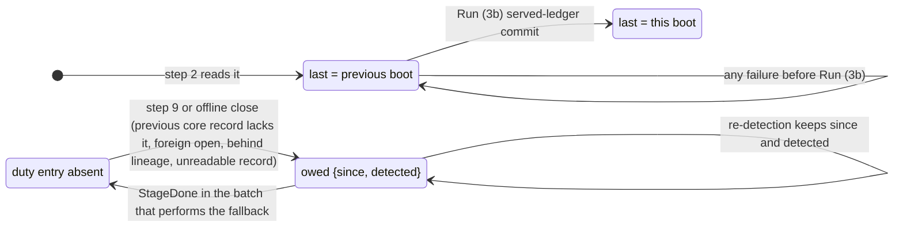
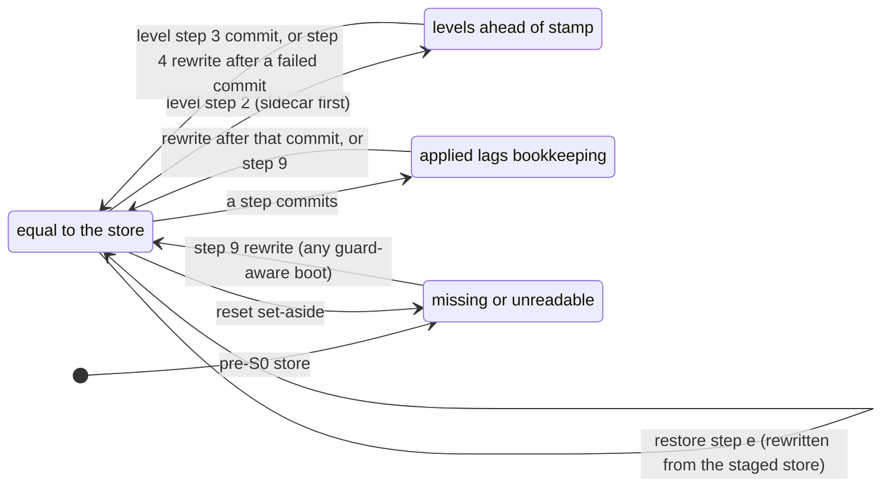

<!-- file: docs/specs/platform-core/05-storage.md -->
<!-- version: 1.12.0 -->
<!-- guid: 940ce8be-6f86-4450-b43a-77bf78827b12 -->
<!-- last-edited: 2026-11-04 -->

# 05 — Storage (`storage`, `storage/index`, `storage/datamigrate`)

Evidence commit `748fd787a`; every `path:line` below is at that commit. Raw inputs:
[`raw/05-storage.md`](../../plans/platform-core/raw/05-storage.md) (engines, 258 key families,
migrations, backup), [`raw/04-database-store.md`](../../plans/platform-core/raw/04-database-store.md)
(`database.Store`), [`raw/12-cross-cutting.md`](../../plans/platform-core/raw/12-cross-cutting.md),
[`raw/02-import-graph-hotspots.md`](../../plans/platform-core/raw/02-import-graph-hotspots.md),
[`raw/08-prior-art.md`](../../plans/platform-core/raw/08-prior-art.md). Names, layers and rules
(R1–R8) are from [03-architecture](03-architecture.md): `storage` and `storage/index` are **L1**;
`storage/keys` (pure tuple-key functions) and `storage/codec` (generic value codecs) are **L0**
leaves that import nothing from core (03 §3.3, MOD3-9; the typed keyspace helper that names both a
codec and a `Keyspace` is therefore `storage.Typed`, not a `codec` type, §5S.3.3); `storage/datamigrate` and its runner `core/internal/storagemigrate` are **L4** (they import
`tasks`; R4 bridge rule). Task-system names (`tasks.Definition`, `tasks.Parallelism`, checkpoints,
preview) are normative in [05-tasks](05-tasks.md). This file owns storage **mechanisms**: claims, the
contract every **app-supplied legacy store** follows (R4-1, §5S.3.11),
the one ownership table of ABO's families (§5S.9.1), migrations, the one store guard and its
sidecars, checkpoints, and the contract of the deferred per-family **cutover** (§5S.3.13), the only
place a storage grant still exists. Boot **order** is [06](06-app-sdk.md) §6.5.1's one phase table
(R2-8); §5S.4 describes storage's own steps and names the phase each runs in. Stage sequencing, the
stage in which each legacy store is supplied and the release that would run a cutover are **policy**
owned by [09](09-abo-on-core.md), which references these mechanisms.

**One stored format per family during the extraction (R3-1, refined by R4-1; 02 decision 13).** From
S0 to S10 every ABO family keeps exactly the stored format HEAD writes, and **core holds no ABO key
name or row format** (03 R1). Each core service that persists state declares a **store interface** in
its SDK package and ships a **native implementation** over its own `c/<subsystem>/` keyspace, which new
apps, `examples/hello` and `coretest` use. An app with a pre-core history passes a **legacy
implementation** of the same interface on the owning module's manifest, `module.Manifest.LegacyStores`
(a `legacy.Stores` value, [06](06-app-sdk.md)): for ABO, books' own store code over books' own claims, built from books' handles
(§5S.3.11). Every identifier that exists only to serve such legacy stores lives in the one core package
`legacy`, outside the API promise like `kernel/` (03 §3.3, R6-3; §5S.3.11 owns its list). **A legacy
implementation stores exactly what the app's pre-core build stores (A-2):** for ABO, HEAD's stored
representation — raw `sess:` rows and HEAD's one-time tokens, `abk_` keys holding legacy atoms, roles
holding legacy atoms only, plaintext blob secrets beside HEAD's four encrypted rows — and nothing beside it
in any other family, so an older build can never be widened by data it does not read. Hardening that
representation (hashed sessions and tokens, native keys and scopes, encrypted secrets, the auth-enable
precedence) is a set of named post-S10 **hardening cutovers** on 02 N15's one-way, floored machinery
(§5S.3.13; 12 and 14 list them). No core subsystem holds a handle on a books family during the extraction:
there are no storage grants, no adoption copy, no mirror, no rebuild at boot, no claim hand-over, no
claim-mode level step and no floor build, so a rollback is a binary swap to the previous release with no
stored-data cost of its own (09 §9.2.1 lists what remains). The per-owner level guard (§5S.3.7) stays for
real format changes: books' own `Breaking` migrations and, outside the extraction, each cutover.

## 5S.0 Decisions in one table

Decision IDs carry a `D-S` prefix so they never read as 09's stages S0–S10 (COR2-19).

| # | Decision | Section |
|---|---|---|
| D-S1 | **One system-of-record Pebble DB per install**, opened only by the kernel at the absolute path `core.storage.path` (never under the state directory by construction). Holders get a `storage.Keyspace` (`m/<module>/`, `c/<subsystem>/`) and, for data written before core existed, a `LegacyRange` over their own claims. Holding the handle *is* the permission — for reads as well as writes. During the extraction no core subsystem holds a `LegacyRange`; only a deferred cutover introduces a grant (§5S.3.13). | §5S.3.1, §5S.3.4, §5S.3.11, §5S.4 |
| D-S2 | Access outside the handle's keyspace or claims is **refused** (`ErrOutsideKeyspace`), never logged-and-allowed — except a one-release shadow mode for the books module's legacy ranges only (shadow → strict). In core and module keyspaces every `Serialized` sub-prefix is checked from the start (R6-1): a `Set` or `Delete` there without an `Expect` on its key, and every `DeleteRange` there, is refused (`ErrBlindWrite`). **A legacy claim is never checked that way (A-3):** `Serialized` on a legacy claim only makes its writes take commit stripes and admits `Expect`. Every legacy writer keeps the pre-core build's lock discipline (for ABO, HEAD's mutexes, `apiKeyMu` with early fix 6 and the single-writer AST ratchet). A batch a legacy store stages into is committed through `storage.CommitLocked`, which holds the store's pre-core locks (`legacy.WriteLock`) from staging through the commit, and the kernel builds one instance of each legacy store family, so every user shares one set of locks (R9-1). A lost update those locks miss is HEAD's behaviour, not detected at runtime. | §5S.3.2, §5S.3.4, §5S.9.4 |
| D-S3 | ABO's 258 key families are **books' legacy claims for the whole extraction**, in one normative table (§5S.9.1) whose families, owners, modes and `Serialized` flags are the same at every stage: no claim changes owner, mode or flag on a store (R3-1). Claims are prefix or exact key; same-owner nesting is legal and the longest match selects the claim; cross-owner nesting needs an explicit `Except`; any other overlap fails boot. | §5S.3.4, §5S.9.1 |
| D-S4 | **App-supplied legacy stores** (R4-1, SIMP4-2): each core service that persists state declares a store interface in its SDK package (frozen by the API-stability gate) and ships a native implementation over `c/<subsystem>/`; the module that owns an app's pre-core families passes a legacy implementation on `module.Manifest.LegacyStores`, which the kernel builds at 06 P4c from that module's own handles (`legacy.Handles`; the struct of constructors is `legacy.Stores`, and every legacy-only identifier lives in package `legacy`, outside the API promise, R6-3). The claim ledger records per subsystem whether it is served `legacy` or `native` (`legacy+native` for a routed store, whose native implementation always serves and whose legacy one additionally serves the records it covers, SIMP5-1), and a build that would switch fails boot (`ErrLegacyStoreMissing`). There are no storage grants during the extraction. | §5S.3.11 |
| D-S5 | **One stored format per family.** A legacy implementation writes correct legacy rows (`codec.LegacyJSON`) that every build able to open the store reads, in the app's pre-core representation and nothing else (A-2): native-only data is never additive in a legacy row (SEC4-3) and has no other home beside the legacy rows either. A feature that needs such data waits for its family's hardening cutover on a legacy-backed install, or is served by a routed store's native half when its owner spec routes it there (§5S.3.11). | §5S.3.11, §5S.9.2 |
| D-S6 | Nothing is copied. Ops runs, queues and pages, the `Requires` stamps, AI job rows, provider holds, the system log rows and the search dirty set are read and written (or read and retention-deleted) **in place** by books' legacy implementations of the core store interfaces; the activity feed and the live v1 ops families keep their books writers. | §5S.9.1–§5S.9.2 |
| D-S7 | Versioned migrations are **per keyspace, forward-only, one atomic batch per step** — except books' HEAD-style legacy steps 1..`LegacyCap`, which keep their idempotent, non-atomic form and run **first**, on books' own claims (R2-4, DATA4-19). All pending steps of all owners run in **one DAG**. **One checkpoint per upgrade attempt**, taken before anything is written, reused only by later boots of the same uncompleted attempt on the same store (install marker + store generation; DATA3-1), beside the DB, restorable offline. Code a pending step needs may be deleted only behind a declared **upgrade floor** (`ErrUpgradeFloor`), which the store's **applied-steps sidecar** `<db>.storage-applied` lets the updater and `make rollback` check before a binary is applied (02 N14). | §5S.3.5, §5S.3.7, §5S.3.12, §5S.4 |
| D-S8 | Anything too large for one batch is a **data migration** (`storage/datamigrate`): a `tasks.Parallelism`, a persisted shard plan (exact resume), a compatibility class, and a dry run that is the real runner on a read-only copy of the store. During the extraction every data migration is `BootBlocking` (in process, a node of the boot DAG). The `Online` mode — a background rewrite of `Serialized` ranges with precondition writes, run as the module kind `<module>.datamigrate.<name>` (COR4-5, COR4-6) — has no S0–S10 consumer, so it is a deferred-build member kept at proof depth (§5S.3.14, SIMP5-7). | §5S.3.6 |
| D-S9 | **One store guard** (SIMP-18): a per-owner minimum-reader **level** — stamp, fsynced sidecar, fast-exit flag, one reader-check function used by `make rollback` and the updater — raised (always as `max`) only by level steps: a physical re-encoding of an owner's data (books' storage-efficiency release B) or a cutover (§5S.3.13). During the extraction nothing raises a core level, so the guard admits every earlier release. ABO's storage-format names are kept as a projection for builds older than the guard. A level step never runs on the first boot of an auto-applied release (`RequiresSelfServed`, OPS2-2). | §5S.3.5, §5S.3.7 |
| D-S10 | Concurrency: **preconditions evaluated at commit** under commit-time stripe locks for `Serialized` ranges (legacy claims and core or module keyspaces alike); in core and module keyspaces **every** write to a `Serialized` key that derives from a read is conditional — state transitions, progress ticks, chunk-ledger commits and usage writes alike — and a write whose precondition failed is re-derived from the new value or dropped, never resubmitted (R6-1); a legacy store that offers no `legacy.WriteLock` and stages an `Expect` (the AI job store, the root source) follows the same re-derive rule, and storage requires none there (A-3, R9-1); **multi-owner atomic batches** by participant binding (each owner binds only the handles it holds; participant APIs take `*storage.Batch`). Storage never holds a lock, lease or reservation for an uncommitted batch, so a leaked batch stalls nothing. | §5S.3.2, §5S.6 |
| D-S11 | Full-text search is a core contract (`storage/index`, which imports `storage`, never the reverse) with a durable dirty set in the entity's batch. Derived indexes record a **storage generation** and are accepted only when it matches and every boot since maintained it; their hooks and rebuild task are registrar data, and the loader runs at Run start step (3a), never inside `app.New` (COR3-7). hnsw, chromem-go and go-memdb stay **app-level** (books). | §5S.3.8, §5S.3.9 |
| D-S12 | Auxiliary, re-creatable Pebble DBs (the Open Library dump mirror) only through `OpenAuxiliary`, with the same format pin; never system of record. The dead standalone AI-scan DB is deleted. | §5S.3.10 |
| D-S13 | **Cutover is deferred** and outside the extraction: moving a family to a native core keyspace and deleting its legacy rows is a later, per-family, one-way, checkpointed `Breaking` data migration behind the per-owner level guard, decided on measured data; it reads the legacy data through the app's legacy store, deletes it through a storage `Grant` (a deferred-build member), and its floor is the cutover release itself (02 N15). | §5S.3.13 |

## 5S.1 Purpose & scope

`storage` is the only persistence API in core: an ordered byte-key/byte-value store over Pebble with
namespaced keyspaces, batches with preconditions, snapshots, iterators, sequences, per-keyspace
migrations, legacy claims, the store guard and a census; §5S.3.11 also specifies the storage-side members
of package `legacy` (the legacy-store handles) and owns that package's full
list (03 §3.3, R6-3). `storage/index` is the
full-text index contract. `storage/datamigrate` declares large resumable rewrites.

In scope: the main DB lifecycle; keyspace issue and enforcement (R8); the legacy-claim registry (the
successor of `internal/database/keyfamilies.go`, which stays ABO code) and the **one ownership table**
of ABO's families that 04, 05-tasks, 05-logging, 05-authn, 05-config and 09 reference instead of
restating (DATA-2); the rules every app-supplied legacy store follows, and the
`backends` ledger that keeps a subsystem from switching between legacy and native (§5S.3.11);
migrations (versioned, books legacy, data); the store guard and its sidecars; checkpoints; the cutover
contract and its deferred grant; derived-index lifecycle; full-text index contract; auxiliary DBs; key
and value codecs.

Out of scope: entity schemas (modules own them; core owns no media table — 02 decision 6); backup
and restore ([05-backup](05-backup.md), which consumes `storage.Admin.Checkpoint` and performs every
directory swap, including checkpoint restores); filesystem roots ([05-library](05-library.md)); each
store interface and its native implementation
([05-authn](05-authn.md), [05-rbac](05-rbac.md), [05-config](05-config.md), [05-tasks](05-tasks.md),
[05-logging](05-logging.md), [05-library](05-library.md), [05-ai](05-ai.md),
[05-metadata](05-metadata.md), `storage/index` §5S.3.8); the legacy implementations themselves, which
are app code (for ABO, books' store code, [09](09-abo-on-core.md)); task execution
([05-tasks](05-tasks.md)); stage order and window lengths ([09](09-abo-on-core.md)).

## 5S.2 Current state at HEAD

| Fact | Evidence |
|---|---|
| Pebble v2.1.7 is the only system-of-record engine; SQLite removed (`InitializeStore` rejects it), NutsDB retired; bbolt indirect only. | `go.mod:7`; `internal/database/store.go:1840-1851`; `raw/05-storage.md` §1 |
| One main DB, directory `audiobooks.pebble`, plus sidecar file `<db>.storage-format`; siblings `library.bleve`, `hnsw/`, `certs/`, bootstrap-token file, `backups/`. | `cmd/root.go:488`; `internal/database/storage_format.go:111-123`; `internal/appdirs/appdirs.go:52-62`; `internal/backup/backup.go:134-146` |
| Every "store" (activity, metrics, embeddings, AI scan, catalog, master list) is a key-prefix namespace over the one DB; one WAL, one backup unit, one migration clock. | `internal/database/store_from_store.go:12-63`; `internal/server/registry_wire.go:270-310` |
| All engine access goes through `GatedDB`, a lease gate so `Close` drains in-flight calls; borrowers get it from `PebbleStore.DB()`. | `internal/database/pebble_gate.go:327-340,363`; `internal/database/pebble_store.go:957-962` |
| Key-family registry: 258 families, feeds `GET /api/v1/diagnostics/db-census`; an unregistered prefix shows as "(unregistered)" and is **not** refused; uniqueness and partition coverage are tested, writer registration is not. | `internal/database/keyfamilies.go:14-36,37-345`; `internal/server/wire_media_routes.go:68`; `raw/05-storage.md` §3 |
| **89 nested pairs** among the 258: a family whose prefix starts with another family's prefix is that family's child (`book:` ⊃ `book:asin:`, `act:` ⊃ 12 children, `opv2:` ⊃ 13, `opv3:` ⊃ 19, `pref:_system:` ⊃ 6), all written by the same owner; some children have a different lifecycle than their parent (`book:hash:`, `book:organizedhash:`, `book:originalhash:` retired; `book:author:`, `book:series:` dead and swept by retention). | `keyfamilies.go:29-36` (nesting rule), `:37-345` (counted at this commit) |
| 256 families are `name:`-prefixed; 2 are bare keys: `narrator_counter` and `sync_alias_use_seed_cutoff`. Both are deliberate (the first keeps legacy narrator numbering, the second must not fall inside the `sync_alias_use:` scans). | `keyfamilies.go:84,316`; `pebble_store_authors.go:1220-1229`; `pebble_store_sync_alias_use.go:209-213` |
| `idx:` is one family shared by auth, users, sessions, API keys, OAuth, invites, playback, playlists, book versions, collections, ABS sessions and the search dirty set. The identity sub-prefixes in code are exactly `idx:user:` (username, email), `idx:role:name:`, `idx:sess:user:`, `idx:apikey:` (hash, user), `idx:invite:username:`, `idx:oauth:` (user, sub). | `keyfamilies.go:64`; `pebble_store_auth.go:67,142,173,178,1126,1131,1670`; `pebble_store_search_dirty.go:39` |
| `setting:` is a general runtime-marker store, not the config store: 56 non-test `SetSetting` call sites write scheduler clocks, the pause gate, index-built and backfill-done flags, the bootstrap token hash and one `transcode_skip_<hash>` row per file; `preference:` holds per-book state (`metadata_state_<bookID>`); `pref:` holds per-user books data moved by the user merge. | `internal/scheduler/interval_clock.go:50`; `internal/operations/registry/pause_gate.go:52`; `internal/server/bootstrap.go:38-39`; `internal/remux/transcode.go:113-116`; `internal/metastate/metastate.go:34`; `internal/database/user_merge.go:241,425` |
| `counter:` holds ASCII-decimal ID counters for unrelated entities; `nextID` commits each increment with its own `pebble.Sync` write, outside the caller's batch. | `pebble_store.go:96-103,966-990` |
| Values are `encoding/json` (v1) by default; binary exceptions: ASCII counters, float16+zstd vectors in a JSON envelope, 8-byte LE `dedup:seq`, big-endian fingerprint windows and clock values. No gob or protobuf in `internal/database`. | `raw/05-storage.md` §3 "Value encoding" |
| Versioned migrations: one hand-ordered slice of 66 (`Version`, `Up`, optional `Down`; 2 have `Down`); `type MigrationFunc func(store migrationStore) error`; version in `preference:db_version`, records `{version, description, applied_at}` in `preference:migration_<n>`; record + version bump are one batch, **but `Up`'s own writes are not in that batch** (they go through store methods that commit their own batches and allocate IDs through `nextID`); several are library-scale repairs (063–066); `Up` must be idempotent (enforced by a test). A version whose record exists is never re-run (replay guard DB-02). | `internal/database/migrations.go:69-112,87,96-100,487-506,512-575,536-548`; `migration_bookkeeping.go:14-80,128-138` |
| An unreadable `db_version` is read as version 0 (fail-open); only versions without a `migration_<n>` record would then re-run. | `migrations.go:579-585,542` |
| Migrations run after the store's init phase has already written (counters, `library:`→`import_path:` conversion, stamp) and after the Pebble format ratchet, and before `ReconcileOpsV3WithV2`, which runs every boot and only logs on failure. No checkpoint is taken before migrations. | `store.go:1846-1872`; `pebble_store.go:689-699,1089-1105` |
| Storage-format guard: `SupportedStorageFormat = 1`; stamp at `preference:storage_format`, marker `preference:storage_migration`, sidecar `<db>.storage-format`; open refuses too-new (stamp or sidecar) and, in serve mode, older or marked stores; Pebble format pinned to `FormatValueSeparation` and ratcheted in the init phase. | `storage_format.go:44-80,82-87,111-123`; `pebble_store.go:620-687,689-699` |
| `RunCutover` is referenced but **does not exist**; `openForCutover` and `StorageMigrationCheckpointSuffix` have no caller. The design is in the storage-efficiency plan (task B6a) and was never built. | `storage_format.go:125-129`; `pebble_store.go:597-619`; `docs/plans/2026-10-03-storage-efficiency-plan.md:168-170` |
| `make rollback` reads the sidecar and the `.prev` binary's `--print-storage-format` and refuses a swap when the sidecar is above `.prev`'s format; the sidecar is read with `sudo -n cat` over ssh. | `Makefile:871-903`; `scripts/storage_format_guard.py:17-22` |
| The shipped unit restarts on failure every 5 s, burst 5 per 60 s. | `deploy/audiobook-organizer.service:81-82,111-112` |
| Derived engines: go-memdb **live**; bleve scorch `library.bleve` **live but degradable**; coder/hnsw **live by default**, snapshot in `hnsw/` validated against a Pebble truth *count*; chromem-go **optional**, in-memory only. | `pebble_store.go:792-845`; `internal/search/register.go:42-60`; `internal/search/bleve_index.go:186-262`; `internal/server/registry_wire.go:65-80,136-159`; `internal/server/server.go:838-870`; `internal/database/hnsw_embedding_store.go:346-380` |
| Second Pebble DBs: the Open Library dump mirror (`ol:` keys, opened with `pebble.FormatNewest`) and a standalone AI-scan DB constructor with no non-test caller. | `internal/openlibrary/store.go:41-43,97-104`; `internal/database/ai_scan_store.go:156-181` |
| Owner locks for identity writes are ad-hoc mutexes, each held across a read and its own direct commit: `inviteMu` and `apiKeyMu` are fields of `PebbleStore`, so they serialise only users of one instance; `userWriteMu` (every rewrite of an existing user row, taken after `inviteMu`), `sessionWriteMu` and `userMergeApplyMu` are package variables, and the server's `bootstrapMu` is taken before `inviteMu` and `userWriteMu`. The admin user merge commits one batch across books and auth families after a compare-and-set under them. Separately, `counterMu`, also a `PebbleStore` field, serialises `nextID`'s own `Sync` commit of an ID counter; no identity row takes an ID from it (HEAD's identity rows use ULIDs; DATA10-9). | `pebble_store.go:226-244,966-989`; `pebble_store_auth.go:136,152,209-212,240,509-525,587,760,1285,1697`; `internal/server/bootstrap.go:136,212`; `user_merge.go:401-403,516-517`; `user_merge.go:241-242,421-486,507-531,719-722` |
| A package-level `globalStore` is still set by `InitializeStore`. | `store.go:1807-1825,1854` |

Coupling that the extraction must cut (`raw/02-import-graph-hotspots.md` findings 1–2):
`internal/database` imports 8 audiobook packages and *is* the book model (`store.go:202`), so
nothing that imports it can be core. Core storage starts from zero code shared with
`internal/database`, and books keeps `internal/database` as its repository layer over core handles
(§5S.9.3).

## 5S.3 Go API

Package `github.com/falkcorp/mediacore/storage` (L1, R4). The engine lives in
`core/internal/pebble`; the only constructor of a `*DB` is `kernel`. Apps never open a DB (R2).
`storage` imports neither `storage/index` nor `tasks` (COR-2, SIMP-17).

### 5S.3.1 DB, Keyspace, keys and values

```go
package storage

import (
	"context"
	"errors"
	"iter"
	"time"
)

// Owner identifies who holds a keyspace or a claim: a module ID ("books"), or
// "core/<subsystem>" ("core/tasks"). Levels (§5S.3.7) use "core" for all of core.
type Owner string

// DB is the install's single system-of-record store. Only the kernel holds a
// *DB; everyone else holds Keyspaces and LegacyRanges cut from it.
type DB struct{ /* engine, claim registry, gate, stripe table, metrics; unexported */ }

// Handle is implemented by Keyspace and LegacyRange only (sealed).
type Handle interface{ handle() }

// Reader is the read surface shared by Keyspace, LegacyRange and Snapshot.
type Reader interface {
	Get(ctx context.Context, key []byte) ([]byte, error)
	Scan(ctx context.Context, opts ScanOptions) iter.Seq2[KV, error]
	NewIterator(ctx context.Context, opts ScanOptions) (*Iterator, error)
}

// Keyspace is a capability: every key passed to its methods is relative and
// is stored as Prefix()+key, so a holder cannot address anything else.
// The zero Keyspace is invalid; every method on it returns ErrInvalidKeyspace.
type Keyspace struct{ /* unexported */ }

func (k Keyspace) Prefix() string      // "m/tv/" or "c/tasks/"
func (k Keyspace) Owner() Owner
func (k Keyspace) Sub(name string) Keyspace // "m/tv/" + "series" -> "m/tv/series/"; name checked by keys.ValidName

// Reads. Get returns a copy owned by the caller; ErrNotFound when absent.
func (k Keyspace) Get(ctx context.Context, key []byte) ([]byte, error)
func (k Keyspace) Has(ctx context.Context, key []byte) (bool, error)

// Single-key writes are a one-entry batch committed with Sync.
func (k Keyspace) Set(ctx context.Context, key, value []byte) error
func (k Keyspace) Delete(ctx context.Context, key []byte) error
// DeleteRange deletes [start, end) inside the keyspace; nil end = to the end of the keyspace.
func (k Keyspace) DeleteRange(ctx context.Context, start, end []byte) error

// Scan yields keys in [opts.Start, opts.End) (relative), forward or reverse.
// Key and Value are valid only until the next iteration step; use KV.Clone to
// retain. A non-nil error is yielded at most once, as the last pair.
func (k Keyspace) Scan(ctx context.Context, opts ScanOptions) iter.Seq2[KV, error]
func (k Keyspace) ScanPrefix(ctx context.Context, prefix []byte) iter.Seq2[KV, error]

// NewIterator is the cursor form for callers that seek, step backwards or
// interleave scans (the books repository layer needs SeekGE/Prev/Last).
func (k Keyspace) NewIterator(ctx context.Context, opts ScanOptions) (*Iterator, error)

func (k Keyspace) NewBatch() *Batch            // write-only
func (k Keyspace) NewIndexedBatch() *Batch     // reads see the batch's own writes
func (k Keyspace) Snapshot() (*Snapshot, error) // point-in-time, read-only, scoped to k

// Sequence returns a named monotonic uint64 allocator stored in the keyspace (§5S.3.2).
func (k Keyspace) Sequence(name string) *Sequence

// EstimateBytes is Pebble's on-disk estimate for the keyspace (cheap).
func (k Keyspace) EstimateBytes(ctx context.Context) (uint64, error)

type ScanOptions struct {
	Start, End []byte // relative; nil = keyspace bound
	Reverse    bool
	KeysOnly   bool  // skips value fetch for value-separated blobs
	Limit      int   // 0 = unlimited
}

type Range struct{ Start, End []byte } // absolute keys; End exclusive

type KV struct{ Key, Value []byte } // Key is relative to the handle
func (kv KV) Clone() KV

type Iterator struct{ /* unexported */ }
func (it *Iterator) First() bool
func (it *Iterator) Last() bool
func (it *Iterator) SeekGE(key []byte) bool
func (it *Iterator) SeekLT(key []byte) bool
func (it *Iterator) Next() bool
func (it *Iterator) Prev() bool
func (it *Iterator) Valid() bool
func (it *Iterator) Key() []byte   // relative
func (it *Iterator) Value() []byte
func (it *Iterator) Err() error
func (it *Iterator) Close() error

type Durability uint8
const (
	DurabilityInvalid Durability = iota // zero value is rejected
	Sync                                  // fsync the WAL before Commit returns (default for every keyspace)
	NoSync                                // caches, census results, metrics snapshots: may be lost on crash
)

var (
	ErrNotFound        = errors.New("storage: not found")
	ErrOutsideKeyspace = errors.New("storage: key outside the handle's keyspace or claims")
	ErrInvalidKeyspace = errors.New("storage: zero or closed keyspace")
	ErrClosed          = errors.New("storage: db closed")
	ErrBatchTooLarge   = errors.New("storage: batch exceeds the configured limit")
	ErrClaimMode       = errors.New("storage: the claim's or grant's mode forbids this operation")
	ErrNotSerialized   = errors.New("storage: preconditions are allowed only on Serialized ranges")
	ErrConflict        = errors.New("storage: a precondition failed at commit; nothing was applied")
	ErrBlindWrite      = errors.New("storage: a write to a Serialized range of a core or module keyspace carries no Expect on its key, or is a DeleteRange there")
	ErrReadOnly        = errors.New("storage: handle of a read-only open; every write is refused") // §5S.3.10, COR7-8
)
```

### 5S.3.2 Batches, preconditions, multi-owner commits, sequences

```go
// Batch is atomic across every handle bound to it: one Pebble batch.
// A batch created from handle H can write H. Bind adds another handle; the
// caller must HOLD that handle — the handle value is the capability, so a
// participant can only touch what it bound. This is how a module writes its
// row and an outbox entry (c/outbox/) or an index-dirty mark in one commit,
// and how a core subsystem joins a module's batch (participant pattern below).
// Batch embeds a noCopy marker: it is only ever passed as *Batch (COR2-12).
type Batch struct{ /* noCopy; unexported */ }

func (b *Batch) Bind(h Handle) *Batch
func (b *Batch) In(h Handle) BatchWriter // panics if h is not bound
func (b *Batch) Set(key, value []byte) error // shorthand for b.In(origin).Set
func (b *Batch) Delete(key []byte) error
func (b *Batch) DeleteRange(start, end []byte) error
func (b *Batch) Get(ctx context.Context, key []byte) ([]byte, error) // indexed batches only

// Expect adds a precondition evaluated at Commit: the key's committed value
// must equal value byte for byte (nil = the key must be absent). Allowed only
// for keys in Serialized ranges (§5S.3.4) of a bound handle; else ErrNotSerialized.
func (b *Batch) Expect(h Handle, key, value []byte) error
// GetForUpdate reads key through h (the batch's own writes first) and records
// Expect(h, key, <value read>): optimistic read-modify-write.
func (b *Batch) GetForUpdate(ctx context.Context, h Handle, key []byte) ([]byte, error)

func (b *Batch) Participants() []Owner // owners of the bound handles, for logs and metrics
func (b *Batch) Len() int              // encoded bytes, for callers that chunk
func (b *Batch) Count() int            // entries
// Commit applies the batch atomically or not at all. ErrConflict: a
// precondition failed; ErrOutsideKeyspace / ErrClaimMode: a write resolves
// outside the bound handles or against the claim's mode.
func (b *Batch) Commit(ctx context.Context, d Durability) error
func (b *Batch) Close() error // discards an uncommitted batch; idempotent

type BatchWriter interface {
	Set(key, value []byte) error
	Delete(key []byte) error
	DeleteRange(start, end []byte) error
}

// RetryOnConflict re-runs fn (which builds and commits a fresh batch) while it
// returns ErrConflict, up to attempts, with jittered backoff; ctx-aware.
func RetryOnConflict(ctx context.Context, attempts int, fn func(ctx context.Context) error) error

// Snapshot pins a Pebble version. Snapshots are for bounded reads (a page, a
// verification pass); long passes must refresh (§5S.6).
type Snapshot struct{ /* unexported */ }
func (s *Snapshot) Get(ctx context.Context, key []byte) ([]byte, error)
func (s *Snapshot) Scan(ctx context.Context, opts ScanOptions) iter.Seq2[KV, error]
func (s *Snapshot) NewIterator(ctx context.Context, opts ScanOptions) (*Iterator, error)
func (s *Snapshot) Age() time.Duration
func (s *Snapshot) Close() error

// Sequence hands out unique, increasing uint64 IDs from leases of
// core.storage.sequence.lease IDs (default 64). A refill is its OWN Sync
// commit of hw = max(hw, start+lease), made under the sequence's mutex BEFORE
// any ID of the new lease is returned. A crash can therefore only skip IDs,
// never reissue one; the cost is one fsync per lease (ABO's nextID pays one
// per ID, pebble_store.go:966-990). IDs increase in allocation order, not in
// commit order.
type Sequence struct{ /* unexported */ }
func (s *Sequence) Next(ctx context.Context) (uint64, error)
// NextIn returns an ID from a durable lease for use in b's keys or values.
// It writes nothing into b; if a refill is needed it commits on its own first.
func (s *Sequence) NextIn(ctx context.Context, b *Batch) (uint64, error)
// AdvancePast makes every later ID greater than n: under the sequence's mutex
// it commits hw = max(hw, n+1) on its own (Sync) and drops the in-memory lease.
// Used after a restore, before records carrying IDs from another copy of the
// store are written back (05-rbac audit copy-forward; DATA2-16, SEC2-12). Like
// a refill, a crash after it can only skip IDs.
func (s *Sequence) AdvancePast(ctx context.Context, n uint64) error
```

**Commit procedure.**

1. Every write and every precondition must resolve, by longest match, to a bound handle's keyspace or
   claims, and the claim's mode must allow the operation (§5S.3.4); otherwise the commit fails and
   nothing is applied.
2. Commit acquires the **commit stripes** (a fixed table of 4 096 mutexes indexed by a hash of the
   absolute key) of every key the batch expects, and of every key it writes in a `Serialized` range
   (§5S.3.4), in ascending stripe order; a `DeleteRange` inside a `Serialized` range has no key set to
   hash, so it takes **every** stripe (a barrier: one tombstone, so the hold is short). It then evaluates
   every `Expect` against committed state, applies the batch with its durability, and releases the
   stripes. A failed precondition releases and returns `ErrConflict`. Ascending acquisition by every
   committer makes deadlock impossible. A family whose writers need no commit-time check (books' ops
   families, §5S.9.1 rows 11 and 13) is simply **not** `Serialized`: its writes and range deletes take no
   stripe, so a bulk write such as books' `ReplaceOpRowsPrefix` (tens of MB of `opv2:row:` rows,
   `internal/database/pebble_store_op_rows.go:107-166`) stalls no `Serialized` commit (DATA8-2's property,
   without a flag of its own). Which lock, if any, that write takes is stated once, in
   [05-tasks](05-tasks.md) 5T.3.13 and 5T.6.2 (HEAD commits it in chunks without `opsMu`; DATA9-7, R9-1).
3. Stripes exist only inside `Commit`. Storage holds **no lock, lease or reservation on behalf of an
   open batch**: an uncommitted batch that is never closed costs only its own memory and blocks no
   other writer, reader, relay or migration.

Because every writer of a `Serialized` key commits under its stripe, a precondition cannot be
overtaken between its evaluation and the apply. Writers that read-modify-write such a key use
`GetForUpdate` + `RetryOnConflict`; they may keep an in-process mutex for their own fairness, but
correctness no longer depends on one (DATA-13). The same API serves core keyspaces (for example a
`c/tasks/` run record that two executor paths may update) and module keyspaces: the owner lists the
sub-prefixes in `Spec.Serialized`.

**Every write to a `Serialized` key of a core or module keyspace is checked at commit (R6-1, DATA6-1).** The rule is not limited to
a store's state transitions. A writer that stages a write derived from anything it read — a whole row
written back with one field changed, a progress tick, a chunk-ledger commit, a checkpoint, a result-data
write, a usage counter — reads that key with `GetForUpdate` in the same batch, or stages `Expect(h, key,
nil)` for a create, so the commit fails with `ErrConflict` when the key changed since the read. On
`ErrConflict` the writer re-reads and decides again from the new value. It never resubmits the bytes it
built from the stale read. A write that the new value makes pointless is **dropped**, by HEAD's
closed-ledger rule (R7-3, DATA7-3): a chunk-ledger commit, checkpoint, Fixer row or row mark is re-staged
when the fresh read shows the run non-terminal under the same `Attempt` and `FenceEpoch`, so marks of rows a
quiesce or shutdown interrupts still land, and is dropped otherwise (05-tasks `ErrRunConflict`); a progress
tick alone is dropped on any state change; an advisory usage write (a last-use time) is dropped outright.
A state change re-derives instead. `Transition` and `Insert` stage into the caller's batch and never
commit, so they never see the commit's `ErrConflict`: they return `ErrRunConflict` at staging when their
`GetForUpdate` read no longer matches `want` (state, attempt, fence), and **the caller that builds the
batch** re-runs build-and-commit under `RetryOnConflict` (05-tasks §5T.7 names those callers), which
re-reads the run and re-stages every participant — clock advance, outbox cursor, idempotency record,
`OnTerminal` — while `want` still holds (DATA7-2, COR8-7). So a tick can never revert a cancel, and a flush can never
resurrect a deleted record. `RetryOnConflict` re-runs `fn`, which reads again; it never re-commits a staged
batch. Native stores follow the same rule, and storage enforces it for them: in a core or module keyspace a
`Serialized` sub-prefix is checked, so `Commit` refuses a `Set` or `Delete` of
a key in it unless the batch carries an `Expect` on that key, and refuses a `DeleteRange` in it
(`ErrBlindWrite`), and a `Sequence` refill in such a range reads its high-water mark with `GetForUpdate`.
An owner that writes keys guarded by another record's `Expect` (a run's pages under its run record) leaves
them out of `Spec.Serialized` and declares only the guard keys (05-tasks §5T.6.1).

**Legacy claims are not checked (A-3).** Storage never refuses a blind write to an app's legacy family and
keeps no record of one. The app's writers keep the pre-core build's lock discipline (for ABO, HEAD's
mutexes, `apiKeyMu` with early fix 6 and the single-writer AST ratchet). HEAD holds each of those mutexes
across a read **and its own direct commit** (`TouchAPIKeyLastUsed`, `pebble_store_auth.go:1284-1302`;
`ConsumeInvite`, `:1565-1569`). A legacy store method that stages into a caller's batch returns before that
batch commits, so a mutex it takes and releases inside the method protects nothing at the commit (COR9-1,
DATA9-1). **The lock therefore spans the commit (R9-1):**

1. **`legacy.WriteLock`.** Every legacy store whose pre-core code relies on an in-process mutex for a
   read-modify-write implements the one capability `legacy.WriteLock` (§5S.3.11): for ABO books' identity
   store ([05-authn](05-authn.md) §3.4's lock names `LockUsers`, `LockSessions`, `LockAPIKeys`,
   `LockInvites`, `LockBootstrap` and `LockMerge`, which books maps to HEAD's `userWriteMu`,
   `sessionWriteMu`, `apiKeyMu`, `inviteMu`, `bootstrapMu` and `userMergeApplyMu`), books' run store
   (`opsMu`, behind 05-tasks' lock name `legacy.LockRuns`; [05-tasks](05-tasks.md) 5T.3.13), books' config,
   integration-instance and notify-rule stores (`legacy.LockConfigSettings` = `"config.settings"`, HEAD's
   `configBlobSaveMu`: one lock and one rank across the three stores; [05-config](05-config.md),
   [05-metadata](05-metadata.md), [05-notify](05-notify.md)), and any other the owner specs list. Its one method,
   `WriteLocks(names []string) []storage.Lock`, returns the locks that guard the named records; the names
   are the `legacy` lock-name constants, never an app key name (03 R1). **The kernel resolves the locks,
   never the owners (COR10-5):** the names live in `legacy` (L5), which no owner (`config` at L3, `auth`,
   `tasks`, `integrations`, `notify`, `ai` at L4) imports, so at P4c the kernel calls `WriteLocks` with them
   and hands each owner an owner-typed value that names no lock string — `auth.Deps.Locks` and
   `auth.RestoreDeps.Locks` (an `auth.StoreLocks` with one `[]storage.Lock` per write kind, runtime values
   resolved at P4c, 05-authn §3.4), the executor's `RunLocks`
   (05-tasks), and `SettingsLocks` for config, integrations and `notify` — and the owner passes those values
   to `CommitLocked` (§5S.4 step 10). No owner and no registry calls `WriteLocks`. `counterMu` is **not**
   among the `WriteLock` locks: HEAD's `nextID` takes it around its own `Sync` commit of the counter
   (`pebble_store.go:966-989`), outside any caller's batch, so it needs only the one shared instance (item 4),
   which 05-library's root source and books' own `CreateImportPath` callers both allocate through (DATA10-9).
2. **`storage.CommitLocked`** (below) is the **one** commit path for a batch that such a store stages into.
   It takes the locks before the first staged read, marks the batch with the lock set it holds, runs the
   staging function, commits, runs the post-commit steps the stores registered on the batch (item 5), and
   releases the locks only after that. `Executor.WriteRuns` and `Stager.WriteRuns` (05-tasks 5T.7) and core
   auth's identity writes (05-authn §3.4, §4.4, §4.6, §7) are uses of it. So single-use invites, single-use
   bootstrap tokens and the revoke-versus-touch race behave as at HEAD, with early fix 6 intact
   (`TestLegacyRevokeRacesTouch_NeverUnrevokes`).
3. **Each lock once, in one total order (R10-4, DATA10-3).** `CommitLocked` takes each **distinct** lock
   once, however many stores return it (several of books' stores return the same `configBlobSaveMu` value,
   and no HEAD mutex is re-entrant), in ascending `LockRank`. The ranks are the **one table** below, which
   covers every lock a commit path may take, core-side mutexes included, and extends every nested order HEAD
   takes, so a `CommitLocked` and a books writer that still takes HEAD's mutexes directly never wait on each
   other in opposite orders. A nested `CommitLocked` joins the locks the enclosing hold already holds (it finds
   them through `ctx`) and does not take them again (a nested `WriteRuns` is refused by 05-tasks with
   `ErrWriteRunsNested`); a nested call that needs a lock ranked **below** one it holds fails with
   `ErrLockOrder` (a programming error, caught by `TestCommitLockedTakesEachLockOnceInOrder`).
4. **One instance per family.** The kernel builds **exactly one** instance of each legacy store family per
   App and hands that same value to every user (§5S.3.11 row "One instance per family"; two apps in one binary,
   D9, are two kernels), so an instance-held mutex such as `apiKeyMu`, `inviteMu`, `opsMu` or the `counterMu`
   that `nextID` takes is shared by every writer (`TestLegacyStoresAreSingletons`; DATA9-2).
5. **The hold lives on the batch (R10-4; COR10-2, DATA10-1).** `CommitLocked` marks `b` with the locks it
   holds for it — every lock it took and every lock it joined — before it calls `stage`, and clears the mark
   when it releases. `storage.LocksHeld(b, l)` reads that mark, so a legacy staging method, which receives
   `b` and no `ctx` (`auth.Store`'s methods, `legacy.AuthAtomWriter.IssueAPIKeyAtoms`,
   `legacy.SecretsStore.Write`), checks the batch it was handed and refuses a write to a guarded family when
   `b` does not hold that family's lock. A write staged **inside** a hold into a different batch (one captured
   from an outer caller, committed after the hold is released) is therefore refused too, which a
   `ctx`-carried hold could not see. Each owner names its refusal (05-authn §3.4, 05-tasks
   `legacy.ErrRunsNotLocked`, 05-config `SecretsStore.Write`), wrapping `storage.ErrNotLocked`.
6. **Post-commit steps run inside the hold (R10-5, DATA10-2).** A store whose pre-core write ends with a
   non-Pebble step under the same mutex registers it on the batch with `storage.OnCommitted` while it
   stages; `CommitLocked` runs every registered step after `Commit` succeeded and before it releases the
   locks. For ABO this is the `config.yaml` gap-fill write that HEAD's `SaveConfigToDatabase` performs under
   `configBlobSaveMu` "until the file step is done" (`internal/config/persistence.go:1940-1944,2010-2013`
   @748fd787a). Books' config store registers it whenever it stages a blob or secret-row write, whichever
   owner commits the batch (the config `Committer`, `integrations.Registry`, `notify`, `secrets.(*Store)` for a
   kept name), so every writer path HEAD covered with `configBlobSaveMu` runs the file step inside that lock,
   and a late set can no longer undo a clear (05-config owns what the step writes). A step's error never
   undoes or fails the commit: `CommitLocked` logs it and returns the commit's result, as HEAD logs a failed
   file step and returns nil.

**The one lock-rank table (R10-4; DATA10-3).** Every lock a commit path may take has one distinct rank.
`CommitLocked` takes the `storage.Lock` rows in ascending rank; the core-side rows are not `storage.Lock`
values and are placed by rule: the outer ones are taken **before** `CommitLocked` and never inside a
`stage`, and the inner ones only **inside** a `stage`, after every lock it holds. Books' `Lock` values
return these ranks. Derivation: HEAD nests `inviteMu` → `userWriteMu` (`pebble_store_auth.go:209-212,
587`, every e-mail writer), `userWriteMu` → `sessionWriteMu` (`:745,760`), `userMergeApplyMu` → `inviteMu`
→ `userWriteMu` → `apiKeyMu` (`user_merge.go:507-529`) and `bootstrapMu` → `inviteMu` → `userWriteMu`
(`internal/server/bootstrap.go:212`, then `CreateUser`) @748fd787a; the table is one total order that
extends all four, and pairs HEAD never nests (`sessionWriteMu`/`apiKeyMu`, the identity locks against
`configBlobSaveMu` and `opsMu`) are ordered arbitrarily but once.

| Rank | Lock | Held by | How it is taken |
|---|---|---|---|
| 10 | config `Apply`'s store mutex | core `config` (05-config §1.6) | outer: before `CommitLocked`, never inside a `stage` |
| 20 | the integrations Registry's writer mutex | core `integrations` (05-metadata M1.6) | outer |
| 30 | the notify rule-set mutex | core `notify` (05-notify §3 `RuleStore`) | outer |
| 40 | the provider-gate Registry's per-scope mutexes | core `providerhttp` (05-metadata M2.6) | outer; every gate write commits its own batch outside any hold |
| 50 | the executor's dispatcher mutex | core `tasks` (05-tasks 5T.3.13) | outer: before `WriteRuns` or after it returns, never inside a `stage` |
| 60 | the executor's ref-lock table (its entries in the table's own sorted order) | core `tasks` (05-tasks 5T.3.13, `tasks.LockRefs`) | outer |
| 70 | the executor's per-run writer | core `tasks` (05-tasks 5T.7) | outer |
| 80 | the executor's progress lock | core `tasks` (05-tasks 5T.3.2) | outer |
| 100 | `legacy.LockMerge` (`userMergeApplyMu`) | books' identity store | `CommitLocked` |
| 110 | `legacy.LockBootstrap` (`bootstrapMu`) | books' identity store | `CommitLocked` |
| 120 | `legacy.LockInvites` (`inviteMu`) | books' identity store | `CommitLocked` |
| 130 | `legacy.LockUsers` (`userWriteMu`) | books' identity store | `CommitLocked` |
| 140 | `legacy.LockSessions` (`sessionWriteMu`) | books' identity store | `CommitLocked` |
| 150 | `legacy.LockAPIKeys` (`apiKeyMu`) | books' identity store | `CommitLocked` |
| 160 | `legacy.LockConfigSettings` (`configBlobSaveMu`) | books' config, integration-instance and notify-rule stores (one value) | `CommitLocked` |
| 170 | `legacy.LockRuns` (`opsMu`) | books' run store | `CommitLocked` |
| 900 | secrets' per-name keyed mutex | core `secrets` (05-config §2.4, §2.6) | inner: only inside a `stage`, after `legacy.LockConfigSettings` |
| 950 | `counterMu` | books' one store instance (`nextID`) | inner leaf: `nextID` takes nothing while it holds it, so it may run inside any hold |

Two rules complete it. **No `stage` function calls a books method that takes a HEAD mutex of a family the
hold covers** (HEAD's mutexes are not re-entrant, and `ErrLockOrder` cannot see a mutex taken directly: for
example `MarkInviteEmailSent` or `RecordInviteGuestPolicy` under `inviteMu`,
`pebble_store_invite_delivery.go:160,183`, or `RehashUserPassword` under `userWriteMu`). And **a lock added
by a later owner spec gets a row here in the PR that adds it.** `TestLockRanksTotalOrder` (ABO, from S3)
checks that every `legacy` lock name resolves, through books' built stores, to a `Lock` whose `LockRank` is
this table's; that distinct HEAD mutexes have distinct ranks and one mutex has one rank; that the table is
ascending along each of HEAD's four nested orders above; and that every core-side mutex an owner spec takes
on a commit path has a row. The owners' races cover the placement rule (05-config's `Apply` against a
legacy write; 05-metadata's native `Registry.Put` against a legacy `PUT /api/v1/config`).

A legacy store that offers **no** `legacy.WriteLock` may instead stage an `Expect` or a `GetForUpdate` on a
`Serialized` legacy key it read, as a **voluntary compare-and-set**, and then follows the re-derive rule
above. That is sound only where every writer of the row compare-and-sets or goes through that store, and it
is not enforcement: no legacy family has a storage-enforced blind-write check. Two stores do this:
05-ai's `JobStore`, whose `Expect` replaces HEAD's `aijobWriteMu` (it is the rows' sole writer), and
05-library's root source, whose `import_path:` writers all merge fields under `GetForUpdate` from S7
(§5S.9.1 row 19). The identity store does **not**: it holds HEAD's mutexes through `CommitLocked`.

```go
package storage

// Lock is one pre-core in-process mutex of an app's legacy store, as
// legacy.WriteLock.WriteLocks returns it (R9-1). storage names only this
// method set, so it never imports legacy (L5).
type Lock interface {
	sync.Locker
	// LockRank is the lock's rank in §5S.3.2's one lock-rank table (R10-4);
	// distinct locks have distinct ranks, and a mutex that several stores
	// share is one Lock value.
	LockRank() int
}

// CommitLocked is the one commit path for a batch that a legacy store with
// legacy.WriteLock stages into (R9-1). It takes each distinct lock in locks
// once (equal values are one lock), in ascending LockRank, skipping one an
// enclosing CommitLocked already holds (found through ctx); marks b with
// every lock it holds for b, taken or joined (LocksHeld; R10-4); runs stage,
// which performs every read the batch's writes derive from and stages them
// into b; commits b with d; after a successful Commit runs the steps the
// stores registered on b with OnCommitted, in registration order (R10-5);
// then clears the mark and releases what it took, in reverse order, whatever
// stage or Commit returned. A step's error is logged and never changes the
// result. Under RetryOnConflict each attempt calls it again with a fresh
// batch, so the locks are re-taken and every read is repeated. ErrLockOrder:
// a nested call needs a lock ranked below one held, or two distinct locks
// share a rank.
func CommitLocked(ctx context.Context, b *Batch, d Durability,
	stage func(ctx context.Context, b *Batch) error, locks ...Lock) error

// LocksHeld reports whether b carries a CommitLocked hold of l (R10-4). A
// legacy store's staging method checks the batch it was handed and refuses a
// write to a guarded family into a batch without the hold, wrapping
// ErrNotLocked (05-authn §3.4, 05-tasks ErrRunsNotLocked, 05-config
// SecretsStore.Write); a batch staged inside a hold but not committed by it
// carries no mark.
func LocksHeld(b *Batch, l Lock) bool

// CommitStep is one post-commit step a store registers on a batch (R10-5).
// Key dedups: several stagings into one batch that register one Key (books'
// config store staging the blob and a secret row) run it once.
type CommitStep struct {
	Key string
	Run func(ctx context.Context) error
}

// OnCommitted is the batch's post-commit hook (R10-5): it registers step on
// b, and CommitLocked runs every registered step after b committed and
// before the locks are released, in registration order. ErrNotLocked when b
// carries no hold; a step is never run when Commit fails.
func OnCommitted(b *Batch, step CommitStep) error

var (
	ErrLockOrder = errors.New("storage: a lock is out of the one lock-rank order")
	ErrNotLocked = errors.New("storage: the batch carries no CommitLocked hold of the lock its write needs")
)
```

**Multi-owner atomic commits (DATA-18).** A commit spanning owners is built by **participant
binding**: the initiating owner creates the batch and writes its rows; each other owner's
subsystem exposes a staging function that binds *its own* handles to that batch, writes its rows and
adds its preconditions; the initiator commits. Nobody receives another owner's handle. The admin
user merge is the motivating case: books builds the batch for its per-user families and its merge
journal (§5S.9.1) and calls the auth participant (`auth.Admin.StageUserMerge(ctx, b, plan)`, specified
in [05-authn](05-authn.md)), which stages the identity half through auth's store: natively by binding
`c/auth/`; for ABO through books' legacy implementation, which binds books' own `LegacyRange`
(§5S.3.11) and writes or deletes the identity rows in their legacy format with the checks HEAD performs
under its merge and invite mutexes (`user_merge.go:507-531`). Books commits the batch through
`storage.CommitLocked` with the identity store's `legacy.WriteLock` locks for the merge
(`userMergeApplyMu`, `inviteMu`, `userWriteMu`, `apiKeyMu`, ascending in the rank table above), so those checks hold through
the commit exactly as at HEAD, with no `Expect` (R9-1): a record changed since the plan was built is
reported at staging, inside the hold, by HEAD's conflict check (`UserMergeConflictError`,
`user_merge.go:533-545`), which auth reports as `auth.ErrMergeConflict`; a native store reports the same
conflict as `storage.ErrConflict` at commit (DATA10-9). Books commits once; all of it lands or none does. The
same shape serves `outbox.Stage`, `index.MarkDirty` and `library.Manager.TransferIn`.

**Participant APIs take `*storage.Batch` (COR2-12).** `Bind` records the handle on the batch the
initiator commits; a participant that received a copy would bind and write into the copy, and the
initiator's `Commit` would then refuse those rows (`ErrOutsideKeyspace`) or apply them unchecked.
Every core API that stages into a caller's batch therefore takes `b *storage.Batch`; `Batch`'s
`noCopy` marker makes `go vet` (copylocks) flag a value copy, and `archtest.NoBatchByValue` rejects a
`storage.Batch` value parameter or field anywhere in core and in the spec's extracted Go blocks
(`TestSpecGoBlocksCompile`).

**No resolution hook.** `Batch` has no `OnResolve`. Its one requested consumer, the outbox gap-safe
horizon, is replaced in [05-events](05-events.md) by commit-ordered intake (the relay observes
committed intake rows and assigns sequence numbers itself, COR-10). A hook could not have made a
horizon safe anyway: a leaked batch is never closed, so its hook never fires. Storage states the
general rule instead: **key order says nothing about commit order**; a consumer that needs commit
order observes commits (scan, then delete what it has handled), it does not infer them from keys or
IDs reserved earlier.

### 5S.3.3 Key and value codecs (helpers + guidance)

`storage/keys` (pure functions) and `storage/codec` (generic value codecs) are L0 leaves that import
nothing from core (03 R4, MOD3-9); `storage.Typed` binds a codec to a keyspace.

```go
package keys

// Seg is one key segment. Join encodes each segment with 0x00 -> 0x00 0xFF and
// ends it with the terminator 0x00 0x01 (FoundationDB tuple-layer style), so
// for any two segment lists the byte order of the joined keys equals the
// lexicographic order of the lists, and every key that extends a list lies in
// [Prefix(list), PrefixEnd(Prefix(list))). Any byte may appear in a segment.
type Seg []byte

func Str(s string) Seg
func Bytes(b []byte) Seg
func U64(n uint64) Seg       // 8-byte big-endian (sorts numerically)
func Time(t time.Time) Seg   // 8-byte big-endian UnixNano, sign bit flipped

func Join(segs ...Seg) []byte
func Prefix(segs ...Seg) []byte         // same bytes as Join; named for intent
func Split(key []byte) ([]Seg, error)   // inverse of Join (census and diagnostics rendering)
func PrefixEnd(prefix []byte) []byte    // smallest key greater than every key with prefix; nil if none

// ValidName checks keyspace and Sub names: [a-z0-9_]{1,32}. '/' (0x2F) sorts
// below every allowed byte, so "m/tv/series/" keys stay contiguous and ordered.
func ValidName(s string) error
```

Why the tuple encoding (DATA-26): a `/`-joined key with escaping of only 0x00 and `/` is not
order-preserving — `"a b"` sorts before `"a/b"` (0x20 < 0x2F) but after it once `/` is escaped to
0x00 0x02, and a segment `"a b"` sorts before its sibling `"a"` because 0x20 < 0x2F. With the
terminator 0x00 0x01 and the escape 0x00 0xFF, a segment that is a prefix of another sorts first
(0x01 < 0xFF and 0x01 < every non-zero content byte), and an embedded zero sorts below every other
content byte, as it should. `TestJoinOrderMatchesSegmentOrder` is a property test over random segment
lists.

**Notation for core keys.** In this spec set a core key written `c/storage/served/<owner>/<level>`
means the keyspace prefix bytes `c/storage/` followed by `keys.Join(keys.Str("served"),
keys.Str(<owner>), keys.U64(<level>))`: after the keyspace prefix, `/` marks a segment boundary, not a
byte. Owner IDs, including `core/auth`, are always one segment. A build that is not yet on core
storage (09 S0) writes the `c/storage/` records it needs with the same `storage/keys` package, so a
later core build reads them unchanged (DATA2-6).

```go
package codec

// Codec[T] encodes one value type. Native codecs write a 1-byte format tag
// first so a value can change encoding without a key-format change.
type Codec[T any] interface {
	Encode(v T) ([]byte, error)
	Decode(b []byte) (T, error)
}

func JSON[T any](version uint8) Codec[T] // native: tag 'j', then {"v":version,...}; Decode rejects unknown versions with ErrUnknownVersion
func Raw() Codec[[]byte]                 // native: tag 'r'
func Zstd[T any](inner Codec[T], minSize int) Codec[T] // native: tag 'z' when compressed (klauspost/compress)

// LegacyJSON is the codec for every legacy row an app-supplied legacy store
// (§5S.3.11) or a read adapter writes or decodes. It is encoding/json (v1)
// with no tag byte and no envelope, byte-compatible with what the previous ABO build decodes —
// permanently, whatever native codecs use (DATA-5). encoding/json/v2 defaults
// (case-sensitive names, omitzero, nil-slice encoding) would silently change
// what the old build reads.
func LegacyJSON[T any]() Codec[T]

var ErrUnknownVersion = errors.New("codec: unknown value version")
```

```go
package storage

// Typed binds a codec to a keyspace for the common Get/Set/Scan shapes. It
// lives in storage, not in codec, so codec stays an L0 leaf (MOD3-9).
type Typed[T any] struct{ KS Keyspace; C codec.Codec[T] }
func (t Typed[T]) Get(ctx context.Context, key []byte) (T, error)
func (t Typed[T]) Put(b *Batch, key []byte, v T) error
func (t Typed[T]) All(ctx context.Context, opts ScanOptions) iter.Seq2[T, error]
```

Guidance (normative for core keyspaces, recommended for module keyspaces):

| Rule | Why |
|---|---|
| Inside a keyspace, keys are built with `keys.Join`; IDs are ULIDs (as `keys.Str`) or `keys.U64`; times are `keys.Time`. Never decimal numbers without padding. Keyspace and `Sub` names are `keys.ValidName`. | Order-preserving range scans; ABO mixes `:` separators, zero-padded and unpadded nanos (`raw/05-storage.md` §3), which the census has to special-case. |
| Secondary index keys: `Join(<index>, <term>, <primary-id>)` with an empty value, written in the **same batch** as the primary row. | ABO's single-writer + ratchet discipline (`raw/08-prior-art.md` §7 `opv2-waiting-deps-index`) generalised. |
| Values: `codec.JSON[T]` with an explicit version; binary only for hot or large values (vectors, bitsets), always behind a tag byte. No gob. Legacy rows: `codec.LegacyJSON[T]` only. | Today's JSON default is readable in the census and diagnostics; the tag byte is what ABO lacks when it must change an encoding; legacy bytes must stay what the old build reads. |
| Values over ~64 KiB: rely on Pebble value separation (`FormatValueSeparation`, already pinned, `storage_format.go:80`) and `KeysOnly` scans; split above 4 MiB. | Large values in a scan path dominate read amplification. |
| A keyspace never stores another owner's key as a foreign key except through `entity.Ref{Module, Kind, ID}` (03 §3.3, L0). | Module isolation (R3); one reference type (COR-17). |

### 5S.3.4 Claims, keyspace issue, enforcement (R8)

```go
// Claim reserves legacy keys (written before core existed) for one owner.
// Exactly one of Prefix or Key is set. A claim's owner and mode are a function
// of the build alone: no claim changes owner or mode on a store (R3-1).
type Claim struct {
	Prefix        string    // e.g. "item:"; ends in a separator byte (':' '/' '_' '.') or is listed in BareAllow
	Key           string    // exact single key, e.g. "item_counter"
	Except        []string  // CROSS-OWNER carve-outs only: sub-prefixes or exact keys claimed by exactly one other owner
	Mode          ClaimMode // zero rejected
	Serialized    bool      // its writes take commit stripes; Expect allowed (§5S.3.2); a blind write is never refused in a claim (A-3)
	TakesOver     string    // optional "<former-owner>": explicit takeover of an orphaned claim (rule 5)
	Description   string
}

type ClaimMode uint8
const (
	ClaimInvalid   ClaimMode = iota
	ClaimReadWrite           // owner reads and writes in place
	ClaimReadOnly            // frozen: reads only; every write refused
	ClaimAgingOut            // reads + Delete/DeleteRange (retention, read-through cleanup); Set refused (DATA-15)
	ClaimRetired             // like AgingOut, and expected to drain to zero: census and health report a non-empty retired range
)

// LegacyRange is the handle for an owner's claims (and, only for a deferred
// cutover, a grantee's grant, §5S.3.13). Keys are ABSOLUTE (legacy keys have
// no m/ or c/ prefix). Every read and every write is checked against the
// handle's claim set with longest-match resolution; a key that resolves to
// another owner, or to no claim of this handle, is refused with ErrOutsideKeyspace,
// and an operation the mode forbids with ErrClaimMode. Scans and iterators
// are clamped: keys outside the handle are skipped (the iterator seeks past
// carve-outs), and c/ and m/ are never reachable.
type LegacyRange struct{ /* unexported */ }
func (r LegacyRange) Get(ctx context.Context, key []byte) ([]byte, error)
func (r LegacyRange) Scan(ctx context.Context, opts ScanOptions) iter.Seq2[KV, error]
func (r LegacyRange) NewIterator(ctx context.Context, opts ScanOptions) (*Iterator, error)
func (r LegacyRange) NewBatch() *Batch
func (r LegacyRange) NewIndexedBatch() *Batch
func (r LegacyRange) Snapshot() (*Snapshot, error)
func (r LegacyRange) Set(ctx context.Context, key, value []byte) error
func (r LegacyRange) Delete(ctx context.Context, key []byte) error
func (r LegacyRange) DeleteRange(ctx context.Context, start, end []byte) error // the whole range must resolve to this handle
func (r LegacyRange) Barrier(ctx context.Context) error // WAL sync barrier; replaces LogData(nil, Sync) (ident_state.go:1360)

// MigrationCompat classifies a step (renamed from Compat, COR-22).
type MigrationCompat uint8
const (
	CompatInvalid MigrationCompat = iota
	Additive // a build that does not know the step can still read and write the owner's data (G5)
	Breaking // a build that does not know the step must refuse the store: requires RaisesLevel (§5S.3.7)
)

// ReadAdapter (deferred-build member with the Online mode, §5S.3.14; SIMP5-7)
// decodes rows of one family written in an older shape into the current
// encoding during an Online data migration's transition (COR-22).
type ReadAdapter struct {
	Family string // legacy family prefix, or a relative sub-prefix of the owner's keyspace
	Read   func(ctx context.Context, key, raw []byte) ([]byte, error)
}

// Spec is what a module (module.Manifest.Storage) or core subsystem declares.
// Data migrations are declared separately (storage/datamigrate, L4) because
// storage (L1) cannot import tasks (SIMP-17).
type Spec struct {
	Keyspace          bool                   // wants m/<id>/ (or c/<sub>/)
	Level             int                    // highest minimum-reader level of this owner the build serves (§5S.3.7)
	MinVersionToServe int                    // 0 = every registered versioned step must be applied before the owner starts
	Claims            []Claim                // legacy claims; books in practice
	Serialized        []string               // relative sub-prefixes of the keyspace that are Serialized; "" = the whole keyspace; every Set/Delete in them carries an Expect (R6-1)
	Migrations        []Migration            // versioned, §5S.3.5
	Legacy            []LegacyMigration      // books only, versions 1..LegacyCap, §5S.3.5
	Derived           []DerivedIndex         // declarative part only; hooks and rebuild task via Registrar.DerivedIndex (§5S.3.9)
	ReadAdapters      []ReadAdapter          // deferred-build member with the Online mode (§5S.3.14)
	LegacyGuard       *LegacyGuardProjection // books only, §5S.3.7
	UpgradeFloor      *UpgradeFloor          // §5S.3.5 (R2-4)
}
```

**Handles.** What a module receives is `module.StorageHandles{Keyspace storage.Keyspace; Legacy
storage.LegacyRange; Indexes index.Opener; Aux storage.AuxOpener; Derived map[string]storage.Derived;
Maintenance legacy.Maintenance}` (`Maintenance` only for the module that declares legacy claims, in a serve
process, from S2b to the S4 r2 PR, §5S.3.11; nil in an offline session; R7-2, SIMP8-4, SIMP8-9),
defined in [06](06-app-sdk.md) and carried by `module.Deps.Storage`. It lives in `module` (L7), not in
`storage`, because it names `storage/index`, which imports `storage` (COR-2). Core subsystems receive
their `Keyspace` from the kernel's constructors and never a `LegacyRange`. `Legacy` is the zero value
unless claims were declared. The legacy stores an app supplies are built at lifecycle step 10 (06 P4c)
from `legacy.Handles` — the owning module's own `LegacyRange`, the same handle that module receives at
P6 (§5S.3.11).

**Claims do not change hands (R3-1).** Every claim's owner and mode are a function of the build alone,
and ABO's claims are the same at every stage of the extraction: books holds all 258 families
(§5S.9.1). One build therefore serves any store of any stage — after a skipped release, a rollback or a
roll-forward — with the same resolution. There is no adopt step, no claim hand-over, no contract and
no claim-mode level step: a core service reaches a books family only through the store interface whose
legacy implementation books supplies (§5S.3.11), and a family moves to a native keyspace only by a
cutover (§5S.3.13), outside the extraction. This supersedes round 2's per-store claim resolution (R2-3,
DATA2-1) and the hand-over rule of the claim ledger that DATA3-2 attacked. `TestS2bBooksWritesEveryFamily`
boots the one claim set with books writing every family — a settings save and a scan's import-root
statistics write included (COR5-1) — in shadow and strict mode and expects zero out-of-claim violations.
Which package of books writes a family is books' concern, not storage's: where a family must have one
runtime writer (the ops families, 05-tasks §5T.6 rule 5), an ABO archtest pins that only books'
legacy-store package writes it (`TestLegacyFamiliesWrittenOnlyByLegacyStores`, 09 §9.2.1, §5S.9.1), and
where several books packages read-modify-write one row they keep HEAD's lock discipline or stage an
`Expect` as §5S.9.1 says per row; storage checks neither (A-3).

**Books' legacy steps (R2-4, DATA2-2, DATA4-19).** Books' HEAD-style steps 1..`LegacyCap` run on books'
own claims through books' own `LegacyRange` (06 P4b). `LegacyCap` is the highest HEAD-style step at the
S2b flip — 66 at `748fd787a`, higher if S0–S2 add HEAD-style steps, which HEAD tolerates
(`internal/database/migrations.go:511-532`); from S2b every new books step is a `Migration` or a
`DataMigration`. No range is exclusive to anyone during the extraction, so these steps need no special
handle and there is no legacy-migration grant (R4-1). A core step never reads a books family; a
cutover reads it through the legacy store and declares `After` the highest step books registers, so on
a store that skipped releases books is brought to its latest version first (§5S.3.5, §5S.3.13).

**Kernel validation at boot** (before any listener; any failure is a boot error; `ErrClaimConflict`
lists every conflict, not only the first; 06 reports a legacy-store problem as `ProblemLegacyStore`):

1. Module IDs and core subsystem names are unique; keyspace prefixes derive from them, so they
   cannot collide.
2. No claim prefix or key starts with `m/` or `c/`, and none is a prefix of `m/` or `c/` (verified
   statically at HEAD for ABO's 258 families, `keyfamilies.go:37-345`: none contains `/`, and every
   family starting with `m` or `c` diverges from `m/`/`c/` at the second byte). The books claim
   generator skips the reserved families `c/` and `m/` that 09 S0 registers in `keyfamilies.go` for the
   census (DATA-28).
3. **Overlap** (DATA-16). Two claims overlap when one's prefix is a prefix of the other's, or an exact
   key lies under a prefix. Resolution is always longest match, which selects both the owner and the
   `Mode`. Then:
   - **same owner** — legal, no `Except` needed (books' 89 nested pairs; a retired or dead child
     gets its own mode under a read-write parent);
   - **different owners** — legal only when the shorter claim lists the longer in `Except` and the
     longer is claimed by exactly one other owner; otherwise boot fails. This is the multi-app safety
     rule: two modules (possibly from two apps in one binary) can never both own a key;
   - two claims with the same prefix or key fail boot, whoever holds them.
4. Runtime proof for the static check: `c/storage/install` is **the first `c/` key ever written** to a
   store, by whichever build first writes under `c/` — 09 S0's guard (before its first served-ledger
   key) or, on a store that never ran S0, the first core-storage boot (§5S.4 step 5). The boot that finds
   the marker absent verifies that `[c/, c0)` and `[m/, m0)` are empty before anything else is written;
   a non-empty range halts boot with `ErrForeignKeys` and a sample of keys (an unregistered ABO writer
   is the only way this can happen; `keyfamilies_test.go` never proved every writer is registered,
   `raw/05-storage.md` §3). The marker is then the first write after the checkpoint, with a new
   `install_id` — except on a restore boot, where it takes the `install_id` the restore journal hands
   over (the pre-swap store's, or on a host with no store the revocation journal header's,
   [05-backup](05-backup.md) §5B.3.4 step 8), so a pre-S0 archive restored onto its own install keeps its
   lineage and its journal and archives stay `Own` (DATA3-12). Because S0 writes the marker first, a
   store that ran S0–S2 opens under core storage at S2b with its S0-era served ledger intact (DATA2-6,
   `TestS2bOpensStoreWrittenByS0`).
5. **Claim ledger** (DATA-28). After validation, and after the checkpoint (§5S.4 step 9, R2-8), the
   kernel writes `c/storage/claims/<owner>` = `{claims, modes (by name), backends, build, at}` for every
   owner in the build, enabled or not; for a core subsystem `backends` records, per store interface,
   whether it served from an app-supplied legacy implementation (`legacy`) or from its native keyspace
   (`native`; a switch from `legacy` happens only in a cutover, §5S.3.13). A claim on
   disk whose owner is absent from the build (a module removed, not just disabled) is **orphaned**: the
   census shows it, no write path reaches it, and a build may claim the same range only with
   `TakesOver: "<former-owner>"` on that claim — an explicit, reviewed takeover — otherwise boot fails.
   Since no claim changes hands during the extraction, this is the only orphan case (DATA3-2 is resolved
   by R3-1).

**Reads are checked too** (DATA-17). Every read through a `LegacyRange` is claim-checked like a write,
and scans are clamped. During the extraction the only `LegacyRange` over a books family is books' own:
books' repository layer and books' legacy store implementations read and write the families through it,
and the identity half of the user merge goes through the auth participant (`auth.Admin.StageUserMerge`,
§5S.3.2), whose ABO store is books' legacy implementation. A core subsystem never holds a `LegacyRange`
during the extraction (R4-1). The census and backup use `storage.Admin` (kernel-only), never a
`LegacyRange`.

### 5S.3.5 Versioned migrations (G2)

```go
// StepRef names one migration step of any owner, for cross-owner ordering.
// Its one printed spelling is "<owner>#<version>" ("core/tasks#1", "books#66")
// or "<owner>#<data-migration-id>"; bookkeeping is keyed by the same owner ID
// (c/storage/ks/core/auth/...), never by "core" alone (DATA2-29).
type StepRef struct {
	Owner         Owner
	Version       int    // a versioned or books legacy step; or
	DataMigration string // a storage/datamigrate ID
}

// Migration is one forward-only step of one keyspace. There is no Down.
type Migration struct {
	Version        int             // 1..n, contiguous per owner; books' are numbered from LegacyCap+1, contiguous with its legacy track (DATA7-7)
	Name           string
	Compat         MigrationCompat // zero rejected at registration
	RaisesLevel    int             // required when Compat == Breaking: the owner's new level (§5S.3.7)
	After          []StepRef       // must run after these steps (DATA-9)
	// Seed marks a step that creates an owner's initial rows (hello's names,
	// a TV or Movies module's default profiles). Allowed only with Additive.
	// On a fresh install the stamp batch records applied only the owner's
	// steps below its lowest Seed step; that seed and every later step of the
	// owner then run in P4b in version order, so a later step that reshapes
	// the seeded rows converts them (§5S.4 step 6, COR5-8, COR6-4). On an
	// upgraded store it runs like any step, so it must leave rows that already
	// exist unchanged: it reads each key first and writes only on ErrNotFound.
	Seed           bool
	Up             func(ctx context.Context, tx *MigrationTx) error
}

// UpgradeFloor lets a build delete step code that an older store would still
// need (books' legacy steps 1..LegacyCap, R2-4, DATA4-19). A store whose
// applied version for Owner is below Version is refused before anything is
// written. An empty store is exempt: it is a fresh install, whose one batch
// records every version up to the floor as applied (§5S.4 steps 3 and 6;
// R7-2, DATA7-7). The floor's Requires list (a step that must be done) is a
// deferred-build member that lands with the first cutover (§5S.3.13, SIMP4-4).
type UpgradeFloor struct {
	Owner        Owner
	Version      int    // the minimum applied version
	InstallFirst string // the STEPPING-STONE release: the newest production tag that still registers the
	                    // steps (and the code they call) when the deleting change merges (OPS4-5)
}

// LegacyMigration is books' existing step form, kept for versions
// 1..LegacyCap only (DATA-8, DATA4-19). Up runs ABO's MigrationFunc through
// the books repository layer over books' own LegacyRange r (§5S.3.4); its
// store methods commit their own batches and allocate IDs with their own
// Sync writes, so the step is NOT atomic.
type LegacyMigration struct {
	Version int
	Name    string
	Up      func(ctx context.Context, r LegacyRange) error
}

// MigrationTx is an indexed batch over the keyspace (plus its legacy claims),
// with a hard size cap. Reads see the step's own writes. The runner commits
// tx + version bump + applied record (+ level stamp) as ONE Pebble batch.
type MigrationTx struct{ /* unexported */ }
func (tx *MigrationTx) Keyspace() Keyspace       // reads go through the tx
func (tx *MigrationTx) Legacy() LegacyRange      // reads/writes go through the tx
func (tx *MigrationTx) Set(key, value []byte) error
func (tx *MigrationTx) Delete(key []byte) error
func (tx *MigrationTx) Log() *slog.Logger

var (
	ErrMigrationTooLarge     = errors.New("storage: migration step exceeds core.storage.migration.max_batch_bytes; make it a DataMigration")
	ErrKeyspaceTooNew        = errors.New("storage: owner has a Breaking step above this build's supported level")
	ErrBookkeepingUnreadable = errors.New("storage: migration bookkeeping unreadable")
	ErrMigrationCycle        = errors.New("storage: migration DAG has a cycle, an unknown reference or an unordered owner")
)

// ErrUpgradeFloor: the store has not applied what a declared UpgradeFloor
// requires (R2-4, DATA2-2); the message names InstallFirst, the stepping-stone
// release. Nothing was written.
type ErrUpgradeFloor struct {
	Owner        Owner
	Have, Floor  int
	InstallFirst string
}

// ErrMigrationFailed wraps the failing step.
type ErrMigrationFailed struct{ Step StepRef; Err error }
```

Runner rules:

| Rule | Detail |
|---|---|
| Order (DATA-9, R2-4, COR3-14) | One **DAG** over every pending step of every enabled owner: versioned steps, books legacy steps and `BootBlocking` data migrations (§5S.3.6). Edges: an owner's steps by `Version`; every `After`; data-migration `After`; and an implicit edge from every core owner's steps to the highest registered books `LegacyMigration`, so the legacy-migration phase completes first (§5S.3.4). Ties are broken by the kernel's fixed core subsystem order — `storage`, `secrets`, `config`, `compat`, `log`, `auth`, `rbac`, `audit`, `tasks`, `outbox`, `index`, `library`, `providerhttp`, `integrations`, `ai`, `download`, `indexer`, `notify`, `acquire`, `backup`, `updater`, `health`, `arrfacade` — then modules by ID, then version. A core owner that declares a step or a data migration and is absent from that list fails registration with `ErrMigrationCycle` ("unordered owner"), so boot order is always deterministic. A cycle, or a reference to an unknown step of a registered owner, is `ErrMigrationCycle` (boot error). An edge to a step that is already **applied** in this store's bookkeeping is satisfied even if its owner is disabled; an edge to an unapplied step of a disabled or absent owner defers the dependent step, and its owner is not started (rule "Barrier and serving" below). There is no "R4 layer order" rule: layer order is not an order inside L4. |
| Bookkeeping (DATA-28, DATA2-29) | `c/storage/ks/<owner>/version` (uint64) and `c/storage/ks/<owner>/applied/<v>` = `{name, compat, raises_level, applied_at, build}` (notation §5S.3.3; the owner ID — `core/tasks`, `core/auth`, `books` — is one segment); data migrations in `c/storage/dm/<id>` (§5S.3.6). Books uses a **version-source adapter** (books code) over its own migration-version rows (ABO-migration table §5S.9.1) so every older ABO build keeps seeing the numbers it wrote; the adapter adds `compat` and `raises_level` fields to new per-step records (older builds ignore unknown JSON fields). An applied step this build does not know and whose record has **no** `compat` field is treated as `Breaking`. Every guard-aware boot writes the applied-steps sidecar from this bookkeeping (§5S.3.7). |
| Atomicity | Versioned steps: step writes + version + record (+ level stamp) in one batch, so there is no replay window; idempotency remains a test, belt and braces. Books legacy steps 1..`LegacyCap`: **not atomic** — crash safety is ABO's idempotency test (`TestMigrationUpFunctionsAreIdempotent`) plus the kept DB-02 replay guard (`migrations.go:536-548`); bookkeeping goes through the version-source adapter after `Up` returns. HEAD-style steps are allowed until the S2b flip and forbidden after: `TestNoNewLegacyMigrations` pins the highest `LegacyMigration` version at `LegacyCap` (the highest HEAD-style step at the flip, 66 at `748fd787a`; DATA4-19), so every later books step is a `Migration` or a `DataMigration`, numbered from `LegacyCap+1`. The floor release's T8 PR (S5, v0, before the split) deletes `storage.LegacyMigration`, `Spec.Legacy`, the runner's legacy phase and `TestNoNewLegacyMigrations`, because the floor refuses every store below `LegacyCap` and nothing consumes them afterwards; `UpgradeFloor` and the version-source adapter that reads books' applied version stay (SIMP7-7). |
| Seed steps (COR5-8, COR6-4) | A fresh install's one batch (§5S.4 step 6) records as applied, per owner, only the versioned steps **below that owner's lowest `Seed` step** (an owner without one: all of them), and sets the owner's `version` to the highest of those. That seed and **every later step of the same owner**, seed or not, stay pending and run in P4b of the same boot as ordinary steps, each in its own batch with its bookkeeping and the usual version bump, in DAG order. A later step that reshapes seeded rows therefore converts them exactly as on an upgraded store, so a fresh install never keeps rows in a seed's older shape behind a step stamped applied; this costs little, because the keyspace holds only the seeds' rows. No checkpoint is taken for them: the store held nothing before this boot. `Seed` without `Additive` fails registration. A seed reads each key before writing it and leaves an existing row unchanged; a one-shot whose rewrite is guarded by its own marker (books' three HEAD settings one-shots, 05-config §1.12.2) is also a valid seed, because on a fresh install it finds no stale value and writes only its marker (DATA7-13). `TestFreshInstallRunsSeedSteps` (a fresh hello install greets `world` with `Seen == 1`; the same step over a store that already holds the row changes nothing; an owner whose step 2 reshapes step 1's seeded row ends a fresh install with step-2-shaped rows and `version` 2). |
| Size cap | `MigrationTx` refuses past `core.storage.migration.max_batch_bytes` (default 64 MiB) or `max_batch_ops` (default 250 000) with `ErrMigrationTooLarge`; the author moves the work to a `DataMigration`. |
| Checkpoint (R2-8) | One per upgrade attempt, before **anything** is written to the store — ratchet, step, install marker, ledgers, every-boot writers (§5S.3.12, 06 §6.5.1 P4a) — and only when a step will actually run: a deferred step does not count (OPS3-14). If it cannot be taken, boot halts before anything is written. |
| Failure (DATA2-19) | A failed versioned `Up` discards its batch; a failed legacy step may leave idempotent partial writes. Either way `app.New` returns an error wrapping `ErrMigrationFailed`, the process exits non-zero, earlier steps stay committed, and the attempt's checkpoint stays **open**, named by `.migration-checkpoint`, for the offline `storage restore-checkpoint` (§5S.3.12). There is **no automatic restore**: it would fight the crash-loop reuse rule and the non-atomic legacy steps. No partial versioned step is ever visible. |
| Unreadable version | Fail closed (`ErrBookkeepingUnreadable`), never "assume 0" (contrast `migrations.go:582`). |
| Newer version on disk | Unknown applied steps all `Additive` → boot continues with a warning (G5: an older build reads a newer DB). An unknown applied `Breaking` step (or compat-less books record) whose recorded `raises_level` is above this build's supported level for the owner → `ErrKeyspaceTooNew`. Levels are reader capabilities, so an unknown `Breaking` step at or below the supported level is readable by definition. This is a consistency check on top of the guard, which refuses the same store first (§5S.3.7). |
| Upgrade floor (R2-4, OPS2-11, OPS3-7, OPS4-5) | A build may delete code that a pending step of an older store would need — books' legacy steps 1..`LegacyCap` and the store methods they call — **only** by declaring an `UpgradeFloor` for that owner (a minimum applied `Version`). Two releases are named, and never confused: the **stepping-stone release** (`InstallFirst`, the manifest's `release`) still registers the steps and the code they call and contains no deletion; the **floor release** is the first release with the deletion and the floor. `InstallFirst` is the newest production tag that exists when the deleting PR merges (`TestStepSteppingStoneValid`, root CI: the tag exists, predates the deleting commit, registers books `LegacyCap` and prints an empty `--print-upgrade-floor`). A level cannot stand in for a floor: it proves a reader capability, not that a given step ran. An **empty** store is exempt (its fresh-install batch records every books legacy step 1..`LegacyCap`, registered as `Spec.Legacy` before the floor release and covered by `UpgradeFloor.Version` after it, and every registered step below each owner's lowest `Seed` step, as applied), so a fresh install and the first boot after a factory reset pass, and so does every later boot (`TestFreshInstallPostFloorBootsTwice`; R7-2, DATA7-7). Any other store that falls short is refused at lifecycle step 3, before the checkpoint, with `ErrUpgradeFloor` naming the stepping stone, so a skipped-release install passes through it instead of failing half-way. The same comparison runs **before** a binary is applied, from the store's applied-steps sidecar and the candidate's `--print-upgrade-floor` (§5S.3.7, `CheckReader` reason `upgrade_floor`; the updater's `StoreState`, 05-updater), so neither an S0+ updater nor `make rollback` installs a build that the next boot would refuse (`TestUpgradeFloorRefusesBeforeAnyWrite`, R-test cell "store at books v64 → cur"). A pre-S0 updater swaps any newer binary unchecked (`internal/updater/updater.go:214-280`), so the floor release's note says what such an install sees and how to recover (09, DATA4-18). |
| Skipped releases (OPS-2) | Releases may be skipped as long as the build still registers every step the store has not applied; a build that no longer does declares an `UpgradeFloor` (above). The one built deferral is `RequiresSelfServed` (next row): the deferred step and every step that depends on it (`After`, and later versions of the same owner, which stay contiguous) are skipped for this boot, the owner serves at its last applied version (a deferred step does not count toward `MinVersionToServe`), the boot log and health detail name the step and the earliest time it can run, and every later boot re-checks it. Deferral never deletes, never fails boot, and never raises a level. Only `ErrUpgradeFloor` refuses to start. (`RequiresServed`, a served-run precondition, is a deferred-build member of the cutover, §5S.3.13, SIMP4-4.) |
| `RequiresSelfServed` (OPS2-2) | Implicit on every step with `RaisesLevel` (books' physical re-encodings and cutovers). Such a step is deferred (row above) until **this binary** (its binary ID, §5S.3.7) has been continuously ready for `core.storage.self_served_min` (default 1 h), recorded in its self-served record (§5S.3.7). A first boot can never satisfy that, so a level step never runs on the first boot of a new release and `make rollback` can still undo a broken one; health reports `storage_step_pending` with the earliest run time (R-test cell d': "release with a level step fails readiness on first boot → rollback allowed"). The updater's unconfirmed-update input is a deferred-build member of 05-updater (A-6). |
| Barrier and serving | An owner starts only when its applied version ≥ `MinVersionToServe` (default: its latest registered version). When a deferred edge (a deferred step, or an unapplied step of a disabled owner) holds the owner below that, the owner is not started in this process, health is `degraded` with the reason, and every later boot re-checks it. (An `Online` migration's `Barrier`, which would hold an owner while it runs and request a graceful restart when it completes, lands with that mode, §5S.3.14.) |
| Systemd budget (OPS2-17) | The kernel passes storage `ExtendStart func(step string)` (05-health's `Supervisor.ExtendStart`; storage does not import `health`). It is called right before each step that makes real progress — store open (WAL replay), the pre-migration checkpoint, each migration step, each group of `BootBlocking` chunks, each cutover phase — and extends the start deadline by `StartupStepBudget` (10 min, HEAD's value, `internal/sdnotify/sdnotify.go:46-53`, called per step at `internal/database/startup_notify.go:15-27`). Never from a timer, so a hung step is still killed. Each step's duration is also reported to the kernel's boot metric with its step name (06, OPS2-24). |

### 5S.3.6 Data migrations (`storage/datamigrate`, large, resumable)

Package `github.com/falkcorp/mediacore/storage/datamigrate` (L4: imports `storage`, `entity` and `tasks`,
so the parallelism declaration is a real `tasks.Parallelism` and there is no storage-local mirror type,
SIMP-17). Modules declare data migrations in `module.Manifest.DataMigrations` ([06](06-app-sdk.md));
core subsystems hand them to the kernel with their `storage.Spec`. The runner is
`core/internal/storagemigrate` (L4 by the R4 bridge rule). **`BootBlocking` data migrations run in
process** inside the P4 DAG (06 §6.5.1 P4b), through `tasks.ForEach` over the persisted shard plan
with the persisted shard cursors below — the tasks service and executor do not exist yet in P4, so they
are not executor runs. During the extraction `BootBlocking` is the only mode built.

**Deferred: the `Online` mode (SIMP5-7).** No stage of 09 declares an `Online` migration: the round-2/3
adopt and fold copies it was designed for were removed by R3-1, the storage-efficiency release B is a
physical re-encoding that raises a level (`Breaking`, hence `BootBlocking`), and so is every cutover
(§5S.3.13). The mode is therefore a deferred-build member (§5S.3.14) that lands additively with its first
consumer; this paragraph, the synthesised definition below and every clause marked `Online` in this
section are its contract at proof depth. An **`Online`** data migration would be an executor run started at
06 §6.5.2 step 5 (COR2-7): a **core** owner's is a run of the core kind `core.storage.migrate`; a **module**'s is a run
of the module kind `<module>.datamigrate.<name>`, which the kernel registers on the module's behalf so
that no core run invokes a module callback that writes module entities (COR3-5). Exclusion against
concurrent writers does **not** come from dispatch: a shard is a key range, not an entity, so no
per-shard subject could overlap an ID-scoped writer, and a whole-kind write effect would block every
writer of the kind for the whole rewrite; and gin handlers, hooks and workers are not task runs at all.
It comes from storage: an `Online` migration rewrites only `Serialized` ranges, every write is a
precondition write, and a lost precondition re-reads the item (COR4-5, "Concurrent owner writes"
below; 05-tasks 5T.3.12 and 5T.4 step 0; 06 §6.5.2 step 5).

**The synthesised definition (COR4-6).** For `core.storage.migrate` and for every
`<module>.datamigrate.<name>` the kernel registers one `tasks.Definition` (05-tasks §5T.3.1, §5T.3.12):
shape Task; `Title` = the migration's `Description`; `Effects` = `Writes(...)` of `DataMigration.Writes`
for attribution (G8, audit, UI), exempt from the dispatch overlap rule, with `ConcurrencyKey`
`<module>.datamigrate` (`core.storage.migrate` for core owners) so two migrations of one owner never run
at once; `Resume = ResumeContinue` (the persisted shard plan and cursors are the checkpoint);
`Timeout` 24 h, and the runner yields at a chunk boundary with `ErrContinueInPlace` whenever
`rc.ShouldYield()`, so a multi-day rewrite is re-queued, never `timed_out`; `Perms.Start` =
`core:system.manage` (a manual retry; never in a system actor's set); parallelism =
`DataMigration.Parallelism`. A kernel-registered kind is implicitly in its owner's `TaskLedger` and
stays there after the migration is removed from the build, so held runs and history keep their
classification. `<name>` follows the task-kind segment grammar `[a-z][a-z0-9-]*`, checked at
registration, so the kind always parses.

```go
package datamigrate

type Mode uint8
const (
	ModeInvalid  Mode = iota
	BootBlocking // a DAG node of the boot (§5S.3.5); a status listener reports progress (05-health)
	Online       // deferred-build member (§5S.3.14, SIMP5-7): a background task while serving; Additive, covered by read adapters
)

type DataMigration struct {
	ID              string // "<owner>.<name>", unique, stable forever; <name> is [a-z][a-z0-9-]*; a module's kind is "<module>.datamigrate.<name>"
	Owner           storage.Owner
	Description     string
	Source          []storage.Range           // absolute ranges in the owner's keyspace/claims (a cutover: its grant) to visit; Online: Serialized ranges only
	Parallelism     tasks.Parallelism         // required (R7): tasks.CPU(), tasks.Fixed(n, reason), tasks.Sequential(reason)
	Mode            Mode                      // zero rejected
	Compat          storage.MigrationCompat   // zero rejected; Breaking ⇒ BootBlocking and RaisesLevel > 0
	RaisesLevel     int                       // stamped (sidecar first) before the first chunk writes (§5S.3.7); a cutover: in its raised phase (§5S.3.13)
	Writes          []entity.Ref              // deferred-build member with Online (SIMP5-7): the resource kinds Step writes (Module and Kind set, ID empty); attribution only (COR4-5)
	RewritesInPlace bool                      // Step writes keys inside Source
	After           []storage.StepRef
	Barrier         int                       // owner Version that may not run before this completes (0 = none)
	Step            func(ctx context.Context, kv storage.KV, w *StepWriter) error
	Verify          func(ctx context.Context, r storage.Reader) (VerifyReport, error) // invariant gate after the last shard
}

// StepWriter accumulates a chunk's writes; the runner commits them with the
// shard's cursor in ONE batch every core.storage.data_migration.chunk_bytes
// (default 4 MiB) or chunk_items (default 2 000).
type StepWriter struct{ /* unexported */ }
// Set and Delete are refused (ErrNotSerialized) in an Online migration, whose
// every write carries a precondition (COR4-5); deferred with that mode.
func (w *StepWriter) Set(key, value []byte) error
func (w *StepWriter) Delete(key []byte) error
func (w *StepWriter) SetIfAbsent(key, value []byte) error             // Expect(key, nil) at chunk commit
func (w *StepWriter) SetIfUnchanged(key, expect, value []byte) error // Expect(key, expect) at chunk commit
func (w *StepWriter) DeleteIfUnchanged(key, expect []byte) error     // Expect(key, expect) + Delete at chunk commit
func (w *StepWriter) Hold(key []byte, reason string) // record and skip; held items listed, never silently dropped
func (w *StepWriter) Count(outcome string)           // "converted", "already-current", ...

type VerifyReport struct {
	Read, Written, Held int64
	Failures []string // bounded sample
}

// DerivedBuildSpec and DerivedBuildTask build the rebuild task of a derived
// index (§5S.3.9). They live here, not in storage, because storage (L1)
// cannot name a tasks type (COR3-7); a module may equally build the same
// tasks.Definition with tasks.Task.
type DerivedBuildSpec struct {
	Title       string
	Reads       []entity.Ref      // module resources the rebuild reads (Effects: ReadOnly over them)
	PermStart   string            // the module permission that may start a rebuild by hand
	Timeout     time.Duration     // 0 = 24h (library-scale, as Batch)
	Run         func(rc *tasks.RC) error // its library-scale loops declare their tasks.Parallelism (R7)
}

// DerivedBuildTask returns the tasks.Definition of kind
// "<module>.derived.<name>.build" (name module-relative, e.g. "hnsw"), with
// Resume set to restart from scratch; Registrar.DerivedIndex takes it (06).
func DerivedBuildTask(module, name string, s DerivedBuildSpec) tasks.Definition
```

Execution contract (built on [05-tasks](05-tasks.md)):

- **One run per data migration ID.** (`Online`, deferred.) An `Online` run's task resource is, for a core owner,
  `entity.Ref{Module: "core", Kind: "storage-range", ID: <migration ID>}` (G8); for a module, its
  declared `Writes` (attribution, no per-shard subject). State `c/storage/dm/<id>` ∈ {pending, running, verifying,
  done, failed, held}; a cutover adds its phases (§5S.3.13). An ID is never reused, so a `done` state is
  never re-entered (DATA2-15).
- **Exact resume** (DATA-12). At first start the runner computes the shard plan `{n, boundaries}` from
  `Parallelism` and the key distribution and persists it at `c/storage/dm/<id>/plan` before any shard
  runs. Every resume reuses that plan, whatever the CPU count, container limit, host or key
  distribution is now. Each shard's cursor `c/storage/dm/<id>/shard/<n>` (last key processed) is
  written in the same batch as the chunk's writes, so a resume restarts exactly after the last
  committed key. Shards are disjoint ranges, which is what makes parallel workers safe (CLAUDE.md
  concurrency rule): no two workers touch the same key.
- **Own writes are never revisited.** `Step` must be idempotent for its own outputs and count
  `already-current`. A write into the not-yet-visited part of any shard's range is refused unless the
  migration declares `RewritesInPlace`; then the runner materialises each chunk's key list before
  stepping it and skips keys the migration wrote itself, so the mandatory 30 s iterator re-open
  (§5S.6) cannot see its own commits as new input.
- **Concurrent owner writes** (DATA-13, COR4-5; `Online`, deferred). An `Online` migration may rewrite only ranges its owner
  declares `Serialized`; `Register` refuses one whose `Source` is not (`ErrNotSerialized`). Every `Step`
  write is `SetIfUnchanged` (against the bytes the step read), `SetIfAbsent` or `DeleteIfUnchanged`, in
  per-item chunks; a failed precondition re-reads that item and steps it again. So a write by any other
  writer — a task run, a gin handler, a hook or a worker — is never overwritten, and none of them is
  blocked for the length of the rewrite. A copy (a cutover's fold) never overwrites a destination row
  the owner wrote (owner writes win).
- **Compatibility class** (DATA-12, DATA-7). (Once built) `Online` ⇒ `Additive`, and the owner declares
  `ReadAdapters` covering every family the migration rewrites, so old and new rows are both readable
  throughout. `Breaking` ⇒ `BootBlocking` with `RaisesLevel`; the level stamp is committed (sidecar
  first) before the first chunk, so a half-converted store is already too new for older builds. A
  cutover is a `Breaking` `BootBlocking` data migration with its own phases (§5S.3.13).
- **Dry run** (DATA-14, DATA2-26) is the real runner on a throw-away copy: offline
  `<app> storage migrate --dry-run [--id <id>] [--from-archive <file>]` refuses while another process
  holds the DB lock, opens the live store **`ReadOnly`** (no WAL flush, no ratchet, no write of any
  kind to the live directory) and hard-links its SSTs and copies its WAL, MANIFEST and OPTIONS into a
  scratch directory beside the DB (same filesystem, free-space precheck, §5S.3.12), or extracts the
  archive there. WAL replay happens in the scratch copy, which is then opened as a full DB; the runner
  runs **every** pending step in DAG order — versioned, legacy and `BootBlocking` data migrations (and,
  once built, `Online` ones), including `Verify` — and reports per step: counts per outcome, held items, bytes written,
  the first N keys per outcome, duration; then deletes the scratch. Cross-chunk state is faithful and
  stray writes outside `StepWriter` land in scratch. While a service holds the DB, use
  `--from-archive` (the newest verified archive) or, once the mode is built, the preview of a pending
  `Online` migration (its run's preview executes the same scratch procedure inside the process via `storage.Admin.Checkpoint`).
  The old in-batch discard mode remains only as `--estimate` and is labelled an estimate in its output.
- Cancellation stops at a chunk boundary. A failed `Verify` leaves state `failed` with the report;
  `Barrier` versions stay blocked, so later versioned steps cannot run on a half-converted keyspace.
  `Hold` mirrors the storage-efficiency plan's held list (B6c, `2026-10-03-storage-efficiency-plan.md:170`).

### 5S.3.7 The store guard: per-owner reader levels (storage format + compat level, merged)

One mechanism (SIMP-18), owned here; the policy of when each level rises, and which build supports
which level, is [09](09-abo-on-core.md) §9.2.2. It replaces both the storage-format guard and 09's
separate compat-level guard, which were the same four parts twice (stamp, sidecar, print flag,
rollback-script check; `storage_format.go:30-50,114-182`).

**Semantics.** Every owner has a monotone integer **level**: the minimum reader level a build needs to
serve that owner's data. Absent stamp = 0. A build declares, per owner it contains, the highest level
it serves (`Spec.Level`; core subsystems share one `core` level). Open refuses a store when, for any
owner the build contains, the store's level is above the build's (`LevelTooNewError`, fail-closed).
Owners present in the store but not in the build are reported and left dormant. A level changes only in
a **level step**, always as `level := max(stored, new)` so no step ever lowers it (DATA2-22): a
`Breaking` step's `RaisesLevel` — a physical re-encoding (the storage-efficiency release B) or a
cutover (§5S.3.13). There is no separate "storage format" number in core (DATA-7). There is **no
"older store" refusal**: a build brings an older level forward with its own pending level steps, and a
raise in progress (stamp raised, migration not done) is resumed by the `BootBlocking` runner before any
service starts, so a half-converted store is never served (DATA-20). Levels are **per owner**, so a
books change never stops a TV app on the same core release, and books can raise its level without a
core release (DATA-20). Levels defined by reader capability (OPS-3) are a policy choice 09 makes with
this mechanism: a build that can already read a new shape declares the higher level before any store is
raised to it.

**Rollback during the extraction (R3-1).** No step of the extraction raises a level for `core` or for
any core subsystem: there are no adopt floors, no window-end contracts and no claim-mode level steps.
Books' level rises only through books' own `Breaking` steps (storage-efficiency release B). So while
every level is 0 the legacy projection stays 1 and the guard admits every earlier release, pre-guard
ones included: `make rollback` and the updater's `Boot` may return to the previous release at any stage,
and that release reads every row because every family keeps one stored format (§5S.3.11). The guard's
job is the real format changes — books' own raises and, outside the extraction, each cutover, whose
floor is the cutover release itself (§5S.3.13). Because every legacy store keeps the pre-core
representation (A-2), a rollback between releases of the extraction costs nothing in stored data: there
is no moved secret, no hashed session and no record beside a legacy row for the older build to miss. The
live security hotfixes — the early fixes of [05-authn](05-authn.md) §11.1, the single list (SEC5-11) — ship
independently and early, so every rollback target from then on carries them; a rollback to a release
older than those hotfixes reopens what they fix, which [14](14-risks-open-questions.md) records.

```go
type Levels map[Owner]int

type LevelTooNewError struct {
	Owner           Owner
	Store, Supported int
	Source          string // "stamp", "sidecar" or "legacy-stamp"
}

// LegacyGuardProjection is declared by books only, so that builds older than
// the guard — which read only ABO's storage-format names — refuse a store
// whose levels were raised. Core never writes these names into another app's DB.
type LegacyGuardProjection struct {
	StampKey      string // the app's storage-format stamp row (books supplies it, §5S.9.1 row 10)
	MarkerKey     string // the app's storage-migration marker row
	SidecarSuffix string // the app's sidecar suffix
	// LegacyMaxFormat is the highest SupportedStorageFormat any pre-guard
	// release shipped (1 at 748fd787a; TestLegacyMaxFormatMatchesReleases
	// checks the release history). The projection of a raised store is
	// LegacyMaxFormat+1, which every pre-guard build refuses (OPS2-10).
	LegacyMaxFormat int
	// Stage writes the stamp and marker rows into b through the app's own
	// claim, in the app's own row format (books: it rewrites the existing
	// record keeping its ID and, for an absent stamp, allocates the ID from
	// its own counter, as storage_format.go:338-356 does today, DATA2-22).
	// The kernel binds the app's LegacyRange to the level step's batch for
	// this call only.
	Stage func(ctx context.Context, r LegacyRange, b *Batch, value int, marker bool) error
}
```

**Binary ID (R5-7, FE5-3).** Every `build` field of this file — the install marker's `build`, a stamp's
`by_build`, an applied record's `build`, the claim ledger's and the served ledger's `build`, the claim-violation
records, the self-served record's key — holds the **binary ID** (`app.BinaryID`, 03 §3.6 "Build identity",
06: `app.Options.Version` plus the SHA-256 of the running executable, computed once per process before the
store opens — by ABO's guard through `buildid.Binary`, the dependency-free leaf that lands at S0 and that
`app.BinaryID` delegates to (06), at S0–S2, by the kernel before P0a from S2b (and before the deferred P−1 once it is built, A-6), so the S0–S2 values the first S2b boot reads are defined
(FE6-3); the updater's `Self.BinaryID`), never the UI bundle's build ID, which is `dev` for every API-only build
and shared by dirty rebuilds of one commit, and never `version.Version`, the core constant. So two binaries
never share a self-served record, and a `RaisesLevel` step on a new binary is deferred until that binary
itself has been confirmed (`TestSelfServedKeyedByBinaryID`).

| Item | Location | Notes |
|---|---|---|
| Install marker | `c/storage/install` = `{install_id, created, build}` (codec `JSON` v1) | the **first** `c/` key on every store (§5S.3.4 rule 4): 09 S0's guard writes it before its first served-ledger key, with `storage/keys` and this exact shape; a core build writes it at §5S.4 step 5 on a store that has none, inheriting the restored install's `install_id` on a restore boot (DATA2-6, DATA3-12) |
| Store generation (DATA3-1) | `c/storage/epoch` = `{epoch, dir_dev, dir_ino, at}` | the store's identity across swaps (distinct from a derived index's storage generation, §5S.3.9). Every guard-aware boot stats the DB directory at §5S.4 step 2; when the record is absent or names another directory identity — the directory was swapped by a restore, revert or checkpoint restore, or copied or replaced by hand — this boot's generation is `epoch + 1`, written at step 9 with the new identity. A swap-back returns the original directory with its own record, so it is the same store again. A store restored **in place** by a pre-core build keeps the directory's identity, and usually the current record too (HEAD extracts the archive into the live directory with `os.Create`, `internal/backup/backup.go:777-850`, and an archive made in this generation carries the same `epoch`), so the generation does not see such a restore; the boot lineage (next row) does (SEC5-6). Conversely, a new generation alone says only that the directory changed — a swap, a copy, or a relocation of the current store (`cmd/root.go:324-327` expects the DB to move while the state directory stays) — and 05-backup decides from it, the lineage and the journal whether the store was replaced (DATA5-7). Input to checkpoint reuse (§5S.3.12) |
| Boot lineage (SEC5-5, SEC5-6, DATA5-13, SEC6-8, DATA6-2) | `c/storage/boot` = `{n, nonce, at}`, mirrored in `<state_dir>/storage.boot.json` = `{n, nonce, install_id, db_path}` | written by every core-storage boot (S2b on) in the served-ledger commit (§5S.4 step 14b, 06 Run step (3b)) — and on a restore boot also in its `marker_written` batch at P4d step 3, before the restore journal reads `applied`, so a restore boot that fails between `applied` and (3b) leaves a **same** verdict for the next boot, never behind (05-backup §5B.3.4 step h; R7-4, DATA7-4) — with `n = max(store n, file n) + 1` (the file's `n` only when the file describes this store, below) and a fresh random `nonce`; the file is rewritten after that commit (temp file + fsync + rename + directory fsync). Read at step 2, before anything is written. The pair is compared **only when the file describes this store**: its `db_path` equals the resolved `core.storage.path` and, when the store has an install marker, its `install_id` equals the marker's; otherwise the verdict is **none** and the file is rewritten for this store at (3b), so two stores that share one state directory (an image job's `--db` on another volume, a staging copy) never read each other's pair as a rollback (SEC6-8). Compared: **restored** (this is a restore boot — a restore journal between `swapped` and `applied`, 05-backup §5B.3.4 — whatever the pair says: the older content is the staged restore's own effect, never a foreign open, R6-4, DATA6-2); **same** (equal pair); **behind** (the store's `n` is below the file's, the store has no record while the file has one, or the same `n` with another nonce: the store's content is older than the last core boot's — restored in place by an older build or copied over); **ahead** (the store's `n` is above the file's: the file write after the last commit was lost; benign, rewritten); **none** (no file: the first core boot, or a moved or lost state directory; the other rules decide alone). A **behind** verdict counts as a foreign open (next rows), and 05-backup's classifier counts it as evidence of a replaced store (§5B.3.6 (2); never on a restore boot, DATA6-5). A store whose content an older build archived **after** the last core boot and then restored in place carries the current pair: it is indistinguishable from that build's own state, and its effect is that of HEAD's own restore (the rollback itself is still a foreign open) |
| Stamp | `c/storage/level/<owner>` = `{level, by_build, at}` | written only by a level step |
| Level sidecar | `<db path>.storage-levels` | one line per owner, `<owner> <level>`, sorted; written temp file + fsync + rename + directory fsync; read by `make rollback` over ssh and by the updater without opening Pebble; every guard-aware boot rewrites it from the stamps, so after the first such boot it always exists |
| Applied-steps sidecar (02 N14, OPS3-7) | `<db path>.storage-applied` | what the store has applied, readable **before open**: one line per owner `<owner> version <n>` (books from its version-source adapter), sorted, plus a header line `install <install_id> epoch <n>` (the per-migration `<owner> done <id>` lines are a deferred-build member of the cutover, §5S.3.13, SIMP4-4); written like the level sidecar by every guard-aware boot at §5S.4 step 9 (09 S0's guard included), after every step that adds to it — always **after** the commit that applied the step, so it can lag the bookkeeping but never lists a step that did not run (a lag only makes a pre-apply check refuse more) — and by a restore swap from the staged store (05-backup §5B.3.4 step e, DATA4-17). Read by `CheckReader` (reason `upgrade_floor`), by `make rollback`, and by the updater's `StoreState` (05-updater), which compares it with a release manifest's `min_upgrade_from` (copied from the candidate binary's `--print-upgrade-floor`); missing or unreadable → the reader fails closed with `sidecar_unreadable`, and the message tells the operator to boot any release ≥ S0 once, which rewrites it (a pre-S0 store has no sidecar until then, DATA4-18) |
| Served ledger (DATA2-9, SIMP4-4, R5-5, COR6-2, DATA6-7, DATA6-9) | `c/storage/served/<owner>/last` = `{build, supported, duties, at}`; owed entries `c/storage/owed/<duty>` = `{since, detected}`, one key per duty, and for `gen` one per derived index, `c/storage/owed/gen/<owner>/<index>` | `last` is the record of the **last boot whose dependent steps all committed**: a boot reads it at step 2 and leaves it unchanged until the served-ledger commit at 06 Run step (3b) (§5S.4 step 14b), which replaces it only after every boot step that reads it has committed; a boot that fails earlier — at P4c, at P4d step 1 (a Fatal settings validation), a power loss — leaves it as it was, so the next boot sees the same previous record (COR5-3, DATA5-6). `duties` lists the store-maintenance duties the build performs on every boot and write — `journal` (it journals every revocation, 05-backup §5B.3.6; listed only by builds in which every revocation path is core's) and `gen` (it touches derived-index generations, §5S.3.9); an absent field means none. These two are the only duties. **Duties are store-wide** (COR6-2): one boot performs them for the whole store, every owner's `last` of one boot carries the same list, and step 9 decides from the `core` owner's record, `c/storage/served/core/last` (09 S0's guard writes it too), so a module added since the previous boot, which has no record of its own, never makes a duty owed. At step 9 the boot decides, per duty, whether a fallback is **owed** — the previous `core` record lacks the duty, or a foreign open or a **behind** lineage was detected, or the record is unreadable (fail-closed: its duties count as none) — and records each owed duty with `since` = the previous record's `at` (the start of the unrecorded interval; **zero, meaning unbounded**, when there is no previous record, the first core-storage boot of a HEAD store, DATA6-7) and `detected` = this boot's time; `gen` is recorded once per registered derived index (DATA6-9). An entry already present keeps its earlier `since` and `detected`, so the signal survives a failed boot after step 9 and a foreign-open verdict whose evidence this boot has just rewritten. **On a restore boot** the entries come only from the restored store's own evidence — its own `last` lacking a duty, or `owed` entries it already holds — never from the swap itself: a **restored** lineage and the identities restoreswap recorded are not a foreign open (R6-4, DATA6-2). Every consumer reads and clears its entries through `storage.Duties` (below), which the kernel hands it: it reads its entry, performs its fallback and stages the entry's delete **in the batch that performs it**; each is idempotent on re-detection: 05-backup appends a `gap` line unless one already covers `since`; the derived loader rejects one index's artifact while that index's `gen` entry is owed and clears it in the batch that records that index's rebuild **completion**, so every derived index is rebuilt and a crash between enqueue and completion leaves the entry (§5S.3.9, DATA6-9). An entry whose consumer is not in this build (an S2b build has no journal) stays until a build with the consumer clears it. The per-level run records `c/storage/served/<owner>/<level>` that `RequiresServed` would read are a deferred-build member (§5S.3.13) |
| Foreign-open record (DATA2-9, DATA3-20, SEC5-5, DATA6-2) | `c/storage/sidecar_identity` = `{device, inode, size, mtime_ns, ctime_ns, at, pending}` of `<db>.storage-format` | every pre-guard open rewrites that sidecar by temp file + rename (`internal/database/pebble_store.go:776-786`, `storage_format.go:285-300`). The inode alone is not proof: after two such opens a filesystem that hands a freed inode number out again (ext4, XFS) can leave the sidecar on the recorded inode, so the identity is the whole tuple, compared in full — a rename always moves the file's ctime. Each guard-aware boot — 09 S0's guard included — compares the recorded identity with the file's before rewriting it; a difference, or a missing or unreadable sidecar, means another binary opened the store in between (fail-closed): the boot logs it, records the owed duties (served-ledger row), then rewrites the sidecar. The new identity is staged at step 9 as `pending` and committed as the record only in the served-ledger commit (06 Run step (3b), R5-5); a later boot whose sidecar matches `pending` sees this build's own rewrite after a failed boot, not a foreign open, and the verdict itself is kept in `owed` until its consumers commit, so neither a failed boot nor the rewrite loses it. A record written before this rule (no `ctime_ns`) cannot rule a foreign open out, so it counts as one (fail-closed: the cost is one round of fallbacks — a `gap` line and derived-index rebuilds — on the first boot of the release that adds the rule), and is rewritten in full. A pre-guard open whose own sidecar rewrite failed (HEAD serves anyway, `pebble_store.go:779-785`) leaves no trace here, but it does leave one in the Pebble open stamp (next row), which detects it (SEC6-4). On a **restore boot** the sidecar is compared with the identity restoreswap recorded when it rewrote `.storage-format` from the staged store (05-backup §5B.3.4 step e, journal step `sidecars`), not with the restored store's record, so a staged restore, revert or checkpoint restore is not a foreign open (R6-4, DATA6-2). Every level step records the identity of the `.storage-format` it just rewrote in its stamp batch (step 3 below), so a crash between the sidecar write and the end of the boot never reads as a foreign open |
| Pebble open stamp (SEC6-4) | `c/storage/pebble_options` = `{num, pending}` | every read-write `pebble.Open` writes a new `OPTIONS-<n>` file whose number is above every file already in the directory (`cockroachdb/pebble/v2@v2.1.7` `open.go:436-445` marks every listed file number used, `:572-600` allocates the next one and renames the file into place), whichever binary opens the store and whether or not ABO's sidecar write succeeds; a read-only open writes none. So it is an open signal independent of the sidecar. Every guard-aware boot (09 S0's guard included) lists the DB directory at step 2 **before** `pebble.Open` and takes the highest `OPTIONS-<n>`: a highest number that differs from both the record's `num` and its `pending` means another binary opened the store read-write in between, a **foreign open** (a number below `num` is a replaced directory, which this rule also catches; DATA7-18); a missing record (a store from before this row) or an unreadable directory counts as one too (fail-closed: one round of fallbacks on the first boot of the release that adds the row). After its own open the boot stages the new highest number as `pending` at step 9 and promotes it to `num` in the served-ledger commit (06 Run step (3b)), the same rule as the sidecar identity. A boot that fails between its open and step 9 cannot record its own number (nothing is written before the checkpoint), so the next boot reads a foreign open: fail-closed, at the cost of one round of fallbacks. On a restore boot the highest number in the staged directory, which restoreswap records at step e, stands in for the record (R6-4). A guard-aware offline open (`kernel.OpenOffline`, §5S.4 "Offline open") promotes its own number at a clean close, after staging the owed entries of any foreign open it found, so it is neither a foreign open nor a way to erase one (R8-2); every other read-write open outside a serve boot is one, ABO's `pebble-inject-skip`, `pid-census` and `diagnostics reserved-prefs` included (one round of fallbacks; DATA7-11, DATA8-4). Every staged swap intent, restore and reset alike, records the live number and is rejected when it moved (05-backup §5B.3.4 step a, §5S.3.15; SEC7-5, SIMP8-1) |
| Staging marker (A-10, ADV-6) | sidecar `<db path>.staging` and key `c/storage/staging`, both `{archive_sha256, nonce, binary_id, at}` (codec `JSON` v1 for the key; the sidecar written temp file + fsync + rename + directory fsync) | written only by `staging-restore` (09 §9.3), into the copy it creates. **Binary check first (R9-9, OPS9-8):** it reads the archive manifest's `binary_id` (05-backup §5B.3.3; for a `legacy-abo/0` archive the manifest sidecar ABO's `internal/backup` writes from S0) and refuses, before it extracts anything, unless it equals the running binary's `buildid.Binary`; the refusal names the `binary_id` to run, so an older binary, whose knowledge of which families hold credentials is older, never prepares the copy. After it has extracted and verified the archive into the empty target it opens the copy read-write — from S2b through `app.Offline`'s `WriteStagingMarker` (06 §6.4.5), which stages the key into `kernel.OpenOffline`'s close batch, because `c/storage/` is a core keyspace no module handle reaches (COR9-6); before S2b through S0's guard-aware open with the `storage/keys` encoding — commits the key with a fresh random `nonce`, the archive's SHA-256 and `binary_id` = the running binary's `buildid.Binary` (which it has just verified equals the manifest's, so the marker carries the archive writer's ID; S0's pre-S2b path writes the same field; R10-11, DATA10-5), closes cleanly, and only then writes the sidecar. It refuses an archive whose store has no `c/storage/install` (one no guard-aware build ever served), so the key is never a store's first `c/` key (§5S.3.4 rule 4). **A pre-S0 archive is therefore never staged** (it has neither a `binary_id` nor an install marker): staging needs an archive made after the reference host first ran S0 (09 §9.3; DATA9-14, OPS9-9). `staging-scrub` reads the sidecar, then the key through `app.ReadStagingMarker` (06 §6.4.5: a read-only open, §5S.3.10, that writes no `OPTIONS-<n>`), **before** any read-write open, and refuses — writing nothing, not even an `OPTIONS-<n>` — unless both exist and agree on hash, nonce **and** `binary_id`, unless that `binary_id` equals its own `buildid.Binary` (the scrub has no archive, so the marker is its only link to the archive's writer, whose list of credential families is the one to scrub with; R10-11, DATA10-5), and unless `--confirm-destroy-credentials` is given. A production store never has the sidecar: an archive taken from a staging copy carries the key inside its checkpoint but never the sidecar, so a copy restored into production is still refused. Nothing else reads either; no swap moves the sidecar (`TestStagingScrubRefusesUnmarkedStore`, `TestStagingRestoreWritesMarker`) |
| Self-served record (OPS2-2) | `c/storage/selfserved/<binary id>` = `{first_boot, first_ready, confirmed_at}` | `first_ready` ends the current upgrade attempt (§5S.3.12); `confirmed_at` is written once this build's process has been continuously ready for `core.storage.self_served_min`; input to `RequiresSelfServed` (§5S.3.5) |
| Fast-exit flags | `--print-storage-levels`, `--print-upgrade-floor`, `--print-restore-journal` | print, and exit before opening anything, the build's supported vector (`<owner> <level>` per line) and its declared upgrade floors as an `UpgradeRequirement` (`{release, owners: {<owner>: <version>}}`, 05-updater; its `steps` list is a deferred-build member, §5S.3.13); computed from manifests only. Both ship from **S0** (09 S0's guard): a build with no floor prints an empty requirement, so a guard-aware `.prev` never answers "unknown flag" (OPS4-16). `--print-restore-journal` ships from **S2b** with the journaled swap and prints the swap kinds the build resumes; `CheckReader` admits a candidate at a `KindCheckpoint` journal only when it answers (DATA8-6) |
| Legacy projection (books) | books' format stamp and migration marker rows (ABO-migration table §5S.9.1 row 10), sidecar `<db>.storage-format`, flag `--print-storage-format` | value **1** while every owner's level is 0, **`LegacyMaxFormat + 1`** once any level is above 0 — during the extraction only after a books physical raise; later from a cutover's raise — which every pre-guard build refuses with `StorageFormatTooNewError` (`storage_format.go:44-49`); the marker is set while a books `Breaking` raise is in progress and cleared when it is done. Written only through `LegacyGuardProjection.Stage` (books owns the rows, §5S.9.1 row 10). A core build prints, for `--print-storage-format`, the projection of its own supported vector. The projection is derived and never decides anything for a guard-aware build, except that a legacy stamp above the value this build would write is treated as too new. A store converted by a pre-guard storage-efficiency release B (legacy stamp 2 at a time `LegacyMaxFormat` is 2) is mapped at its first guard-aware boot to books level ≥ 1 by books' first versioned step; 09 §9.0 orders release B behind this guard (OPS2-10) |
| Checkpoint record | `<db path>.migration-checkpoint` | names the checkpoint of the latest upgrade attempt and whether it is open or completed (§5S.3.12); absent when there is none; read by the rollback script to print the restore steps |
| Pebble format pin | `FormatValueSeparation` | one constant for main and auxiliary DBs; ratcheted only after the checkpoint (§5S.4) |

The staging marker's record is storage's, so `app.Offline.StagingMarker`, `WriteStagingMarker` and
`app.ReadStagingMarker` (06 §6.4.5) return it without exposing `c/storage/` (COR9-6). `WriteStagingMarker`
fills `BinaryID` with the running binary's `buildid.Binary` itself, so its argument stays the archive hash:

```go
package storage

// StagingMarker is the value of c/storage/staging and of the sidecar
// <db path>.staging (row "Staging marker"; A-10). Both halves must exist and
// agree on ArchiveSHA256, Nonce and BinaryID, and BinaryID must equal the
// running binary's buildid.Binary, for staging-scrub to proceed (R10-11).
type StagingMarker struct {
	ArchiveSHA256 string    `json:"archive_sha256"`
	Nonce         string    `json:"nonce"`     // fresh random, hex
	BinaryID      string    `json:"binary_id"` // the archive writer's buildid.Binary, as staging-restore verified it (DATA10-5)
	At            time.Time `json:"at"`
}
```

**The owed-duty API (COR6-2).** The owed entries live in storage's own keyspace, which no consumer
holds, so storage exposes them through one kernel-built handle. The kernel builds it at P4c over storage's
`c/storage/` handle and passes it to its two consumers: the journal's boot re-apply input (05-backup
§5B.3.6) and the derived loader (§5S.3.9). A consumer reads only through it and clears its entry only by staging the delete into the
batch that performs the fallback (participant binding, §5S.3.2), so the entry disappears exactly when the
fallback commits.

```go
// Duty names one store-maintenance duty of the served ledger (§5S.3.7).
type Duty string

// DutyJournal is the one named duty (05-backup: the gap line); the other is
// GenDuty's per-index form.
const DutyJournal Duty = "journal"

// GenDuty is the gen duty of one derived index, "gen/<owner>/<index>"; the
// derived loader clears it when that index's rebuild completes (DATA6-9).
func GenDuty(owner Owner, index string) Duty

// Owed is one owed duty. Since is the start of the unrecorded interval (the
// previous core record's at; zero = unbounded: no previous record, or one
// that could not be read); Detected is the first boot that saw it and keeps
// its value on every retry (logged and shown by health; no rule reads it).
type Owed struct {
	Since, Detected time.Time
}

// Duties is the owed-duty ledger's only API. Read-only except StageDone.
type Duties interface {
	Owed(d Duty) (Owed, bool)
	// StageDone binds storage's own handle to b and stages the delete of d's
	// entry; the entry is gone only if b commits.
	StageDone(b *Batch, d Duty) error
}
```

**One implementation.** `core/internal/pebble/guard.go` has one `guard{stampKey, sidecarPath,
printFlag, compare}` type instantiated twice: the per-owner vector (`compare: minReader`) and, for
books, the legacy projection (`compare: legacyExact`).

**Level step procedure** (shared by versioned steps and data migrations, cutovers included):

1. The boot's checkpoint exists (§5S.3.12).
2. Compute `new = max(stored, RaisesLevel)`; if it equals `stored`, the step stamps nothing and the
   procedure ends here. Otherwise write the sidecar(s) with the new level — `.storage-levels`, and for
   books also `.storage-format` = `LegacyMaxFormat + 1` and, for a books `Breaking` raise, the marker —
   fsynced.
3. Commit the batch that holds the stamp (and, when the projection changes, `LegacyGuardProjection.Stage`)
   together with the foreign-open record of the `.storage-format` file just written (DATA3-20): for a
   versioned step, together with the step's writes; for a data migration, alone, before the first chunk;
   for a cutover, in its `raised` phase (§5S.3.13).
4. If that commit returns an error (disk full, not a crash), rewrite the sidecars from the committed
   stamps before returning, so a failed raise does not block rollback (OPS-26b).
5. When the raising step or migration completes, clear the books marker.

A crash between 2 and 3 leaves a sidecar ahead of its stamp: older builds refuse (safe), and the next
boot of this build re-runs the pending step. At open the guard uses `max(stamp, sidecar)` per owner
for the too-new check; an unreadable sidecar is rewritten from the stamps with an error log (kept from
`pebble_store.go:651-660`); when stamp and sidecar disagree the boot log prints both.

**Reader check (one decision, three callers).** `core/internal/pebble.CheckReader(ctx, stateDir,
dbPath, exe string, opt ReaderCheckOptions) error` decides whether the binary
at `exe` may open the store as it is now, without opening Pebble. It reads `.storage-levels` (or, if
absent, the legacy `.storage-format`) and runs `exe --print-storage-levels` (falling back to
`--print-storage-format` for a pre-guard binary), comparing per owner; it reads `.storage-applied` and
`exe --print-upgrade-floor` and refuses when the store has not applied what a floor of that binary
requires (an "unknown flag" exit with empty stdout counts as "no floor" only when `--print-storage-levels`
also failed, i.e. a pre-guard binary; for a guard-aware binary it is `cannot_determine`, OPS4-16). **No
store passes the floor (DATA8-11):** no DB directory at the resolved path, or an empty one, with no
sidecars, is the empty store that boot exempts at §5S.4 step 3 (a new host, or one prepared for a restore),
so it passes `upgrade_floor` rather than reading `sidecar_unreadable`, and 05-updater's `StoreState`
reports it `Empty`. It refuses while a swap of **any kind** — an archive restore, a revert, a checkpoint
restore or a factory reset's `KindReset` (§5S.3.15) — is staged or in flight: `<state_dir>/restore/pending.json`
exists (`restore_pending`), or a swap journal `restore/<id>/` holds an `inflight.json` (`restore_inflight`:
from the rename that ends step b, **before** the first live item is moved at step c, until `applied` or
`swapped_back` ([05-backup](05-backup.md) §5B.3.4, DATA3-6), and for `KindReset` from the rename that
precedes `set_aside_started` until `hook_done` or `rejected`; in every kind the in-flight file exists before
the first rename of a live item, so no half-moved directory ever reads as only `restore_pending`; R9-7,
DATA9-3) or an `inflight-checkpoint.json`; each message names the swap's kind
(R8-1, SIMP8-1). The exceptions: an intent whose `staged_by_build` equals `opt.IgnoreRestoreStagedBy` and
whose journal shows no swap or set-aside step yet does not refuse — only 05-updater's automatic rollback,
a deferred-build member (A-6), would pass the failing build there, and the restored `.prev` would then reject
that intent as foreign (OPS2-3); the S8 binding passes zero options; and a `KindCheckpoint`
journal at `swapped` or `failed` does not refuse a candidate whose levels and floors admit the restored store
**and** which implements the journaled swap — it answers the fast-exit flag `--print-restore-journal` (row
"Fast-exit flags"); a pre-S2b candidate does not and reads `restore_inflight`, because it would ignore the
journal and leave it to surprise a later core build — and, at `failed`, is not the binary the `failed` record
names (`storage restore-checkpoint --accept-loss` and the failed checkpoint boot, §5S.3.12; R7-4, DATA7-12,
DATA8-6). Any other swap that has started always refuses, because only a core build can finish or undo it.
Reason tokens: `level_newer`, `format_newer` (pre-guard binary), `upgrade_floor`, `restore_pending`,
`restore_inflight`, `sidecar_unreadable`, `cannot_determine`; there is no reset-only token (R8-1).
The kernel binds it as [05-updater](05-updater.md)'s `ReaderCheck(ctx, dbPath, exe) error`, supplying the
state directory and zero options itself; in process (the
updater, from S2b through that binding also ABO's S0–S7 `internal/updater`) it stats the state-directory
files directly as the service user, never through `sudo`, which the committed unit's `NoNewPrivileges=yes`
forbids (OPS8-8). `scripts/storage_format_guard.py` (name kept) implements the same table for `make rollback`
and the operator `deploy` recipe. Over ssh the script reads the sidecars and probes the swap state with
**one** literal sudoers command under a `DEPLOY_STATE_DIR` variable, which exits 0 whenever the state
directory is readable, whether or not `restore/` exists:
`sudo -n /usr/bin/find <state_dir> -maxdepth 3 ( -path <state_dir>/restore/pending.json -o -path '<state_dir>/restore/*/inflight.json' -o -path '<state_dir>/restore/*/inflight-checkpoint.json' ) -print`.
Non-empty stdout means a swap is staged or in flight (`restore_pending` or `restore_inflight` by the path
printed, the kind read from the file; a `KindCheckpoint` swap names its in-flight file
`inflight-checkpoint.json`, so the script applies the `KindCheckpoint` exception from the path alone); a
non-zero exit, or stderr starting with `sudo:` (no rule, password required), is `cannot_determine`, which
**refuses**, naming the missing line. The one override, `ROLLBACK_IGNORE_RESTORE=1` for both recipes,
passes `restore_pending` only — the intent left behind is rejected at its next core boot, because the older
build's open moves the open stamp (05-backup step a) — and never `restore_inflight`: a started swap is
finished by booting the current build once (OPS3-13, OPS4-3, OPS7-11, OPS8-7,
SIMP8-1). The probe is one S0 owner action, so it is in place before
S2b. The `--print-*` probes of `.prev` and the current binary run as the deploy user without sudo, so the
binary directory must be readable by that user — never inside the 0700 state directory (05-updater's install
layout, OPS4-4). Both implementations are tested against one fixture set (`TestReaderCheckMatchesRollbackScript`,
and the script's own cases: no `restore/` directory → pass; no DB directory and no sidecars → pass; no
sudoers line → refuse naming it; an `inflight.json` under any swap ID → refuse, the override included; a
pending intent of any kind → refuse unless `ROLLBACK_IGNORE_RESTORE=1`; a `KindCheckpoint` journal at
`swapped` or `failed` with an admitting core candidate → pass, with a pre-S2b candidate or the failed binary
→ refuse). The sudoers lines for `.storage-levels`, `.storage-applied` and the swap probe are **S0** owner
actions (09 S0; OPS-26a, OPS3-13, OPS4-3).

**ABO's `RunCutover` is resolved** by this mechanism (the name is the storage-efficiency plan's and is
unrelated to the per-family cutover of §5S.3.13): the storage-efficiency release B becomes a books
`DataMigration{Compat: Breaking, Mode: BootBlocking, RaisesLevel: N}` following the B6a order
(checkpoint, record, raise before the first legacy delete, convert, `Verify`, clear marker). ABO's
`openForCutover`, `StorageMigrationCheckpointSuffix` and the comments at `storage_format.go:125-129`
and `pebble_store.go:597-619` are deleted when books moves onto core.

### 5S.3.8 Full-text index contract (`storage/index`)

Package `storage/index` (L1) imports `storage`; `storage` never imports it, and the kernel wires
`index.Opener` into `module.StorageHandles` (COR-2).

```go
package index

// Spec declares one named index owned by a module.
type Spec struct {
	Name           string  // "books"; on disk <db parent>/index/<module>/<name>.bleve
	MappingVersion string  // a change triggers drop + rebuild (today's bookMappingVersion, bleve_index.go:104)
	Fields         []Field
	LegacyPath     string  // an app with a pre-core index: its existing index directory beside the DB, kept so it is reused
	Dirty          DirtySet // nil = the native set c/index/<module>/<name>/dirty/<id>; an app with a pre-core dirty set supplies its own (R4-1)
	Rebuild        func(ctx context.Context, w RebuildWriter) error // full rebuild from the module's storage
	Document       func(ctx context.Context, id string) (Doc, bool, error) // reconciler: load one doc, false = delete
}

type Field struct {
	Name     string
	Kind     FieldKind // Text, Keyword, Number, Date, Bool
	Analyzer string    // "standard", "keyword", or a module-registered analyzer name
	Store    bool
	Facet    bool
}

type Doc map[string]any

// DirtySet is the store interface of the durable dirty set (R4-1): the IDs
// whose index documents must be reconciled. The native implementation is
// core's; a module whose pre-core build already keeps a dirty set in its own
// legacy family implements it over its own handles, in that family's format,
// so the previous build drains the same set after a rollback.
type DirtySet interface {
	Mark(b *storage.Batch, id string) error                    // in the entity's own batch
	Pending(ctx context.Context) iter.Seq2[string, error]     // IDs to reconcile
	Clear(ctx context.Context, b *storage.Batch, id string) error
}

type Opener interface {
	Open(ctx context.Context, s Spec) (Index, error)
}

type Index interface {
	Search(ctx context.Context, q Query, page Page) (Result, error)
	Count(ctx context.Context, q Query) (uint64, error)
	Facets(ctx context.Context, q Query, fields []string, size int) (map[string][]FacetValue, error)
	// MarkDirty records id in the durable dirty set inside b, the same batch as
	// the entity write, and touches the index's storage generation (§5S.3.9).
	// It is the only write path modules use (G4: the index never depends on an
	// in-memory event).
	MarkDirty(b *storage.Batch, id string) error
	State() State // Ready, Rebuilding, Degraded (open failed; callers fall back)
	Close() error
}

// Query is engine-neutral; bleve types never appear in the SDK.
type Query interface{ isQuery() }
func Match(field, text string) Query
func Term(field, value string) Query
func Prefix(field, prefix string) Query
func Range[T int64 | float64 | time.Time](field string, min, max *T) Query
func And(qs ...Query) Query
func Or(qs ...Query) Query
func Not(q Query) Query
func QueryString(s string) Query // user query syntax, parsed by the engine

type Page struct{ From, Size int; SortBy []string }
type Result struct{ Total uint64; Hits []Hit }
type Hit struct{ ID string; Score float64; Fields map[string]any }
type FacetValue struct{ Term string; Count int }
type RebuildWriter interface{ Put(id string, d Doc) error }
type State uint8
const ( StateInvalid State = iota; Ready; Rebuilding; Degraded )
```

Implementation `core/internal/bleveindex` generalises `internal/search/bleve_index.go`: scorch, mapping
marker and rebuilding marker as **siblings** of the index directory (`bleve_index.go:177-184,257-264`),
open failure = `Degraded` not boot failure (`register.go:42-60`), mapping change = drop + rebuild.
The native dirty set lives at `c/index/<module>/<name>/dirty/<id>` (generalising HEAD's,
`pebble_store_search_dirty.go:39`). An index whose `Spec.Dirty` is set uses that implementation
instead: books supplies one over its own HEAD-format dirty family (§5S.9.1 row 18), so after a rollback
the previous build drains the marks this build left in the shared index directory, and after the
roll-forward this build drains the previous build's (R3-1, R4-1). Core holds no name or value format of
that family. `Spec.Dirty` is the **only** door through which an app's dirty set reaches core: per index,
set by the module in the `Spec` it opens with its own handles, so the binding to one named index is
explicit; there is no `legacy.Stores.Dirty` field (SIMP5-2). Conformance is `indextest.DirtySetSuite`
(package `storage/index/indextest`, 03 §3.3), which the native set runs in core and an app's own set runs
with its fixtures (books': HEAD's dirty-family rows); the interface has no legacy-only capability, so it has
no `legacytest` suite (SIMP6-6). The `backends` ledger does not
cover it: a build that lost it degrades to a rebuildable index missing some marks, never to data loss. The reconciler is a `lifecycle.Component` (SIMP-6 rule: an
in-process loop shorter than the task scheduler's one-minute poll is not a `tasks.Schedule`): it wakes
every `core.index.reconcile.interval` and after any commit that carried a dirty mark, and drains with a
bounded pool of `core.index.reconcile.workers`. A full rebuild is a `tasks` definition with a declared
`tasks.Parallelism`. Backups capture the index with bleve's online `CopyTo` (`bleve/v2 index.go:350-354`)
under the generation rule of §5S.3.9 ([05-backup](05-backup.md)). ABO's query parser and per-user field
routing (`internal/search/query_*.go`, `per_user_*.go`) are books code that compiles to `index.Query` or
to `QueryString`.

### 5S.3.9 Derived indexes and storage generations (memdb, hnsw, chromem stay in books)

Decision with evidence: go-memdb (`MemStore`, tables are book tables, `memdb_schema.go:12-21`),
coder/hnsw (dedup layer 2 over `emb:` rows, `hnsw_embedding_store.go:98`) and chromem-go (opt-in
brute-force alternative, `registry_wire.go:71-76`) each have exactly **one** consumer, the audiobook
dedup/query paths. Under the promotion rule (03 §3.4) they stay app-level. What *is* generic is their
lifecycle and the check that a warm-start artifact still describes storage, which core owns.

```go
// Generation is an opaque token that changes in every batch that touches a
// derived index's source.
type Generation [16]byte

// Derived is the per-index handle (module.StorageHandles.Derived[name]); it
// carries write access to exactly one core key, c/storage/gen/<module>/<name>.
type Derived struct{ /* unexported */ }
// Touch blind-writes a fresh Sequence value into the generation key in b.
// Every batch that changes the index's source must Touch (index.MarkDirty does
// it for full-text indexes).
func (d Derived) Touch(ctx context.Context, b *Batch) error
func (d Derived) Current(ctx context.Context) (Generation, error)

// DerivedIndex is the DECLARATIVE part of anything rebuilt from storage
// (in-memory tables, ANN graphs, caches with an on-disk warm-start snapshot).
// It is manifest data (Spec.Derived), so the claim ledger and readiness gating
// know the index while its module is disabled.
type DerivedIndex struct {
	Name     string // module-relative: "memdb", "hnsw" (COR3-7)
	Version  string // a change forces a rebuild
	Blocking bool   // true: readiness waits for it (05-health)
}

// DerivedHooks are the closures, supplied through
// Registrar.DerivedIndex(name, hooks, build) (06) because they close over
// services built in Register (COR2-15). The rebuild is not a hook: build is an
// ordinary tasks.Definition of the MODULE kind "<module>.derived.<name>.build"
// (datamigrate.DerivedBuildTask builds one, §5S.3.6), which P7 validates like
// every definition (Title, Effects, Perms.Start, Resume, a Timeout sized for a
// library-scale rebuild). storage (L1) cannot name a tasks type (COR3-7).
type DerivedHooks struct {
	Snapshot func(ctx context.Context, dir string, gen Generation) error // optional warm-start export; records gen in the artifact
	// Load must refuse unless the artifact's recorded generation equals current
	// AND the owner's own check passes (hnsw truth count, server.go:845-866).
	Load func(ctx context.Context, dir string, current Generation) (accepted bool, err error)
}
```

Why a generation and not a count (DATA-25): a truth *count* passes when an add and a delete cancel,
and an artifact captured after a checkpoint can hold documents the checkpoint lacks. The generation
key is blind-written with a fresh, unique `Sequence` value by every touching batch. After an artifact
records value X, any later committed touch leaves a value ≠ X (values are unique, and X's own batch
committed before the snapshot), so an artifact can be falsely *rejected* (two touches committed out of
order) but never falsely *accepted* — **provided every write to the source touched the key**. A build
that predates the mechanism (any rollback target before the index's stage) changes the source without
touching it, so the loader rejects an index's artifact while the served ledger owes that index's `gen` duty
(`storage.GenDuty(owner, name)`: a boot without the duty, a foreign open or a behind lineage since the last
boot that held it, §5S.3.7). Each derived index has its own entry, and the loader clears it in the batch
that records **that index's rebuild completion** (`c/storage/derived/<module>/<name>` state `built`), not
in the enqueue: so every derived index of a module is rebuilt after a rollback to such a build, and a crash
between the enqueue and the completion leaves the entry, so the next boot still rejects the stale artifact
(DATA5-6, DATA6-9). Rejection means rebuild — the artifact is an
accelerator only.

**When the hooks run (COR3-7).** At 06 P7 the kernel validates the declarations against the registered
hooks and build kinds: a declared index with no hooks, hooks for an undeclared index, or a build whose
kind is not `<module>.derived.<name>.build` fails boot (06 `ProblemDerivedIndex`). The version and
generation check, `Load` and the record `c/storage/derived/<module>/<name>` = `{version, state, built_at}`
run at Run start step (3a) (06 §6.5.2): after the module's hooks have started, so `Load` may use objects
a start hook builds (books' hnsw store and the truth count of `server.go:845-866`), and before
`Bus.Open`; never inside `app.New`, so `Describe` never calls them. On a version change, a `Load`
refusal and after every restore ([05-backup](05-backup.md) §5B.3.4) the kernel enqueues a run of the
build kind at (3a): `Executor.Start` before `Executor.Run` only queues, and the enqueue writes the run's
record through the tasks store, which is the other store write of (3a) (COR4-16); the run starts at
Run step 5. A `Blocking` index keeps readiness false until its build completes. Snapshots go to
`<db parent>/derived/<module>/<name>/` (ABO keeps `hnsw/` via a legacy path) and are backup class
`Cache`. Core components that invoke these module callbacks (the derived loader, the index reconciler)
start after module hooks and stop before them (06 §6.5.2).

### 5S.3.10 Auxiliary databases

```go
// OpenAuxiliary opens a separate Pebble DB for re-creatable bulk data a module
// owns (the Open Library dump mirror). Same format pin and close gate as the
// main DB; never system of record; backup class Recreatable by default.
// Exposed to modules as module.StorageHandles.Aux; path <db parent>/aux/<module>/<name>
// unless the module passes a legacy path.
func (h AuxOpener) OpenAuxiliary(ctx context.Context, name string, opts AuxOptions) (*Aux, error)

type AuxOptions struct{ LegacyPath string; CacheBytes int64 }
type Aux struct{ /* Keyspace-shaped API over the whole aux DB */ }
func (a *Aux) Root() Keyspace
func (a *Aux) Close() error
```

This closes TASK-A7's open item for `internal/openlibrary/store.go:43` (`FormatNewest`) by
construction. `NewAIScanStore` (`ai_scan_store.go:156`, no non-test caller) is deleted, not ported. The
kernel records the absolute path of every auxiliary DB it opened (default or `LegacyPath`), so a staged
`ResetFactory` sets each aside beside itself, or lists a `Recreatable` one outside the DB's filesystem for
deletion (§5S.3.15, COR7-1, COR8-3).

**Read-only open of a store directory (COR7-8; open item 5's read-only half).** `storage.Admin`
(kernel-only) opens a second, read-only store for 05-backup's restore hooks (the pre-swap store
`restore/<id>/previous/`) and for `kernel.OpenOffline`'s read-only mode (§5S.4):

```go
// OpenReadOnly opens the store directory dir read-only: pebble ReadOnly (no
// WAL flush, no ratchet, no OPTIONS-<n>), no guard writes, no sidecar
// rewrite. Kernel-only, on storage.Admin.
func (a *Admin) OpenReadOnly(ctx context.Context, dir string) (*ReadOnlyDB, error)

type Admin struct{ /* kernel-only; the rest of its surface is open item 5 */ }

// ReadOnlyDB issues handles whose every write (Set, Delete, DeleteRange,
// Commit of a batch with writes, Sequence refill) fails with ErrReadOnly.
type ReadOnlyDB struct{ /* unexported */ }
func (r *ReadOnlyDB) Legacy(owner Owner) (LegacyRange, error) // owner's claims as the build declares them
func (r *ReadOnlyDB) Keyspace(owner Owner) (Keyspace, error)  // m/<owner>/ or c/<subsystem>/
func (r *ReadOnlyDB) Close() error
```

From it the kernel builds a second `legacy.Handles` (the owner's read-only `Legacy` range) and calls the owner's `legacy.Stores` constructor once more, on a staged
restore only, for the read-only `auth.Store` and `rbac.Store` of 05-backup's `RestoreContext.Previous`
(06 P4d step 3); a native store is built the same way over the read-only `Keyspace`.

### 5S.3.11 App-supplied legacy stores (R4-1)

The access model for every core service that serves data an app already had before core (resolution
R4-1, which refines R3-1 and replaces round 3's legacy-format storage grants; SIMP4-2, SIMP4-3). The
family stays where and how the app stores it, and **the app's own code** reads and writes it: core
defines the interface, the app implements it over its own claims. Core therefore holds no app key name
or row format (03 R1), no core subsystem holds a handle on another owner's legacy range, and one stored
format means the previous build reads every row the new build wrote, and the new build reads every row
the previous build wrote after a rollback, with nothing to reconcile.

| Rule | Specification |
|---|---|
| Store interfaces | Each core service that persists state declares, in its own SDK package, the interface it persists through; every write takes the caller's `*storage.Batch`, so the service joins multi-owner commits by participant binding (§5S.3.2) — except where a method commits its own batch and never joins a multi-owner commit: `log.JournalStore` (append-only; it names only `log` types, so `log`, L0, imports nothing for it), the maintenance methods `Prune` and `Recover` (COR5-12, MOD5-10), and `providerhttp.GateStore`, which commits its own batch under the Registry's mutex with no commit-time check (05-metadata M2). The set is the one list of 03 §3.3's "Store interfaces" table (SIMP5-8; owner specs: [05-authn](05-authn.md) §3.4 `auth.Store`, [05-rbac](05-rbac.md) §3.4 `rbac.Store`, [05-config](05-config.md) `config.OverrideStore` with `legacy.SecretsStore` reached through its `legacy.ConfigSecrets` capability, [05-tasks](05-tasks.md) §5T.3.13 `tasks.Stores`, [05-logging](05-logging.md) `log.JournalStore`, [05-ai](05-ai.md) `ai.JobStore`, [05-metadata](05-metadata.md) `providerhttp.GateStore` and `integrations.InstanceStore`, [05-notify](05-notify.md) `notify.RuleStore`, and `index.DirtySet` §5S.3.8, which reaches core per index through `index.Spec.Dirty`, never through `legacy.Stores`, SIMP5-2). There is no `ai` result-journal store (SIMP5-3 (a)), and library's import roots have no SDK store interface: [05-library](05-library.md)'s `legacy.LibraryRootSource` is legacy-only as a whole (row "Legacy capabilities", SIMP6-3). The owner spec names the methods and the invariants core enforces above the interface (staging rules, the routing of routed stores). Staging into the caller's batch moves the commit out of HEAD's in-store mutexes, so a legacy store whose pre-core code relies on an in-process mutex implements `legacy.WriteLock` and every caller commits its batch through `storage.CommitLocked`, which holds those locks from staging through the commit (§5S.3.2, R9-1: the identity, run, config, integration-instance and notify-rule stores); a store that offers no lock compare-and-sets voluntarily, and **every legacy family a store method writes under a voluntary `Expect` (the AI job store's `aijobWriteMu` replacement, the root source) is `Serialized` in §5S.9.1** (R5-4, DATA5-1). Storage requires neither of any legacy writer (A-3, §5S.3.2). They are SDK and frozen by the API-stability gate: that is the cost of keeping app formats out of core, and every legacy-only identifier lives outside them, in package `legacy` (row "Legacy capabilities", R6-3). |
| Native implementation | Core ships one per interface over `c/<subsystem>/` (`codec.JSON[T](1)` of the core type, plus index rows), specified by a "Native store" table in the owner spec; ranges consumed once (native sessions and one-time tokens, `c/auth/session/`, `c/auth/onetime/`) are declared `Serialized` and consumed with `Expect` + `Delete` (DATA4-9). It lands with its subsystem (auth and rbac at S4, tasks at S5, the rest with theirs; 03 §3.4 rule (b): `examples/hello` and `coretest` are its consumers) and is what every app without a pre-core history uses ([10](10-tv-movies-proof.md)). Library roots have no store interface at all: their native form is the `core.library.roots`/`mappings` config entries, written through `config.Store` like any setting, and `c/library/` holds only library's transfer journal and quarantine records; an app's pre-core roots come in through the legacy-only `legacy.LibraryRootSource` (SIMP5-1, SIMP6-3), so every SDK store interface has exactly one native implementation. **Naming rule (SIMP5-9):** the conformance suite of interface `I` in package `p` is `ptest.ISuite` (`authtest.StoreSuite`, `taskstest.StoresSuite`, `indextest.DirtySetSuite`), and the native round-trip test is `TestNative<I>_RoundTrip` (`TestNativeStore_RoundTrip` for `auth.Store` and `rbac.Store`, `TestNativeStores_RoundTrip` for `tasks.Stores`); library's config-entry round trip keeps its owner's name, `TestConfigEntryRoots_RoundTrip`; a legacy suite is `legacytest.<Pkg><Interface>Suite` (row "Legacy capabilities"). |
| Legacy implementation | The module that owns an app's pre-core families declares a constructor per interface in a `legacy.Stores` value set on `module.Manifest.LegacyStores` (03 §3.3, [06](06-app-sdk.md)): `func(legacy.Handles) (X, error)`. Manifest data, so it is read for a disabled module too (G1); the kernel calls it at lifecycle step 10 (06 P4c) with **that module's own** handles and hands the result to the subsystem; the module receives the same handles at P6 (and the same store instances, next row). For ABO the implementations are books' existing store code (`internal/database` and the books store packages), which stays in ABO with its ratchets; nothing is moved into or re-implemented in core. Books' implementations run every owner suite, and the `legacytest` suite of every interface that has one, against HEAD fixtures in the one ABO umbrella test `TestLegacyStoreSuites` (09 §9.2.3), which also asserts that every fixture decodes and re-encodes byte-identically (`codec.LegacyJSON`, DATA-5; SIMP5-9). |
| What a legacy implementation writes | Rows in the app's legacy format with `codec.LegacyJSON`, together with every legacy index row the previous build resolves through and the deletes of stale ones, in **one** batch with the primary row; IDs the legacy format allocates from a counter come from that counter. It writes what the pre-core build writes and nothing more (A-2): for ABO an API key's scopes are legacy atoms in HEAD's form (HEAD's empty-list semantics included, `internal/server/middleware/auth.go:405-408`) and a role holds legacy atoms only, so core-namespaced scopes are an API-level mapping over the atoms (`rbac.LegacyAtom`, 05-rbac) and never a stored string. Every restriction it makes (revoke, disable, epoch bump, role removal) is a field older builds read. Revocations, post-restore hook writes and journal re-application are such ordinary writes ([05-backup](05-backup.md) §5B.3.4, §5B.3.6). Where it commits its own batch it keeps the pre-core build's lock discipline. Where it writes into a caller's batch and its pre-core writers rely on an in-process mutex, it implements `legacy.WriteLock` and the caller commits through `storage.CommitLocked` (§5S.3.2, R9-1); a store with no such mutex, or one whose `Expect` replaces it for every writer of the row, stages an `Expect` on a `Serialized` row it read, as the owner spec names per method. Storage checks neither (A-3). |
| One instance per family (R9-1, DATA9-2) | HEAD's `apiKeyMu`, `inviteMu`, `counterMu` (taken by `nextID` around its own commit), `opsMu` and the book stripe tables are fields of `*PebbleStore` (`internal/database/pebble_store.go:226-244`), so two instances serialise nothing between them, and a package rule such as `TestLegacyFamiliesWrittenOnlyByLegacyStores` cannot tell. The kernel therefore builds **exactly one** instance of each legacy store family per App (two apps in one binary, D9, are two kernels, each with its own store; COR10-10): it calls each `legacy.Stores` constructor once (P4c, or `kernel.OpenOffline` in an offline session) and hands the same value to every subsystem and every caller that uses it (the identity store to auth and to the user-merge participant; the run store to the executor, the stager and the relay). The app's constructors return views over **one** memoised store per `legacy.Handles` value, the same one its module receives at P6 (books: one `*database.PebbleStore` and one taskstore, which books' `Register`, opsbridge and every ticker reuse; §5S.9.3). The one sanctioned second instance is the read-only one over the pre-swap store at P4d step 3 (§5S.3.10), which writes nothing. `TestLegacyStoresAreSingletons` (ABO): every P4c constructor, every offline open and books' P6 store return lock owners that are identical (one `legacy.WriteLock` lock value per HEAD mutex), and the kernel calls each constructor once per App. |
| Native-only data | **Never in a legacy row** (SEC4-3: an older build's confinement test can be "nothing else in the list", so even a string it ignores can change its decision), and for a legacy-backed subsystem **nowhere beside the legacy rows either** (A-2): there is no extension family, so nothing annotates a legacy row that an older build could change underneath it. Data the legacy format has no place for is either not offered on a legacy-backed install until its family's hardening cutover (§5S.3.13), or, for a routed store, held by the native half for the records the legacy half does not cover (row "Adapter selection"); the owner spec says which. **Config is the exception (COR9-11):** a key with no legacy name is stored natively in `c/config/` on a legacy-backed install too, through the kernel's routing store (05-config §1.12.2), never in HEAD's row or file. Data of services that have no legacy store — the secrets keyring and native secret records (`c/secrets/`), the revocation-journal head and gap records (`c/backup/`), library's transfer journal and quarantine records (`c/library/`), the outbox, audit and storage bookkeeping — is core's own and lives in `c/<subsystem>/`. |
| Adapter selection and the `backends` ledger (SIMP5-1) | Two models, fixed per interface by 03 §3.3's "Model" column. **Exclusive** stores (`auth`, `rbac`, `tasks`, `log`, `ai` jobs): the subsystem uses the legacy implementation exactly when the build supplies one, else its native implementation; the ledger records `legacy` or `native`. **Config** is exclusive **per key** (COR9-11; 05-config §1.3.1, §1.12.2 own the routing): with a legacy store supplied, the kernel's routing store sends a key with a legacy name to HEAD's storage for it — HEAD's row (`Alias.LegacyBlob`, the settings blob or one of HEAD's encrypted rows) through the legacy store, or HEAD's file for a file-only key (`Alias.LegacyYAML` with no blob field, never stored; R9-5) — and a key without one natively to `c/config/`; the ledger records `legacy+native`, and without a legacy store `native`. **Routed** stores (`integrations` instances, `providerhttp` gates, `notify` rules): the native half always serves, and the legacy one additionally serves the records it covers, decided by its `Covers(id)` (the `legacy.Covering` capability; only a legacy half implements it, and a legacy half without it covers every record, the native half is never asked, and the ledger then records `legacy`, SIMP6-5); the record ID is the owner spec's cover ID; the ledger records `legacy+native` or `native`. **Library roots** are neither model: the native roots are config entries, not a store, and `legacy.LibraryRootSource` adds an app's pre-core roots beside them; its `Covers` is a member, because the whole interface is legacy-only; the ledger records `legacy+native` while a root source is supplied, else `native` (SIMP6-3). The claim ledger records the choice per subsystem and store interface (`backends`, §5S.3.4 rule 5). It is compared in two steps (COR7-4): at P2 (§5S.4 step 4) only "legacy supplied or not" per subsystem, which is all the manifests tell; at P4c (step 10), after the kernel has built the legacy store and asserted `legacy.Covering` on a routed legacy half, the full value (`legacy`, `legacy+native` or `native`), before any P4d write. Adding or removing `Covering` on a recorded routed store is therefore a backend switch, allowed only by a cutover. A build that contains the subsystem and whose choice differs from the store's record fails boot with `ErrLegacyStoreMissing` naming it — a build that lost its legacy store (or its legacy half) would otherwise serve an empty native keyspace. A subsystem absent from the build is not checked. Because the legacy store is supplied by the release in which its subsystem lands and by every later one, a rollback between releases of the extraction never switches (DATA4-2, COR4-4); the only legitimate change is a cutover (§5S.3.13), which records `native` in its `raised` batch. |
| Legacy capabilities: package `legacy` (R6-3; SIMP5-4, SIMP6-2, SIMP6-3, SIMP6-4, SIMP6-6, SIMP6-7) | The frozen store interfaces carry only the native contract. **Every exported identifier that exists only to serve an app's legacy stores lives in the one core package `legacy`** (L5, suites in the test-support sub-package `legacy/legacytest`), which the API-stability gate excludes like `kernel/` (03 §3.3, 12 SC1): the optional capability interfaces, the legacy secret store, `legacy.Stores` and `legacy.Handles`, library's legacy-only root source and their suites. Deleting a family's identifiers from `legacy` at its cutover is therefore **not** a v1 break and needs no deprecation period and no major (12 §12.4.2; SIMP6-2). The table below is the one list; owner specs define the members and record IDs. A legacy implementation asserts each capability it has at compile time (`var _ legacy.TasksRecoverer = …`); a native implementation implements none, so it has no stubs. **Detection (SIMP7-5, COR7-3, SIMP8-3).** The kernel asserts only the capabilities 03 §3.3 lists, the one list: the two it **drives**, `legacy.ConfigOpener` and `legacy.ConfigSecrets`, whose signatures name `legacy` types (`legacy.ConfigOpenEnv`, `legacy.SecretsStore`), so they are called by the kernel, never by their owner (05-config §1.3.3); `legacy.ConfigResetArgs`, which `kernel.stageReset` asserts and calls at staging (§5S.3.15, COR8-2); and `legacy.Covering` on a routed store's legacy half for the `backends` ledger (COR7-4). Every other capability is detected once, by its owner, through its mirror. No owner package (L4 or lower) imports `legacy` (L5): an owner that consumes a capability names it through an unexported interface of its own with the same method set, so its signatures name only types of its owner's layer or lower (the kernel-asserted capabilities excepted), and **the mirror test** of 03 §3.3 keeps the two identical (COR7-2, SIMP7-1): the owner's `export_test.go` (`package <owner>`) only exports a test alias of the mirror (`type CoveringMirror = covering`) and of each unexported record-ID helper, and `legacy_mirror_test.go` in the owner's external test package (`package <owner>_test`, which may import `legacy`) asserts assignability in both directions and compares the helpers on a table; for the run store's recoverer it is `internal/executor`'s external test package. What stays in SDK packages is the table "Legacy-serving identifiers that stay in SDK packages" below. **Conformance follows one pattern** (SIMP6-6): `<pkg>/<pkg>test` tests the native contract and every implementation runs it; each store interface whose legacy implementation can have a capability has **one** legacy suite, `legacytest.<Pkg><Interface>Suite`, which runs a case for each capability the implementation has, built from the shared case set `legacytest.CoveringCases`. |
| Format changes of a legacy family | Only by a `Breaking` step of its owner with `RaisesLevel`, shipped with the legacy implementation updated in the same build. |
| No copy, no rebuild | No subsystem copies a legacy family into its keyspace, mirrors its writes into a second format, keeps a copy of a legacy field in a side record, or rebuilds anything at boot. Round 2's mirror machinery and round 3's grants (`Grant`, `GrantMode`, `Exclusive`, the legacy-migration grant, `ErrGrant*`, the grant metric and golden) do not exist during the extraction; a read-and-delete `Grant` returns only with the first cutover (§5S.3.13). |

**The one list of legacy-only identifiers (R6-3).** 03 §3.3 gives the naming rule (SIMP7-8): an
identifier drops any `Legacy` prefix; an owner-specific one takes its former package's name in Go
initialism form (`Auth`, `RBAC`, `Tasks`, `Config`, `Secrets`, `Library`, `Integrations`, `ProviderHTTP`),
and a cross-owner one (`Stores`, `Handles`, `Covering`, `Maintenance`) takes none. The spelling of each member is its owner spec's, and the former names are listed
so that older text resolves.

| `legacy` identifier | Former name | Owner spec | Lands |
|---|---|---|---|
| `legacy.Stores`, set on the permanent `module.Manifest.LegacyStores` field | `module.LegacyStores` | [06](06-app-sdk.md) | field `Config` at S2b, every other field with its subsystem |
| `legacy.Handles` | `storage.LegacyHandles` | this file (below) | S2b |
| `legacy.Maintenance` (handed as `module.StorageHandles.Maintenance` to the module that declares legacy claims, in a serve process) | — (round 7: `storage.Admin.UpgradeFloors`/`StageFactoryReset` were named for app code that cannot reach `storage.Admin`, COR7-1; `UpgradeFloors` deleted, SIMP8-4) | this file (below), [06](06-app-sdk.md) | S2b; deleted in the S4 r2 PR, with `module.StorageHandles.Maintenance` and books' gin reset handlers (SIMP8-4) |
| `legacy.ConfigResetArgs`, `legacy.ConfigResetPlan`, `legacy.ConfigResetRun` | — (round 7 had one carrier type, renamed and split by the naming rule, SIMP8-7) | this file (§5S.3.15); `ConfigResetRun` reaches books' config store as `legacy.ConfigOpenEnv.Reset` ([05-config](05-config.md)) | S2b |
| `legacy.Covering` | `storage.Covering` | this file (below) | S7 |
| `legacy.IntegrationsCoverID`, `legacy.ProviderHTTPCoverID` | `integrations.CoverID`, `providerhttp.CoverID` | [05-metadata](05-metadata.md) | S7 |
| `legacy.ConfigOpener` with its argument type `legacy.ConfigOpenEnv` (S2b, COR6-8); `legacy.ConfigExternalWriter` (deleted in the S3 PR, SIMP5-5) | `config.LegacyOpener` and `config.OpenEnv`; `config.ExternalWriter` | [05-config](05-config.md) §1.3.3 | S2 (`ConfigExternalWriter`); S2b (`ConfigOpener`, `ConfigOpenEnv`) |
| `legacy.ConfigSecrets`, `legacy.ConfigCommitObserver`, `legacy.SecretsStore` | `config.LegacySecrets`, `config.CommitObserver`, `secrets.LegacyStore` | [05-config](05-config.md) | S3 |
| `legacy.AuthReconciler` | `auth.Reconciler` | [05-authn](05-authn.md) §3.4 | S4 |
| `legacy.RBACAtomWriter` | `rbac.LegacyAtomWriter` | [05-rbac](05-rbac.md) §3.4 | S4 |
| `legacy.WriteLock` (one capability on every legacy store whose pre-core code relies on an in-process mutex; called only by the kernel at P4c, which hands owners owner-typed lock values; consumed through `storage.CommitLocked`, R9-1, COR10-5) | — (round 8's run-store-only lock capability, generalised) | this file (below; §5S.3.2, whose one lock-rank table ranks every lock); each store's locks are its owner spec's ([05-authn](05-authn.md) §3.4, [05-tasks](05-tasks.md) 5T.3.13, [05-config](05-config.md), [05-metadata](05-metadata.md), [05-notify](05-notify.md)) | S3 (config store), S4 (identity store), S5 (run store), S7 (integration-instance and notify-rule stores) |
| `legacy.LockUsers`, `legacy.LockSessions`, `legacy.LockAPIKeys`, `legacy.LockInvites`, `legacy.LockBootstrap`, `legacy.LockMerge` (the identity store's lock names; ranks in §5S.3.2) | — | [05-authn](05-authn.md) §3.4 | S4 |
| `legacy.AuthAtomWriter` (books asserts it at compile time, `var _ legacy.AuthAtomWriter = …`; without it core would fall back to `IssueAPIKey` with canonical scopes; removed at H1) | — | [05-authn](05-authn.md) §3.4 | S4 |
| `legacy.LockConfigSettings` (the lock name of HEAD's `configBlobSaveMu`) | — | this file (below), [05-config](05-config.md) | S3 |
| `legacy.StateFiles` (the labelled state filesystem behind `legacy.ConfigOpenEnv.Files`: books' key-file, gap-fill and post-reset writes and deletions go through it, confined as §5S.3.15 "Hook confinement" states) | — | [05-config](05-config.md); confinement this file (§5S.3.15) | S2b |
| `legacy.TasksRecoverer` (the constructor is the plain field `legacy.Stores.Tasks`, `func(legacy.Handles) (tasks.Stores, error)`; no named function type) | `tasks.Recoverer`; `tasks.LegacyStoresFunc` | [05-tasks](05-tasks.md) §5T.3.13 | S5 |
| `legacy.TasksScheduleTicks` (on the `tasks.Client` handed to the module that supplies `legacy.Stores.Tasks`: its pre-core scheduler's tick reports, R9-3), `legacy.ErrScheduleTickRefused`, `legacy.ErrRunsNotLocked`, `legacy.LockRuns` | — | [05-tasks](05-tasks.md) §5T.3.13 | S5 (`TasksScheduleTicks` deleted at T7) |
| `legacy.LibraryRootSource`, `legacy.LibraryCoverID` | `library.RootSource`, `library.RouteKey` (`library.SourcedRoot` is gone; a legacy-served root carries only HEAD's fields, the others fixed by the source, `library.ErrRootFieldFixed`, A-2) | [05-library](05-library.md) §5L.3.1 | S7 |
| `legacytest.ConfigOverrideStoreSuite`, `legacytest.AuthStoreSuite`, `legacytest.RBACStoreSuite`, `legacytest.TasksRunStoreSuite`, `legacytest.LibraryRootSourceSuite` (was `legacytest.RootSourceSuite`), `legacytest.IntegrationsInstanceStoreSuite`, `legacytest.ProviderHTTPGateStoreSuite`, `legacytest.NotifyRuleStoreSuite`; `legacytest.CoveringCases` | `configtest.LegacyOverrideStoreSuite`, `authtest.LegacySignInsSuite`, rbac's optional cases in `rbactest.StoreSuite`, `librarytest.RootSourceSuite`, `integrationstest.LegacyInstanceStoreSuite`, and the implementor-only `Recoverer` test | owner specs | with each interface |

**Legacy-serving identifiers that stay in SDK packages (SIMP7-3; the one list, which 03 §3.3 and 14 K23
cite).** An owner package cannot name a type of a higher layer, so these serve legacy stores from outside
`legacy`; all stay in v1 until a major. Reasons: *lower-layer type* (a record or option type of the owner
names it), *owner format* (only the owner knows the bytes), *permanent guard*, *owner entry point*. Route
requirements for legacy routes (`rbac.LegacyAtom`, `rbac.LegacyCheck`) serve compatibility routes, not legacy
stores, and are 05-rbac's.

| Identifier | Why it cannot move | After the family's cutover |
|---|---|---|
| `module.Manifest.LegacyStores` (type `legacy.Stores`) | owner entry point of the module API (lead decision, round 6) | stays; zero for every app without pre-core data |
| record-type legacy state: `integrations.InstanceConfig.Legacy` (`InstanceConfigLegacyState`), and any other `<Type>LegacyState` an owner spec keeps (none annotates a legacy row, A-2) | lower-layer type (SIMP6-7) | inert nil |
| `secrets.LegacyCopies`, `secrets.LegacyCheck`, `secrets.ReadLegacyKey`, `secrets.SourceLegacy`, `secrets.LegacyForm`, `secrets.Value.LegacyForm` | owner format; the mirror of `legacy.SecretsStore` names the result types | inert (`SourceLegacy` never set); `ReadLegacyKey` stays live for pre-cutover archives |
| `secrets.Options.LegacyStore any`, `library.Options.LegacySource any` | owner entry point with no SDK interface, typed `any` (R7-7) | inert nil |
| `providerhttp.Options.Legacy` | owner entry point typed by the owner's own `GateStore` | inert nil |
| `storage.LegacyRange`, `storage.Claim` and the claim mechanism | an app's module code reads and writes its own pre-core families directly, for as long as it keeps them | stays live; moved claims become `ClaimRetired` and drain |
| `storage.ErrLegacyStoreMissing`, `storage.ErrLegacyStoreType` and the `backends` ledger | permanent guard: a build never switches a subsystem's backend, and never serves a mistyped legacy value | stays live |
| `storage.LegacyGuardProjection`, `storage.Spec.LegacyGuard` | permanent guard: `storage.Spec` names them and pre-guard builds never go away (SIMP7-7) | stays live |
| `storage.LegacyMigration`, `storage.Spec.Legacy` | `storage.Spec` names them | not in v1: deleted by the floor release's T8 PR (S5, v0; §5S.3.5, SIMP7-7) |
| `storage.CommitLocked`, `storage.Lock`, `storage.LocksHeld`, `storage.OnCommitted`, `storage.CommitStep`, `storage.ErrLockOrder`, `storage.ErrNotLocked` (§5S.3.2, R9-1, R10-4, R10-5) | lower-layer type: the owners that commit a legacy store's staged batch — `config` (L3) and `auth`, `tasks`, `integrations`, `notify` (L4) — call it with the lock values the kernel handed them, and `legacy` (L5) is above them (COR10-10) | stays live; unused once no legacy store implements `legacy.WriteLock` |
| `storage.ResetRequest`, `storage.ResetStaged`, `storage.LibraryConfirmError` and the reset sentinels (§5S.3.15, R9-6); `storage.StagingMarker` (§5S.3.7, the record `app.Offline` returns) | lower-layer type: `legacy.ConfigResetArgs`, `kernel.stageReset` and `storagehttp.Stager` all carry one request, and `storage` is the lowest package they share | stays live: the native reset route uses them too |

```go
package storage

var ErrLegacyStoreMissing = errors.New("storage: the store records a legacy backend this build does not supply")

// ErrLegacyStoreType is returned by an owner's constructor whose any-typed
// legacy option (secrets.Options.LegacyStore, library.Options.LegacySource)
// does not satisfy the owner's mirror; it fails the boot, never a silent skip
// (03 §3.3, R7-7). It lives here, the lowest package both owners import.
var ErrLegacyStoreType = errors.New("storage: a legacy store value does not have the type its owner requires")
```

```go
// Package legacy holds every identifier that exists only to serve an app's
// legacy stores (03 §3.3, R6-3): L5, outside the API promise like kernel/.
package legacy

import (
	"context"

	"github.com/falkcorp/mediacore/storage"
)

// Handles is what an app-supplied legacy store constructor receives (a
// legacy.Stores field, 06): the declaring module's OWN legacy range. On a
// staged restore the kernel builds a second Handles over the read-only
// pre-swap store, whose handles fail every write with storage.ErrReadOnly
// (§5S.3.10, COR7-8).
type Handles struct {
	Owner  storage.Owner       // the module whose claims hold the legacy family ("books")
	Legacy storage.LegacyRange // that module's claims, exactly as the module receives them
}

// Covering is the routing capability of a routed store's legacy half
// (SIMP5-1): Covers reports whether the legacy store holds, or would hold for
// a new record, the record with this owner-defined cover ID. Only a legacy
// half implements it; a legacy half without it covers every record, the
// native half is never asked, and the backends ledger then records "legacy"
// (SIMP6-5).
type Covering interface {
	Covers(id string) bool
}

// WriteLock is the one capability of an app's legacy store whose pre-core
// code relies on an in-process mutex for a read-modify-write (R9-1; it
// generalises round 8's run-store-only capability). This is the canonical signature (lead decision,
// round 9; 06 §6.4.11 cites it). WriteLocks returns the locks that guard the
// records named by names — the lock names declared in this package
// (LockUsers, LockSessions, LockAPIKeys, LockInvites, LockBootstrap,
// LockMerge, 05-authn §3.4; LockRuns, 05-tasks 5T.3.13; LockConfigSettings,
// below), never an app key name (03 R1); each returned Lock's LockRank is the
// rank 05-storage §5S.3.2's one table gives that name (R10-4). An
// implementation may return one lock for every name (HEAD's opsMu), and
// stores that share a mutex (books' configBlobSaveMu) return the same Lock
// value. Only the kernel calls it: at P4c it asserts the capability on every
// built store value, calls WriteLocks with these names and hands each owner
// an owner-typed value that names no lock string (auth.Deps.Locks and
// auth.RestoreDeps.Locks, the executor's RunLocks, SettingsLocks for config, integrations and notify);
// owners and registries never call it (COR10-5). The owner passes those
// locks to storage.CommitLocked, the only path that takes them, and the
// store refuses a write staged into a batch without the hold
// (storage.LocksHeld(b, l)). One instance per family, so every caller gets
// the same Lock values (§5S.3.11 row "One instance per family").
type WriteLock interface {
	WriteLocks(names []string) []storage.Lock
}

// LockConfigSettings is the lock name of HEAD's configBlobSaveMu: one lock,
// one rank (160 in 05-storage §5S.3.2's table), returned by books' config,
// integration-instance and notify-rule stores alike, so storage.CommitLocked
// takes it once; books' config store registers the config.yaml gap-fill write
// as the batch's post-commit step (storage.OnCommitted, R10-5). The identity names
// (LockUsers, LockSessions, LockAPIKeys, LockInvites, LockBootstrap,
// LockMerge) are 05-authn §3.4's and the runs lock name, LockRuns, is
// 05-tasks 5T.3.13's.
const LockConfigSettings = "config.settings"

// Maintenance is the narrow kernel-built handle of an app's pre-core reset
// routes until the core route (S4 r2) owns them (R7-2, COR7-1, SIMP8-4). The
// kernel hands it as module.StorageHandles.Maintenance to the module that
// declares legacy claims, in a serve process only (nil in an offline
// session, SIMP8-9). StageFactoryReset is kernel.stageReset (§5S.3.15) with
// the one request type (R9-6): books' gin handlers check HEAD's confirm
// interlock themselves and pass {Kind, Confirm: "RESET", LegacyConfirm: true,
// DeleteLibraryFiles: Kind == ResetFactory} — HEAD's wipe (A-17), with no
// count check, as HEAD did — and returns the swap ID. It fails with storage.ErrSwapPending while the
// swap slot is taken or a swap is in flight. S2b; deleted in the S4 r2 PR.
type Maintenance interface {
	StageFactoryReset(ctx context.Context, requestedBy string, req storage.ResetRequest) (string, error)
}

// ConfigResetArgs is the capability of an app's legacy config store that
// kernel.stageReset asserts and calls when it stages a reset, before the
// intent is written (§5S.3.15; 03 §3.3 lists it with the kernel-asserted
// capabilities, SIMP8-3). It receives the one request (storage.ResetRequest,
// R9-6) and returns what the reset discards and the app still needs, rendered
// now by the binary that will boot the intent. With req.DeleteLibraryFiles it
// also runs the preflight: it resolves the library directory and counts what
// the hook would remove (§5S.3.15 "Who stages"); without it, it records no
// directory, counts nothing and runs no dangerous-root check (SEC9-4). An
// error wrapping storage.ErrResetRefused refuses the reset (400, nothing
// staged; books: with DeleteLibraryFiles, a library RootDir that HEAD's
// IsDangerousRoot refuses). S2b.
type ConfigResetArgs interface {
	ResetArgs(ctx context.Context, req storage.ResetRequest) (ConfigResetPlan, error)
}

// ConfigResetPlan is recorded in the reset intent (hook_args, fresh_rows).
type ConfigResetPlan struct {
	// Hook is what the post-reset hook needs from the discarded settings
	// (books, ResetFactory only: the Open Library dump directory, the gap-fill
	// file's path, and, only when req.DeleteLibraryFiles is set,
	// delete_library_files with the library_root and library_file_count the
	// preflight found, so the hook deletes only under that root); nil for
	// ResetStore. Opaque to the kernel.
	Hook []byte
	// Paths are the directories the hook removes entries under that lie
	// outside the state directory and <db parent> (R10-6, COR10-4), absolute:
	// books' Open Library dump directory and, only when req.DeleteLibraryFiles
	// is set, LibraryRoot. The kernel records them as the intent's hook_paths
	// and bounds the labelled state filesystem by them (§5S.3.15 "Hook
	// confinement"), so it never parses Hook. Nil for ResetStore.
	Paths []string
	// Rows are written by the reset boot's fresh-install batch, each key
	// inside the declaring module's claims (books: HEAD's factory-default
	// settings blob, the same for both kinds; SEC8-5, 05-config §1.12.2).
	Rows []storage.KV
	// LibraryRoot and LibraryFiles: the preflight's fresh values, set only
	// when req.DeleteLibraryFiles is (§5S.3.15): the library directory the
	// hook would wipe and the number of its top-level entries the hook would
	// remove. kernel.stageReset compares them with the request.
	LibraryRoot  string
	LibraryFiles int
}

// ConfigResetRun is the applied ResetFactory swap an app's post-reset hook
// completes (SIMP8-7: its name follows the rule, and Reset != nil replaces
// the former ResetUnfinished flag). The kernel hands it as
// ConfigOpenEnv.Reset at Open on the reset boot (the swap journal at
// set_aside) and on every later boot whose journal reads applied without
// hook_done (COR8-8); books' start hook runs the hook at Run step 2. Done
// journals hook_done with the entries the hook could not remove and deletes
// the in-flight file; the hook calls it once every action has been
// attempted, whatever failed, so only a crash reruns it (COR8-4). S2b.
type ConfigResetRun struct {
	ID     string
	Args   []byte   // ConfigResetPlan.Hook
	Delete []string // Recreatable auxiliary DBs outside the DB's filesystem, to remove
	// DeleteLibraryFiles is the intent's delete_library_files: the hook wipes
	// the recorded library directory only when it is set (A-17).
	DeleteLibraryFiles bool
	Done               func(ctx context.Context, failed []string) error
}
```

Cost surfaced: the store interfaces become frozen SDK surface (the API-stability gate measures
the run store, the widest); runtime one-writer rules inside an app are enforced by the app's package
structure (`TestLegacyFamiliesWrittenOnlyByLegacyStores`, 09 §9.2.1), not by storage; the first cutover re-introduces a grant. What
the extraction gives up is native shapes for these families until each one is cut over (§5S.3.13).
Gain: no app format enters `mediacore`, there is no re-implementation of ABO's store code in core and no
duplicate ops store, and R8 stays "own keyspace or own claims".

### 5S.3.12 The pre-migration checkpoint

| Rule | Specification |
|---|---|
| When (R2-8, OPS3-14) | At lifecycle step 6 (06 §6.5.1 P4a), when this boot will write something a restore point must cover: a Pebble format ratchet, a versioned or legacy step, a `BootBlocking` data migration or a level step that will actually **run** — `RequiresSelfServed` is evaluated read-only first, and a deferred step does not count — or the install marker on a non-empty store. It is then the boot's **first store write**: it precedes the ratchet (DATA-11; a ratchet ahead of the checkpoint makes it unopenable by the previous build, `internal/database/storage_format.go:61-80`), the DAG, the ledgers and every every-boot writer (auth's boot writes, journal re-apply, post-restore hooks), so it holds no post-upgrade row (COR2-7). A boot with nothing to run takes none; its every-boot writes are routine operation. An empty store needs none (§5S.4 step 5). |
| Where (DATA-10) | Beside the DB: `<db parent>/.mediacore-checkpoints/<name>/` (as ABO's backup staging sits beside the DB, `internal/backup/backup.go:569-571`), overridable by `core.storage.checkpoint_dir`. Hard links need the DB's filesystem, so the device is checked; a mismatch halts boot before any write with a message naming the override. Never the state directory, which may be another filesystem when the DB path is set by flag or env. |
| How (DATA3-22) | In this order: `storage.Admin.Checkpoint` with `WithFlushedWAL` into `<name>.tmp/`, fsync, rename to `<name>/`, directory fsync; then the record `<name>.json` = `{install_id, epoch, from_vector, journal_seq, taken_at, completed_at, consumed_at, status}` by temp file + fsync + rename + directory fsync; then `<db path>.migration-checkpoint` the same way. `install_id` is the live store's marker or, on a marker-less store, the ID §5S.4 step 5 chose for the marker this boot will write (a restore boot's hand-over, the `install_id` of an open record of the same store generation, or a new one), so a crash between the checkpoint and the marker reuses the record instead of taking a new full checkpoint per boot (DATA4-16); `epoch` is the store generation this boot runs at (§5S.3.7); `journal_seq` is the store's revocation-journal head read before the checkpoint, the boundary of a checkpoint restore (05-backup §5B.3.6). A checkpoint directory without a record (a crash before the record) is garbage and is swept at boot before the free-space check; a record without its directory is dropped. |
| Upgrade attempt and reuse (DATA3-1, OPS3-14) | An **upgrade attempt** begins with the boot that takes a checkpoint and ends at the first later boot that finishes every step it runs or reaches readiness (the self-served record's `first_ready`). A boot reuses an existing checkpoint instead of taking one only when **all** hold: its record's `install_id` and `epoch` equal the live store's (the store generation differs after any swap, copy or in-place restore); it has no `completed_at` and its `status` is not `restore_left`; no boot has reached readiness since its `taken_at` (a real crash loop); and its from-vector (every owner's applied version, every level, the Pebble format) is an ancestor of the current vector. So a crash loop — also when a fixed binary retries the failed upgrade — keeps the one pristine pre-upgrade checkpoint, and nothing else ever reuses one: a second upgrade takes its own (`TestSecondUpgradeTakesFreshCheckpoint`), a checkpoint taken weeks before a deferred step finally runs is not reused (`TestDeferredStepTakesFreshCheckpoint`), and a checkpoint of another store is never reused (`TestSwapBackCheckpointNeverReused`; 05-backup step x also moves the checkpoints a failed restore boot took into `restore/<id>/failed/` and marks any it cannot move `restore_left`). |
| Completed, consumed, pruned (DATA2-18) | When a boot finishes every step it ran, it writes `completed_at` into the attempt's record (a deferred step does not keep an attempt open: the later boot that runs it begins a new attempt with a new checkpoint). **Any** later boot marks a completed checkpoint consumed once `completed_at` is at least `core.storage.migration.checkpoint_min_age` (default 7 d) old and the served ledger shows at least one boot after it. When a boot takes a new checkpoint, completed-but-unconsumed predecessors beyond `core.storage.migration.checkpoint_keep` are pruned; consumed ones are pruned keeping the newest `checkpoint_keep` (default 1). A checkpoint whose record names another `install_id` (a reset or deleted store, or a pre-DATA4-16 crash) can never be reused or restored and is pruned once its `taken_at` is `checkpoint_min_age` old (DATA4-16). An open checkpoint of the live store is never pruned automatically. `.migration-checkpoint` names the checkpoint of the latest attempt and says whether it is open or completed; it is removed with that checkpoint. |
| Free space (OPS-25) | Before taking one: available space on the DB's filesystem ≥ the live store's on-disk size (`EstimateDiskUsage`) + `core.storage.checkpoint.free_space_margin` (default 2 GiB), because hard-linked files diverge as compaction rewrites them. Otherwise boot halts with the numbers. `mediacore_storage_checkpoint_bytes` reports retained checkpoints. |
| Restore (DATA-10, DATA2-19, DATA3-1) | Offline `<app> storage restore-checkpoint <name>` restores only the checkpoint of the **latest** upgrade attempt of this store (its record's `install_id` and `epoch` equal the live store's): an older checkpoint would also discard a later upgrade's work and is refused, naming the latest one. Restoring a completed attempt's checkpoint discards every write since its `taken_at` and needs `--accept-loss`, which prints that time. It performs the journaled directory swap of [05-backup](05-backup.md) §5B.3.4 directly with kind `KindCheckpoint` (the three sidecars rewritten from the restored store, derived indexes invalidated, the live directory kept as the undo point), refusing while another process holds the DB lock. That swap is core code from S2b (05-backup "Stages", DATA4-6), so a failed migration has this recovery from the first release on core storage. It runs without booting the app, because a crash-looping new build must not be required; ABO's cobra tree reaches it through `app.OfflineCommands` (06 §6.4.5), because neither `kernel` nor `restoreswap` is importable by an app (COR9-6). Three rules make its result usable by `make rollback` to the previous binary (R7-4, DATA7-12; 05-backup "Checkpoint restore"): (1) for an **open** checkpoint (no boot reached readiness since `taken_at`, the failed-attempt case) the tool finishes the restore journal to `applied` itself, with no hooks, because nothing was served since the checkpoint: **before** it journals `applied_offline` it commits the offline close batch (§5S.4 "Offline open" step 4) over the restored store through the kernel-internal `kernel.offlineCloseBatch(store, identities)` that `OpenOffline`'s clean close also uses — never through the public `kernel.OpenOffline`, which refuses while this journal's in-flight file exists (COR9-15) — with the step-e identities standing in for the store's records, as on a restore boot, promoting the directory's highest `OPTIONS-<n>` and the `.storage-format` identity it wrote and keeping `last` and the lineage — `pebble.Checkpoint` copies the live OPTIONS file under its own number (`cockroachdb/pebble/v2@v2.1.7` `checkpoint.go:198,266-269`), the failed boot's own unrecorded open, so without this the next boot (`.prev` after `make rollback`) would read a foreign open and owe every duty (DATA8-5); the same rule binds every offline swap finished without a boot — then it deletes the in-flight file and logs it; (2) for `--accept-loss` on a completed checkpoint it leaves the restore boot with its hooks, names the in-flight file `inflight-checkpoint.json`, and `CheckReader` passes that journal at `swapped` for a candidate that implements the journaled swap and whose levels and floors admit the restored store (§5S.3.7); (3) a `KindCheckpoint` restore boot whose migration DAG fails does not swap back, because the swap-back would only bring back the broken store: it keeps the checkpoint, journals `failed` with its own binary ID (`Record.Build`) and exits non-zero; `CheckReader` admits a candidate at `failed` on the same terms, except the binary the record names, and that candidate's P0a resumes the journal as a restore boot — its own DAG, the hooks, then `applied` (DATA8-6). Nothing restores a checkpoint automatically. |

### 5S.3.13 Deferred: per-family cutover (out of the extraction)

Moving a family from its legacy keys to a native core keyspace, and deleting the legacy rows, is **not
part of the extraction** (R3-1, R4-1, 02 N15): no build of S0–S10 registers a cutover, and every core
subsystem serves an app's pre-core data through the app's legacy store until one does. A cutover is a
later, per-family, **one-way** step, decided on measured data (key counts, row sizes, the native
features that need a different shape; 09 decides when), run behind the boot's pre-migration checkpoint
and the single per-owner level guard. Its floor is the cutover release itself: once it ran, every older
build is refused, and only a restore of the pre-cutover checkpoint or of a pre-cutover backup goes back.
This section is its whole contract; every identifier only it needs is listed under "Deferred-build
members" below and lands with the first cutover. **The hardening cutovers (A-2)** are cutovers of this
shape: *identity* (hash `sess:` sessions and HEAD's one-time tokens, `mck_` keys, native scopes), *secrets*
(encrypt the config blob's plaintext secrets) and *auth precedence* (the auth-enable precedence 05-config
defines natively). Each changes its families' representation one way behind its own floor, so none of them
needs anything an older build would have to tolerate; 12 and 14 list them, and 09 schedules them after S10.
**Which levels they raise (DATA9-8, R9-11).** "Every older build refuses the store" holds only for an owner
that every older build declares, because an owner present in the store but absent from a build is dormant,
not refused (§5S.3.7). So each hardening cutover raises the level of **`books`**, the owner of every legacy
family it rewrites (H1's identity rows in place, H2's blob fields, H3's flags), and also of **`core`** when it
changes `c/` rows. Every guard-aware ABO build from S0 declares both, and a pre-guard build is refused by the
legacy projection (`LegacyMaxFormat + 1` once any level is above 0). **The restore bound (DATA10-7):** books'
legacy restore bound `{core, 0}` is passed only by a level step that raises **`core`** (05-backup §5B.3.9
rule 3), so the step past it is **the first cutover that raises `core`**, not simply the first hardening
cutover: H3 raises `books` only, and H1 raises `core` only when it changes `c/` rows, so a cutover that raises
only `books` leaves archive encryption inactive (the safe direction). **What a cutover leaves on disk (SEC9-3,
R9-11, R10-11).** A Pebble delete is a tombstone, and a pre-migration checkpoint is a hard-linked full copy, so
rewriting the live rows alone leaves the old representation on disk. H1 and H2, the cutovers that remove a
credential representation (raw session and one-time tokens; plaintext blob secrets), therefore clear, in
their `done` phase, **this one list**:

1. **Every checkpoint of this store** under the checkpoint directory, with its record, and
   `.migration-checkpoint` — not only the attempt's own: §5S.3.12 keeps the newest consumed predecessor
   (`checkpoint_keep`), which holds the old representation too (DATA10-6).
2. **The old Pebble files:** a forced compaction of the rewritten key ranges and a WAL rotation, so no SST or
   WAL segment under the DB directory keeps the old bytes.
3. **Swap set-asides**, checked before the cutover starts: a swap's `previous/` and `failed/` directories
   (`<db parent>/.mediacore-restore/<id>/`, `<state_dir>/restore/<id>/previous/` and every beside-itself
   destination a reset recorded, §5S.3.15) are full pre-cutover stores too, kept for
   `core.storage.swap.keep_previous`. While any exists, H1 and H2 do not run: the step is deferred, as an unmet
   precondition defers a step (health `storage_step_pending`, naming the paths; `storage.ErrCutoverResidue` in
   the log; never a boot failure), until the kernel's sweep after `keep_previous` removes them or the operator
   sets `core.storage.cutover.sweep_set_asides`, with which the cutover boot deletes them first (DATA10-6).

The done-checks
`TestH1_NoRawTokenOnDisk` and `TestH2_NoPlaintextSecretOnDisk` plant the canary **before** a fixture upgrade,
restore and reset, so retained checkpoints and set-asides contain it, run the cutover, and scan every file
under the DB directory, `.mediacore-checkpoints/`, `.mediacore-restore/` beside the DB, every recorded
beside-itself destination and `<state_dir>/restore/`. Their floor then reads "restore from a pre-cutover
archive only", and archives made before the cutover still hold the old representation, which their
done-checks and release notes state (09 §9.13).

| Rule | Specification |
|---|---|
| Shape | A `datamigrate.DataMigration` of the **subsystem** (`core/<subsystem>`), `Breaking`, `BootBlocking`, `RaisesLevel` = the cutover build's supported level for that owner, `Source` = the legacy ranges it moves, `After` the highest step the owning module registers (§5S.3.4). It **reads** the legacy data through the app's legacy store (the app's code decodes it; core still holds no app row format) and writes native rows through the native store. |
| The grant | To delete legacy rows, the owning module declares in the cutover build a `storage.Grant` to the subsystem over exactly those ranges (below). The kernel issues the grantee a `LegacyRange` over them in the grant's mode: reads always; with `GrantReadDelete`, deletes only once the cutover's `raised` phase is recorded (`ErrClaimMode` before). A grant to a module, on a range that is not the declarer's claim, or to a grantee absent from the build fails boot (`ErrGrantNotOwned`; 06 `ProblemGrant`): a cutover build always contains its grantee (COR4-17, SIMP4-8). Every grant is logged at boot and recorded in the claim ledger. |
| Phases (DATA3-11, DATA3-15) | Persisted in `c/storage/dm/<id>` under the phase names 09 uses: **`folding`/`folded`** — the legacy rows the app's legacy store serves are folded into the native keyspace (one batch under `core.storage.migration.max_batch_bytes`; above it, per-item commits with a cursor in `folding`); until `raised`, legacy is authoritative and a resumed fold restarts from the legacy rows, overwriting its own native rows; **`raised`** — the sidecars first (§5S.3.7 level-step step 2), then one batch that stamps the level, records the subsystem's backend as `native` in the claim ledger and records `raised`; from here the native rows are authoritative and older builds are refused; **`deleting`** — legacy rows deleted in chunks with a cursor; **`done`**. The level is always raised before the first legacy delete, so a crash mid-delete can never let an older build open a half-deleted family; a resume skips completed phases. |
| Preconditions | `RequiresSelfServed` (implicit: never on the first boot of a new release); `RequiresServed` when 09 sets one; the boot takes its checkpoint, because a cutover that will run always counts as pending (§5S.3.12). |
| After it | The owning module drops the grant and marks the moved claims `ClaimRetired` (they drain to zero). The cutover build itself still sets the family's `legacy.Stores` member, because it reads the legacy data through it; the family's legacy-only identifiers are deleted from `legacy` in the first release after the cutover that no longer sets the member, behind the cutover's floor, a minor (COR7-5; 12 §12.4.2). A build that deletes the legacy store declares `UpgradeFloor{Owner: <subsystem>, Requires: [<cutover>], InstallFirst: <cutover release>}`, so a store that skipped the cutover release is refused before any write and the updater refuses to apply that build (§5S.3.5). An archive taken before the cutover restores only through a build that still registers the cutover (05-backup §5B.3.4 step 4 checks the floor at staging). |
| Tests (when built) | `TestCutoverCrashAtEveryPhase` (`CrashClone` at every chunk: no row lost, no delete before `raised`), `TestCutoverRefusesOlderBuild`, `TestCutoverFloorRefusesSkippedStore`, `TestCutoverGrantDeletesOnlyAfterRaised`, `TestStepClockResetsAfterRollback` (served runs), `TestUpgradeFloorRequiresDoneStep`. |

```go
// Grant (deferred-build member) lets one core subsystem reach ranges inside
// the DECLARING owner's legacy claims for a cutover. Declared in the owner's
// storage.Spec.Grants in a cutover build only; it never changes ownership.
type Grant struct {
	To       Owner     // "core/<subsystem>"; a module ID is refused (R3)
	Prefixes []string  // each resolves inside a claim of the declaring owner
	Keys     []string  // exact keys inside the declaring owner's claims
	Mode     GrantMode // zero rejected
	Cutover  string    // the data migration whose raised phase enables deletes
	Reason   string    // required; boot log, ledger, census
}

type GrantMode uint8 // deferred-build member
const (
	GrantInvalid    GrantMode = iota
	GrantRead                 // reads only: the owner's own retention drains the retired claims
	GrantReadDelete           // + Delete/DeleteRange once the cutover's raised phase is recorded
)

// Served (deferred-build member) is a precondition on the per-level served
// runs c/storage/served/<owner>/<level> = {run_start, last_boot, boots,
// build}: met when the latest uninterrupted run of boots by builds whose
// supported level for Owner is >= Level has lasted at least For. A boot by a
// lower-level build or a detected foreign open ends the run; an unmet
// precondition defers the step (token storage_step_deferred), never fails boot.
type Served struct {
	Owner Owner
	Level int
	For   time.Duration
}
```

### 5S.3.14 Deferred-build members

Land with their first consumer (03 §3.4; SIMP4-1, SIMP4-2, SIMP4-4, SIMP5-6, SIMP5-7): the cutover members
with the first cutover, the `Online` members with the first `Online` data migration. Per 03 §3.4 the first
column holds only package-qualified Go identifiers and the second everything else deferred (COR5-16); the
PR that builds a member deletes its entry. The table is planning information: nothing checks it in CI (A-4).

| Member | Also deferred (not checked) |
|---|---|
| `storage.Grant`, `storage.GrantMode`, `storage.Spec.Grants`, `storage.ErrGrantNotOwned`, `storage.ErrCutoverResidue`, `module.ProblemGrant` | the config key `core.storage.cutover.sweep_set_asides` (bool, `ProtectOperator`, default false; DATA10-6), the claim-ledger field `grants`, metric `mediacore_storage_grant_ops_total`, `storage_grants.golden`. Only a cutover's delete reaches another owner's range (R4-1). Round 3's `Exclusive`, `GrantReadWrite`, the legacy-migration grant and `ErrGrantConflict`/`ErrGrantNotSerialized`/`ErrGrantMissing` are not deferred: they are deleted |
| `storage.Served`, `storage.Migration.RequiresServed` | the per-level records `c/storage/served/<owner>/<level>`, health token `storage_step_deferred`. No extraction step waits for a served run (SIMP4-4) |
| `storage.UpgradeFloor.Requires`, `storage.ErrUpgradeFloor.Missing` | the `.storage-applied` line `<owner> done <id>`, and 05-updater's deferred requirement members (listed there, not here). The only floor of the extraction is books' `Version` floor (SIMP4-4) |
| `datamigrate.Online`, `datamigrate.DataMigration.Writes`, `storage.ReadAdapter`, `storage.Spec.ReadAdapters` | the `Online` precondition-only `StepWriter` rule, an `Online` migration's `Barrier` hold and restart, the kernel-registered kinds `core.storage.migrate` and `<module>.datamigrate.<name>` with their synthesised definition, 05-tasks' dispatch exemption for those kinds (5T.3.12, 5T.4 step 0), tests `TestModuleOnlineMigrationRunsAsModuleKind` (the one name, run over a test module fixture, not hello; COR5-17), `TestOnlineMigrationYieldsPastTimeout` and `TestOnlineCopyNeverOverwritesOwnerWrite` (05-tasks 5T.3.12 and 06 cite the first two by these names). No S0–S10 consumer (SIMP5-7). `datamigrate.DataMigration.RewritesInPlace` is **not** deferred: the storage-efficiency release B, a `BootBlocking` re-encoding of keys inside its own `Source`, needs it |

### 5S.3.15 Factory reset: `KindReset` of the one swap (DATA6-6, R7-2, R8-1)

HEAD has **two** whole-store wipes, both behind the same chain (`credRoute`, the always-authenticated admin
group and the owner gate, `internal/server/wire_system_routes.go:45-48`) and the same `{"confirm":"RESET"}`
interlock. `POST /system/factory-reset` (`FactoryReset`, `internal/server/handlers/system/handler.go:538-589`)
calls `PebbleStore.Reset`, which commits one `DeleteRange` over the whole key space plus fresh counters and a
format stamp (`internal/database/pebble_store.go:6310-6360`), and then, in the same request, deletes the Open
Library store and dump files (`deleteOLDataLocked`, `handler.go:507-536`), deletes every entry of the library
`RootDir` (`:563-580`) and saves HEAD's factory defaults (`:582-589`). `POST /system/reset` (`ResetSystem`,
`handler.go:463-491`) calls the same `Reset`, then `config.ResetToDefaults()` in memory only, and deletes no
file (COR8-1). Under claims the store wipe cannot run: strict mode refuses the range (`ErrOutsideKeyspace`, a
500); the S2b shadow release would wipe `c/` under a live kernel, and the next boot would halt with
`ErrForeignKeys`; and a reset narrowed to books' claims would leave `c/secrets/`,
`c/audit/` and core's bookkeeping behind and reset `preference:db_version`, so after the floor release the
store is refused with `ErrUpgradeFloor`. A core build's reset is therefore **`KindReset` of the one journaled
swap** (05-backup §5B.3.4), and the next boot is a fresh install. **The request only stages; nothing
destructive runs before the restart** (R7-2; COR7-1, SEC7-4, SEC7-5, DATA7-6). It is core code from S2b, in
`core/internal/restoreswap` (L1), and it shares everything around the swap with the restore: **one intent
slot** (`restore/pending.json` with its `kind`, created atomically), **one sentinel** (`storage.ErrSwapPending`),
**one rejection rule** for every kind (`expires_at`, `staged_by_build`, a moved open stamp), **one journal**
(`restore/<id>/journal.json`), **one token pair** (`restore_pending`/`restore_inflight`) and **one override**
(`ROLLBACK_IGNORE_RESTORE=1`, pending only). There is no reset-only directory, token or override, and no precedence
rule between a reset and a restore (SIMP8-1).

| Step | Specification |
|---|---|
| Kinds (COR8-1) | `restorejournal.ResetKind`, recorded in the intent's `reset` field. **`ResetStore`** serves HEAD's `POST /system/reset`: the store and the settings only, with no file effect (HEAD's `ResetSystem` deletes no file and keeps the Open Library store), so its targets exclude the auxiliary DBs and no post-reset hook runs. **`ResetFactory`** serves HEAD's `POST /system/factory-reset`: also the auxiliary DBs and the app's post-reset hook (the gap-fill file, the Open Library data and, only when the intent's `delete_library_files` is set, the library `RootDir` wipe; A-17). |
| Who stages (COR7-1, COR8-1, COR8-2, COR8-5, SEC7-4, R9-6) | One kernel function, `kernel.stageReset(ctx, requestedBy string, req storage.ResetRequest) (storage.ResetStaged, error)`, and **one request type**, `storage.ResetRequest` (below), which every caller passes unchanged: books' gin handlers through `legacy.Maintenance.StageFactoryReset`, the core route through `storagehttp.Stager.StageReset`, and the kernel into `legacy.ConfigResetArgs.ResetArgs` (R9-6, COR9-4, SEC9-4; 05-config, 05-rbac §6.2 and 05-http-api cite this definition). In order: (1) `req.Validate()` — `Confirm` must be `"RESET"` (`storage.ErrResetConfirmRequired`, 422 `confirm_required`), and `ResetStore` refuses `DeleteLibraryFiles` (`storage.ErrResetRequestInvalid`, 422), because it has no file effect; (2) it asserts `legacy.ConfigResetArgs` on the built legacy config store; when absent (no app hook: `examples/hello`, a TV or Movies app), a request with `DeleteLibraryFiles` is refused with `storage.ErrResetRequestInvalid` (422), nothing staged, because no hook would ever wipe a file and the kernel journals `hook_done` itself (COR10-9 (a)); when present, it calls `ResetArgs(ctx, req)` (03 §3.3's one list of kernel-asserted capabilities, this one asserted at staging; SIMP8-3), which for `DeleteLibraryFiles` runs the **preflight**: it resolves the library directory and counts the top-level entries the hook would remove — HEAD removes each top-level entry of `RootDir` with everything under it (`internal/server/handlers/system/handler.go:571-577`), and the kept paths of the hook's rule (4) are not counted — so the count is one directory read, never a walk of a NAS library, and it is exact, not a bound; (3) **the confirmation check**, in core: when `DeleteLibraryFiles` is set and `LegacyConfirm` is not, `req.LibraryRoot` and `req.LibraryFileCount` must equal the preflight's `LibraryRoot` and `LibraryFiles`, else it returns `*storage.LibraryConfirmError{Root, Files}` carrying the fresh values (`errors.Is` `storage.ErrLibraryConfirmRequired`; 422 `library_files_confirm_required`, problem body `library_root`, `library_file_count`) and **stages nothing**; a client confirms the values that answer names, so a live import that adds a top-level entry between the two requests costs one more confirmation, never a wipe nobody confirmed; (4) only then it stages through the kernel-held swapper, `restoreswap.Swapper.StageReset`, with the plan's bytes and its `Paths` (recorded as `hook_paths`, COR10-4), and returns `storage.ResetStaged{ID, LibraryRoot, LibraryFileCount}` (the root and count only when the wipe is staged). `storage` never names `legacy`, and `storage.Admin` has no staging or swap method: `restoreswap` imports `storage`, never the reverse (COR8-5). Two callers reach it. **From S2b until S4 r2** books' gin handlers for `POST /system/factory-reset` (`ResetFactory`) and `POST /system/reset` (`ResetStore`), behind HEAD's chain and HEAD's confirm interlock unchanged (400 without it, `handler.go:465-476,540-547`), call `legacy.Maintenance.StageFactoryReset` with `{Kind, Confirm: "RESET", LegacyConfirm: true, DeleteLibraryFiles: Kind == ResetFactory}` (HEAD's wipe with no count, A-17), handed as `module.StorageHandles.Maintenance` to the module that declares legacy claims in a serve process only (nil in an offline session, SIMP8-9; §5S.3.11, 06 §6.4.4). There is **no core route before S4 r2**: no `rbac`, guard or owner verifier exists to evaluate one. **At S4 r2** the one route `POST /api/core/v1/system/factory-reset` lands in a new `internal/storagehttp` (L6, imported only by `kernel`, 03 §3.3), which receives this function from the kernel as `storagehttp.Stager` (below), never `*storage.Admin` or the swapper, the way `modulehttp` receives `ModulesView`; `core:admin` + `Guards.Interactive` + `Guards.Owner` (05-authn §4.8's fallback), audit `core.system.factory_reset` with the request's kind, flag, root and count (05-rbac §4.10, §6.2). It decodes the body into `storage.ResetRequest` (`kind` defaults to `factory`; `delete_library_files` defaults to `false`, A-17, so the wipe is never a default side effect of the new API) and maps the errors above; success answers 200 `{reset_id, message, library_root, library_file_count}` (the last two only with the flag). `LegacyConfirm` is never decoded from a body: the route sets it only from the factory-reset alias's path value `library_confirm=legacy`, which no native request can carry. Both legacy paths become its `Alias`es: `POST /system/factory-reset` (its `LegacyPath.Request` sets the path values `library_confirm=legacy` and `delete_library_files=true`: kind `factory`, HEAD's wipe, HEAD's confirm token as the whole confirmation) and `POST /system/reset`, which sets the path value `reset_kind=store`. **The path values alone set `Kind`, `DeleteLibraryFiles` and `LegacyConfirm` on an alias (COR10-9 (b)):** each reset alias lists `kind`, `delete_library_files`, `library_root` and `library_file_count` in its `Selector`, so a body's values for them are dropped before the strict decode, as HEAD's handlers bound only `confirm` (`handler.go:469-472,539-541`); each alias keeps HEAD's confirm token and HEAD's `{data: {message}}` response through its `LegacyPath.Shape` (05-http-api owns the route, its decoding, its errors and the shapes). `legacy.Maintenance` and `module.StorageHandles.Maintenance` are deleted in that PR, with books' gin handlers (SIMP8-4). `PebbleStore.Reset` is deleted in the S2b PR (§5S.9.3). |
| Stage (R8-1, COR8-3, COR8-4, DATA8-1, SEC7-5) | `StageReset` resolves the targets (absolute): the DB directory, its sidecars (`.storage-levels`, `.storage-applied`, `.storage-format`, `.migration-checkpoint`), the derived and index directories, the checkpoints of this store, the config boot record `<state_dir>/config.boot.json` (05-config §1.3.5) and `<state_dir>/storage.boot.json`; for `ResetFactory` also every auxiliary DB the kernel opened (`<db parent>/aux/<module>/<name>` or a module's `LegacyPath`, such as books' Open Library store, which HEAD keeps at `<RootDir>/openlibrary-dumps/oldb` by default, `internal/metafetch/openlibrary.go:54-61,73`; COR7-1). **Each target is set aside on its own filesystem** (`rename(2)` across filesystems fails with `EXDEV`), by one rule that this file owns and 06 P0a cites (COR9-12): a target under the state directory to `<state_dir>/restore/<id>/previous/`; a target under `<db parent>` and on its filesystem to `<db parent>/.mediacore-restore/<id>/previous/`; **every other target beside itself**, to `<its parent>/.mediacore-restore/<id>/previous/` — so an auxiliary DB at a `LegacyPath` under `RootDir`, such as books' Open Library store, goes beside itself whichever filesystem it is on, and the hook's kept-path rule (4) sees the same destination in both files; a `Recreatable` auxiliary DB outside the DB's filesystem is not moved but listed in the intent's `delete`, for the app's post-reset hook to remove (books' Open Library store, as HEAD's `deleteOLDataLocked` does), or for the kernel when there is no app hook. It then **pre-validates every rename** as 05-backup §5B.3.4 step 6 does (the target's parent writable, the target not a mount point and not a single-file bind mount, its destination on its own filesystem) and refuses with `storage.ErrRenameRefused`, nothing staged, when one fails. When the reset will wipe the library (`req.DeleteLibraryFiles`), a dangerous library `RootDir` (HEAD's `IsDangerousRoot`) is refused here, by books' `ResetArgs` with an error wrapping `storage.ErrResetRefused`, which the route answers 400 as HEAD does, with nothing staged; HEAD refused it only after its store was wiped (`handler.go:563-568`), and here the hook never refuses (COR8-4, OPS8-5). Then it creates `restore/pending.json` = `{id, kind: "reset", reset, delete_library_files, db_path, targets[{from, to}], delete, staged_by_build, pebble_options, hook_args, hook_paths, fresh_rows, expires_at, requested_by}` in the one slot through `restorejournal.CreateIntent` (below) — temp file + fsync, `link(2)`, which fails with `EEXIST` while any intent is staged (`storage.ErrSwapPending`), remove the temp, directory fsync: the one create that a restore's staging calls too, kernel and ABO's pre-S8 `internal/backup` alike, so a reset and a restore exclude each other across processes with no mutex and the two writers share one type (05-backup step 8; COR8-6, COR9-13) — refusing likewise while a swap of any kind is in flight; journals `staged` in `restore/<id>/journal.json`; and requests a restart through 06's `Lifecycle.RequestRestart` (drain, then `core.lifecycle.restart_exit_code`, which the committed unit's `Restart=on-failure` restarts; OPS8-12). `pebble_options` is the live store's highest `OPTIONS-<n>` (its open stamp, §5S.3.7); `expires_at` is staging time + `core.storage.swap.intent_ttl` (§5S.7). The live settings blob is never written in the request. |
| Set aside (06 P0a) | P0a applies the one rejection rule of 05-backup §5B.3.4 step a: an intent whose `expires_at` passed, whose `staged_by_build` is not this binary, or whose `pebble_options` differs from the DB directory's highest `OPTIONS-<n>` (another binary opened the store since staging) is moved to `restore/<id>/rejected.json`, and the store and every setting are untouched (`restore_rejected`, naming kind `reset`; `TestFactoryResetRejectedLeavesStoreAndSettings`). Otherwise restoreswap renames `pending.json` to `restore/<id>/inflight.json` **before anything is moved** (R9-7), copies `<state_dir>/backup.location.json` into `restore/<id>/` **if it exists** (for manual undo; DATA8-12 (b)): its one writer, the journal component, writes it only from S4 r2, so on S2b–S4 r1 and after a host loss it is absent, and a missing source is not an error (R10-6, DATA10-4); journals `set_aside_started` (its `Record.InstallID` the old install's, so a manual undo after a crash mid-set-aside has it too; DATA9-15), and moves each target to its recorded destination by idempotent renames (rename only if the source exists and the destination does not), each journaled as a `moved` record naming both paths (`Record.From`, `Record.To`), so resume and manual undo know where every item went; the operator config file and the gap-fill file `<db parent>/config.yaml` beside the DB directory stay (COR8-9). The journal reads `set_aside`. P0a re-runs set-aside renames only while the journal's last step precedes `set_aside`; from `set_aside` on, `inflight.json` only gates `CheckReader` and the hook, so a resume never moves fresh-store artifacts that have no counterpart in `previous/` (DATA8-12 (a)). **An accepted reset is never rejected (DATA9-4, R9-6):** the rejection rule reads only `pending.json`; once `inflight.json` exists (a journal at `staged` with `inflight.json` and no `pending.json` is a crash right after that rename), whichever core build boots — after `expires_at`, or another binary such as a recreated container on a newer image — resumes the set-aside forward to `set_aside`. The rows rendered at staging stay valid for a resuming build: they were rendered by the staging binary and a resuming build writes them as given; they are factory defaults, so a key they lack takes the resuming build's default (DATA10-9 (b)). The only paths to `rejected` once the in-flight file exists are the failure rule below, which moves back first (`TestFactoryResetResumeAfterExpiryCompletes`). |
| Failure rule (COR8-3, DATA8-1, R10-6) | **Before `set_aside_started`** (DATA10-4): a failure after the in-flight rename and before that journal record — the copy of `backup.location.json` failing, or the journal write itself — has moved nothing, so restoreswap journals `rejected` and renames `inflight.json` to `restore/<id>/rejected.json` (machine 1's `staged --> rejected` edge for a journal whose in-flight file exists), and boots the untouched store as below. **From `set_aside_started`:** a set-aside rename that fails although staging pre-validated it (a mount, a permission or a device changed since), and a resume that cannot complete the set-aside for any reason, **always** moves every target already moved back to its source, in reverse journal order, **before** it journals `rejected` (R9-6, DATA9-4), then journals `rejected`, renames `inflight.json` to `restore/<id>/rejected.json` and boots the **untouched** store with health `degraded` (`factory_reset_failed`, naming the path and the error; 05-health). The token is set while the newest swap journal is that rejected `KindReset` journal, and clears when the next swap of any kind is staged. A move-back that fails too halts boot with the journal naming every path, as 05-backup step x does. |
| Next boot (SEC8-5) | The store path is empty, so §5S.4 steps 3–6 make a **fresh install**: the empty store is exempt from the upgrade floor (step 3), a new `install_id`, the one fresh-install batch with every owner's applied versions recorded (books' 1..`LegacyCap` included, so no later boot's floor refuses it; DATA7-7) and the intent's `fresh_rows`, then the Seed steps in P4b, no checkpoint. `fresh_rows` are the rows the app's `ResetArgs` returned at staging, written through the declaring module's own claims (claim-checked like any write). For books they are one settings blob, the same for both kinds: HEAD's `factoryDefaultConfig` (the shipped defaults only, never the process environment) with `root_dir` empty and `setup_complete` false, which HEAD's `FactoryReset` saves (`handler.go:582-589`) and HEAD's `ResetSystem` leaves only in memory (`handler.go:485`, `internal/config/config.go:4131-4155`), so after a restart HEAD itself has no stored `root_dir` either (05-config §1.12.2 owns the bytes). So, under HEAD's auth-enable precedence, which the extraction keeps (the stored value wins, A-2), an environment value such as `ENABLE_AUTH=false` loses to the stored default after the reset, as it does after HEAD's (05-config §1.12.2). The rows are rendered at staging by the staging binary, and whichever core build boots the reset writes them as given (an accepted reset may be resumed by another build, DATA9-4); they are factory defaults, so a key they lack takes that build's default (DATA10-9 (b)). A crash before the batch repeats the reset boot; one after it finds the rows in place, with the journal still at `set_aside`. |
| Journal, keyring and lineage (DATA7-17) | The swap journal stays at `set_aside` until P4d step 1 has run — from S3 until `secrets.Open`, which the kernel tells it is the reset boot (`secrets.Options.ResetBoot`, set from the `set_aside` record), has rewritten the keyring header's `install_id` — and only then reads `applied`. P0a moved `storage.boot.json` aside, so the lineage verdict is **none** (never behind) and Run (3b) writes a fresh file. At P4d step 2 the revocation journal's header names the old install, so 05-backup sets it aside and starts a new journal, re-applying nothing (§5B.3.6 step (0), DATA4-15); 05-backup rewrites `backup.location.json`. Every archive of the old install verifies as foreign (05-backup §5B.3.7). |
| Completion: `hook_done` (COR8-4, OPS8-5) | The in-flight file is deleted at `hook_done`, never at `applied`. **Who records it:** for `ResetStore`, and whenever the built legacy config store does not implement both `legacy.ConfigOpener` and `legacy.ConfigResetArgs` (no app hook: `examples/hello`, a TV or Movies app, ABO after its settings cutover), the kernel journals `hook_done` itself right after `applied`, first removing the `delete` entries with the hook's per-entry rule below (`TestFactoryResetNativeAppCompletes`); otherwise the app's post-reset hook records it through `legacy.ConfigResetRun.Done`. So no reset leaves `restore_inflight` behind except across a crash. |
| Side effects: the app's post-reset hook (`ResetFactory`; DATA7-6, SEC7-5) | HEAD's in-request file effects run in the app's **post-reset hook**, never in the request. The kernel hands the app's legacy config store a `legacy.ConfigResetRun` (the intent's `hook_args` and `delete`; `legacy.ConfigOpenEnv.Reset`, 05-config) at `Open` on the reset boot, whose journal reads `set_aside` then, and on every later boot whose journal reads `applied` without `hook_done` (COR8-8); books' start hook runs the hook at Run step 2 (06 §6.5.2), after `applied`, before any listener. It rewrites HEAD's gap-fill file `<db parent>/config.yaml` as HEAD's reset leaves it (05-config §1.12.2; until `hook_done` the store serves no gap-fill copy), removes the `delete` entries and the Open Library dump files left in the recorded dump directory, and, only when `ConfigResetRun.DeleteLibraryFiles` is set, wipes the entries of the recorded `RootDir`. Four rules: **(1) it never fails boot**: a per-entry error is logged and audited, as HEAD warns and continues (`handler.go:571-577`), counted in the `hook_done` record (`{failed, paths}`) and reported by health as `factory_reset_cleanup_incomplete` with the count and paths (05-health; set while the newest `KindReset` journal's `hook_done` record lists failures, cleared when a later reset completes without one or the operator removes that journal); the hook re-checks the dangerous root only to skip the wipe, never to fail, and it calls `Done` once every action has been attempted, whatever failed; **(2) only a crash reruns it**: a crash before `Done` reruns it at the next boot, idempotently (deleting what is already gone is success); **(3) its runtime is bounded and exempt from the 60 s start limit**: it calls `Deps.ExtendStart` per batch of entries, 06 §6.5.2's per-hook `core.lifecycle.start_timeout` does not apply to it, and at `core.storage.swap.reset_hook_timeout` (§5S.7) it stops and records the entries it did not reach as failed; **(4) kept paths are skipped**: an entry that is, or contains, `<db parent>`, the state directory or a set-aside destination is never removed, so a `RootDir` that holds the store keeps the fresh store, `previous/` and the keyring; the labelled state filesystem applies this rule itself (next row), so no hook can bypass it. The hook is **not undoable**. It reaches books only through `legacy.ConfigOpenEnv`, so the settings cutover must give the Open Library and `RootDir` wipes another carrier, or end them, and its release note says which (SIMP8-7; 05-config's cutover paragraph, 14 Q-K). Owner question **Q-K** is decided (A-17): the legacy alias keeps HEAD's wipe, with a release-note line, and the native route wipes only on request. |
| Hook confinement (R10-6, COR10-4) | The kernel builds the labelled state filesystem (`core/internal/statefs`, which books receives as `legacy.StateFiles` through `legacy.ConfigOpenEnv.Files`, 05-config) and defines its confinement here, once: it follows a path only inside the state directory, `<db parent>`, the intent's `delete` entries and, on a boot that hands a `legacy.ConfigResetRun`, the intent's `hook_paths` — books' Open Library dump directory (by default `<RootDir>/openlibrary-dumps`, `internal/metafetch/openlibrary.go:54-61,73`) and, only with `delete_library_files`, the confirmed library root — so the legacy alias keeps HEAD's wipe of `RootDir`'s top-level entries and of the dump directory (`internal/server/handlers/system/handler.go:507-534,571-577`; A-17) without the kernel ever parsing `hook_args`. It refuses removing a kept path of the hook's rule (4) (an entry that is, or contains, `<db parent>`, the state directory or a set-aside destination) and reports the refusal as a skip, not a failure. Any other path is refused and lands in `hook_done`'s failure list. `TestFactoryResetFromLegacyRoute_S2b` asserts that the `RootDir` entries and the dump files are gone and `hook_done` lists no failure. |
| Rollback tooling (OPS7-11, OPS8-7) | The swap's one token pair: while `restore/pending.json` exists, `CheckReader` refuses with `restore_pending`, and while `restore/<id>/inflight.json` exists (from the rename that precedes the first set-aside move until `hook_done` or `rejected`) with `restore_inflight`, each message naming kind `reset`; so `make rollback`, `deploy` and the updater refuse (§5S.3.7). The one override, `ROLLBACK_IGNORE_RESTORE=1`, passes `restore_pending` only: the intent left behind is then rejected, because the older build's open moves the open stamp. `restore_inflight` has no override ("boot the current build once to finish the reset"), so a rollback never lands an older build on a half-moved directory, and never below a hook that would wipe the library after the operator rolled back to get away from it. |
| Keyring | **Kept** (lead decision, round 6: 14 Q-J's recommendation (a), owner may override): the keyring stays in place, so moving `previous/` back restores the store with every secret readable and the keyring export stays valid; only the reset boot rewrites its header's `install_id` (05-config §1.12.2). |
| Undo (DATA8-12 (b)) | None through the API: the `previous/` directories are kept for `core.storage.swap.keep_previous` (§5S.7) for manual recovery and then swept by the kernel after a boot reaches readiness, for every swap kind (SIMP8-1). By hand, with the service stopped: move each `moved` record's destination back to its source (the journal lists every pair), rename the old install's revocation journal `<name>.other-install-<ts>` back over the new one and copy `restore/<id>/backup.location.json` back if the set-aside saved one (it is copy-if-exists, R10-6), and set the keyring header's `install_id` back to the one the `set_aside_started` record names (`<app> secrets set-install-id`, 05-config). That restores the store, its secrets, its settings and its revocation coverage; files the post-reset hook deleted (the library folder's contents, the Open Library data, the old gap-fill file) are **not** restored. A crash during the renames resumes from the journal at the next boot. |
| Tests | `TestFactoryResetUnderClaims` (shadow and strict: no `ErrOutsideKeyspace`, no claim-violation record for a range, the auxiliary DBs set aside with the store, the next boot a fresh install with a new `install_id`), `TestFactoryResetFromLegacyRoute_S2b` (S2b done-check: gin admin + owner chain, intent in the one slot with the open stamp, the hook arguments, `hook_paths` and the fresh rows, the next boot fresh, the Open Library store set aside or deleted by the hook, the `RootDir` entries and the dump files gone and `hook_done` listing no failure, with the library root and the dump directory outside the state directory and `<db parent>`; COR7-1, COR10-4), `TestSystemResetStagesStoreOnlyReset_S2b` (S2b done-check: `POST /system/reset` behind HEAD's guards stages a `ResetStore`; no file under `RootDir` or the Open Library dump directory is deleted; the next boot is fresh; COR8-1), `TestFactoryResetCoreRouteRecordsHookArgs` and `TestFactoryResetAliasKeepsConfirmAndShape` (S4 r2: the intent from the core route and from both aliases carries the plan; 422 without the confirm; HEAD's shape on the aliases; COR8-2), `TestFactoryResetNativeRouteKeepsLibraryFilesByDefault` (S4 r2: the core route without `delete_library_files` deletes no file under `RootDir` and counts nothing; with it and a missing or mismatched `library_root` or `library_file_count`, 422 `library_files_confirm_required` naming the fresh values and **no intent staged**; with matching values, 200 naming them and the hook wipes only under that root; the `/system/factory-reset` alias passes `delete_library_files` and `library_confirm=legacy` as path values and wipes with no count; `ResetStore` with the flag answers 422; a dangerous `RootDir` is refused only when the wipe is requested; A-17, R9-6), `TestResetRequestFlowsUnchanged` (the one `storage.ResetRequest` reaches `ResetArgs` unchanged from the gin handler, the route and both aliases; `LegacyConfirm` cannot be set from a body; `/system/reset` with a body `kind: "factory"` and `delete_library_files: true` stays a `ResetStore` with no wipe; R9-6, COR10-9 (b)), `TestFactoryResetResumeAfterExpiryCompletes` (a crash after some targets moved, then a boot after `expires_at` and, separately, by another binary: the set-aside resumes to `set_aside` and the reset completes; a rename failure on resume moves back before `rejected`; DATA9-4), `TestFactoryResetPostFloorBoots` and `TestFreshInstallPostFloorBootsTwice` (a floor build boots the reset store, and boots it again; DATA7-7), `TestFactoryResetIntentRejectedAfterRollback`, `TestFactoryResetRejectedLeavesStoreAndSettings` (a rejected intent — expired, another binary, or `TestFactoryResetIntent_RejectedAfterInterveningOpen`'s moved open stamp — leaves the store and every setting as they were; SEC7-5, DATA7-6), `TestFactoryResetCrossDeviceTargets` (state directory and Open Library store on other filesystems, or an injected `EXDEV`: each set aside beside itself or deleted by the hook; COR8-3), `TestFactoryResetSetAsideFailureKeepsStore` (a rename failing at P0a moves back, journals `rejected`, boots the untouched store `degraded`; a failure between the in-flight rename and `set_aside_started` journals `rejected` with nothing moved; DATA8-1, DATA10-4), `TestFactoryResetWithoutLocationFileS2b` (no `backup.location.json` before S4 r2: the set-aside completes; R10-6), `TestStageFactoryReset_DangerousRootRefused` (400, nothing staged), `TestFactoryReset_StaleEnableAuthFalseKeepsAuthOn` (SEC8-5), `TestCheckReaderRefusesPendingReset` (`restore_pending` and `restore_inflight` naming kind `reset`; the override passes pending only; OPS8-7), `TestPostResetHookRerunsUntilDone` (a crash before `ConfigResetRun.Done` reruns the hook; it wipes the recorded `RootDir`, not the fresh setting), `TestPostResetHook_RemoveErrorsStillDone` / `TestFactoryResetReadOnlyRootDirCompletes` (per-entry failures recorded, `hook_done` written, `factory_reset_cleanup_incomplete` reported; OPS8-5), `TestPostResetHookSkipsKeptPaths`, `TestFactoryResetNativeAppCompletes` (hello: `restore_inflight` gone after the reset boot; a request with `delete_library_files` on an app without `legacy.ConfigResetArgs` answers 422 with nothing staged; COR8-4, COR10-9 (a)), `TestSwapSlotExclusive` (05-backup: a reset and a restore staged concurrently, one wins, the other gets `storage.ErrSwapPending`; COR8-6). |

```go
package storage

// ResetRequest is the one factory-reset confirmation contract (R9-6): the
// core route decodes its body into it, books' pre-S4 r2 gin handlers build
// it, and kernel.stageReset, storagehttp.Stager.StageReset and
// legacy.ConfigResetArgs.ResetArgs all receive it unchanged. 05-config,
// 05-rbac §6.2 and 05-http-api cite this definition.
type ResetRequest struct {
	Kind               restorejournal.ResetKind `json:"kind"`                           // "factory" (the route's default) or "store"
	Confirm            string                   `json:"confirm"`                        // must be "RESET"
	DeleteLibraryFiles bool                     `json:"delete_library_files,omitempty"` // A-17; refused for ResetStore
	LibraryRoot        string                   `json:"library_root,omitempty"`         // must equal the preflight's root
	LibraryFileCount   int                      `json:"library_file_count,omitempty"`   // must equal the preflight's count
	// LegacyConfirm: HEAD's confirm token is the whole confirmation (HEAD's
	// wipe, no count). Never decoded from a body: set only by the route from
	// the factory-reset alias's path value library_confirm=legacy, and by
	// books' gin handlers before S4 r2.
	LegacyConfirm bool `json:"-"`
}

// Validate checks what needs no preflight: ErrResetConfirmRequired, or
// ErrResetRequestInvalid for an unknown kind or ResetStore with
// DeleteLibraryFiles.
func (r ResetRequest) Validate() error

// ResetStaged is what a staged reset answers: the intent's ID and, only when
// the library wipe is staged, the root and count it will remove.
type ResetStaged struct {
	ID               string `json:"reset_id"`
	LibraryRoot      string `json:"library_root,omitempty"`
	LibraryFileCount int    `json:"library_file_count,omitempty"`
}

// LibraryConfirmError is the preflight mismatch (422
// library_files_confirm_required): the fresh values the client must confirm.
// Nothing is staged. errors.Is(err, ErrLibraryConfirmRequired) holds.
type LibraryConfirmError struct {
	Root  string
	Files int
}

func (e *LibraryConfirmError) Error() string
func (e *LibraryConfirmError) Is(target error) bool

var (
	ErrResetConfirmRequired   = errors.New("storage: the factory reset needs confirm \"RESET\"")
	ErrResetRequestInvalid    = errors.New("storage: the factory reset request is invalid")
	ErrLibraryConfirmRequired = errors.New("storage: deleting library files needs the current root and count confirmed")
	// ErrSwapPending: the one intent slot of the journaled swap is taken (an
	// intent of any kind is staged) or a swap is in flight. Defined in the L0
	// leaf restorejournal, whose CreateIntent returns it, and re-exported here
	// for every caller: the kernel's reset staging, backup's StageRestore and
	// ABO's pre-S8 restore staging (R8-1, COR8-6, COR9-13).
	ErrSwapPending = restorejournal.ErrSwapPending
	// ErrRenameRefused: a swap target fails the rename pre-check (another
	// filesystem, read-only, a mount point or a single-file bind mount).
	ErrRenameRefused = errors.New("storage: a swap target cannot be moved by rename")
	// ErrResetRefused wraps an app's refusal of a reset at staging (books: a
	// dangerous library RootDir); the route answers 400 and nothing is staged.
	ErrResetRefused = errors.New("storage: the app refused the factory reset")
)
```

```go
package storagehttp // internal/storagehttp (L6), imported only by kernel

// Stager is the kernel's staging function as the core route receives it
// (COR8-2, COR9-4): kernel.stageReset, never *storage.Admin or the swapper.
type Stager interface {
	StageReset(ctx context.Context, requestedBy string, req storage.ResetRequest) (storage.ResetStaged, error)
}
```

The swap journal's record types are storage-level, so `core/internal/restoreswap` (L1) and storage's open
never import 05-backup's L4 packages, and `backup` uses them directly under these names, with no alias
(SIMP8-8); the kernel passes the identity a restore journal recorded at its step `sidecars` to storage's open,
so storage never reads a journal file (COR7-10):

```go
// Package restorejournal holds the kinds, record types and intent of the one
// journaled directory swap (05-backup's staged restore, revert and checkpoint
// restore; the factory reset above): an L0 leaf that imports nothing from core.
package restorejournal

import (
	"errors"
	"time"
)

// ErrSwapPending: the one intent slot is taken or a swap is in flight;
// storage re-exports it as storage.ErrSwapPending.
var ErrSwapPending = errors.New("storage: a restore or factory reset is already staged or in flight")

// Intent is restore/pending.json for every kind, the one shared type of its
// two writers, core's restoreswap and ABO's pre-S8 internal/backup, and of
// P0a's one rejection rule (COR9-13). Fields a kind does not use are empty.
type Intent struct {
	ID             string        `json:"id"`
	Kind           Kind          `json:"kind"`
	Reset          ResetKind     `json:"reset,omitempty"`
	DBPath         string        `json:"db_path"`         // absolute
	Targets        []Target      `json:"targets"`         // absolute from/to
	StagedByBuild  string        `json:"staged_by_build"` // the binary ID
	PebbleOptions  uint64        `json:"pebble_options"`  // the live open stamp; 0 = no store
	ExpiresAt      time.Time     `json:"expires_at"`
	RequestedBy    string        `json:"requested_by"`
	RequestedAt    time.Time     `json:"requested_at"`
	// Restore kinds (05-backup §5B.3.4 step 8).
	ArchiveID      string        `json:"archive_id,omitempty"`
	Staging        string        `json:"staging,omitempty"`
	InstallID      string        `json:"install_id,omitempty"`
	ManifestSHA256 string        `json:"manifest_sha256,omitempty"`
	// KindReset (05-storage §5S.3.15).
	DeleteLibraryFiles bool      `json:"delete_library_files,omitempty"`
	Delete         []string      `json:"delete,omitempty"`
	HookArgs       []byte        `json:"hook_args,omitempty"`  // opaque app bytes; the kernel never parses them
	HookPaths      []string      `json:"hook_paths,omitempty"` // ConfigResetPlan.Paths: the hook's directories outside the state dir and <db parent> (R10-6)
	FreshRows      []Row         `json:"fresh_rows,omitempty"`
}

type Target struct{ From, To string }

// Row is one fresh-install row of a reset intent (the leaf names no storage type).
type Row struct{ Key, Value []byte }

// CreateIntent writes in into <stateDir>/restore/pending.json atomically:
// temp file + fsync, link(2) (EEXIST → ErrSwapPending, the temp removed),
// remove the temp, directory fsync. It also returns ErrSwapPending while any
// restore/<id>/inflight.json or inflight-checkpoint.json exists. Both writers
// call it, so the slot has one create.
func CreateIntent(stateDir string, in Intent) error

// Kind is the swap's kind, the intent's "kind" field and the "staged"
// record's Note. 05-backup's journal.RestoreKind is the hooks' view of the
// first three; a reset runs no restore hook.
type Kind string

const (
	KindArchive    Kind = "archive"
	KindRevert     Kind = "revert"
	KindCheckpoint Kind = "checkpoint"
	KindReset      Kind = "reset"
)

// ResetKind is a KindReset swap's reset kind, the intent's "reset" field
// (COR8-1).
type ResetKind string

const (
	ResetStore   ResetKind = "store"   // HEAD's POST /system/reset: store and settings, no file effect
	ResetFactory ResetKind = "factory" // HEAD's POST /system/factory-reset: also aux DBs and the post-reset hook
)

// Record is one line of restore/<id>/journal.json, for every kind. Restore
// steps are 05-backup §5B.3.4's; KindReset steps are "staged",
// "set_aside_started", "moved", "set_aside", "applied", "hook_done",
// "rejected". In every kind restore/<id>/inflight.json (or
// inflight-checkpoint.json) is created by renaming pending.json before the
// first live item is renamed (R9-7).
type Record struct {
	At    time.Time
	Step  string
	Seq   uint64 // restore "staged": the outgoing store's journal head seq (DATA2-25)
	Actor string
	Note  string
	// From and To (KindReset "moved" only): the target and its set-aside
	// destination, so resume, move-back and manual undo know where it went.
	From, To string
	// Build ("failed" only): the binary whose KindCheckpoint restore boot
	// failed; that binary does not resume the journal (DATA8-6).
	Build string
	// Failed ("hook_done" only): the entries the post-reset hook could not
	// remove (COR8-4).
	Failed []string
	// InstallID ("set_aside_started" only): the old install's ID, for manual
	// undo, also after a crash mid-set-aside (DATA9-15).
	InstallID string
	// Sidecar and Options (restore step "sidecars" only): the identity of the
	// .storage-format file restoreswap wrote and the highest OPTIONS-<n> of the
	// staged DB directory (R6-4).
	Sidecar *SidecarIdentity
	Options uint64
}

// SidecarIdentity is the foreign-open identity tuple (§5S.3.7).
type SidecarIdentity struct {
	Device, Inode, Size uint64
	MtimeNs, CtimeNs    int64
}
```

### 5S.3.16 Durable state machines and the boot crash matrix (A-8, ADV-4)

The boot path combines four durable state machines, each defined elsewhere in this file or in
[05-backup](05-backup.md): the swap journal, the served ledger with its owed duties, the sidecars, and the
open stamp with the foreign-open identity. The diagrams below are the **only legal transitions**; a write
that would make any other transition is a defect, and the crash matrix (below) is the test that catches it.
Every state is durable (an fsynced file, or a committed `Sync` batch); "crash" means a kill at any point,
and every arrow is idempotent when a later boot repeats it.

**1. The swap journal** (`restore/<id>/journal.json`, the slot `restore/pending.json` and the in-flight
file; 05-backup §5B.3.4, §5S.3.12, §5S.3.15). One slot, so at most one journal is non-terminal.

```mermaid
stateDiagram-v2
    direction LR
    [*] --> staged: stage (link pending.json)
    staged --> rejected: P0a a/b (expired, other binary, open stamp moved, recheck failed)
    staged --> rejected: KindReset, in-flight file present, failure before set_aside_started (nothing moved; inflight → rejected.json)
    staged --> rechecked: P0a b (restore kinds), then pending.json → inflight
    rechecked --> previous_moved: c
    rechecked --> swapped_back: x (a failure inside c after the in-flight rename; moves back whatever c moved, rename-if-exists)
    previous_moved --> staged_moved: d
    staged_moved --> sidecars: e
    sidecars --> swapped: g (journal only)
    swapped --> opened: P2 at db_path
    opened --> restore_line: P4d 2
    restore_line --> hooks_done: P4d 3
    hooks_done --> marker_written
    opened --> marker_written: no P4d steps 2-3 in this build (S2b, S3, S4 r1)
    marker_written --> applied: inflight deleted
    swapped --> applied_offline: open checkpoint, offline close batch
    opened --> failed: KindCheckpoint DAG fails
    failed --> opened: admitted candidate resumes
    previous_moved --> swapped_back: x (any failure from c to marker_written)
    staged --> set_aside_started: P0a (KindReset), after pending.json → inflight
    set_aside_started --> set_aside: moved records, then set_aside (any core build resumes)
    set_aside_started --> rejected: rename fails, every moved target moved back first
    set_aside --> reset_applied: P4d 1 rewrote keyring install_id
    reset_applied --> hook_done: hook or kernel; inflight deleted
    rejected --> [*]
    applied --> [*]
    applied_offline --> [*]
    swapped_back --> [*]
    hook_done --> [*]
```

`reset_applied` is the journal step `applied` of a `KindReset` swap, drawn apart only because its successor
differs. The arrow from `previous_moved` to `swapped_back` stands for one from each state between
`previous_moved` and `marker_written`. **Every state has a failure exit (R10-6, DATA10-4).** A non-crash
failure between the in-flight rename and the first journalled move — a failed state-file copy, an `EACCES`,
`EBUSY` or `EXDEV` on a live rename that staging pre-validated, a failed journal write — leaves the journal at
`rechecked` (a restore, some items perhaps moved) or `staged` (a reset, nothing moved), which step a can no
longer reject because `pending.json` is gone; so a restore takes `rechecked --> swapped_back` (step x moves
back whatever c moved, renaming only what exists) and a reset takes `staged --> rejected` (nothing to move
back; `inflight.json` becomes `rejected.json`). The state-file copies themselves are **copy-if-exists**:
`backup.location.json` has one writer, which writes it only from S4 r2, so a missing source on S2b–S4 r1 or
after a host loss is not a failure (05-backup step c, §5S.3.15 "Set aside"). **The in-flight file comes first (R9-7, DATA9-3).** In every kind restoreswap renames
`pending.json` to `restore/<id>/inflight.json` (`inflight-checkpoint.json` for `KindCheckpoint`) **before the
first rename of a live item**: a restore after journalling `rechecked` and before step c, a reset before
`set_aside_started`. So every state from which a live item may have moved holds the in-flight file, and
`CheckReader` reads `restore_inflight`, which has no override, never only `restore_pending`. **The one
acceptance rule.** Step a's rejection rule reads only `pending.json`: a journal at `staged` or `rechecked`
whose `pending.json` still exists (nothing moved) is re-run from its last step or rejected by it; once the
in-flight file exists the journal is **never rejected by that rule** — a restore journal is resumed forward or
swapped back, and a reset journal is resumed forward to `set_aside` by whichever core build boots, after
`expires_at` or with another binary included, and reaches `rejected` only through the failure rule, which
moves every target back first (DATA9-4, R9-6, R10-6). `failed` is resumed only by a binary other than the one its
record names; terminal states are never left. **A restore boot without P4d steps 2–3** (a build of S2b, S3
or S4 r1, which has no journal re-apply and no hooks) reaches `applied` through its one legal edge,
`opened --> marker_written`, whose batch writes only `c/storage/boot` and then `storage.boot.json`
(05-backup §5B.3.4 step h; DATA9-5). `inflight.json` (or `inflight-checkpoint.json`) exists exactly from that
first rename until a terminal state (`failed` included), so `CheckReader`'s `restore_inflight` is a pure
function of this diagram. **The S1–S2 r3 ABO-local swap (DATA10-8).** Before S2b, ABO's own
`internal/backup` performs the staged restore's swap (05-backup "Stages"). It follows machine 1 exactly: it
writes the `restorejournal` JSON shape (a copy of the types, since the package lands at S2b), renames the
intent to the in-flight file after `rechecked` and before c, and ends at `applied` right after the swap with
no lineage write (`c/storage/boot` exists only from S2b). S2b's P0a resumes a journal that code left in flight
like its own (`TestS2bResumesS1Journal`).

**2. The served ledger and owed duties** (`c/storage/served/<owner>/last`, `c/storage/owed/<duty>`;
§5S.3.7).



The two machines are linked by one rule: `last` moves only in the Run (3b) commit, after every consumer of
the previous record has committed, and an owed entry disappears only in its consumer's own batch, so a crash
anywhere leaves either the previous `last` with every entry still owed, or a cleared entry together with the
fallback that cleared it. The duties are `journal` and `gen` (one entry per derived index). On a restore
boot the arrow from `absent` is taken only on the restored store's own evidence.

**3. The sidecars** (`.storage-levels`, `.storage-applied`, `.storage-format` beside the DB; §5S.3.7). Each is
compared with what the store records (stamps, applied bookkeeping, the legacy projection).



Never legal: a level sidecar below its stamp, an applied sidecar listing a step the bookkeeping lacks, or a
sidecar describing the pre-swap store after step e. Every allowed deviation makes a reader refuse more,
never less (`level_newer`, `upgrade_floor`, `sidecar_unreadable`).

**4. The open stamp and the foreign-open identity** (`c/storage/pebble_options` = `{num, pending}`,
`c/storage/sidecar_identity` = `{…, pending}`; §5S.3.7).

```mermaid
stateDiagram-v2
    direction LR
    state "recorded = on disk" as clean
    state "pending staged" as pend
    state "foreign open" as foreign
    [*] --> clean
    clean --> pend: own open, step 9 stages pending
    pend --> clean: Run (3b) promotes pending
    pend --> pend: crash after step 9; next boot matches pending
    clean --> foreign: another binary's read-write open, or a crash between own open and step 9
    foreign --> pend: step 9 stages owed entries, then pending
    foreign --> clean: offline close stages owed entries (machine 2), then promotes its own number
    clean --> clean: offline close promotes its own number; restore boot compares step-e identities
```

The verdict at step 2 is a pure function of this diagram: on-disk equal to the record or to `pending` is
clean; anything else is a foreign open, which only ever adds owed entries (machine 2). A staged swap is
never a foreign open, because its step-e identities stand in for the record.

**The crash matrix (required at S2b; R9-7, COR9-5).** The harness is the **public test kit**
`coretest/crashmatrix` (06 §6.4.8), not a test inside `core/internal/kernel`: a core package test can import
neither an app's modules (03 R1) nor build an app's previous release, so a kernel-only harness would never
reach books' P4d step 1 `Open`, its start hooks, the post-reset hook or `auth.BootWrites` over books' store —
the writers in which rounds 6–8 found the joint defects. This file owns the kit's types, the invariants and
the scenarios; 06 §6.5.1 owns the writer table the kit walks.

```go
package crashmatrix // coretest/crashmatrix: SDK test support; no non-test core package imports it

// Injector wires fault injection into one in-process boot: Pebble vfs error
// injection on the DB directory (vfs.NewCrashableMem and CrashClone, pebble
// v2 vfs/mem_fs.go:61,140, behind an injecting vfs.FS that stops the boot at
// the N-th operation) and the labelled state-directory FS, the
// core/internal/statefs seam that every core non-Pebble write goes through
// (auth's bootstrap-token write included, through auth.RestoreDeps; COR10-7)
// and that the kernel also hands an app's legacy config store
// (legacy.ConfigOpenEnv.Files, 05-config), so books' key-file, gap-fill and
// post-reset deletions and, until S4 r2, HEAD's .bootstrap-token and
// .readonly-key writes carry labels too. No core/internal type is exposed.
type Injector struct{ /* unexported */ }

// New is app.New with the injector wired in: the caller passes its own
// Options and modules, so the app's boot writers run.
func (inj *Injector) New(ctx context.Context, opts app.Options, mods ...module.Module) (*app.App, error)

// Fixture is one starting state: a store directory and a state directory
// (copied per run) and the scenario name it stands for.
type Fixture struct {
	Name     string // "fresh", "upgrade-pending-step", "level-step", "restore-archive-nohooks", ...
	DBDir    string
	StateDir string
}

// Scenario is one boot to break. Build boots the current binary in process
// through inj.New; Prev is the path of the previous release's binary, which
// reboots every broken state (core's instance builds hello from the PR's
// merge base; an empty Prev checks the current build only, and I6 then reads
// "cur reaches readiness"; COR10-7); Fixtures are the starting states.
type Scenario struct {
	Build    func(t testing.TB, inj *Injector) error
	Prev     string
	Fixtures []Fixture
}

// Run breaks the boot at every durable write, rename and fsync between P0a
// and Run (3b) in two modes: a kill, and an error return (ENOSPC, then
// EACCES) from that one operation with the boot continuing, so a non-crash
// failure, such as a failed state-file copy inside the swap, must also leave
// a legal state (R10-6, DATA10-4). It reboots cur until readiness and, on a
// copy, runs Prev through CheckReader and boots it when admitted, then
// asserts I1–I7 below. It fails on any durable operation that carries no
// writer-table label, and after each boot it diffs the DB parent and
// state-directory trees against its label log, so an unlabelled new or
// changed file written past both seams fails the run too (COR10-7).
func Run(t *testing.T, s Scenario)
```

Two instances, both required from the S2b PR that lands the journaled swap and run on every PR:
`TestBootCrashMatrix` (core, over hello and the kernel's writers) and `TestBootCrashMatrix_ABO` (ABO's root
module, `extraction-gates`: books with HEAD fixtures, `Prev` built from `PREV_REF` as the R-test does, over
ABO's full boot and the complete writer table of 06 §6.5.1, including books' P4d step 1 `Open` and its
`InitEncryption` key-file write on a store that has none, the kernel's `applied` and `hook_done` journal
writes and its `delete`-entry removals, and the hookless `marker_written` batch). The matrix kills the boot
at **every** durable write, rename and fsync from **P0a to Run (3b)** (the deferred P−1 joins the range once
it is built, A-6; P0a is in it because the swap's own renames are what machine 1 governs) for each scenario: a
fresh install; an upgrade boot with a pending step and its checkpoint; a level step; a staged restore of
each kind (archive, revert, checkpoint) **without hooks** from S2b, and **with hooks** added by the S4 r2 PR
(DATA9-5); a kill between steps c and g followed by `prev` run with `ROLLBACK_IGNORE_RESTORE=1`, which
`CheckReader` must still refuse (`restore_inflight`; DATA9-3); an error return on every operation from the
in-flight rename to the first journalled move, for a restore and for a reset, which must end in
`swapped_back` or `rejected` with the store untouched (DATA10-4); a restore and a reset on S2b with no
`backup.location.json` (`TestRestoreWithoutLocationFileS2b`); a `KindReset` of both kinds, with a reboot
after `expires_at` and by another binary mid-set-aside (DATA9-4); a boot after a foreign open (a pre-guard
sidecar rewrite, an `OPTIONS-<n>` bump, a behind lineage); an offline open followed by `serve`, and one
killed before its close batch; and a rollback to `prev` with a roll-forward. After each kill it boots `cur`
again until it reaches readiness, and on a copy of the killed state runs `prev` through `CheckReader` and,
when admitted, boots it. It then asserts the cross-mechanism invariants:

| # | Invariant |
|---|---|
| I1 | **No duty is lost.** Every duty owed at the kill, or detected by the killed boot, is either still owed or its fallback has committed (the `gap` line exists for its interval; the derived index was rebuilt). |
| I2 | `last` changes only in a committed Run (3b); an owed entry disappears only in its consumer's batch (machine 2). |
| I3 | **The journal resumes or rejects.** Every journal ends in a terminal state of machine 1, or in `failed` for `KindCheckpoint`; the DB path holds exactly one of the pre-swap store, the staged store or a reset's empty store, never a mix; the in-flight file exists exactly while machine 1 says so. |
| I4 | **Sidecars agree with the store** after the next completed boot, and at every kill point stay within machine 3's legal states. |
| I5 | A foreign-open verdict appears only for a real foreign open or for machine 4's documented fail-closed windows (a kill between the boot's own `pebble.Open` and step 9, or a kill inside an offline session before its close batch, §5S.4 "Offline open" step 4; DATA9-9); a staged swap is never one. |
| I6 | **Both `cur` and `prev` boot**: `cur` reaches readiness; `prev` boots, or `CheckReader` refuses it with a documented token (`restore_pending`, `restore_inflight`, `level_newer`, `upgrade_floor`). With an empty `Prev` only `cur` is checked (COR10-7). |
| I7 | A crash loop reuses one checkpoint, and no checkpoint holds a row written after it (§5S.3.12). |

The per-scenario crash tests (`TestRestoreCrashAtEveryJournalStep`, `TestCheckpointSurvivesCrashLoop`,
`TestFailedBootAfterRollbackKeepsFallbacks`, `TestCrashAfterStep9StillRecordsGap` and the others §5S.10 and
05-backup list) are cases of this matrix. **Every later boot writer extends it in its own PR**: each durable
operation carries a crash-point label (the `statefs` call and the Pebble batch's label), the kit fails on an
operation between P0a and Run (3b) whose label is not registered in the matrix or not listed in 06 §6.5.1's
boot-writer table, and a PR that adds a boot writer, core's or an app's, adds its row there and registers its
labels, its scenario if it has a new one, and an invariant if it adds durable state
(`TestBootCrashMatrixCoversEveryWriter`, run by both instances: an app or core write that bypasses both
seams shows up in the after-boot tree diff and fails the run, COR10-7).

## 5S.4 Lifecycle

Boot order is [06](06-app-sdk.md) §6.5.1's one phase table (R2-8); where this list and 06 differ, 06
wins. This list names storage's own steps and the 06 phase each belongs to. **Write rule:** steps 1–5
write nothing; the first store write of a boot is the fresh-install batch or the checkpoint, both at
step 6 (06 P4a; DATA4-21); storage's last bookkeeping write of a boot is the served-ledger commit at step 14b (06 Run
step (3b), R5-5).

```
06 P−1  deferred-build (A-6): no S0–S10 build runs it; once built, updater.Boot (05-updater) may
        restore .prev before anything below runs. 05-health's ExtendStart callback is passed to
        kernel.Open
06 P0a  the one journaled swap (05-backup §5B.3.4, core code from S2b, run by the kernel's
        restoreswap): the intent in the one slot <state_dir>/restore/pending.json, of any kind, is
        rejected when stale, from another binary, or when the DB directory's highest OPTIONS-<n> moved
        since staging; otherwise a restore, revert or checkpoint intent is swapped using its absolute
        targets, and a KindReset intent is set aside, after which the store path is empty (§5S.3.15);
        or a swap journal left in flight is resumed (DATA3-6, DATA4-6). One slot, so there is no
        precedence rule (R8-1). The kernel keeps the identity a restore journal recorded at step e
        (storage/restorejournal) and passes it to kernel.Open; storage never reads a journal file
        (COR7-10)
kernel.Open(storage)                                                   06 P2 — read only
  1 resolve path: core.storage.path from 05-config's BootView (absolute; ABO maps database_path /
    DATABASE_PATH, permanent aliases). Refuse to CREATE a store at the resolved path when none exists
    there and 05-config reports a retired or unread database-path setting (OPS-5), or when
    <state_dir>/restore/ records a failed restore that had no previous store (05-backup step x): a
    failed host-loss restore never leaves an empty fresh store behind (DATA3-9). An alias conflict on
    this ProtectOperator key has already failed P0 (05-config §1.3.5, OPS2-12). After a P0a swap the
    resolved path must equal the recorded target, else 05-backup swaps back (DATA2-25)
                                                                       fail → boot error
  2 pebble.Open without a format version (os.OpenRoot on the DB's parent directory, which need not be
    under the state directory, DATA2-19); read level stamps, the sidecars, legacy projection, marker,
    store generation and the DB directory's identity, the foreign-open identity and the sidecar's full
    stat, the served ledger's last record and owed entries, c/storage/boot and the lineage file
    <state_dir>/storage.boot.json (§5S.3.7); compute the lineage verdict (restored on a restore boot;
    none when the file describes another store, SEC6-8). BEFORE pebble.Open: list the DB directory's
    highest OPTIONS-<n> for the Pebble open stamp (SEC6-4). On a restore boot the sidecar identity and
    the OPTIONS number restoreswap recorded at step e, which the kernel passes in, stand in for the
    store's records (R6-4, COR7-10)
  3 guard: any owner's store level > build level → LevelTooNewError; a non-empty store short of a
    declared UpgradeFloor version → ErrUpgradeFloor; an empty store (step 5's fresh install, decided
    here from the open store) is exempt from the floor (R7-2, DATA7-7)
                                                                       fail → boot error, nothing written
  4 validate specs: keyspaces, claims (overlap, orphans vs c/storage/claims/), legacy stores (each supplied constructor names a subsystem in the build and an
    owner module that holds the families; whether a legacy store is supplied per subsystem vs the
    ledger's backends → ErrLegacyStoreMissing; the full value is compared at step 10, COR7-4),
    migration DAG (unordered owners), data migrations (name grammar),
    Seed only with Additive                                            conflict → boot error (all listed)
  5 install marker (decided here, written at step 6):
      empty store → FRESH INSTALL planned (also the first boot after a factory reset, §5S.3.15)
      non-empty, marker absent → verify [c/, c0) and [m/, m0) empty (read only); choose the install_id:
        the one a restore boot hands over (05-backup step 8, DATA3-12), else that of an open
        checkpoint record of this store generation (DATA4-16), else — when the lineage file records
        this db_path — the file's install_id (an in-place restore of this install by an older build,
        e.g. of a pre-S0 archive, keeps its lineage, so 05-backup re-applies the journal tail before
        the hooks; DATA5-13), else a new one
      marker present → nothing
                                                                       06 P4a
  6 empty store → FRESH INSTALL (DATA2-28, DATA3-21): ONE batch writes c/storage/install,
      c/storage/epoch, every owner's stamp at the build's supported level, an applied record, per
      owner, for every versioned step below that owner's lowest Seed step (for books, through its
      version-source adapter, also every legacy step 1..LegacyCap, which its UpgradeFloor covers once
      Spec.Legacy is gone; books' Migrations are numbered from LegacyCap+1, DATA7-7), `done` for every
      registered data migration and the claim ledger, and on a reset boot the KindReset intent's
      fresh_rows through the declaring module's claims (books' factory-default settings blob, SEC8-5,
      §5S.3.15); the sidecars follow. A crash before that batch leaves an
      empty store and the next boot starts over; no checkpoint. Each owner's lowest Seed step and every
      later step of that owner then run in P4b (step 8) as ordinary steps (COR5-8, COR6-4).
      (No kernel seeding exists: books' counters treat an absent counter as HEAD's seed, §5S.9.3,
      DATA4-10; an owner's initial rows come from its Seed steps.)
    otherwise evaluate RequiresSelfServed read-only; a ratchet, a step or data migration that will RUN,
      or the marker → take the attempt's checkpoint, or reuse it (§5S.3.12); the marker (with step 5's
      install_id) is the first write after it
                                                                       fail → boot error, nothing written
  7 ratchet to the pinned Pebble format
                                                                       06 P4b
  8 run the DAG (§5S.3.5): books legacy steps 1..LegacyCap first, on books' own claims, then versioned
    steps (books' conversion of HEAD's init-phase key migrations among them, §5S.9.3; a fresh install's
    Seed steps) and BootBlocking data migrations (in process, tasks.ForEach); deferrals (status listener up, 05-health; ExtendStart
    per step)                                                          fail → boot error; checkpoint open
  9 write c/storage/claims/<owner> (backends), the owed-duty entries c/storage/owed/<duty> (one per
    derived index for gen; on a restore boot only from the restored store's own evidence; never the
    last record, R5-5, COR6-2, DATA6-9), the pending foreign-open identity of the sidecar this boot
    rewrote, the pending Pebble open stamp (SEC6-4), the store generation; rewrite .storage-levels and
    .storage-applied; clear the books marker; write completed_at on the attempt's checkpoint when
    every step that ran finished
                                                                       06 P4c
 10 issue Keyspace handles to core subsystems; build the storage.Duties handle (§5S.3.7); build each
    app-supplied legacy store from legacy.Handles of its owning module, calling each constructor once
    per App, and hand that one instance to every subsystem and caller that uses it (§5S.3.11 row
    "One instance per family", R9-1); assert legacy.WriteLock on every built store value, call
    WriteLocks with legacy's lock names and hand each owner an owner-typed value that names no lock
    string — auth.Deps.Locks and auth.RestoreDeps.Locks (auth.StoreLocks), the executor's RunLocks, SettingsLocks for config,
    integrations and notify — whose commits pass them to storage.CommitLocked; owners and registries
    never call WriteLocks (COR10-5); a returned Lock whose LockRank is not §5S.3.2's rank for its
    name fails boot with ErrLockOrder (R10-4); assert the driven
    capabilities (legacy.ConfigOpener,
    legacy.ConfigSecrets) and legacy.Covering on each routed legacy half (legacy.ConfigResetArgs,
    also on 03 §3.3's list, is asserted at staging, §5S.3.15), then compare the full
    backends value (legacy / legacy+native / native) with the ledger → ErrLegacyStoreMissing before
    any P4d write (COR7-4, SIMP7-5, SIMP8-3); in a serve boot, build legacy.Maintenance for the module
    that declares claims (S2b to the S4 r2 PR; R7-2, SIMP8-4)
                                                                       06 P4d
 11 every-boot reconcilers, in 06's fixed order, each a function of its owning package over its
    handles and stores, no service built yet (DATA2-24, COR3-2):
      (a) in this order (COR5-2): the config store's legacy Open (legacy.ConfigOpener; for ABO books'
          legacy config store runs ABO's key-regeneration guard and settings-encryption init, and
          S2b–S3 also the settings load, over the one DB handle, R4-6) → secrets.Open(…,
          the store's legacy.ConfigSecrets Secrets()) (keyring and k0-legacy capture; its only store
          write is c/secrets/meta; no derive-key retirement, which P5 decides) → Store.SetSecrets → Store.Attach (Load, read only): DB overrides become
          visible, so (b) finds a backup directory an admin set in Settings. On a factory-reset boot
          (KindReset journal at set_aside) secrets.Open rewrites the keyring header's install_id
          (secrets.Options.ResetBoot), and only then does the kernel mark the swap journal applied;
          for a ResetFactory, books' legacy config store receives the legacy.ConfigResetRun at Open on
          the reset boot (journal at set_aside) and on every later boot whose journal reads applied
          without hook_done; otherwise the kernel journals hook_done itself right after applied
          (§5S.3.15, DATA7-17, COR8-4, COR8-8)
      (b) revocation journal (05-backup §5B.3.6): locate it from the effective core.backup.dir (moving
          it first when its recorded location differs); check its header's install_id against
          c/storage/install (a mismatch sets it aside and starts a new journal, DATA4-15); read the
          store's head before any append; classify the boot per 05-backup §5B.3.6 (2), the one
          classifier (no other file adds a signal, R7-4, DATA7-10) — content
          marker, the journal's committed-head anchor, store generation with journal evidence, the
          lineage verdict (DATA4-7, DATA6-4, DATA6-5); re-apply the verified tail the store lacks
          through auth's and rbac's stores (the one stored format); only then append the gap and restore
          lines, each with its head update (SEC4-5); the gap line's batch stages
          Duties.StageDone(b, DutyJournal)
      (c) post-restore hooks (05-backup §5B.3.4 step h) on a restore boot as P0a decides it, or on a
          boot that 05-backup's step (2) classifies as a replaced store, in the order auth, rbac, audit;
          on a restore boot, the content marker, the boot lineage c/storage/boot and then
          backup.location.json and storage.boot.json are written only after the hooks commit, in the
          marker_written batch, before journal applied (05-backup, DATA6-3, R7-4, DATA7-4); on a
          staged restore the auth and role constructors are called once more over read-only
          legacy.Handles from storage.Admin.OpenReadOnly (§5S.3.10, COR7-8)
      (d) auth.BootWrites (05-authn §5), from S4 r2: the _system principal, the one-shot expiry stamp
          on legacy API keys and the verified-email reconcile, written through
          auth's store (for ABO, books' legacy rows; DATA3-18, DATA4-10, DATA4-12); until S4 r2 books'
          start hook runs HEAD's ReconcileVerifiedEmails (§5S.9.3, COR5-7)
    There is no mirror rebuild, no verification rebuild and no tasks reconcile (R3-1; from S5 05-tasks
    rebuilds stale run records inside Executor.Run through legacy.TasksRecoverer; until S5 books' start hook
    runs HEAD's ReconcileOpsV3WithV2 before it builds its ops registry, §5S.9.3, COR5-7)
                                                                       06 P6
 12 issue handles to started modules (module.StorageHandles); a module constructor writes nothing
    (books' remaining HEAD init-phase writers have the homes of §5S.9.3)
                                                                       06 P7
 13 derived indexes: declarations, hooks and build kinds validated (§5S.3.9)
                                                                       06 §6.5.2
 14 Run start step (3a): derived version/generation check, Load, c/storage/derived/<module>/<name>;
    the build runs enqueued where needed (their run records, COR4-16); an index's gen entry is cleared
    by the batch that records its rebuild's completion (§5S.3.9, DATA6-9). Run step 5 (task executor):
    queued builds start; index reconciler component after module hooks
 14b Run step (3b), the served-ledger commit (06 §6.5.2; R5-5, SEC5-5): one batch writes
    c/storage/served/<owner>/last for every owner with this binary's ID and duties, the foreign-open
    identity and the Pebble open stamp (promoting the pending ones) and c/storage/boot {n = max(store n, file n) + 1, new
    nonce}; after it commits, <state_dir>/storage.boot.json is rewritten. Every consumer of the
    previous record has committed by now (P4d steps 2, 4 and 5, Run (3a)); a boot that fails earlier
    leaves last, the identity and the lineage untouched (a restore boot has already written the
    lineage in its marker_written batch and does not write c/storage/boot or storage.boot.json again
    here, as 06 Run (3b) states; it still promotes the foreign-open identity and the open stamp;
    DATA8-13)
 15 after readiness: self-served record (first_ready ends the upgrade attempt; confirmed_at);
    checkpoint consumption (§5S.3.12)
App.Run ends → executor drained (05-tasks) → handles invalidated → gate drain (core.storage.close_timeout)
             → WAL sync → engine close (GatedDB semantics, pebble_gate.go:600-680)
```

Until 09 S2b the kernel runs without `storage` (06 §6.5.1 "Stages"): books opens its store and runs its
own migrations as HEAD does, and only 09 S0's guard writes `c/storage/install`, the served ledger, the
foreign-open identity, the Pebble open stamp and the two sidecars, with the encodings of §5S.3.3 and §5S.3.7; the guard follows
the same rule — `owed` at open, `last` only once the books store has finished its startup — and writes no
boot lineage, which starts at S2b. From S2b to S4 r1 books' start hook (06 §6.5.2 step (2)) also runs the
every-boot repairs HEAD ran at open whose core homes land later: `ReconcileOpsV3WithV2` before books
builds its ops registry until S5, and `ReconcileVerifiedEmails` until S4 r2 (§5S.9.3, COR5-7).

**Offline open (`kernel.OpenOffline`; R7-4, DATA7-11, R8-2).** Every read-write `pebble.Open` writes a new
`OPTIONS-<n>`, so an open outside a serve boot reads as a foreign open at the next boot unless it is
guard-aware. `kernel.OpenOffline` (apps reach it as `app.OpenOffline`, 06 §6.4.5–§6.4.6) is the one
guard-aware open outside a serve boot:

1. It runs storage's read-only checks of steps 1–4 (path, the level guard, the upgrade floor, claim and
   legacy-store validation), **computes the boot verdicts of step 2** as a serve boot does (foreign-open
   identity and Pebble open stamp, the served ledger's previous `core` record, the lineage), and refuses
   while `CheckReader`'s swap tokens would refuse (`restore_pending`, `restore_inflight`); it counts no boot
   attempt, swaps nothing and takes no checkpoint.
2. It refuses when step 8 would run any migration step (`ErrOfflinePendingSteps`, naming the steps): an
   offline open never migrates, so a store a newer build has not yet migrated is opened only by `serve`. An
   empty store is refused the same way, because its fresh install is `serve`'s (every `Seed` step is pending).
3. It issues each module's `StorageHandles` (`Maintenance` nil, SIMP8-9) and builds the core subsystem stores
   as step 10 does; nothing else of P4d runs (no journal re-apply, no hooks, no `auth.BootWrites`).
4. At a **clean close** it commits one batch. **It never launders a foreign open (R8-2, DATA8-3, SEC8-4):**
   when step 1 found a foreign open (a stamp or sidecar mismatch, or a missing record), an unreadable
   `core` ledger record or a **behind** lineage, the batch first stages the owed entries step 9 would stage
   (`since` = the previous `core` record's `at`, zero when there is none or it is unreadable; `detected` =
   now; an entry already present keeps its values). Then it promotes its own highest `OPTIONS-<n>` to
   `c/storage/pebble_options.num` and its sidecar identity to `c/storage/sidecar_identity` (when it rewrote
   a sidecar), keeps the served ledger's `last` and the boot lineage unchanged, and records an owed
   `journal` duty (`since` = `detected` = now, unless already owed) if it committed a revoking write without
   journaling it (an offline password reset that bumps an epoch with no journal open). So the next serve
   boot reads no foreign open from this session and still owes every duty an earlier foreign open caused —
   the `gap` line and the `gen` rebuilds — and appends its `gap` line only when one is due. A crash before
   the close is a foreign open, as any other binary's open is (fail-closed: one round of fallbacks). The
   same close batch, built by the kernel-internal `kernel.offlineCloseBatch(store, identities)`, finishes an
   open checkpoint's offline restore with the step-e identities standing in (§5S.3.12 rule (1), DATA8-5); the
   checkpoint command calls that function directly, never this open, which refuses while the restore's
   in-flight file exists (COR9-15).
5. `readOnly` opens Pebble `ReadOnly` (§5S.3.10's `OpenReadOnly`) and writes nothing.

Users (DATA8-4): core's offline commands, which an app's CLI reaches through `app.OfflineCommands` (06
§6.4.5, COR9-6; the full list, SEC10-9): `<app> users reset-password` and `secrets rotate-derive` open the
store read-write through it; `secrets set-install-id` opens it read-only (it reads the install marker and
writes only the keyring header in the state directory); `storage restore-checkpoint` uses the kernel's swap
and `kernel.offlineCloseBatch`, never this open (§5S.3.12); and `secrets export-keyring` opens no store at
all — it reads the state directory and the install ID from the keyring header, so it works while the server
runs (05-config §2.4). From
S2b, every ABO subcommand that writes it (`scan`, `playlist`, `tag`, `organize`, `diagnostics
cleanup-invalid`, `staging-scrub`) use it read-write; `diagnostics query` and the `bench`-tagged
`dedup-bench` (`cmd/dedup_bench.go:106-109`) open read-only, which also fixes §5S.13's defect from S2b;
ABO's `Isolate` child mode (`cmd/child_mode.go:71`) opens through it until it is deleted with its caller.
`seed` "populates a fresh database" (`cmd/seed.go:5-8`), which step 2 refuses, so its help text and `docs/`
say "start `serve` once first". `staging-restore` and `staging-scrub` run with the binary of the release
that wrote the archive, which has no pending step on the copy (09 §9.3, R8-3); `staging-restore` refuses
any other binary, by the archive manifest's `binary_id` (R9-9), and refuses a pre-S0 archive, which has no
`binary_id` and no install marker, with an error telling the operator to take a fresh archive on a release
≥ S0 (lead decision, round 9). It writes the copy and then its staging marker through this open
(`app.Offline.WriteStagingMarker`), and `staging-scrub` refuses, before any read-write open (it checks
through `app.ReadStagingMarker`), a store without a matching marker — both halves agreeing on hash, nonce
and `binary_id`, and that `binary_id` its own (R10-11, DATA10-5) — or a call without
`--confirm-destroy-credentials` (§5S.3.7 row "Staging marker"; A-10). ABO's
`pebble-inject-skip`, `pid-census` and `diagnostics reserved-prefs` keep opening Pebble directly and are
documented as foreign opens costing one round of fallbacks: `reserved-prefs` is HEAD's break-glass tool
for a store the guard refuses (`cmd/diagnostics.go:41-53`), so it must not go through the guard, and from
S2b it also lists and rewrites core's reserved records (`c/storage/level/<owner>`,
`c/storage/ks/<owner>/version` and its applied records) and the sidecars, with HEAD's confirm-and-log
rules, so a corrupt core level stamp or an unreadable version record (§5S.3.5, fail-closed) has a repair
tool (06 §6.4.6; `TestOfflineOpenIsNotForeign`, `TestOfflineOpenAfterForeignOpenKeepsEvidence`; ABO's
`TestCLISubcommandsUseOfflineOpen`, which covers the `bench` tag and names `reserved-prefs` on its
allow-list).

A disabled module (G1) still has its claims validated and recorded in the claim ledger and its keyspace
reserved; the legacy stores the app supplies from its handles are built anyway, so a core service never
loses the rows it serves; the module itself gets no handle, runs no migrations, and its data is retained.
Its pending migrations run the next time it is enabled; steps of other owners that declared `After` on
them wait (§5S.3.5).

## 5S.5 Error semantics

| Error path | Fail-open / fail-closed | Why |
|---|---|---|
| Any owner's level (stamp or sidecar) above the build's | closed (`LevelTooNewError`) | An older build would misread newer data (kept from `pebble_store.go:670-680`, generalised per owner). |
| Store level below the build's, or books marker present | neither: the build's pending level step runs before any service starts; a build without it has a lower supported level and is refused by the row above | A half-converted store must never serve (DATA-20). |
| Store short of a declared `UpgradeFloor` (version or `Requires`) | closed (`ErrUpgradeFloor`, names the release to install first and the missing steps), before the checkpoint; the same check refuses the binary before it is applied (`CheckReader` `upgrade_floor`, updater `StoreState`) | The code its pending steps need is gone; failing half-way, or applying a build the next boot refuses, would be worse (R2-4, DATA2-2, DATA3-10, OPS3-7). |
| Level step (books' physical raise, a cutover) whose `RequiresSelfServed` does not hold | neither: deferred, boot continues, health `storage_step_pending` | A one-way step must not run on an unconfirmed or too-young build (OPS2-2). |
| Foreign open detected (sidecar identity or stat changed, sidecar missing, a Pebble `OPTIONS-<n>` above the recorded stamp, or a behind lineage; never a staged restore's own swap, R6-4) | open (logged; the previous boot's duties count as none, so every duty consumer falls back, `TestServedDutiesFallBack`) | An older binary served the store, or its content is older than the last core boot's; duties that must hold continuously restart (DATA2-9, SEC5-5, SIMP5-12). |
| A boot fails after step 9 and before its served-ledger commit (Run step (3b)) | open: `last` and the lineage stay as they were, `owed` keeps every entry no consumer cleared; the next boot's consumers fall back again, idempotently | The rollback evidence must survive a failed roll-forward boot, the common case (COR5-3, DATA5-6, R5-5). |
| A boot fails between its own `pebble.Open` and step 9 | open: the next boot reads a foreign open (its `OPTIONS-<n>` was never recorded) and runs one round of fallbacks | Nothing can be written before the checkpoint, so the boot cannot record its own open; fail-closed is the safe side (SEC6-4). |
| A swap intent of any kind (a factory reset included) stale, staged by another binary, or the live store's open stamp moved since staging, while its `pending.json` still exists (nothing moved) | open for the app (boot on the live data and settings, untouched), closed for the swap (rejected, `restore_rejected` naming the kind) | No surprise reset or restore after a rollback and roll-forward, and nothing was changed in the request (§5S.3.15, SEC7-5, SIMP8-1). |
| A second staging of any kind while the slot is taken or a swap is in flight | closed (`storage.ErrSwapPending`), nothing staged | One slot, created atomically, across processes; no precedence rule (R8-1, COR8-6). |
| A reset target fails the rename pre-check, or the app refuses (a dangerous `RootDir`) | closed at staging (`storage.ErrRenameRefused`; `storage.ErrResetRefused`, 400), nothing staged | A reset must never move the store and then fail on another filesystem, nor wipe a protected directory (COR8-3, COR8-4). |
| A swap whose in-flight file exists (accepted), booted after `expires_at` or by another core binary | open: resumed forward (a reset to `set_aside`; a restore forward or swapped back), never rejected | Rejecting it would boot a half-moved directory as an empty fresh install and sweep the old store from `previous/` (DATA9-4, R9-6, R9-7). |
| A native factory-reset request with `delete_library_files` whose `library_root` or `library_file_count` is missing or differs from the fresh preflight; `ResetStore` with the flag; no `confirm: "RESET"` | closed (422 `library_files_confirm_required` with the fresh values; 422; 422 `confirm_required`), nothing staged | The wipe must be bound to exactly what the operator confirmed (A-17, R9-6). |
| A `CommitLocked` nested inside a hold that needs a lower-ranked lock, or two distinct locks with one rank | closed (`ErrLockOrder`), nothing committed | Taking locks out of the one global order could deadlock against a writer that takes HEAD's mutexes directly (R9-1). |
| A `legacy.WriteLock` lock whose `LockRank` differs from §5S.3.2's table for its name | closed (boot, P4c, `ErrLockOrder`) | A rank the app chose could invert the one total order (R10-4). |
| A legacy staging method handed a batch that carries no `CommitLocked` hold of its family's lock (a missed `CommitLocked`, or a second batch staged inside a hold), or `OnCommitted` on such a batch | closed (the owner's refusal wrapping `storage.ErrNotLocked`), nothing staged | The HEAD mutex would not span the commit: the revoke-versus-touch and double-accept races return (COR10-2, DATA10-1). |
| A post-commit step (the gap-fill file write) fails | open: logged, the commit stands, the locks are released after it | HEAD logs a failed file step and returns success (`persistence.go:2010-2013`; R10-5). |
| `staging-restore` run by a binary whose `buildid.Binary` differs from the archive manifest's `binary_id`, or on a pre-S0 archive (no `binary_id`, no install marker) | closed, before extracting anything; the message names the `binary_id` to run, or says to take a fresh archive on a release ≥ S0 | An older binary would scrub with older knowledge of which families hold credentials (R9-9, OPS8-8; lead decision on OPS9-9/SEC9-12). |
| A reset set-aside rename fails at P0a | open for the app: what was moved is moved back, the journal reads `rejected`, the untouched store boots `degraded` (`factory_reset_failed`); a failed move-back halts boot naming every path | The audited reset must not silently vanish, and the store must not be left half-moved (DATA8-1). |
| `make rollback`, `deploy` or the updater while a swap of any kind is staged or in flight | closed (`restore_pending`, `restore_inflight`); `ROLLBACK_IGNORE_RESTORE=1` passes `restore_pending` only | A rollback mid-swap would land an older build on a half-moved directory or below a pending library wipe; a pending intent left behind is rejected by its moved open stamp (OPS7-11, OPS8-7). |
| The post-reset hook cannot remove an entry, or reaches `core.storage.swap.reset_hook_timeout` | open: the entry is logged, audited and recorded in `hook_done`; health `factory_reset_cleanup_incomplete`; boot continues | HEAD warns and continues; a hook that failed boot would crash-loop or keep `restore_inflight` forever (COR8-4, OPS8-5). |
| The boot crashes before `ConfigResetRun.Done` | open: the next boot reruns the (idempotent) hook | The side effects are not undoable, so they run only after the reset applied, and only a crash repeats them (R7-2). |
| `kernel.OpenOffline` on a store with a pending migration step | closed (`ErrOfflinePendingSteps`) | An offline open never migrates (DATA7-11). |
| `staging-scrub` on a store without a matching staging marker (sidecar and key agreeing on hash, nonce and `binary_id`), run by a binary other than the marker's `binary_id`, or without `--confirm-destroy-credentials` | closed, before any read-write open: nothing written | The scrub irreversibly destroys every credential and integration setting; only a copy `staging-restore` made may be its target (A-10, ADV-6). |
| A sidecar unreadable or missing at open | open (rewrite from stamps and bookkeeping) + error log | Stamps and bookkeeping are authoritative; kept from `pebble_store.go:651-660`. Before open (`CheckReader`, `StoreState`) the same condition is closed (`sidecar_unreadable`). |
| Level-step batch commit returns an error | closed (step fails); sidecars rewritten from stamps first | A failed raise must not block rollback (OPS-26b). |
| Claim conflict, cross-owner overlap without `Except`, orphan claimed without `TakesOver`, keyspace collision, zero-valued `MigrationCompat`/`Mode`/`Parallelism`, migration cycle or unordered owner | closed (boot) | Ownership ambiguity is a data-corruption risk; registration time is the cheapest place to catch it. |
| An app-supplied legacy store whose subsystem is absent from the build, or whose owner module does not claim the families it serves | closed (boot; 06 `ProblemLegacyStore`) | A legacy store must be built from the handles of the module that owns its rows (R4-1). |
| A subsystem's legacy/native choice differs from the store's recorded backend | closed (`ErrLegacyStoreMissing`) | A subsystem must never silently switch between the app's legacy rows and an empty native keyspace. |
| Keys found in `c/` or `m/` on first boot | closed (boot), with sample | Proves the static collision check; an unknown writer must be investigated, not overwritten. |
| Read or write outside keyspace or claims | closed (`ErrOutsideKeyspace`) | R8, reads included (DATA-17). Shadow mode (count + log, allow) exists only for books' `LegacyRange` for one release (§5S.9.4). |
| Write against the claim's mode (`ReadOnly`; `Set` on `AgingOut`/`Retired`) | closed (`ErrClaimMode`) | Writers must not resurrect retired data. |
| `Set` or `Delete` in a `Serialized` range of a core or module keyspace without an `Expect` on that key in the batch, or any `DeleteRange` there | closed (`ErrBlindWrite`), counted | A blind write would revert another writer's update of the same row (R6-1). A legacy claim refuses no blind write and records none (A-3): its writers keep the pre-core build's lock discipline. |
| Precondition fails at commit | closed (`ErrConflict`, nothing applied); the writer re-reads and decides again: the caller that built a `Transition` or `Insert` batch re-builds and recommits it under `RetryOnConflict` while `want` still holds (COR8-7); a ledger commit, checkpoint or mark is re-staged while the run is non-terminal under the same `Attempt` and `FenceEpoch` (HEAD's closed-ledger rule); a bare progress tick on any state change and an advisory usage write are dropped (R7-3, DATA7-2, DATA7-3) | Optimistic concurrency; resubmitting bytes built from a stale read would revert a cancel or resurrect a deleted record (R6-1). |
| Migration bookkeeping unreadable | closed (boot) | Replaces the fail-open at `migrations.go:582`. |
| Versioned step error / `ErrMigrationTooLarge` | closed (boot), batch discarded, earlier steps committed, checkpoint open; no automatic restore | G2; the offline `storage restore-checkpoint` is the restore path (DATA2-19). |
| Books legacy step error | closed (boot); partial writes are idempotent and replayed next boot | Existing ABO contract (`TestMigrationUpFunctionsAreIdempotent`). |
| Checkpoint fails (cross-device, too little space) | closed (boot) before anything is written | Without the checkpoint there is no restore point; `ensureSameDevice` rationale `backup.go:557-598`. |
| A checkpoint of another store, another attempt, or one a failed restore left | never reused; `restore-checkpoint` refuses all but the latest attempt's | Reusing or restoring it silently rolls the store back by days (DATA3-1, OPS3-14). |
| Unknown `Breaking` step on disk | closed (`ErrKeyspaceTooNew`) | Secondary to the level check. |
| Unknown `Additive` step on disk | open + warning | G5: previous release keeps working. |
| BootBlocking data migration fails `Verify` | closed (boot), state `failed`, held list kept | Same as B6a "stop states". |
| Online data migration fails (deferred with the mode, §5S.3.14) | open (app serves through the read adapters); task `failed`; health `degraded` | Old and new rows are both readable while it is incomplete. |
| Cutover crashes mid-way | resume from its persisted phase; nothing is deleted before `raised` | A delete ahead of the raise would let an older build open a half-deleted family (§5S.3.13). |
| Full-text index open fails | open (`Degraded`; callers fall back) | Kept from `search/register.go:38-60`. |
| Index dirty mark fails | closed (the whole entity batch fails) | It is in the same batch; partial commit impossible. |
| Derived index `Load` rejects (generation, own check, or a boot without the `gen` duty since the artifact) | open (rebuild) | Snapshot is an accelerator only. |
| `Get` on missing key | `ErrNotFound` (not an error log) | Normal control flow. |
| Iterator/scan I/O error | yielded once, iteration stops | Callers must check; `iter.Seq2` makes it visible at the call site. |
| Close timeout with leases outstanding | closed (engine not closed; error returned; process exits) | Closing under a lease is use-after-free in Pebble; kept from `pebble_gate.go:600-680`. |

## 5S.6 Concurrency contract

- `DB`, `Keyspace`, `LegacyRange`, `Snapshot`, `Sequence`, `Derived`, `index.Index` are goroutine-safe.
  `Batch` and `Iterator` are **not**: one goroutine each (as in Pebble).
- Every call takes `context.Context`; a cancelled context fails the call before engine work starts.
  Engine calls themselves are not interruptible; scans check `ctx.Err()` every step.
- Every engine call holds a gate lease (the `GatedDB` design moves into `internal/pebble`); `Close`
  waits up to `core.storage.close_timeout`.
- **Commit stripes** are taken only inside `Commit`, in ascending order, for every expected key and for
  written keys in `Serialized` ranges; a `DeleteRange` in a `Serialized` range takes every stripe, and
  writes outside `Serialized` ranges take none (§5S.3.2); preconditions are evaluated under them. No lock, lease or reservation is held for an open
  batch (§5S.3.2). Pebble gives no snapshot isolation to indexed batches; correctness for
  read-modify-write comes from `Expect`, not from reading inside a batch.
- **Commit order is not key order.** Two batches may commit in either order regardless of the keys or
  `Sequence` values they carry. Consumers that need commit order observe commits (05-events intake).
- `Sequence` refills are serialised by a per-sequence mutex and made durable before use; `Next` is
  lock-free inside a lease.
- Snapshot and iterator lifetimes pin memtables/SSTs. Rule: a pass longer than
  `core.storage.snapshot_max_age` (default 30 s, the same refresh interval as the exact census,
  `census_exact.go:40-45`) re-opens its iterator from its last key; the data-migration runner (a
  cutover's fold included) and the census do so; `mediacore_storage_snapshot_oldest_seconds` alarms on violations.
- Data migrations and index rebuilds are bounded worker pools sized by a declared `tasks.Parallelism`
  over **disjoint key ranges** from a persisted plan; nothing is shared between shards except counters
  (atomics). (Deferred with the mode, §5S.3.14.) An `Online` migration over a `Serialized` range commits
  per item with preconditions, so it never overwrites a concurrent owner write (DATA-13).
- Batch size: `Commit` refuses batches over `core.storage.max_batch_bytes` (default 256 MiB) with
  `ErrBatchTooLarge`, so a runaway writer cannot stall the WAL.
- Tests use `testing/synctest` for snapshot-age and lease-drain timing, and `vfs.NewCrashableMem`
  + `CrashClone` for crash points (pebble v2 `vfs/mem_fs.go:61,140`).

## 5S.7 Config keys

| Key | Type | Default | Hot-reload? |
|---|---|---|---|
| `core.storage.path` | string (absolute path) | `<state_dir>/storage/main.pebble` (compiled default); ABO maps `database_path` / `DATABASE_PATH` (permanent aliases, 05-config); the one source of the DB location (COR2-8) | no |
| `core.storage.cache_bytes` | int64 | 512 MiB | no |
| `core.storage.memtable_bytes` | int64 | 64 MiB | no |
| `core.storage.max_batch_bytes` | int64 | 256 MiB | yes |
| `core.storage.close_timeout` | duration | 30s | yes |
| `core.storage.snapshot_max_age` | duration | 30s | yes |
| `core.storage.sequence.lease` | int | 64 | no |
| `core.storage.claims.mode` | enum `strict`/`shadow` | `strict` (books' first release on core: `shadow`, 09) | no |
| `core.storage.claims.violation_flush` | duration | 1m | yes |
| `core.storage.checkpoint_dir` | string (path) | `<db parent>/.mediacore-checkpoints` (must be on the DB's filesystem) | no |
| `core.storage.checkpoint.free_space_margin` | int64 | 2 GiB | no |
| `core.storage.migration.max_batch_bytes` | int64 | 64 MiB | no |
| `core.storage.migration.max_batch_ops` | int | 250000 | no |
| `core.storage.migration.checkpoint_min_age` | duration | 168h | yes |
| `core.storage.migration.checkpoint_keep` | int (completed or consumed checkpoints kept) | 1 | yes |
| `core.storage.self_served_min` | duration | 1h | no |
| `core.storage.data_migration.chunk_bytes` | int64 | 4 MiB | yes |
| `core.storage.data_migration.chunk_items` | int | 2000 | yes |
| `core.storage.swap.intent_ttl` | duration (a staged swap intent of any kind expires after it; 05-backup reuses it, SIMP8-1; lands at S2b with the journaled swap, 09 S2b) | 24h | yes |
| `core.storage.swap.keep_previous` | duration (`previous/` of any swap kind kept, then swept after a boot reaches readiness; SIMP8-1; lands at S2b) | 168h | yes |
| `core.storage.swap.reset_hook_timeout` | duration (the post-reset hook's bound, instead of the 60 s start limit; COR8-4; lands at S2b) | 30m | no |
| `core.index.reconcile.workers` | int | `runtime.NumCPU()` | yes |
| `core.index.reconcile.interval` | duration | 5s (in-process component, not a task schedule) | yes |

Environment overrides for Pebble open settings (TASK-A7's intent) are the generic env layer of
[05-config](05-config.md); none of these keys is DB-persisted (they are read before the DB opens), so
every one is `ProtectOperator` (file, env or flag only). The round-2 adoption caps
(`core.storage.adopt.max_atomic_bytes`/`_keys`) are gone with the mirrors (R3-1); a cutover's fold uses
`core.storage.migration.max_batch_bytes` and the data-migration chunk keys (§5S.3.13).

## 5S.8 Metrics

| Name | Type | Labels |
|---|---|---|
| `mediacore_storage_ops_total` | counter | `keyspace`, `op` (get, set, delete, scan, commit) |
| `mediacore_storage_op_duration_seconds` | histogram | `op` |
| `mediacore_storage_batch_bytes` | histogram | `keyspace` |
| `mediacore_storage_keyspace_bytes` | gauge (estimate, refreshed 5 min) | `keyspace` |
| `mediacore_storage_claim_violations_total` | counter | `owner`, `op` (read, write), `mode` (refused, shadow) |
| `mediacore_storage_conflicts_total` | counter | `keyspace` |
| `mediacore_storage_snapshots_open` | gauge | — |
| `mediacore_storage_snapshot_oldest_seconds` | gauge | — |
| `mediacore_storage_migrations_applied_total` | counter | `owner` |
| `mediacore_storage_migration_duration_seconds` | histogram | `owner` |
| `mediacore_storage_data_migration_items_total` | counter | `migration`, `outcome` |
| `mediacore_storage_data_migration_state` | gauge (enum as 0/1 per state) | `migration`, `state` |
| `mediacore_storage_level` | gauge (the one level metric; 09's `mediacore_compat_level` is not a second name, OPS2-24) | `owner`, `kind` (store, supported) |
| `mediacore_storage_checkpoint_bytes` | gauge | `state` (open, completed, consumed) |
| `<namespace>_pebble_*` (`mediacore_pebble_*` by default; no `storage` segment) | the existing Pebble collector's series, which moves into `storage` with HEAD's family names, help strings and types and registers under the app's metric namespace, so ABO's are `audiobook_organizer_pebble_*`, unchanged (`internal/metrics/pebble_collector.go:119-146`; 05-metrics §13; A-5) | `store`, as today |
| `mediacore_index_docs` | gauge | `module`, `index` |
| `mediacore_index_dirty` | gauge | `module`, `index` |
| `mediacore_index_reconcile_lag_seconds` | gauge | `module`, `index` |
| `mediacore_storage_derived_state` | gauge | `name`, `state` |

`keyspace` and `owner` cardinality is bounded by the number of modules + core subsystems (< 40).
Names are shown with the default namespace `mediacore`; core takes the namespace as an `app.Options`
value and ABO passes its own, so no ABO series is renamed (A-5, 05-metrics).

## 5S.9 Migration from ABO

### 5S.9.1 Ownership of the 258 families and the stores that serve them (normative, single table; ABO-migration table)

This is the **only** statement of who owns each legacy family, in which mode, and which core store
interface books' legacy implementation serves it through (DATA-2). 04, [05-tasks](05-tasks.md) §5T.6,
[05-logging](05-logging.md), [05-authn](05-authn.md), [05-config](05-config.md), [05-ai](05-ai.md),
[05-metadata](05-metadata.md), [05-library](05-library.md), 06 and [09](09-abo-on-core.md) reference it
instead of restating (SIMP4-7, COR4-22, DATA4-20: the stage column below is the one copy; 09 decides a
stage by editing it). Counts are from `keyfamilies.go:37-345`.

The table's families, owners, modes and `Serialized` flags are **the same at every stage of the
extraction** (R3-1, R4-1). Books holds every family in the mode shown, no claim changes owner, mode or
flag, nothing is copied, and **no core subsystem holds a handle on any of these families**: books' own store
code reads and writes them as the legacy implementation of the named store interface, from the stage shown
(09's) until that family's cutover (§5S.3.13), in HEAD's stored representation and nothing beside it (A-2).
`Serialized` takes commit stripes and admits `Expect`; storage refuses no blind write in any of these
families (A-3), whose writers keep HEAD's lock discipline — across core's commit through `storage.CommitLocked`
where a legacy store with `legacy.WriteLock` stages into a core batch (§5S.3.2, R9-1) — unless the row says a
store with no lock stages an `Expect` instead.
"Sole writer" means that from that stage every runtime write of the family goes through books' legacy store
package, which the ABO archtest `TestLegacyFamiliesWrittenOnlyByLegacyStores` (09 §9.2.1) and its per-family
instances (05-tasks' `TestOpsFamiliesWrittenOnlyByTaskstore`, 05-config's
`TestOnlyLegacyConfigStoreWritesSettingsRows`) pin (storage cannot tell two books packages apart,
§5S.3.4). Exact keys and sub-prefixes inside a books family named here are books' own same-owner nested
claims where they need their own mode or flags; there are no cross-owner carve-outs in ABO's claim set. The
counts are informative, at `748fd787a`; tests count by group at each stage's base commit (ADV-11).

| # | Families / exact keys | Families | Owner and mode | Served through (books' legacy implementation, stage) | Native-only data and notes |
|---|---|---|---|---|---|
| 1 | `u:` + `idx:user:` | 1 | books RW, Serialized | identity store (S4), sole writer | legacy `User` rows and their index rows in HEAD's format, every rewrite under HEAD's `userWriteMu` (after `inviteMu` for an e-mail check; `pebble_store_auth.go:509-515,587`); writes books' identity store stages into a core batch commit through `storage.CommitLocked` under its `legacy.WriteLock` (05-authn §3.4; R9-1); every restriction is a field older builds read (05-authn §11); nothing is stored beside them (A-2) |
| 2 | `role:` + `idx:role:name:` | 1 | books RW, Serialized | `rbac.Store` (S4), sole writer | the role row holds legacy atoms only, as at HEAD; core-namespaced scopes are an API-level mapping over them (`rbac.LegacyAtom`, 05-rbac), never extra strings in the row: HEAD's worker confinement is a "nothing else" test that an extra string defeats (SEC4-3; A-2) |
| 3 | `apikey:` + `idx:apikey:` | 1 | books RW, Serialized | identity store (S4), sole writer | `abk_` keys holding legacy atoms in HEAD's format, HEAD's empty-list semantics included (`internal/server/middleware/auth.go:405-408`; A-2); HEAD's writers of the row — status, expiry, scopes and the coalesced last-use write (`last_used_at`, `last_used_ip`, `use_count`, `internal/database/pebble_store_auth.go:1284-1302`) — keep `apiKeyMu`, which early fix 6 extends to `SetAPIKeyStatus` and `SetAPIKeyExpiry` (05-authn §11.1, SEC6-3, §5S.13); where books' identity store writes into auth's batch, auth commits it through `storage.CommitLocked` holding `apiKeyMu` (lock name `LockAPIKeys`) from the read through the commit, so a touch never undoes a revoke (05-authn §3.4, §4.4; R9-1, COR9-1); storage enforces nothing (A-3); a key an older build revoked reads revoked on roll-forward, because the row is the only truth |
| 4a | `invite:` + `idx:invite:username:` | 1 | books RW, Serialized | identity store (S4), sole writer | invites in HEAD's format, written, read by presented token, consumed and deleted as at HEAD under HEAD's `inviteMu` (A-2, A-3); writes books' identity store stages into a core batch commit through `storage.CommitLocked` under its `legacy.WriteLock` (05-authn §3.4; R9-1), so an invite is accepted once; a user merge deletes the source's open invites (05-authn) |
| 4b | `inviteallow:` | 1 | books RW, Serialized | identity store (S4), sole writer | — |
| 5 | `oauthid:` + `idx:oauth:` | 1 | books RW, Serialized | identity store (S4), sole writer | — |
| 6 | `sess:` + `idx:sess:user:` | 1 | books RW, Serialized | identity store (S4), sole writer | raw session rows in HEAD's format, written, read and deleted as at HEAD under HEAD's `sessionWriteMu` (A-2, A-3); writes books' identity store stages into a core batch commit through `storage.CommitLocked` under its `legacy.WriteLock` (05-authn §3.4; R9-1); hashing them is the identity cutover's (§5S.3.13) |
| 7 | exact keys `setting:config_blob` and the four legacy secret rows `setting:openai_api_key`, `setting:google_books_api_key`, `setting:hardcover_api_token`, `setting:basic_auth_password` (all Serialized) | — | books RW (inside row 16; same-owner exact-key claims) | `config.OverrideStore` (S2b reads, S3 writes); books' legacy config store also runs ABO's settings load, settings-encryption init and key-regeneration guard over the one DB handle (R4-6) | HEAD's representation stays (A-2): the blob's secrets stay plaintext in the blob and HEAD's four encrypted rows stay encrypted under HEAD's key, read in place (R5-1); a key with no legacy name is stored natively in core's `c/config/` keyspace (05-config C4, §1.12.2), which is therefore written on ABO installs too and which no older build reads, never in another books family. The rows' writers keep HEAD's single write path (`saveRawBlob` and `SaveConfigToDatabase`'s secret loop, `internal/config/persistence.go:883-885,1989-2006`) behind books' store, with HEAD's lock discipline (A-3); HEAD's internal-flag route, which writes any `setting:` key (`internal/server/handlers/operations/handler.go:378-397`), refuses these keys from S3, so the legacy config store stays their sole writer (DATA4-4). The legacy `Open` writes nothing into the store: it runs HEAD's load without the corrupt-secret repair (05-config §1.12.2; DATA6-11). Its one durable write is outside Pebble: HEAD's `InitEncryption` creates the key file on a store that has none (a fresh install, or the first boot after a reset with no key; `internal/database/settings.go:149`, a plain `os.WriteFile`), which goes through the labelled state FS the kernel hands books' legacy config store, so the crash matrix covers it (§5S.3.16, COR9-5); and HEAD's marker-guarded load-time one-shots (`log_retention_zero_migrated`, `embed_cover_art_default_on_migrated`, `maintenance_window_migrated`; `persistence.go:649,1088-1129,1274,1314-1338`) become books versioned `Migration`s (`Seed: true`, `Additive`, P4b, over books' `LegacyRange`, numbered from `LegacyCap+1`, each writing HEAD's marker so an older build skips it too), which therefore **run** on a fresh install, where the blob holds no stale value and they only write the three markers, so a rollback below S2b from a store created fresh never re-runs HEAD's one-shots and drops a stored `embed_cover_art=false` (DATA7-13, 05-config §1.12.2; `TestFreshInstallWritesHEADMarkers`); the reshaping `migrate*Blob` functions stay pure read transforms (COR6-5). From S3 every commit of a batch books' config store staged a blob or secret-row write into — the config `Committer`'s, `integrations.Registry`'s, `notify`'s and `secrets.(*Store)`'s for a kept name — goes through `storage.CommitLocked` with `legacy.LockConfigSettings`, and the store registers the `config.yaml` gap-fill write as that batch's post-commit step (`storage.OnCommitted`), so the file step runs inside `configBlobSaveMu` as at HEAD (`persistence.go:1940-1944`; §5S.3.2 item 6, R10-5, DATA10-2). Nothing deletes the blob during the extraction (05-config C4, §1.12.2; DATA3-3) |
| 8 | exact keys `setting:bootstrap_token_hash`, `setting:bootstrap_token_expires_at` | — | books RW (inside row 16) | identity store (S4) | HEAD's bootstrap rows, regenerated at every start as at HEAD and redeemed once under HEAD's `bootstrapMu` (lock name `LockBootstrap`), which `storage.CommitLocked` holds through auth's commit (05-authn §4.6; R9-1); an older build regenerates its own (05-authn §4.1; A-2) |
| 9 | sub-prefix `setting:scheduled_task_last_tick.`; exact keys `setting:library_scan_full_last_run`, `setting:maintenance_window_last_run`, `setting:registry.operations_paused`, `setting:registry.scan_standdown` (the scan stand-down marker, `tasks.Stores`' stand-down store, MOD6-4) | — | books RW (inside row 16). HEAD writes these rows without `opsMu`: the clocks through `SetSetting` (`internal/scheduler/maintenance.go:71`), the pause gate under its own `g.mu` (`internal/operations/registry/pause_gate.go:93-121`). From T0+T1 the run store's `Clocks`, `Pause` and `StandDown` share its hold: their writes build and commit inside `WriteRuns`, under `legacy.WriteLock` on `Stores.Runs` through `storage.CommitLocked` (05-tasks 5T.3.13; COR9-8, R9-1) | run store (S5, from T0+T1), sole writer | `maintenance_window_last_run` is taskstore's `ClockStore` clock of the maintenance-window kind, kept in HEAD's `YYYY-MM-DD` date codec (not the RFC3339 codec of `scheduled_task_last_tick.`), so a pre-T7 build reads the window it already ran (MOD7-3; 05-tasks §5T.6.2); every runtime write goes through books' legacy run store from T0+T1; books' ticker keeps ticking the 38 definitions through books' `ClockStore` until T7 converts each and deletes its ticker entry in the same PR, so exactly one scheduler ticks each clock and none stops early (`TestOneSchedulerPerKind`; DATA4-5, DATA5-8, 05-tasks §5T.6.2); the rows hold only HEAD's fields (A-2; 05-tasks §5T.6) |
| 10 | exact keys `preference:storage_format`, `preference:storage_migration` | — | books RW (inside row 16), written only through `LegacyGuardProjection.Stage` (§5S.3.7, DATA2-22) | none | — |
| 11 | ops run families: `opv2:act:`, `opv2:op:`, `opv2:state:`, `opv3:run:`, `opv3:prog:`, `opv3:ckpt:`, `op:batch:`, `opv3:sched:` | 8 | books RW (plain ownership claims, not `Serialized`): every write keeps HEAD's `opsMu` (`internal/database/pebble_store_ops_v3.go:1029-1041,1655-1666`, `pebble_store_ops_v2.go:718-751`), which `legacy.WriteLock` on `Stores.Runs` returns and `storage.CommitLocked` holds through the commits of `Executor.WriteRuns` / `Stager.WriteRuns`, the batches the run store stages (05-tasks §5T.6; A-3, R9-1), so no write needs a commit-time check and none takes a commit stripe | run store (S5, from T0+T1), sole writer | runs stored in place in HEAD's format (the `opv3:` record and its paired `opv2:` rows in one batch), one row per run, never copied; `op:batch:` (the debounce bucket, `pebble_store_ops_v2.go:1554-1567`) and `opv3:sched:` (HEAD's v3 schedule state, `keyfamilies.go:303`, served as `ClockStore`) are written under the same lock; books' residue keeps only code called by its legacy steps and dead code awaiting T8 (DATA4-5); the rows hold only HEAD's fields (A-2) |
| 12 | v1 `opstate:`, `op_result:`, `opsummary:`, `operation:` | 4 | books RW: live books writers, all staying ABO (`internal/operations/state.go`'s v1 checkpoint helpers move to `internal/books/contract`, and `legacy_op_status.go`/`legacy_backfill.go` stay in opsbridge until T8; MOD7-2) — `opstate:` (`internal/operations/state.go:59-74`), `op_result:` (`CreateOperationResult`, `internal/database/pebble_store_operations.go:438`, 15 call sites, e.g. `internal/server/metadata_ops.go:391`), `opsummary:` (`SaveOperationSummaryLog`, `:256`, e.g. `internal/maintenance/jobs/backfill_book_files.go:197`), `operation:` (`UpdateOperationStatus`, `:138`, `internal/operations/registry/legacy_op_status.go:244`) | `op_result:`, `opsummary:`, `operation:`: the run store's v1 history reader, read only (S5); `opstate:`: none — core never reads it (05-tasks §5T.6, SIMP4-7) | merged into `GET /runs`; AgingOut once 05-tasks' `TestLegacyOpsWriters` ratchet reaches zero writers (DATA-15, DATA2-12) |
| 13a | `op:completion:`, `op:deprev:` (`Requires` stamps) | 2 | books RW | run store (S5, from T0+T1), sole writer | read and written in place (library-scale, never copied); stamps of subjects with no legacy type are 05-tasks' (§5T.6; OPS2-9), never in a books family (A-2) |
| 13 | all other ops families: v1 `operationlog:`; `op:`; `opv2:` and its other 10 children; `opv3:` and its other 15 children | 29 | books RW (plain ownership claims, not `Serialized`): queue and index rows, pages, marks, row marks, ledgers, snapshots and the census row `opv3:meta:counts` are written under HEAD's `opsMu` through `legacy.WriteLock` on `Stores.Runs`, `Prune` and `Recover` included (`pebble_store_ops_v3.go:309-325,421-439`, `pebble_store_ops_v3_reconcile.go:75`; 05-tasks; A-3, R9-1). Fixer rows are not: HEAD's `ReplaceOpRowsPrefix` clears with `DeleteRange` and commits in chunks **without** `opsMu` (`pebble_store_op_rows.go:107-166`), and its lock rule is stated once, in 05-tasks 5T.3.13 and 5T.6.2 (DATA9-7); being non-`Serialized`, that bulk write takes no commit stripe and stalls no `Serialized` commit; `operationlog:` is read and retention-deleted only | run store (S5, from T0+T1): sole writer of the `op:`, `opv2:`, `opv3:` families (queues, indexes, trails, pages, Fixer rows); `operationlog:` read and retention-deleted | written in place by the same implementation as row 11; terminal history deleted only by retention (05-tasks §5T.6) |
| 14 | `syslog:` | 1 | books RW | journal store (S5) | HEAD's `StandardLogger` writer and pruner stay until the S5 release that starts the journal and are removed in that release (MOD4-5); from then books' legacy journal store reads in place, retention-deletes in chunks and holds the journal's records (05-logging decides their format; no level stamp; DATA3-14 is resolved by R3-1) |
| 15 | `act:` (+12 children) | 13 | books RW: books' activity feed (05-logging) | none | core does not serve the activity feed (DATA4-20); core audit writes only new rows in its own `c/audit/` |
| 16 | `setting:` (+`repairs_last_apply_op:`, `repairs_last_plan_op:`), `preference:`, `pref:` (+`pref:_system:` and its 6 children) | 12 | books RW: runtime markers, per-book and per-user state, migration bookkeeping (`preference:db_version`, `preference:migration_<n>`; resolution 7) | only the exact keys and sub-prefix of rows 7 and 9 | they are not config; a broad store would hand library-scale book state to core (DATA-1). HEAD's one-shot API-key expiry flag `setting:system:migration:apikey_expiry_stamp_v1_done` (`internal/server/apikey_expiry_stamp.go:23,40-54`) is read by books' legacy identity store, so `auth.BootWrites` keeps HEAD's one-shot semantics (DATA4-12, 05-authn §5) |
| 17 | `guestcftoken:` | 1 | books RW: guest tokens stay in ABO (09 S4) | none | — |
| 18 | `idx:` (remainder) | 1 | books RW | sub-prefix `idx:sidx:dirty:` → `index.DirtySet` (S7) | the full-text dirty set stays in HEAD's format, so both builds drain one set (§5S.3.8) |
| 19 | everything else, incl. `counter:` and the bare keys `narrator_counter`, `sync_alias_use_seed_cutoff` (exact-key claims) | 180 | books RW; same-owner children `book:hash:`, `book:organizedhash:`, `book:originalhash:`, `library:` Retired; `book:author:`, `book:series:` AgingOut | `import_path:` (Serialized) and exact key `counter:import_path` (Serialized; allocated by HEAD's `nextID` under `counterMu` with its own commit, on the one shared books store instance that books' `CreateImportPath` callers use too, so two roots never get one ID; R9-1, DATA9-2) → `legacy.LibraryRootSource` (S7); `aijob:`, `aijob_batch:`, `aijob_payload:` (Serialized: the AI job store stages a commit-time `Expect` where it writes into a caller's batch, which HEAD's `aijobWriteMu`, `pebble_store_aijobs.go:23,96,123`, cannot span; R5-4, 05-ai) → AI batch-job store (S7), sole writer; `provider_throttle:`, `provider_daily_budget:` (not `Serialized`: the gate store commits its own batches under the Registry's mutex, as HEAD's `dailyquota.go:160` lock does, and checks nothing at commit, 05-metadata M2) → provider gate store (S7), sole writer | import roots: books' scan statistics (`LastScan`, `BookCount`) and library's root edits both read-modify-write one row; books' source stages an `Expect` on the row it read (it writes into library's batch), and the S7 PR that supplies it converts books' scanner, autoscan and filesystem-handler writers (`pebble_store_importpaths.go:166,199-208`) to a field-merge `GetForUpdate` + `RetryOnConflict` that updates only the statistics (DATA4-4) — books code, which storage does not enforce (A-3); books' source writes through its repository layer, so books' in-memory root table stays current; a legacy-served root holds only HEAD's fields (05-library §5L.10; A-2); AI: the job rows hold only HEAD's fields (05-ai; A-2); provider gates: holds and counters of scopes HEAD's rows have no place for are kept by the routed store's native half (05-metadata) |

Total: 7 (rows 1–6) + 8 + 4 + 2 + 29 + 1 + 13 + 12 + 1 + 1 + 180 = **258**. The ops group is 43
families: v1 `operation:`, `operationlog:`, `op_result:`, `opstate:`, `opsummary:` (5), `op:` and 3
children (4), `opv2:` and 13 children (14), `opv3:` and 19 children (20) = rows 11 (8) + 12 (4) + 13a (2)
+ 13 (29). `met:`, `aijournal:` and `system:census:` are generic-looking but stay books claims served
through no core store until their owning spec ([05-metrics](05-metrics.md), [05-ai](05-ai.md)) changes
this table; in particular there is no `ai` result-journal store interface: `aijournal:` is written only by
books' batch-apply handlers inside books' own module task (SIMP5-3 (a), DATA5-15), and the AI job families
are exactly row 19's `aijob:`, `aijob_batch:`, `aijob_payload:`; `system:census:` is a recomputable cache (core's census writes `c/storage/census/`).

The books claim list is **generated** from `keyfamilies.go` into `internal/books/storage_claims.go`
(ABO side) by a `go generate` tool that skips the reserved `c/` and `m/` entries and emits every row as
books' claim in the mode and flags above — the same for every build of the extraction; the legacy store
constructors are declared beside it by hand on books' `module.Manifest.LegacyStores`. A test checks
that the generated claims and the supplied legacy stores agree with this table, counting by group rather
than against a literal 258 (DATA-28), and 09's `TestBooksClaimsGenerated` asserts which legacy stores
each stage's build supplies. `keyfamilies.go` stays ABO code, and so does every row format: core holds
no audiobook key name (R1, 03 §3.4), which the ABO-side test `TestCoreHoldsNoAppKeyNames` (03 R1(c), 04
§2.1 (h); one name, DATA5-16) checks (MOD5-3). Its name set (the claim generator's **output** for owner
`books`, the reserved `c/` and `m/` excluded, read through the exported `KeyFamilies()` at the file's current
path, plus ABO's setting and preference sub-keys and the op IDs) and its **one match rule** are 03 R1(c)'s,
which this file cites instead of restating: a family prefix fails by begins-with unless the next character
is a space, and a setting or preference sub-key or an op ID fails by equality or when followed by `.` or `:`
(MOD6-7). So core's own `c/tasks/` and `c/storage/install` literals and 05-library's `"library: …"`
sentinels pass, while `"library:" + id` fails; a reviewed allowlist file replaces the one inline exception
(`invite:global`). The census
**mechanism** moves into core as `storage.Admin.Census`, which partitions by claims + keyspaces:
`census.go` and `census_families.go` take the family list as input and hold no key name, and so does
`census_exact.go` except its `book_ver:` special case (`census_exact.go:169,545`), which stays books code
behind a census hook. So `GET /api/core/v1/storage/census` replaces the books endpoint and keeps its
shape (DATA2-29, 04).

### 5S.9.2 Legacy store or read in place

Production counts are unknown to this spec. The design does not depend on them: nothing is copied, so
size decides only how a legacy store pages its reads, never whether a step fits in a batch.

| Group | Expected size (reasoning from code) | Decision | Why |
|---|---|---|---|
| users, roles, API keys, the invite allow-list, OAuth identities (+ their `idx:` rows) | one row per user/key/role/entry/identity on a single-tenant home install (D7): tens to hundreds | **books' legacy identity and role stores**, read and written in place | one format: the previous build reads every identity row this build wrote; nothing is stored beside HEAD's rows (A-2; 05-authn §11, 05-rbac) |
| sessions `sess:`, invites `invite:` | bounded by active logins and open invites (72 h TTL); a 10-minute cleanup removes expired sessions (`server_lifecycle.go:529-530`) | **in place, in HEAD's format** (raw tokens, as at HEAD; A-2) | one format: a rollback keeps every session and invite; raw tokens are never copied (SEC-19); hashing them is the identity cutover's (§5S.3.13) |
| `setting:config_blob`, the four legacy secret rows | one blob row + four secret rows | **books' legacy config store**, in HEAD's representation (plaintext blob secrets beside HEAD's four encrypted rows; A-2) | 05-config C4; a rollback costs nothing; encrypting the blob's secrets is the secrets cutover's (§5S.3.13) |
| the rest of `setting:`, `preference:`, `pref:` | `setting:` holds per-file and per-job markers (one `transcode_skip_<hash>` per file); `preference:` holds per-book state; `pref:` per-user books data | **books family**, served through no core store beyond rows 7 and 9 | they are not config; a broad store would hand library-scale book state to core (DATA-1) |
| ops runs, queues, trails, pages, clocks, `Requires` stamps | small per run; pages and stamps library-scale | **in place** through books' legacy run store | one row per run, never in two stores, so no build can double-execute it (05-tasks §5T.6) |
| v1 ops history and live v1 families | bounded by retention | **read in place** (the run store's v1 reader); live books writers ratcheted to zero | the v1 writers move job by job (05-tasks) |
| activity `act:*` | tiered, retention-pruned, includes the debug tier | **books family** | books' domain feed (05-logging) |
| `syslog:` | retention-pruned (`log_retention_days`) | **read and retention-deleted in place** by books' legacy journal store | append-only; what a rollback shows is 05-logging's |
| `import_path:` | tens | **books' legacy import-root source** | the previous build keeps every import root this build added (05-library) |
| AI job rows, provider holds and daily counters | open jobs; one row per provider | **books' legacy batch-job and gate stores** | an older build finishes an open job and honours every hold after a rollback (05-ai, 05-metadata) |
| search dirty set `idx:sidx:dirty:` | bounded by pending re-index work | **in place** (books' `index.DirtySet`) | both builds drain one set (§5S.3.8) |

**Read-in-place procedure** (history families, `syslog:`): books' legacy store reads the rows through
books' own `LegacyRange`, decodes them with books' row types for the store interface's list, detail and
census views, and deletes them by retention. Core receives only the interface's values.

**Read-only command for the owner** (gives per-family key counts and bytes; the estimated census
reads sstable properties and an in-memory cache only, `census.go:317-372`):

```bash
curl -sS -H "Authorization: Bearer <redacted-token>" \
  "https://<host-a>/api/v1/diagnostics/db-census?fresh=true" \
| jq '.data.families[]
      | select(.prefix | test("^(u:|role:|sess:|apikey:|invite|oauthid:|guestcftoken:|idx:|setting:|preference:|pref:|act:|syslog:|operation|op_result:|opstate:|opsummary:|op:|opv2:|opv3:|import_path:|aijob|provider_)"))
      | {prefix, keys, raw_key_bytes, raw_value_bytes, disk_bytes}'
```

`idx:` is one family in the census, so its sub-ranges are not split; they are bounded by their parent
rows. Do **not** use `diagnostics query --raw` for this: it prints values, and session rows hold bearer
credentials.

### 5S.9.3 Code moves

| ABO code | Becomes |
|---|---|
| `internal/database/pebble_gate.go` (`GatedDB`, leases, drain/seal) | `core/internal/pebble` gate |
| `storage_format.go`, `pebble_store.go:597-700` (open/init split, format pin, sidecar) | `core/internal/pebble` guard (§5S.3.7) + kernel; ABO copies deleted |
| `keyfamilies.go` | stays ABO: the source of the generated books claim list (§5S.9.1) |
| `census.go`, `census_families.go`, `census_exact.go` | core `storage.Admin.Census` (the mechanism holds no key name); the `book_ver:` special case stays books behind a census hook (DATA2-29) |
| `migrations.go` runner + `migration_bookkeeping.go` | core DAG runner; books' HEAD-style migrations become `LegacyMigration`s 1..`LegacyCap` over the version-source adapter (non-atomic, idempotent, DATA-8, DATA4-19), run first on books' own claims; every later books step is a `Migration` or `DataMigration`; the legacy steps and the store methods they call (incl. `MigrateOpsV2ToV3`) are deleted only in the **floor release**, which declares books' `UpgradeFloor{Version: LegacyCap, InstallFirst: <stepping-stone release>}` (R2-4, OPS4-5); its T8 PR also deletes `storage.LegacyMigration`, `Spec.Legacy`, the runner's legacy phase and `TestNoNewLegacyMigrations` (SIMP7-7) |
| identity, ops, config-blob, import-path, AI-job, provider-hold and search-dirty store code (`pebble_store_auth.go`, `pebble_store_ops_v2.go`/`_v3*.go`, `persistence.go`'s blob path, `pebble_store_importpaths.go`, `pebble_store_aijobs.go`, `provider_throttle.go`/`dailyquota.go`, `pebble_store_search_dirty.go`) | **stays in ABO** as books' legacy implementations of the core store interfaces (§5S.3.11), over books' own `LegacyRange`, keeping HEAD's encodings and representation (A-2), with their ratchets; nothing is moved into or re-implemented in core, so there is no second copy of the ops-format code (SIMP4-2) |
| `ReconcileOpsV3WithV2` boot step (`store.go:1862-1870`) | books' legacy run store's `legacy.TasksRecoverer`, called by 05-tasks inside `Executor.Run` from S5 (no P4d step); from S2b until S5 books' start hook (06 §6.5.2 step (2)) runs it before books builds its ops registry, because HEAD runs it before the registry whose boot resume acts on opv3 records (`store.go:1861-1871`) and nothing else would run it between S2b and S5 (COR5-7) |
| HEAD's init-phase writers in `initPebbleStore` (`pebble_store.go:689-786`; DATA4-10): the `library:`→`import_path:` key migration and `counter:library` move (`:722`, `:1060-1105`); counter initialisation (`:727-742`); the journal-clock seed and list-index backfill (`seedJournalClock`, `pebble_store_journal_clock.go:229-300`); the identification-index stamp (`loadIdentIndexState`, `ident_state.go:929-952`); `ReconcileVerifiedEmails` (`:759`); the storage-format stamp (`:766-786`) | each gets a home and books' constructor (P6) writes nothing: the key migration and the list-index backfill become books `Migration`s (`Additive`, P4b); books' counter allocation treats an absent counter as HEAD's seed `1`, so no seeding write exists (an older build seeds its own on open); the journal-clock repair and the identification-index stamp run in books' start hook (06 §6.5.2 step 2), before books serves; `ReconcileVerifiedEmails` becomes an `auth.BootWrites` item (P4d step 4, from S4 r2) through the identity store's `legacy.AuthReconciler`, with `email_source` pinned in `TestLegacyStoreSuites` — from S2b until S4 r2 books' start hook runs it, since `auth.BootWrites` is absent before S4 and skipped at S4 r1 (COR5-7); the storage-format stamp is the guard's legacy projection (§5S.3.7) |
| `NewPebbleStore(path)` / `InitializeStore` / `globalStore` | books module constructor `database.NewPebbleStore(h module.StorageHandles)`; `globalStore` deleted |
| `internal/database` call sites of `p.db.*` (`GatedDB` method set) | a thin ABO adapter `internal/database/legacyrange.go` mapping the used subset (Get/Set/Delete/DeleteRange/NewIter/NewBatch/NewIndexedBatch/NewSnapshot/LogData) onto `storage.LegacyRange`; admin calls (Checkpoint, Compact, Metrics, SSTables) move to core `storage.Admin` users (backup, health, metrics) |
| ad-hoc identity mutexes (`inviteMu`, `userWriteMu`, `apiKeyMu`, `sessionWriteMu`, `userMergeApplyMu`; HEAD's server-side `bootstrapMu`, `internal/server/bootstrap.go:135-136`) | **stay** (A-3): books' legacy identity store keeps them, `apiKeyMu` extended by early fix 6 to `SetAPIKeyStatus` and `SetAPIKeyExpiry` (05-authn §11.1), and returns them through `legacy.WriteLock` under 05-authn's lock names (`LockInvites`, `LockUsers`, `LockAPIKeys`, `LockSessions`, `LockMerge`, `LockBootstrap`), ranked by §5S.3.2's one table, which extends HEAD's order (R10-4), so core auth's commits hold them through `storage.CommitLocked` (R9-1); the user merge's auth half becomes the `auth.Admin.StageUserMerge` participant (DATA-18), and books commits the merge batch through `storage.CommitLocked` with the merge's locks, so HEAD's checks hold through the commit with no `Expect`; HEAD's coalesced last-use writers keep their form; one store instance per process (§5S.3.11), because the instance-held mutexes serialise only one instance's users; storage enforces nothing on these rows |
| HEAD's two whole-store wipes (`PebbleStore.Reset`, `pebble_store.go:6310-6360`, called by `FactoryReset`, `handlers/system/handler.go:538-589`, and by `ResetSystem`, `:463-491`) | from S2b the `KindReset` swap of §5S.3.15: books' gin handlers call `legacy.Maintenance.StageFactoryReset` with `ResetFactory` and `ResetStore` until the S4 r2 core route of `internal/storagehttp` exists, whose `Alias`es both paths then become; HEAD's file effects move to books' post-reset hook (`ResetFactory` only), and `Reset` is deleted (DATA6-6, R7-2, R8-1, COR8-1) |
| HEAD's settings-load one-shots (`log_retention_zero_migrated`, `embed_cover_art_default_on_migrated`, `maintenance_window_migrated`; `internal/config/persistence.go:1088-1129,1274,1314-1338`) and the corrupt-secret repair (`:1233-1262`) | the one-shots become books versioned `Seed` `Migration`s (P4b) writing HEAD's markers, so they also run on a fresh install (DATA7-13); the repair is not run by the legacy `Open` (05-config §1.12.2), so `Open` writes nothing (COR6-5, DATA6-11) |
| `nextID` / `counter:` | ABO keeps `counter:<name>` (claimed) for existing entity IDs; books' legacy stores allocate legacy IDs from the same counters through HEAD's `nextID`, under HEAD's `counterMu` on the **one shared** books store instance (§5S.3.11 row "One instance per family"), so a counter that a legacy store and another books path both allocate from (`counter:import_path`: the root source and `CreateImportPath`'s callers, `internal/server/handlers/filesystem.go:239`, `internal/importer/path_service.go:40`) never issues one ID twice (DATA9-2, R9-1); new core rows use `storage.Sequence` |
| `internal/search` (bleve index, reconciler, dirty set) | `core/internal/bleveindex` + `storage/index` (the books index keeps its legacy dirty set, §5S.3.8); books keeps document building and query parsing |
| `MemStore`, `HNSWEmbeddingStore`, `ChromemEmbeddingStore` | stay in books; registered as `DerivedIndex` with a `Derived` generation handle |
| `internal/openlibrary` OL store | books, opened via `OpenAuxiliary(…, LegacyPath: <openlibrary-dumps>/oldb)` |
| `ai_scan_store.go` standalone constructor | deleted |

### 5S.9.4 Rollout order (summary; 09 owns the stages)

1. Core `storage` lands with zero modules (G7 harness); `coretest` opens an in-memory DB.
2. Books moves onto `LegacyRange` with claims in **shadow** mode for one release; every
   `mediacore_storage_claim_violations_total` hit (reads and writes) is fixed by registering or
   correcting the access. ABO's full test suite also runs in strict mode in CI from the start.
   Because the counter resets on every restart, shadow and strict violations are also **persisted**:
   `c/storage/claimviol/<owner>/<op>/<family>` = `{first_at, last_at, count, mode, build}`, where
   `<family>` is the key's longest registered family prefix (or the first 16 bytes, hex, for an
   unregistered key — never a value), written by one coalescing writer at most once per
   `core.storage.claims.violation_flush` per entry and never inside the caller's batch. The census
   (`c/storage/census`) and `GET /api/core/v1/storage/claim-violations` (`core:system.manage`) list
   them; 09 S2b's done-check ("zero persisted violations ≥ 14 days") reads `last_at`. Entries are
   kept until a strict-mode release has run 14 days with none newer. The 14-day soak before the strict
   release is an owner checkpoint in 09's soak ledger `ci/soak.txt` (A-9): the strict release `S2br2` is
   admitted only after the shadow release `S2br1`'s soak row, which records the soaked binary's `binary_id`
   and requires **no new violation since the soak started**: no persisted entry in shadow mode whose
   `last_at` is at or after `<since>`, the deploy timestamp the owner command records in the soak row;
   `S2br2`'s own row requires the same in strict mode (no refusal after `<since>`; R9-8, OPS9-2, R10-7,
   OPS10-3 (i): an entry a fixed writer left behind stays under the retention above and does not block the
   soak; release-ID spelling per OPS9-14, 09 owns the grammar). This shadow → strict rollout of
   the claims is the only enforcement release of the extraction's storage (A-3).
3. Strict mode. Then each legacy store is supplied from the stage that lands its subsystem (§5S.9.1,
   09); no stage hands a claim over, grants a range, copies a family or raises a core level. Cutovers are
   outside the extraction (§5S.3.13).

## 5S.10 Tests

| Test | Proves |
|---|---|
| `TestKeyspaceWritesCannotEscapePrefix` | relative keys always land under `Prefix()` incl. `Sub`, `DeleteRange` bounds |
| `TestLegacyRangeRefusesForeignKeys` | R8 for absolute keys on reads and writes, longest-match resolution, carve-outs, scan clamping |
| `TestSameOwnerNestedClaimsSelectMode` | books' nested pairs boot; the longest match selects the child's mode |
| `TestClaimOverlapFailsBoot` / `TestClaimCarveOutAccepted` | cross-owner rules, multi-owner conflicts listed together |
| `TestOrphanedClaimNeedsTakeover` | claim ledger; removed module's claims not silently re-owned |
| `TestABOClaimsMatchOwnershipTable` | generated books claims (modes, `Serialized`) and the supplied legacy stores equal §5S.9.1 by group; none touches `m/`, `c/`; families, modes and `Serialized` identical for every stage's build; every family listed as written by a store method under a commit-time precondition is `Serialized` (R5-4, DATA5-1) |
| `TestS2bBooksWritesEveryFamily` | the S2b claim set with books writing every family, a settings save and a scan's import-root statistics write included: zero out-of-claim violations in shadow and strict mode (COR5-1) |
| `TestLegacyClaimsNeverRefuseBlindWrites` | a blind `Set`, `Delete` and `DeleteRange` in a `Serialized` legacy claim commit and leave no violation record; an `Expect` on a key of a non-`Serialized` claim fails with `ErrNotSerialized`; a `DeleteRange` in a `Serialized` range takes every stripe (A-3) |
| `TestUnserializedBulkWriteTakesNoStripes` | a 100 000-key `ReplaceOpRowsPrefix` commit into the non-`Serialized` ops page families does not delay a concurrent `apikey:` commit (DATA8-2's property) |
| `TestPruneUnderConcurrentCompletions` (ABO, with 05-tasks) | `Prune` and `Recover` under N completing runs, all under `legacy.WriteLock` on `Stores.Runs` through `storage.CommitLocked`: no run that turned non-terminal is deleted, retention makes progress (DATA8-8, A-3) |
| `TestSerializedKeyspaceRefusesBlindWrite` | in a core or module keyspace a `Set` or `Delete` in a `Serialized` sub-prefix without an `Expect` fails with `ErrBlindWrite`; a `Sequence` refill in such a range commits (R6-1) |
| `TestLegacyFamiliesWrittenOnlyByLegacyStores` (ABO archtest, 09 §9.2.1; instances `TestOpsFamiliesWrittenOnlyByTaskstore`, `TestOnlyLegacyConfigStoreWritesSettingsRows`) | from each row's stage, only books' legacy-store package writes a family §5S.9.1 marks "sole writer" at runtime (books' legacy steps excepted); run in T0+T1's done-check for the run-store rows (DATA4-5) |
| `TestCoreHoldsNoAppKeyNames` (ABO; 03 R1(c)) | 03 R1(c)'s name set and one match rule over every string literal of the core module's non-test sources; cases: a `"library: …"` error passes, `"library:" + id` fails, `"c/tasks/"` passes, a setting sub-key followed by `.` fails, an op ID followed by `.` (`"<op-id>.x"`) fails (MOD7-7), a `FormerKinds` literal naming an ABO op ID fails, allowlist entries pass (R4-1, MOD5-3, DATA5-16, MOD6-6, MOD6-7) |
| `TestLegacyStoresBuiltFromOwnerHandles` | each `legacy.Stores` constructor (on `module.Manifest.LegacyStores`) receives exactly its owning module's `LegacyRange` at P4c, also while the module is disabled; no core subsystem holds a `LegacyRange` |
| `TestReadOnlyOpenRefusesWrites` | `storage.Admin.OpenReadOnly` writes no `OPTIONS-<n>`; every write through its `Legacy` and `Keyspace` handles fails with `ErrReadOnly`; the auth and role constructors build read-only stores over it (COR7-8) |
| `TestOfflineOpenIsNotForeign` | `kernel.OpenOffline` with a write and a clean close: the next serve boot reads no foreign open and owes nothing; with an unjournaled revoking write it owes `journal`; a crash before the close reads as a foreign open; a store with a pending step, an empty store, a staged or in-flight swap of any kind are refused; `Maintenance` is nil; `readOnly` writes nothing (DATA7-11, DATA8-4, SIMP8-9) |
| `TestOfflineOpenAfterForeignOpenKeepsEvidence` | a pre-guard open (and, separately, a behind lineage and an unreadable `core` record), then an offline write, then `serve`: `journal` and `gen` are owed with `since` = the previous `core` record's `at` and `detected` = the offline open's time (R8-2, DATA8-3, SEC8-4) |
| `TestBackendsRecordedInLedger` | the claim ledger records `legacy`/`native` per subsystem and store interface; the census shows it |
| `TestLegacyStoreSelectionMatchesLedger` | a build containing a subsystem whose legacy/native choice differs from the recorded backend fails with `ErrLegacyStoreMissing`; a build without the subsystem boots; rolling back between two releases that both supply the store boots (DATA4-2); a routed legacy half that gains or loses `legacy.Covering` fails at P4c, before any P4d write (COR7-4) |
| `TestLegacyStoreSuites` (ABO, 09 §9.2.3; the one umbrella name, SIMP5-9) | every owner suite runs against books' legacy implementations with HEAD fixtures; every fixture of every family §5S.9.1 serves decodes and re-encodes byte-identically (`codec.LegacyJSON`); each legacy implementation asserts its capabilities and passes its interface's `legacytest` suite, one case per capability it has (SIMP5-4, SIMP6-6) |
| `TestNoNativeDataInLegacyRows` | rows books' legacy stores write hold no field or list entry the HEAD build would not write itself, and no legacy store writes outside books' claims (A-2, SEC4-3) |
| `TestOneFormat_PrevBuildReadsLegacyStoreWrites` | rows books' legacy stores wrote (a user, an API key created through the core API with core-namespaced scopes mapped to legacy atoms, a role, a config value with a secret, a run, an import root) are read correctly by the previous release's store code; runs in `make ci` against `prev` built from `PREV_REF` and cached by tag (OPS4-6) |
| `TestFirstBootRefusesForeignKeys` | runtime `ErrForeignKeys` |
| `TestBootCrashMatrix` (S2b, required; core, over hello, through the kit `coretest/crashmatrix`) | §5S.3.16: a kill at every durable write, rename and fsync from P0a to Run (3b) of 06 §6.5.1's boot writers, in every scenario listed there (a staged restore without hooks from S2b, with hooks from S4 r2; the c–g kill with `prev` and the override still refused); invariants I1–I7 hold, and both `cur` and `prev` boot or are refused with a documented token (A-8, ADV-4, R9-7) |
| `TestBootCrashMatrix_ABO` (ABO root module, `extraction-gates`, S2b, required) | the same kit over ABO's full boot with books, HEAD fixtures and `Prev` built from `PREV_REF`: books' P4d step 1 `Open` (the key-file write), its start hooks, the post-reset hook and `auth.BootWrites` over books' store are killed at every write (R9-7, COR9-5) |
| `TestBootCrashMatrixCoversEveryWriter` (both instances) | a durable operation between P0a and Run (3b) whose crash-point label is unregistered, or absent from 06 §6.5.1's boot-writer table, fails the kit; a new or changed file under the DB parent or the state directory that the after-boot tree diff finds without a label fails it too (an app write past both seams, such as HEAD's token files before they are routed; A-8, COR9-5, COR10-7) |
| `TestRestoreBootWithoutHooksReachesApplied` (S2b) | a staged restore booted by a build without P4d steps 2–3 takes `opened --> marker_written --> applied`, writes only `c/storage/boot` and `storage.boot.json` in that batch, and removes `inflight.json` (DATA9-5) |
| `TestRestoreWithoutLocationFileS2b` (S2b) | a staged restore on a store with no `<state_dir>/backup.location.json` (S2b–S4 r1, a host-loss restore) completes: step c copies only what exists, and step x restores only the copies it saved (R10-6, DATA10-4) |
| `TestSwapFailureExitBeforeFirstMove` (a scenario of `TestBootCrashMatrix`) | an error return (`ENOSPC`, `EACCES`) on each operation from the in-flight rename to the first journalled move: a restore takes `rechecked --> swapped_back` with the live store in place, a reset takes `staged --> rejected` with nothing moved; neither wedges at boot (R10-6, DATA10-4) |
| `TestS2bResumesS1Journal` (ABO) | a restore journal that S1–S2 r3's ABO-local swap left in flight is resumed by S2b's P0a to a terminal state of machine 1 (DATA10-8) |
| `TestInflightPrecedesFirstRename` | for every kind, a kill after the first live-item rename always finds the in-flight file and no `pending.json`, and `CheckReader` reads `restore_inflight` even with `ROLLBACK_IGNORE_RESTORE=1` (R9-7, DATA9-3) |
| `TestCommitLockedHoldsThroughCommit` (`synctest`, `-race`) | a second `CommitLocked` on the same lock blocks from the first one's first staged read until its `Commit` and its post-commit steps returned, on success, on `ErrConflict` and on a staging error; a store write staged into a batch outside any hold is refused (`LocksHeld(b, l)` false, `ErrNotLocked`); a write staged **inside** a hold into a second batch is refused too; a nested call's batch carries the joined locks; an `OnCommitted` step runs once per key, after `Commit`, before the release, never after a failed `Commit`, and its error leaves the commit standing (R9-1, R10-4, R10-5) |
| `TestLockRanksTotalOrder` (ABO, from S3; each lock from its stage) | §5S.3.2's table: every `legacy` lock name resolves through books' built stores to a `Lock` whose `LockRank` is the table's; distinct HEAD mutexes have distinct ranks and one mutex has one rank; the table ascends along HEAD's four nested orders (`inviteMu`→`userWriteMu`, `userWriteMu`→`sessionWriteMu`, `userMergeApplyMu`→`inviteMu`→`userWriteMu`→`apiKeyMu`, `bootstrapMu`→`inviteMu`→`userWriteMu`); every core-side mutex an owner spec takes on a commit path has a row; a P4c lock with another rank fails boot with `ErrLockOrder` (R10-4, DATA10-3) |
| `TestCommitLockedTakesEachLockOnceInOrder` | two stores returning the same `configBlobSaveMu` lock: it is taken once; locks are taken in ascending `LockRank` whatever the argument order; a nested call joins held locks, and one that needs a lower-ranked lock, or two distinct locks with one rank, fails with `ErrLockOrder` (R9-1) |
| `TestLegacyStoresAreSingletons` (ABO, from S2b; each family from its stage) | every `legacy.Stores` constructor is called once per App; every subsystem and caller, offline opens included, and books' own P6 store reach one backing instance and identical `legacy.WriteLock` lock values; only the read-only pre-swap instance at P4d step 3 is a second one (R9-1, DATA9-2) |
| `TestStagingRestoreWritesMarker` (ABO) | `staging-restore` into an empty path leaves `<db>.staging` and `c/storage/staging` (through `app.Offline.WriteStagingMarker`) with the archive's SHA-256, one nonce and the writer's `binary_id` (R10-11); an archive whose store has no `c/storage/install`, a pre-S0 archive and a binary whose `buildid.Binary` differs from the manifest's `binary_id` are refused before anything is extracted, naming the `binary_id` to run or telling the operator to take a fresh S0+ archive; a non-empty target is refused (A-10, R9-9) |
| `TestStagingScrubRefusesUnmarkedStore` (ABO) | `staging-scrub` on an unmarked fixture store, on one whose sidecar and key disagree (hash, nonce or `binary_id`), on one with the key but no sidecar (a staging archive restored elsewhere), on a marked copy run by another binary (DATA10-5) and without `--confirm-destroy-credentials` refuses, and the store directory is byte-identical afterwards (no `OPTIONS-<n>` written); a marked copy with the flag is scrubbed (A-10, ADV-6) |
| `TestS2bOpensStoreWrittenByS0` | a store with S0's install marker, served ledger and sidecars opens under core storage, ledger history readable (DATA2-6) |
| `TestFreshInstallStampsLevelsAtomically` | at P4a, an empty store gets marker, store generation, every owner at the build's level, every step below each owner's lowest seed step applied and data migration done, in one batch; `CrashClone` before it leaves an empty store (DATA2-28, DATA3-21) |
| `TestFreshInstallRunsSeedSteps` | a fresh install runs `Seed` steps in P4b (hello greets with `Seen == 1`); the same step on a store holding its rows changes nothing; an owner whose step 2 reshapes step 1's seeded row ends a fresh install with step-2-shaped rows and `version` 2; `Seed` without `Additive` fails registration (COR5-8, COR6-4, COR7-13) |
| `TestFreshInstallWritesHEADMarkers` (ABO) | a store created fresh by an S2b+ build holds HEAD's three settings one-shot markers (books' `Seed` steps ran), so a rollback below S2b keeps a stored `embed_cover_art=false` (DATA7-13) |
| `TestFreshInstallPostFloorBootsTwice` | a build with books' `UpgradeFloor` creates a store (the empty store is exempt at step 3, books' 1..`LegacyCap` recorded applied, its steps numbered from `LegacyCap+1`) and boots it a second time without `ErrUpgradeFloor` (R7-2, DATA7-7) |
| `TestRestoreBootInheritsInstallID` | a pre-S0 archive restored onto its install gets the pre-swap `install_id`, not a new one (DATA3-12) |
| `TestInPlacePreS0RestoreReappliesJournal` | an older build's in-place restore of a pre-S0 archive: the marker-less store inherits the lineage file's `install_id`, its lineage reads behind, and 05-backup re-applies the journal tail before the hooks (DATA5-13) |
| `TestCheckpointInstallIDOnMarkerlessStore` | a crash between the checkpoint and the marker on a marker-less store: the next boot reuses the record and its `install_id`, takes no second checkpoint; a checkpoint of another `install_id` is pruned after `checkpoint_min_age` (DATA4-16) |
| `TestBooksConstructorWritesNothing` | books' P6 constructor commits no write; HEAD's init-phase writers run at the homes §5S.9.3 gives them (DATA4-10) |
| `TestS2bBootRepairsOpsAndEmails` | on the first S2b boot a store with a stale opv3 record and an unstamped email row is repaired by books' start hook before books serves; from S5 and S4 r2 the repairs run in `legacy.TasksRecoverer`'s `Recover` and `auth.BootWrites` (COR5-7) |
| `TestCheckpointPrecedesEveryWrite` | on an upgrade boot the checkpoint holds no `c/` row written by that boot (marker, ledgers, reconcilers) (R2-8) |
| `TestPostDAGReconcilerOrder` | reconcilers (a)–(d) run in 06's order after the DAG and handle issue, before any listener; the journal re-apply sees overrides and the keyring (DATA2-24, COR3-2) |
| `TestBatchAtomicAcrossBoundKeyspaces` | outbox/dirty-mark/participant writes in one commit; `CrashClone` shows all or nothing |
| `archtest.NoBatchByValue` | no core API or spec Go block takes or holds a `storage.Batch` by value (COR2-12) |
| `TestExpectConflictAppliesNothing` (`-race`) | concurrent writers on a `Serialized` key: one wins, the other gets `ErrConflict`, no lost update |
| `TestLeakedBatchBlocksNobody` | an unclosed batch with preconditions holds no stripe; other commits proceed |
| `TestUserMergeAtomicAcrossOwners` | books + the auth participant (through books' legacy identity store) in one batch committed through `storage.CommitLocked` with the merge's identity locks; a source user with an open legacy invite merges and the invite is deleted; a concurrent invite accept or key touch waits for the merge commit; `CrashClone` at every point |
| `TestSequenceNeverReusesAfterCrash` | crash at every point between refill and consuming commits; no ID reissued |
| `TestSequenceAdvancePast` | after `AdvancePast(n)` every ID is > n, across a crash (DATA2-16) |
| `TestJoinOrderMatchesSegmentOrder` | tuple-encoding order property over random segment lists |
| `TestMigrationStepAtomicWithBookkeeping` | crash at every point of a versioned step: nothing, or step+version+record |
| `TestLegacyMigrationsReplayIdempotent` / `TestNoNewLegacyMigrations` | books 1..`LegacyCap` semantics; ratchet at `LegacyCap` (DATA4-19) |
| `TestLegacySteps59to66RunFirst` | on a store at books v58, steps 59..`LegacyCap` run before every core step, on books' own claims; boot succeeds (R2-4, DATA2-2) |
| `TestUpgradeFloorRefusesBeforeAnyWrite` | a store below a declared version floor is refused with `ErrUpgradeFloor` naming the stepping-stone release; the store is byte-identical |
| `TestStepSteppingStoneValid` (root CI) | the floor's `InstallFirst` tag exists, predates the deleting commit, registers books `LegacyCap` and prints an empty `--print-upgrade-floor` (OPS4-5) |
| `TestAppliedSidecarMatchesBookkeeping` | `.storage-applied` lists exactly the committed applied versions after every step and boot; a crash leaves it lagging, never ahead (02 N14, OPS3-7) |
| `TestPrintUpgradeFloor` | `--print-upgrade-floor` prints the build's floors as an `UpgradeRequirement` without opening anything; a build without floors prints an empty one (OPS4-16) |
| `TestMigrationDAGOrdersAcrossOwners` | `After` edges, ties by the fixed core list, an unordered core owner refused, cycle detection, deferral on a disabled owner (COR3-14) |
| `TestMigrationFailureHaltsBoot` | G2 |
| `TestCheckpointPrecedesRatchet` | the checkpoint opens at the previous pinned Pebble format |
| `TestCheckpointSurvivesCrashLoop` | five failing boots, some committing steps, one with a replaced binary, reuse one pristine checkpoint; `.migration-checkpoint` keeps naming it; nothing pruned |
| `TestSecondUpgradeTakesFreshCheckpoint` | a completed attempt's checkpoint is never reused; the next upgrade takes its own and prunes predecessors beyond `checkpoint_keep` (DATA3-1) |
| `TestSwapBackCheckpointNeverReused` | after a failed restore swaps back, no checkpoint the restored store took is reused or named (DATA3-1) |
| `TestDeferredStepTakesFreshCheckpoint` | a boot whose only pending step is deferred takes no checkpoint; the boot that finally runs it takes a fresh one (OPS3-14) |
| `TestPartialCheckpointSwept` | a checkpoint directory without a record is swept at boot and never reused (DATA3-22) |
| `TestCheckpointConsumedByLaterBoot` | a completed checkpoint is consumed by a later boot after `checkpoint_min_age`, not only by the upgrade boot's own process (DATA2-18) |
| `TestRestoreCheckpointOffline` | offline swap of the latest attempt's checkpoint; an older one refused; a completed one needs `--accept-loss`; sidecars rewritten; an open checkpoint's journal is finished to `applied` offline with no hooks, after the offline close batch promoted the step-e identities, and `make rollback` passes with no foreign open on `.prev`'s boot; an `--accept-loss` journal at `swapped` passes `CheckReader` for an admitting core candidate; a failing checkpoint restore boot keeps the checkpoint and journals `failed` with its binary ID, which a fixed or previous core build resumes (05-backup's `TestRestoreCheckpointThenRollback`, `TestOpenCheckpointRestoreThenRollbackIsNotForeign`, `TestCheckpointRestoreBootFailingStepKeepsCheckpoint`; DATA7-12, DATA8-5, DATA8-6); previous binary boots on it |
| `TestCheckpointFreeSpaceRefused` | too little space → boot halts before any write |
| `TestMigrationTooLargeRefused` | cap enforcement |
| `TestUnreadableVersionFailsClosed` | contrast with ABO fail-open |
| `TestOlderBuildAcceptsNewerAdditiveSteps` / `TestOlderBuildRefusesNewerBreakingStep` / `TestCompatlessBooksRecordIsBreaking` | G5 vs `ErrKeyspaceTooNew` |
| `TestBreakingStepRequiresRaisesLevel` | registration rule |
| `TestLevelsArePerOwner` | a books raise does not stop a build without books; a core raise does |
| `TestRaiseWritesSidecarBeforeStamp` / `TestRaiseCommitErrorRewritesSidecar` | raise ordering; OPS-26b |
| `TestRaiseNeverLowersLevel` | two level steps in any order leave `max` (DATA2-22) |
| `TestNoExtractionStepRaisesCoreLevel` | every build of the extraction declares `core` level 0 and registers no core step with `RaisesLevel`; the previous release opens a store this build wrote (R3-1) |
| `TestLegacyProjectionRefusesPreGuardBuild` / `TestLegacyMaxFormatMatchesReleases` | after any level step the projection is `LegacyMaxFormat + 1` and a HEAD-era open refuses with `StorageFormatTooNewError`; the constant matches the release history (OPS2-10) |
| `TestProjectionKeepsRecordID` **(ABO)** | the projection rewrite keeps the preference record's `ID`; an absent stamp gets one from `counter:preference` (DATA2-22) |
| `TestReaderCheckMatchesRollbackScript` | `CheckReader` and `storage_format_guard.py` agree on one fixture table: guard-aware and pre-guard `exe`, a store short of the candidate's upgrade floor, a pending restore, an in-flight restore journal, a restore staged by the failing build with and without a started swap, no `restore/` directory (passes), an unrunnable probe or missing sudoers line (refuses, naming it), a guard-aware `.prev` answering "unknown flag" to `--print-upgrade-floor` (`cannot_determine`), a pending `KindReset` intent (`restore_pending`, refused; `ROLLBACK_IGNORE_RESTORE=1` passes it) and an in-flight `KindReset` journal (`restore_inflight`, refused even with the override; OPS8-7), no DB directory and no sidecars (passes `upgrade_floor`, DATA8-11), and a `KindCheckpoint` journal at `swapped` or `failed` with an admitting core candidate (passes), with a pre-S2b candidate or the failed binary (refuses; DATA8-6) (OPS2-3, OPS3-13, DATA3-6, OPS4-3, OPS4-16, OPS7-11, DATA7-12; `TestCheckReaderRefusesPendingReset`) |
| `TestForeignOpenDetected` / `TestLevelStepNoFalseForeignOpen` / `TestForeignOpen_InodeReuseDetected` / `TestForeignOpen_SidecarWriteFailedDetected` | a pre-guard open between two guard-aware boots is detected from the sidecar's full stat, also when two simulated pre-guard opens end on the recorded inode; a missing sidecar counts; a crash after a level step's sidecar write is not a foreign open a pre-S0 build whose sidecar path is read-only serves the store and is detected by the Pebble open stamp; a boot that fails before step 9 makes the next one read a foreign open; a missing stamp record counts (DATA3-20, SEC5-5, SEC6-4) |
| `TestStagedRestoreIsNotForeignOpen` | an archive restore, a revert and a checkpoint restore: the sidecar identity and `OPTIONS-<n>` match what restoreswap recorded, the lineage reads **restored**, no duty is owed from the swap, while a duty the restored store's own `last` lacks is still owed (R6-4, DATA6-2) |
| `TestBootLineageVerdicts` | restored (a restore boot), same, behind (an older build's in-place restore of an older archive, a store with no record while the file has one), ahead (the file write lost after the commit) and none, each with the consumers' response; the end-of-boot batch writes `n = max + 1` ; a file whose `db_path` or `install_id` names another store gives none and is rewritten for this store, so two stores sharing a state directory never read each other's pair; a restore boot that fails after journal `applied` and before (3b) leaves a **same** verdict (its `marker_written` batch wrote the pair); the first boot after a factory reset reads none (SEC5-5, SEC5-6, SEC6-8, DATA6-2, DATA7-4, DATA7-17) |
| `TestFailedBootAfterRollbackKeepsFallbacks` / `TestCrashAfterStep9StillRecordsGap` / `TestDerivedRejectedAfterCrashedRollForward` | rollback boot, roll forward, fail at P4d step 1 (and a crash right after step 9), boot again: `last` was not replaced, `owed` survives, the gap line is appended once, the stale derived artifact rejected (COR5-3, DATA5-6, R5-5); cases of `TestBootCrashMatrix` |
| `TestSelfServedKeyedByBinaryID` | two API-only binaries of one commit with different code have different binary IDs and separate self-served records; a `RaisesLevel` step on the second is deferred until it is confirmed (FE5-3, R5-7) |
| `TestServedDutiesFallBack` | after a boot without the `journal` or `gen` duty, a foreign open or a behind lineage, the duty is owed and its consumer falls back (coverage gap; derived rebuild) and clears its entry through `Duties.StageDone` in the batch that does it; an entry whose consumer is absent stays; with two owners, duties are decided from the `core` record only, a module with no previous record makes nothing owed, and one `StageDone` clears a duty for the store; `Since` is zero when there was no previous record or it was unreadable (COR6-2, DATA6-7) |
| `TestDerivedGenOwedPerIndex` | two derived indexes of one module after a rollback: each rejects its artifact until its own rebuild completes; a crash after the enqueue and before completion keeps rejecting at the next boot (DATA6-9) |
| `TestStoreGenerationBumpsOnSwap` | a directory swap, a copy or a relocation changes the store generation; a swap-back returns the original one; an older build's in-place restore does not (the lineage sees it, SEC5-6) |
| `TestLevelStepDeferredUntilSelfServed` | before the build's `confirmed_at` (first boot included), a `RaisesLevel` step is deferred and health says `storage_step_pending` (OPS2-2) |
| `TestStartupStepsExtendTimeout` | `ExtendStart` is called once per progressing step and never from a timer (OPS2-17) |
| `TestDataMigrationResumesExactly` | crash between chunks and a changed CPU count on resume; no item processed twice or skipped |
| `TestDataMigrationRewritesInPlaceNotRevisited` | own writes not re-stepped after the iterator re-open |
| `TestDataMigrationShardsDisjoint` (`-race`) | parallel shards never touch the same key |
| (deferred with the `Online` mode) | `TestOnlineCopyNeverOverwritesOwnerWrite`, `TestModuleOnlineMigrationRunsAsModuleKind`, `TestOnlineMigrationYieldsPastTimeout`: listed in §5S.3.14, built with the mode (SIMP5-7, COR5-17) |
| `TestDryRunMatchesLiveRun` | counts from `--dry-run` equal a live run's; the live directory's SST and MANIFEST file names and sizes are unchanged and no ratchet ran (DATA2-26) |
| `TestDataMigrationVerifyBlocksBarrier` | later versions cannot run |
| `TestSnapshotAgeMetricAndRefresh` (`synctest`) | long-pass rule |
| `TestCloseWaitsForLeases` (`synctest`) | gate drain/seal |
| `TestIndexMarkDirtyInSameBatch` / `TestIndexReconcilerDrainsAfterCrash` | G4 for search |
| `TestBooksDirtySetSharedWithPrevBuild` **(ABO)** | marks this build leaves in `idx:sidx:dirty:` are drained by the previous release, and vice versa |
| `TestIndexOpenFailureDegrades` / `TestIndexMappingChangeRebuilds` | kept ABO behaviours |
| `TestDerivedGenerationRejectsStaleArtifact` | add+delete that cancel in a count are still rejected; an artifact older than a boot without the `gen` duty is rejected |
| `TestDerivedIndexRebuildTriggers` | lifecycle; hooks and the build definition come from `Registrar.DerivedIndex`; a wrong build kind name fails P7; `Load` runs at Run start step (3a), never in `app.New` or `Describe` (COR2-15, COR3-7) |
| `TestAuxiliaryDBUsesPinnedFormat` | no `FormatNewest` |
| `TestFactoryResetUnderClaims` / `TestFactoryResetFromLegacyRoute_S2b` / `TestSystemResetStagesStoreOnlyReset_S2b` / `TestFactoryResetCoreRouteRecordsHookArgs` / `TestFactoryResetAliasKeepsConfirmAndShape` / `TestFactoryResetNativeRouteKeepsLibraryFilesByDefault` / `TestFactoryResetPostFloorBoots` / `TestFactoryResetIntentRejectedAfterRollback` / `TestFactoryResetRejectedLeavesStoreAndSettings` / `TestFactoryResetCrossDeviceTargets` / `TestFactoryResetSetAsideFailureKeepsStore` / `TestStageFactoryReset_DangerousRootRefused` / `TestFactoryReset_StaleEnableAuthFalseKeepsAuthOn` / `TestPostResetHookRerunsUntilDone` / `TestPostResetHook_RemoveErrorsStillDone` / `TestFactoryResetReadOnlyRootDirCompletes` / `TestPostResetHookSkipsKeptPaths` / `TestFactoryResetNativeAppCompletes` | §5S.3.15 (DATA6-6, R7-2, R8-1, COR7-1, COR8-1 … COR8-4, SEC7-5, SEC8-5, DATA7-6, DATA8-1, OPS8-5, A-17); the slot's exclusion is 05-backup's `TestSwapSlotExclusive` |
| `BenchmarkKeyspaceScan`, `BenchmarkBatchCommit`, `BenchmarkSerializedCommit` | overhead of prefixing and stripes vs raw Pebble (< 5 % target for unserialized commits) |

## 5S.11 Open items

1. **Claim generator source of truth**: the generator reads `keyfamilies.go`; once retired, the books
   claim list is hand-maintained Go. 09 decides whether the db-census "unregistered" view stays as a
   CI check over a production census snapshot.
2. books' metrics-snapshot family (§5S.9.1) size and owner — 05-metrics; default stays a books claim served through no core store.
3. Whether `codec.JSON` (native rows) uses `encoding/json/v2` depends on its status in the toolchain
   at implementation time (record in [13-toolchain](13-toolchain.md)); the tag byte makes a later
   switch a per-value change. Legacy rows never change codec (`codec.LegacyJSON`).
4. 02 §2.4 G2 says "checkpoint before each module". This spec takes **one** checkpoint per upgrade
   attempt before the first step that runs and the ratchet: it captures every keyspace at once and is
   the only restore point anyone would use; per-keyspace restore would need a tool that does not exist.
   06 P4 already follows this; 02 to align.
5. The exact `storage.Admin` surface (Checkpoint, Compact, Metrics, Census, EstimateDiskUsage) is shared
   with [05-backup](05-backup.md) and [05-health](05-health.md); listed there as consumers. It has no
   staging or swap method: the swap is the kernel-held `restoreswap` (§5S.3.15, COR8-5). Its read-only half is closed: `OpenReadOnly` (§5S.3.10, COR7-8).
6. Multi-app store merge (DATA-30) is not "copy keyspaces": two installs each hold `c/auth/`,
   `c/rbac/`, `c/tasks/`, `c/config/`, `c/secrets/` under different keyrings, their own
   `c/storage/install`, bookkeeping, levels and `Sequence` high-water marks — and an ABO install keeps
   its identity data in books' legacy families until their cutover. Merging needs a core
   export/import capability (per keyspace, version and level check, ID-remap hooks for users, roles
   and keys, keyring merge, sequence rebase). It changes a core contract and is not built until
   multi-app exists (lowest priority); per-owner levels already keep one app's raise from blocking
   another's rollback.
7. Which families are cut over first, and when, is decided on measured data after the extraction
   (§5S.3.13, 09); nothing in S0–S10 depends on it.
8. **Reset versus in-place restore (DATA5-13, DATA6-10).** A core build's factory reset is a fresh install
   with a new `install_id` (§5S.3.15), so only an **older** build's reset is ambiguous. A marker-less,
   non-empty store at the path the lineage file records inherits the install's `install_id` (§5S.4 step 5).
   An older build's factory reset that the older build then re-populated looks the same to core, which holds no app key name to tell "no books
   rows" apart (03 R1); it then keeps the old install's journal, whose re-applied revocations can only
   narrow rows (fail-closed, but they can hit rows whose IDs the reset re-allocated). 05-backup's install
   check and an app-supplied discriminator are the candidates; until decided, this residual is stated here
   and in 14 (05-backup §5B.5 states the same residual row).
9. **Factory reset and the keyring (DATA6-6).** (Closed in the integration pass, round 6: the lead adopted
   14 Q-J's recommendation (a), the keyring is kept; §5S.3.15 row "Keyring".)

## 5S.12 Objections to 03

None open. The round-4 objection (03 R8 naming `Exclusive` among the deferred cutover members) is
resolved: 03 R8 and §3.3 now name only `storage.Grant` and `GrantMode`; `Exclusive` and `GrantReadWrite`
are deleted, not deferred (§5S.3.13).

## 5S.13 Out-of-scope defects found

| Defect | Evidence |
|---|---|
| `getCurrentVersion` treats a read *error* on `db_version` as version 0 (fail-open). The DB-02 replay guard limits the damage: only versions without a `migration_<n>` record would re-run. | `internal/database/migrations.go:579-585`; `:536-548`; `migration_bookkeeping.go:132-138` |
| `diagnostics query --raw` is documented as read-only but calls `pebble.Open` without `ReadOnly: true` (WAL replay can write), and it prints value previews, which for `sess:` are bearer credentials. From S2b it opens through `app.OpenOffline` (the app-side wrapper over `kernel.OpenOffline`) read-only (§5S.4 "Offline open", DATA7-11). | `cmd/diagnostics.go:262-300`; `internal/database/pebble_store_auth.go:1657` |
| `migrations.go` comments still say 398 methods / 61 migrations (now 445 / 66). | `migrations.go:17-24`; `raw/04-database-store.md` §7 |
| `SetAPIKeyStatus` and `SetAPIKeyExpiry` read-modify-write the `apikey:` row without `apiKeyMu`, while `TouchAPIKeyLastUsed` holds it and writes the whole row back on every key-authenticated request: a revoke that commits between a touch's read and its write is overwritten with the pre-revoke row and lost. Filed as early fix 6 (05-authn §11.1, SEC6-3, R6-5), which extends `apiKeyMu` to both; the legacy rows keep that lock discipline (§5S.9.1 row 3, A-3). | `internal/database/pebble_store_auth.go:1226-1247,1254-1268,1284-1302`; `internal/server/middleware/auth.go:382` |
| `SetAPIKeyStatus` sets `Status` from any state, `revoked` included, and leaves `RevokedAt`; the key-auth path checks only `Status`, so `PATCH /auth/api-keys/:id {"status":"active"}` re-activates a revoked key. Filed as a live hotfix in `todo.d/2026-11-04_platform_core_followups.md`, shipped independently and early; a rollback to a release older than the hotfix reopens it (§5S.3.7). | `internal/database/pebble_store_auth.go:1222-1247`; `internal/server/handlers/apikeys.go:336-372`; `internal/server/middleware/auth.go:335-344` |

## Review history

Round-1 findings applied to this file (`docs/plans/platform-core/reviews/spec-round-1-*.md`):

- COR-2 — `storage.Handles` removed; `module.StorageHandles` (06) holds `Indexes`; `storage/index` imports `storage`, never the reverse.
- COR-4 — participant binding lets `library.Manager.TransferIn` and other owners join a caller's batch (§5S.3.2).
- COR-10 — no `OnResolve`; storage holds nothing for an open batch, so a leaked batch stalls nothing; commit order ≠ key order rule; outbox uses commit-ordered intake.
- COR-17 / SIMP-16 — `core.EntityRef` replaced by `entity.Ref`; data-migration resource is an `entity.Ref`.
- COR-19 — layers: `storage`, `storage/index` L1; `storage/datamigrate`, `internal/storagemigrate` L4.
- COR-22 — enum renamed `MigrationCompat`; `ReadAdapter` type defined; `Spec.ReadAdapters`.
- COR-26 — task kinds and metric names checked against 03 §3.6 (`core.storage.migrate`, `mediacore_*`).
- DATA-1 — `setting:`/`preference:`/`pref:` stay books; core holds exact-key carve-outs only; counts recomputed.
- DATA-2 — one normative ownership table (§5S.9.1); ops model = 05-tasks' core claims with books `opstate:` carve-out; `act:`, `guestcftoken:` books; single `idx:` list; `keyfamilies.go` stays ABO. (Ops model and carve-outs superseded in round 3 by R3-1: books holds every family, core reaches them through grants.)
- DATA-3 / DATA-4 / OPS-19 (resolution 5) — mirrors: legacy authoritative, same-batch dual write, rebuild every boot, side records, per-principal fail-closed, over-cap read-through path. (Superseded in round 3 by R3-1.)
- DATA-5 — projections include every legacy index row and deletes; `codec.LegacyJSON` (v1) for legacy bytes. (Mirror projections superseded in round 3 by R3-1; `codec.LegacyJSON` and the index-row rule kept for grantee writes.)
- DATA-6 — return paths: mirrors rebuild every boot; config re-import and tasks reconcile carry the claims they need (rows 7, 9, 11). (Superseded in round 3 by R3-1.)
- DATA-7 / SIMP-18 — one guard: per-owner levels raised only by `Breaking` steps; `RaisesLevel` on steps and data migrations; legacy projection for pre-guard builds; one `CheckReader` for rollback script and updater.
- DATA-8 — `LegacyMigration` kind for books 1..66, non-atomic, ratcheted; S6 reworded.
- DATA-9 — cross-owner migration DAG with `After`; deferral and restart rule for barriers; one checkpoint per boot.
- DATA-10 / OPS-25 — checkpoint beside the DB, reused by from-vector, pruned only when consumed and aged, free-space precheck, offline restore.
- DATA-11 — checkpoint before the Pebble ratchet; lifecycle reordered.
- DATA-12 — persisted shard plan, idempotent steps, `RewritesInPlace`, compatibility class on data migrations.
- DATA-13 — `Serialized` ranges (claims and keyspaces), commit-time stripes, `Expect`/`GetForUpdate`, `SetIfAbsent`/`SetIfUnchanged`, per-item online copies.
- DATA-14 — dry run is the real runner on a throw-away checkpoint (offline, from archive, or preview); in-batch mode labelled estimate.
- DATA-15 — `ClaimAgingOut` mode; `opstate:` read-write for its live books writers.
- DATA-16 — same-owner nesting legal; longest match selects mode; `Except` only across owners.
- DATA-17 — reads claim-checked, scans clamped, `ClaimReadShare`; census/backup via `storage.Admin`. (`ClaimReadShare` superseded in round 3 by R3-1's grants.)
- DATA-18 — multi-owner atomic batches by participant binding with preconditions; user-merge example.
- DATA-19 — `Sequence` refill durable before use; `NextIn` writes nothing.
- DATA-20 — per-owner levels; no install-wide format; no "older store" refusal; books-only legacy names.
- DATA-25 — storage generations for derived indexes; `Load` accepts only a matching generation.
- DATA-26 — tuple key encoding; `ValidName` for keyspace names; order property test.
- DATA-27 — no all-runs adoption batch: ops runs adopted per run under caps (05-tasks), table row 11. (Superseded in round 3 by R3-1: runs stay in place.)
- DATA-28 — claim ledger and orphan takeover; generator skips reserved families; bookkeeping keyed by owner; compat field on books records.
- DATA-29 — factual slips fixed (db_version defect, ops counts incl. `op_result:`, layers); `OnResolve` declined with reason.
- DATA-30 — store merge recorded as a future core contract change (open item 6).
- SEC-1 — never-widen rule and mirror-disabled rows in the mirror contract. (Mirror-disabled rows superseded in round 3 by R3-1; never-widen kept for grantee writes.)
- OPS-2 (resolution 6) — `Adopts`, adopt steps registered forever, `ErrAdoptMissing`, served ledger and `RequiresServed`. (`Adopts`, adopt steps and `ErrAdoptMissing` superseded in round 3 by R3-1; served ledger and `RequiresServed` kept.)
- OPS-5 — storage refuses to create a store when a retired or unread database-path setting is present (lifecycle step 1).
- OPS-26 — raise rewrites sidecars after a commit error; sudoers note for the new sidecar.
- SIMP-6 — index reconciler is an in-process component, not a task schedule.
- SIMP-17 — `storage.Shards` deleted; data migrations declare `tasks.Parallelism` in L4 `storage/datamigrate`.

Integration pass (cross-cluster requests, 2026-11-04):

- integration pass: R-H request (OPS-2) — an unmet `RequiresServed` defers the step and its dependants (never fails boot); `Served` comment and the skipped-releases row say so, matching 09 §9.2.2.
- integration pass: R-H request (09 S2b done-check) — claim violations persisted in `c/storage/claimviol/…` with a coalescing writer, a listing route and `core.storage.claims.violation_flush` (§5S.9.4).
- integration pass: Objections to 03 removed: both adopted by 03 v1.4.0 (`storage/datamigrate` at L4; R8 reads and writes).

Round 2:

- R2-1 — adopt steps declare the Teach build's level as `Migration.Floor`; the guard refuses every older build once adoption ran; the legacy projection becomes `LegacyMaxFormat + 1` at the first adopt step (D-S4, §5S.3.7 "Rollback floor"). (Superseded in round 3 by R3-1.)
- R2-2 — revocations reach legacy rows: every restriction (request, journal re-apply, post-restore hook) goes through `Mirror.Stage`; `Native`/`Side` writable only by `Stage` and the rebuild in phase mirror (§5S.3.11). (Superseded in round 3 by R3-1: one stored format, so every revocation is a legacy-row write.)
- R2-3 / DATA2-1 — per-stage ownership table (*Before* / *Hand-over* / *After* / *Contract*); `Claim.From`, `Adopt`, `Contract`; claims resolved per store and re-resolved after each adopt/contract; claim-mode changes are stamped level steps; generator per build (§5S.3.4, §5S.9.1). (Superseded in round 3 by R3-1.)
- R2-4 / DATA2-2 — books legacy steps run first under a logged legacy-migration grant; implicit edge from every adopt step; `UpgradeFloor` and `ErrUpgradeFloor` for deleting code a pending step needs. (Implicit edge now from every core step; the grant now matters only for exclusively granted ranges, round 3.)
- R2-8 / COR2-7 — §5S.4 follows 06 §6.5.1 (P2 read only, P4a checkpoint first write, P4b DAG, P4c handles, P4d reconcilers); BootBlocking data migrations in process via `tasks.ForEach`.
- DATA2-3 / SEC2-1 — side-record `Restriction` (replaces `MirrorDisabled`), most-restrictive rebuild, restricted keys projected revoked with a non-empty scope set, `LegacyFullScope` only without a side record; the reactivation path is closed by the Teach build's guards (resolution R2-1, so the reviewers' decoy/poisoned hash is not added). (Superseded in round 3 by R3-1.)
- DATA2-4 / SEC2-3 — post-restore writes via `Stage`, legacy session and invite deletes, verification rebuild after reconcilers (b) and (e). (Superseded in round 3 by R3-1.)
- DATA2-5 — reconciler (b) re-applies the revocation-journal tail through the mirror (mechanism 05-backup). (Re-apply now writes through the grantees' adapters, round 3.)
- DATA2-6 — `c/storage/install` is the first `c/` key on every store (09 S0 writes it first); exact encodings via `storage/keys`; `TestS2bOpensStoreWrittenByS0`.
- DATA2-8 — row 4 split: `invite:` + `idx:invite:username:` aging out, `inviteallow:` mirrored; native invites outside every `Native` range. (Mirror part superseded in round 3 by R3-1.)
- DATA2-9 — `Served` met by an uninterrupted ≥-level run; foreign-open detection from the `.storage-format` sidecar identity; served ledger records `run_start` and `last`.
- DATA2-12 — `op_result:`, `opsummary:`, `operation:` join `opstate:` as books read-write carve-outs (row 12, 4 families); counts recomputed.
- DATA2-14 — contracts run as persisted phases (`folded` with the level stamp, `deleting`, `done`); resume never rebuilds after `folded`. (Superseded in round 3 by R3-1; the cutover keeps persisted phases, §5S.3.13.)
- DATA2-15 — native rows in generations `Native/<gen>/`; over-cap rebuild writes a new generation and drops the old one; ID carries the generation; the adopt step does not rebuild. (Superseded in round 3 by R3-1.)
- DATA2-16 / SEC2-12 — `Sequence.AdvancePast`.
- DATA2-18 — checkpoint record with `completed_at`; consumed by any later boot; ancestor reuse; `.migration-checkpoint` names the oldest unconsumed. (Ancestor reuse narrowed by DATA3-1 in round 3.)
- DATA2-19 — DB opened at `core.storage.path` (never under the state directory); no automatic restore after a failed step.
- DATA2-21 — `Mirror.UniqueIndexes` and `Expect` on each unique legacy index row. (Superseded in round 3 by R3-1; unique legacy index rows are `Serialized` claims written with `Expect` by the grantee.)
- DATA2-22 — level steps use `max`; projection rows books-owned and written by `LegacyGuardProjection.Stage` keeping the record ID.
- DATA2-23 — row 7 adds the sub-prefix `setting:metadata_sources.`. (Superseded in round 3 by R3-1: no sub-prefix grant.)
- DATA2-24 — one ordered list of post-DAG reconcilers (a)–(f) at §5S.4 step 11.
- DATA2-26 — offline dry run opens the live store read-only and copies into scratch; test asserts unchanged SST/MANIFEST names and sizes.
- DATA2-28 — fresh-install rule at §5S.4 step 5 (levels at the build's level, adopt and contract steps recorded applied). (Adopt/contract records superseded in round 3 by R3-1; one batch per DATA3-21.)
- DATA2-29 — row 8 (bootstrap) `AgingOut` for `core/auth`; census mechanism moves to core; row 12 "a books claim"; one step spelling `core/auth#1` and bookkeeping `c/storage/ks/<owner>/…`. (Row 8 is books with no grant since round 3, R3-1.)
- OPS2-2 — implicit `RequiresSelfServed` on every `RaisesLevel` step: no contract on an unconfirmed update or before the build's confirmed readiness; `core.storage.contract.self_served_min`.
- OPS2-3 — `CheckReader` takes `ReaderCheckOptions.IgnoreRestoreStagedBy`; a started swap always refuses; state directory, not a data dir.
- OPS2-9 — `op:completion:`/`op:deprev:` (row 13a) read-write for the stamp mirror; `req-migrate` copies only; legacy delete moves to C5. (Superseded in round 3 by R3-1: stamps read and written in place, no copy.)
- OPS2-10 — legacy projection value `LegacyMaxFormat + 1`; mapping of a pre-guard B-converted store.
- OPS2-11 — adopt steps registered forever; deleting code behind an `UpgradeFloor` only. (Adopt steps superseded in round 3 by R3-1; `UpgradeFloor` kept and extended.)
- OPS2-12 — step 1 notes that a DB-path alias conflict fails P0 (05-config).
- OPS2-17 — `ExtendStart` callback per progressing step (HEAD's 10-minute budget), never on a timer.
- OPS2-24 — `mediacore_storage_level` is the one level metric; step durations reported to the kernel boot metric.
- COR2-8 — `core.storage.path` is the one DB-location source, default under the state directory; index, derived and aux directories beside the DB.
- COR2-12 — participant APIs take `*storage.Batch`; `Batch` has a `noCopy` marker; `archtest.NoBatchByValue`.
- COR2-15 — `DerivedIndex` is declarative; hooks are `DerivedHooks` via `Registrar.DerivedIndex`, run after `Register`, `Build` as a module kind. (`Build` hook and P7 `Load` superseded by COR3-7 in round 3.)
- COR2-19 — decision IDs renamed `D-S1`…`D-S12`.

Integration pass (round 2, 2026-11-04):

- integration pass (round 2): Claims table: identity adopt steps at S4 r2, config at S3 r2; mirror procedure names S4 r1/r2/r3 levels 3/4 and `Floor` 3 (09 v1.2.0); Teach-build guard list includes the integration-URL bound. (Superseded in round 3 by R3-1.)

Round 3:

- R3-1 — one stored format per family: claims never change hands (`Claim.From`/`FromMode`/`Adopt`/`Contract`/`ContractMode`, `ClaimMigrating`, `ClaimReadShare` and per-store claim resolution removed); storage grants (`Spec.Grants`, `Grant`, `GrantMode`, `Exclusive`, ledger `grants`/`backends`, `ErrGrant*`, `mediacore_storage_grant_ops_total`, §5S.3.11) and core-only families replace the mirrored families (`Mirror`, `MirrorView`, `SideRecord`, `Restriction`, `LegacyProjection`, rebuild every boot, verification rebuild and the adoption caps removed); `Migration.Floor`, `Adopts`, `ErrAdoptMissing`, window contracts and the Teach-build rollback floor removed — no extraction step raises a core level (§5S.3.7); §5S.9.1 rewritten (every family books', one grant column, incl. `core/ai`, `core/providerhttp`, `core/library`, `core/index`); deferred cutover contract in one section (§5S.3.13); the live hotfixes are independent early fixes (§5S.3.7, §5S.13).
- DATA3-1 — checkpoint reuse only by the same uncompleted upgrade attempt on the same store (install marker + store generation `c/storage/epoch`); completed or restore-left checkpoints never reused; `restore-checkpoint` restores only the latest attempt's (§5S.3.7, §5S.3.12).
- DATA3-2 — superseded by R3-1: no claim hand-overs; the ledger's only orphan case is a removed module (§5S.3.4 rule 5).
- DATA3-3 — superseded by R3-1: nothing deletes the config blob during the extraction; row 7 is a `core/config` grant (§5S.9.1).
- DATA3-6 — `CheckReader` refuses while a restore journal holds `inflight.json` (reason `restore_inflight`, §5S.3.7).
- DATA3-9 — storage refuses to create a store while a failed restore with no previous store is recorded (§5S.4 step 1); the staging floor check is 05-backup's.
- DATA3-10 — `UpgradeFloor.Requires` and `ErrUpgradeFloor.Missing`; a level is never taken as proof that a step ran (§5S.3.5); the S10 contract floors are superseded by R3-1.
- DATA3-11 / DATA3-15 — the cutover's phases `folding`/`folded` → `raised` → `deleting` → `done`, level raised before the first delete, 09's names (§5S.3.13); C5 itself is superseded by R3-1.
- DATA3-12 — a restore boot writes the restored install's `install_id` into a marker-less store (§5S.3.4 rule 4, §5S.4 step 5), at boot rather than into the staged checkpoint, which 05-backup step b re-hashes against the manifest.
- DATA3-14 — superseded by R3-1: `syslog:` is a `core/log` read-delete grant; no `core/log#1` (§5S.9.1 row 14).
- DATA3-20 — 09 S0's guard records the sidecar identity; every level step records the identity of the `.storage-format` it rewrote in its stamp batch (§5S.3.7).
- DATA3-21 — fresh install in one batch; the "no mirror" sentence removed (§5S.4 step 5).
- DATA3-22 — checkpoint write order (directory, record, `.migration-checkpoint`) and the boot sweep of record-less directories (§5S.3.12).
- DATA3-23 — superseded by R3-1: no contracts during the extraction.
- COR3-2 — P4d: keyring and DB overrides before the journal re-apply; 06's order (§5S.4 step 11).
- COR3-5 — a module's `Online` data migration runs as `<module>.datamigrate.<name>` with `DataMigration.Writes` as its effects; `core.storage.migrate` for core owners only (§5S.3.6).
- COR3-7 — derived check and `Load` at Run start step (3a); `DerivedHooks` without `Build`; the rebuild is a module `tasks.Definition` passed to `Registrar.DerivedIndex`, built by `datamigrate.DerivedBuildTask` (L4) rather than a `storage` helper (L1 cannot import `tasks`); module-relative names (§5S.3.6, §5S.3.9).
- COR3-14 — complete tie-break list (incl. `compat`, `log`, `index`, `providerhttp`, `integrations`, `ai`, `download`, `indexer`, `notify`, `acquire`); an unordered core owner fails registration (§5S.3.5).
- OPS3-7 — applied-steps sidecar `<db>.storage-applied`, `--print-upgrade-floor`, `CheckReader` reason `upgrade_floor`, read by the updater's `StoreState` (02 N14; §5S.3.5, §5S.3.7).
- OPS3-13 — the rollback/deploy script probes the restore state with literal sudoers commands under `DEPLOY_STATE_DIR`; `cannot_determine` refuses; `ROLLBACK_IGNORE_RESTORE=1` (§5S.3.7).
- OPS3-14 — a deferred step does not trigger a checkpoint; reuse only in a real crash loop (§5S.3.12).
- OPS3-20 — superseded by R3-1: no C5 `Adopts` list.
- SEC3-2 — item (4), the rebuild rule, superseded by R3-1 (no rebuild exists).
- SEC3-11 — superseded by R3-1: no `Restriction`, decoy hash or `MirrorDisabled` in this file.
- MOD3-9 — `storage/keys` and `storage/codec` are L0 leaves; `Typed` moved into `storage` so `codec` imports nothing from core (§5S.3.3).
- (Rollback-safety follow-on of R3-1) derived-index artifacts are accepted only when every boot since maintained generations (served-ledger `duties`, §5S.3.9); the books full-text dirty set stays in its legacy family (§5S.3.8).

Integration pass (round 3, 2026-11-04):

- integration pass (round 3): objection 1 closed (03 R8 now lists this file's claim modes and grants); `StepRef` example named `core/integrations#1` (round 4: `core/tasks#1`, since integrations' initial grant is a books legacy step), not the removed `core/config#1`; §5S.9.1 row 14: the `core/log` `syslog:` grant comes into force at S5 with `logjournal` (it imports `tasks`; no S2b reader exists and P2 would refuse an adapter-less grant).

Round 4:

- R4-1 — app-supplied legacy stores replace legacy-format grants: store interfaces (incl. `integrations.InstanceStore`, `notify.RuleStore`) + native implementations over `c/<subsystem>/` + books' legacy implementations declared on `module.Manifest.LegacyStores` and built at P4c from books' own handles (`storage.LegacyHandles`); per-entry extension records inside one blob row; `backends` ledger and `ErrLegacyStoreMissing`; native-only data only in books' extension family `m/books/ext/<store>/`; extension records with a legacy-row hash (`storage.Extension`, `ExtState`, suspension and `Confirm`); no core subsystem holds a `LegacyRange`; ABO key names removed from core Go blocks and mechanism text (intro, D-S1/4/5/6/13, §5S.3.4, §5S.3.8, §5S.3.11, §5S.4, §5S.9).
- SIMP4-2 — grants, `GrantReadWrite`, `Exclusive`, the legacy-migration grant, `ErrGrantConflict`/`NotSerialized`/`Missing`, the grant metric and the legacy-grant-write metric deleted; `Grant`/`GrantMode` kept only as the cutover's deferred-build members (§5S.3.13, §5S.3.14); ABO store code stays in ABO (§5S.9.3).
- SIMP4-3 — every store interface has a native implementation landing with its subsystem, specified in the owner spec, with `TestNativeStore_RoundTrip` (§5S.3.11).
- SIMP4-4 — `Served`, `RequiresServed`, `UpgradeFloor.Requires`, `ErrUpgradeFloor.Missing`, per-level served runs, the sidecar `done` lines and `UpgradeRequirement.steps` moved to "Deferred-build members"; served ledger keeps `last` with `duties`, plus a `usage` duty (§5S.3.5, §5S.3.7, §5S.5).
- SIMP4-1 — `### 5S.3.14 Deferred-build members` heading.
- SIMP4-7 / COR4-22 / DATA4-20 — §5S.9.1's stage column is the one copy; `opstate:` is not read by core (row 12); activity is not core-served (row 15).
- SIMP4-8 / COR4-17 — no extraction-time grants; the deferred cutover grant to an absent grantee fails boot.
- SIMP4-9 / DATA4-8 — one extension-record rule (keyed by the legacy key, no copied legacy field, same batch, hash of the guarded projection, Independent/Derived/Widening field classes, orphans swept); "current again on roll-forward" deleted.
- SEC4-3 — native permissions and scopes never as strings in a legacy row (rows 2, 3; §5S.3.11).
- DATA4-2 / COR4-4 — no grant, so no dark-release read problem and no r2→r1 `ErrGrantMissing`; the legacy store is supplied from the release that lands its subsystem.
- DATA4-4 — `Claim.CheckedWrites` and `ErrBlindWrite`; config blob, secret rows and `import_path:` are `CheckedWrites`, `counter:import_path` `Serialized`; books' import-root writers merge fields with `Expect`; the internal-flag route refuses row 7 keys; books' root source keeps its in-memory table current.
- DATA4-5 — every runtime write of rows 9, 11, 13, 13a goes through books' legacy run store from T0+T1, books' scheduler stops ticking then; `TestLegacyStoreSoleWriter`.
- DATA4-9 — rows 4a and 6 `Serialized`; legacy invites and sessions consumed with `Expect` + `Delete`; a merge deletes the source's legacy invites.
- DATA4-10 — HEAD's init-phase writers each given a home; books' constructor writes nothing; counters treat absent as HEAD's seed (no seeding write, instead of a fresh-install seed the kernel could not write without books' key names) (§5S.4, §5S.9.3).
- DATA4-12 — the one-shot expiry flag is read by books' legacy identity store (row 16).
- DATA4-16 — checkpoint `install_id` chosen at step 5 and reused on a marker-less crash; other-install checkpoints pruned (§5S.3.12, §5S.4).
- DATA4-18 — sidecar advice "boot any release ≥ S0 once"; pre-S0 updater caveat on the floor release.
- DATA4-19 — `LegacyCap` replaces the literal 66.
- DATA4-21 — fresh-install batch moved under P4a (§5S.4 steps 5–6).
- DATA4-6 / DATA4-17 — `restore-checkpoint` uses core's swap from S2b and rewrites the three sidecars; the restore swap rewrites `.storage-applied`.
- DATA4-7 / DATA4-15 / SEC4-5 — step 11 (b): install-ID check first, head read before any append, replaced store by store generation, gap and restore lines appended after the re-apply.
- R4-2 / SEC4-1 / DATA4-1 / DATA4-3 — row 7: secrets moved to `c/secrets/` leave a never-matching sentinel in the legacy row and the `config.yaml` copy.
- R4-6 / COR4-1 — row 7 and step 11 (a): ABO's settings load, encryption init and key-regeneration guard run inside books' legacy config store.
- COR4-5 — `Online` migrations rewrite only `Serialized` sources with precondition writes; no per-shard subjects; module kind for attribution with its own `ConcurrencyKey`.
- COR4-6 — synthesised definition (Title, `ResumeContinue`, 24 h timeout with yield, `core:system.manage`, TaskLedger membership, name grammar); `TestOnlineMigrationYieldsPastTimeout`.
- COR4-16 — (3a) enqueues the build run and writes its record; it starts at Run step 5.
- OPS4-3 — one `find` restore probe that passes without `restore/`, S0 sudoers line, script cases.
- OPS4-4 — `--print-*` probes run as the deploy user; binaries outside the 0700 state directory.
- OPS4-5 — stepping-stone release (`InstallFirst`) vs floor release; `TestStepSteppingStoneValid`.
- OPS4-6 — one-format test runs in `make ci` against `prev` from `PREV_REF`.
- OPS4-16 — `--print-upgrade-floor` ships at S0 (empty requirement); "unknown flag" is "no floor" only for a pre-guard binary.
- MOD4-5 — row 14: HEAD's system-log writer and pruner stay until the S5 journal release.

Integration pass (round 4):

- integration pass (round 4): served ledger gains the `auth` duty (09 §9.2.1 row 2) and `TestServedDutiesFallBack` covers it; `TestLegacyStoreSoleWriter` renamed to 09's umbrella `TestLegacyFamiliesWrittenOnlyByLegacyStores` with its instances; §5S.9.1 labelled an ABO-migration table; ABO key names removed from §5S.3.5/§5S.3.7 rows and open item 2; two books tests marked (ABO); objection 1 (`Exclusive`) removed, settled by 03. Store-interface row and row 2 name `rbac.Store`, `tasks.Stores`, `log.JournalStore` (owner names).

Round 5:

- R5-3 / COR5-1 / DATA5-11 — `CheckedWrites` carries a start stage: row 7 from S3 (HEAD's blind blob, secret and repair writers named, converted in the S3 PR), `import_path:` from S7; D-S2, D-S3, claim comment, generator, `TestS2bBooksWritesEveryFamily` (settings save, scan statistics, shadow `ErrBlindWrite` recorded).
- R5-4 / DATA5-1 — rows 9, 11, 13 (run-store families), 14, and 19's `aijob*` `Serialized` (`provider_*` not: the gate store commits under its own mutex, an exception to the batch rule); §5S.3.11 rule "precondition or extension record ⇒ Serialized"; `TestABOClaimsMatchOwnershipTable` cross-checks it.
- R5-5 / COR5-3 / DATA5-6 — served ledger keeps `last` until the served-ledger commit (new step 14b = 06 Run step (3b)); owed duties persisted in `c/storage/served/<owner>/owed` and cleared by each consumer's own batch; consumers idempotent; derived loader rule; failed-boot tests.
- R5-6 / DATA5-2 / SEC5-12 — guarded projection = security-relevant fields only, no default (`Hash` required), every write path of an annotated row goes through `Put` or touches only unguarded fields; monotone restrictions; row 3 and D-S5 (grants-nothing scope, never `LegacyFullScope` with an extension; DATA5-3, DATA5-5, SEC5-1, SEC5-2 at storage level).
- R5-7 / FE5-3 — binary ID (`app.BinaryID`) for every `build` field and the self-served record key; `TestSelfServedKeyedByBinaryID`.
- SEC5-5 — foreign-open identity is the sidecar's full stat; missing sidecar or an old-format record counts (fail-closed); boot lineage `c/storage/boot` + `<state_dir>/storage.boot.json`; HEAD's failed sidecar write named as a residual.
- SEC5-6 — the store-generation row's "older record" sentence corrected; the lineage detects an older build's in-place restore; residual stated.
- DATA5-7 — a new generation only means the directory changed (relocation included); 05-backup classifies.
- DATA5-13 — step 5 inherits the lineage file's `install_id` for a marker-less in-place restore; open item 8 records the reset residual.
- COR5-2 — step 11 (a) order: legacy `Open` → `secrets.Open(…, Secrets())` (with the roll-forward re-import) → `SetSecrets` → `Attach`.
- COR5-7 — books' start hook runs `ReconcileOpsV3WithV2` until S5 and `ReconcileVerifiedEmails` until S4 r2 (§5S.4, §5S.9.3); `TestS2bBootRepairsOpsAndEmails`.
- COR5-8 — `Migration.Seed`; fresh install leaves seed steps pending and runs them in P4b; `TestFreshInstallRunsSeedSteps`.
- COR5-12 / MOD5-10 — store-interface batch rule names its exceptions (`log.JournalStore`, `Prune`, `Recover`).
- COR5-16 / SIMP5-6 — §5S.3.14 table: first column package-qualified identifiers only, second column "Also deferred (not checked)"; 05-updater's member cited, not re-listed.
- COR5-17 — one test name, `TestModuleOnlineMigrationRunsAsModuleKind`, over a test module fixture, deferred with the mode.
- DATA5-4 — only records with a Widening field are suspended (`Extension.Widening`); `TestExtensionWithoutWideningClearsOnPut`.
- DATA5-8 — row 9 note: books' ticker keeps ticking until T7 converts each definition (`TestOneSchedulerPerKind`).
- DATA5-14 — `Extension.Put` takes the `seen` record; `TestExtensionPutLosesNoConcurrentUpdate`.
- DATA5-15 / SIMP5-3 — no `ai` result-journal store; `aijournal:` books-only; one AI family list.
- DATA5-16 — `legacy_ref.fp` named as the one spelling; `TestCoreHoldsNoAppKeyNames` replaces `TestCoreHoldsNoBooksKeyName`.
- MOD5-3 — `TestCoreHoldsNoAppKeyNames` reads the generator's output (reserved `c/`, `m/` excluded) via `KeyFamilies()` at its current path, matches only key literals (not `pkg: msg` errors), allowlist file; cases listed.
- SIMP5-1 — exclusive vs routed models, `legacy+native` ledger value, `storage.Covering`; library's `RootSource` has no native implementation (config entries).
- SIMP5-2 — `index.Spec.Dirty` is the only door for an app's dirty set; no `LegacyStores.Dirty`.
- SIMP5-4 — "Legacy capabilities" row: optional interfaces per owner (`tasks.Recoverer`, `config.LegacyOpener`, `auth.LegacySignIns`, …), `storage.ExtConfirmer` and `storage.Covering` defined.
- SIMP5-7 — `Online` data migrations, `ReadAdapter`, `Spec.ReadAdapters`, `DataMigration.Writes`, the synthesised kinds, 05-tasks' dispatch exemption and their tests deferred (§5S.3.14); D-S8, §5S.3.6, §5S.4, §5S.5, §5S.6 marked; "read-in-place legacy families" remnant deleted. `RewritesInPlace` kept (release B needs it).
- SIMP5-8 — the store-interface row cites 03 §3.3 as the one list and adds `secrets.LegacyStore`.
- SIMP5-9 — naming rule `ptest.ISuite` / `TestNative<I>_RoundTrip`; one ABO umbrella `TestLegacyStoreSuites`.
- SIMP5-12 — failure-table row for a foreign open no longer mentions per-level served runs.
- SEC5-11 — the hotfix sentence cites 05-authn §11.1 as the single list.
- integration pass (round 5): history completed for the R-D requests already in the body — "Legacy capabilities" lists `rbac.LegacyAtomWriter` and `rbac.Reconfirmer` (now with every capability's members, and `library.RootSource`'s `Covers` member explained); row 3's `["none"]` legacy scope for a key with no admitted atom (R5-6, SEC5-1); fail-closed foreign-open (missing sidecar or pre-rule record counts, SEC5-5). Step 11 (a) and `TestS2bBootRepairsOpsAndEmails` cite `config.LegacySecrets` and `tasks.Recoverer` instead of members of the frozen interfaces.

Round 6:

- R6-1 / DATA6-1 — §5S.3.2 "Every write to a `Serialized` key is checked at commit": every write derived from a read is conditional (ticks, chunk-ledger commits, usage writes), a failed one is re-derived or dropped, never resubmitted; `Serialized` keyspace sub-prefixes refuse blind writes (`ErrBlindWrite`); rows 11 and 13 `CheckedWrites` from T0+T1 (steps 62/65/66 move into taskstore and stage `Expect`); D-S10, error table, `TestSerializedKeyspaceRefusesBlindWrite`.
- R6-3 / SIMP6-2 / SIMP6-3 — §5S.3.11 row "Package `legacy`" and the one list of legacy-only identifiers (former names, owner, stage); `legacy.Handles`, `legacy.Extension`, `legacy.ExtRecord`, `legacy.ExtConfirmer`, `legacy.Covering` moved into a `package legacy` Go block; `storage.ExtState` kept (record-type state names it); kept-outside list with reasons; library roots: `legacy.RootSource` legacy-only as a whole (option (b)), no native-implementation exception; cutover removal is not a v1 break.
- R6-4 / DATA6-2 — restore boot: lineage verdict **restored**, the sidecar identity and `OPTIONS-<n>` restoreswap recorded stand in for the store's records, owed duties only from the restored store's own evidence; `TestStagedRestoreIsNotForeignOpen`.
- R6-5 / SEC6-3 — row 3: last use is the conditional, field-only `TouchAPIKey`, dropped on conflict; `CheckedWrites` from S4 r2; HEAD's race recorded in §5S.13 (early fix 6).
- COR6-2 — `storage.Duties` / `Owed` / `Duty` / `GenDuty` (the owed-duty API, handed to every consumer); duties store-wide, decided from the `core` record; owed entries keyed per duty (`c/storage/owed/<duty>`); step 11 and `TestServedDutiesFallBack` use it.
- COR6-4 — seed rule: a fresh install stamps only the steps below an owner's lowest seed; that seed and every later step run in P4b; seeds read before writing; test extended.
- COR6-5 / DATA6-11 — row 7 and §5S.9.3: the corrupt-secret repair is no S2b writer (`Open` writes nothing); HEAD's three marker one-shots become books versioned migrations.
- COR6-7 — checked: the store-interface row already names three batch-rule exceptions (comma fixed).
- DATA6-5 — step 11(b) classifies per 05-backup (2); a behind lineage is stated as that classifier's evidence, never on a restore boot.
- DATA6-6 — §5S.3.15 factory reset: `storage.Admin.StageFactoryReset`, P0a set-aside (DB, sidecars, derived dirs, `config.boot.json`), next boot a fresh install, journal set aside, stale intent rejected; error rows, code move, tests, open item 9 (keyring).
- DATA6-7 — usage window restarts at `Detected`, persisted by the usage consumer; `Since` zero (unbounded) without a previous record.
- DATA6-8 — §5S.9.3: coalesced last-use writers become `TouchSession`/`TouchAPIKey` conditional field writes.
- DATA6-9 — `gen` owed per derived index, cleared at rebuild completion (§5S.3.9, step 14); `TestDerivedGenOwedPerIndex`.
- DATA6-10 — open item 8: a core build's reset is a fresh install; only an older build's reset stays ambiguous.
- DATA6-12 — every `CheckedWrites` flag has one count-only release (D-S2, claim comment, §5S.9.4, error table); the S2b blind-write check replaced by per-stage tests (S3, S4 r2, T0+T1, S7); the generator's flag is set by the stage's flip PR; row 19's `aijob*` also `CheckedWrites` from S7.
- SEC6-2 — row 3 and the extension-record rule: scopes come from the record only when it holds canonical scopes; "has or had" deleted.
- SEC6-4 — new row "Pebble open stamp" (`c/storage/pebble_options`, `OPTIONS-<n>` listed before open, verified against `pebble/v2@v2.1.7` `open.go:436-445,572-600`); the failed-sidecar-write residual deleted; `TestForeignOpen_SidecarWriteFailedDetected`.
- SEC6-8 — lineage compared only when the file's `db_path` (and `install_id`) describes this store; otherwise none and rewritten.
- SIMP6-1 — `config.Suspender` dropped from the capability list (deferred in 05-config).
- SIMP6-4 — one `legacy.ExtConfirmer` with kind-qualified IDs; `auth.KeyConfirmer` and `rbac.Reconfirmer` gone; doc corrected.
- SIMP6-5 — a legacy half without `Covering` covers every record and the ledger records `legacy`.
- SIMP6-6 — one conformance pattern (`<pkg>test` native, one `legacytest.<Pkg><Interface>Suite` per interface, shared case sets); `indextest.DirtySetSuite` defined in §5S.3.8.
- SIMP6-7 — legacy-only record state is one `Legacy *<Type>LegacyState` pointer field (rule in row "Package `legacy`").
- MOD6-4 — row 9 adds `setting:registry.scan_standdown` (the run stores' stand-down marker).
- MOD6-7 — `TestCoreHoldsNoAppKeyNames` cites 03 R1(c)'s one name set and match rule.
- FE6-3 — the binary ID is computed before the store opens by ABO's guard at S0–S2 and by the kernel from S2b.
- integration pass (round 6): the one list of legacy identifiers adds `legacy.ConfigOpenEnv` (05-config §1.3.3) and drops `legacy.TaskStoresFunc` (`legacy.Stores.Tasks` is a plain `func(legacy.Handles) (tasks.Stores, error)`, as 05-tasks and 06 state); §5S.3.15: factory-reset route guards `core:admin` + interactive + owner (05-rbac owns them), keyring kept (lead decision, 14 Q-J (a)); open item 9 closed.

Round 7:

- R7-2 / COR7-1 / SEC7-4 — §5S.3.15 "Who stages": `storage.Admin.StageFactoryReset` reached from S2b to S4 r2 by books' gin handler (HEAD's chain unchanged) through `legacy.Maintenance` (`module.StorageHandles.Maintenance`, S2b to the S8 PR), no core route before S4 r2, the S4 r2 route in `internal/storagehttp` (L6) with the legacy path as its `Alias`; `legacy.Maintenance` in the Go block and the one list; Handles paragraph; §5S.9.3 row; `TestFactoryResetFromLegacyRoute_S2b`.
- R7-2 / DATA7-6 / SEC7-5 — nothing destructive before the restart; the live blob is never written with defaults; HEAD's gap-fill, Open Library and `RootDir` side effects run in books' post-reset hook (Run step 2, on a boot whose reset journal reads `applied` without `hook_done`, rerun until `legacy.ResetRun.Done`, idempotent, not undoable), with the pre-reset paths recorded at staging through `legacy.ConfigResetArgs`; Q-K in 14; "Undo" and "Keyring" reworded; `TestFactoryResetRejected_LiveConfigUntouched`, `TestPostResetHookRerunsUntilDone`.
- R7-2 / OPS7-11 — `CheckReader` tokens `reset_pending` and `reset_inflight` (`reset/<id>/inflight.json` until `hook_done`), `ROLLBACK_IGNORE_RESET=1`, one probe over `restore/` and `reset/` delivered at S0; error rows; `TestCheckReaderRefusesPendingReset`.
- R7-2 / SEC7-5 — the intent records the live Pebble open stamp (`pebble_options`) and is rejected when it moved.
- R7-2 / COR7-9 / DATA7-17 — a staged restore and a staged reset exclude each other under one staging mutex; P0a resumes an in-flight journal first and the reset supersedes a pending restore; `TestRestoreAndResetBothStaged`; P0a moves `storage.boot.json` aside (verdict none); the reset journal stays `set_aside` until P4d step 1 (`secrets.Open` with `ResetBoot`) and only then reads `applied`.
- R7-2 / DATA7-7 — the empty store is exempt from the upgrade floor (step 3, `UpgradeFloor` comment, runner row); the fresh-install batch records books' 1..`LegacyCap`; books' `Migration`s numbered from `LegacyCap+1`; §5S.3.15 "level" → applied versions; `TestFreshInstallPostFloorBootsTwice`.
- R7-2 / COR7-1 — module auxiliary DBs (default path or `LegacyPath`) are set-aside targets; the kernel records their paths (§5S.3.10).
- R7-3 / DATA7-1 — `CheckedWrites` only on the guard rows (`opv3:run:`, `opv2:op:`, `opv3:meta:counts`), the other run families `Serialized` only and written only under the guard `Expect` (taskstore's archtest); `DeleteRange` refused in a `CheckedWrites` claim or `Serialized` keyspace range, allowed in a `Serialized`-only claim (D-S2, §5S.3.2, claim comment, rows 11 and 13, error table, `ErrBlindWrite`); debounce bucket `Serialized`; `TestCheckedWritesDeleteRangeRule`, `TestT0T1RunRowsCheckedWrites` extended.
- R7-3 / DATA7-2 — `Transition`/`Insert` recommit under `RetryOnConflict` while `want` holds; `opv3:meta:counts` read with `GetForUpdate` and retried.
- R7-3 / DATA7-3 — the drop predicate is HEAD's closed-ledger rule (non-terminal under the same `Attempt`/`FenceEpoch`); only a bare progress tick is dropped on any state change (§5S.3.2, error table).
- R7-3 / DATA7-8 — `legacy.Extension.Delete(ctx, b, legacyKey, entryID, seen)` stages a conditional delete; `Confirm` reads with `GetForUpdate`; table "Writers in the extension family and their preconditions"; `TestExtensionDeleteIsConditional`.
- R7-4 / DATA7-4 — the lineage row and step 14b: a restore boot writes `c/storage/boot` in its `marker_written` batch before journal `applied`.
- R7-4 / DATA7-10 — step 11 (b) names 05-backup (2) as the one classifier.
- R7-4 / DATA7-11 — §5S.4 "Offline open" (`kernel.OpenOffline`, `app.OpenOffline`): read-only checks, no migrations (`ErrOfflinePendingSteps`), clean-close promotion batch, owed `journal` only for an unjournaled revoking write, read-only mode, users and documented foreign opens; Pebble open stamp row; §5S.13 note; `TestOfflineOpenIsNotForeign`.
- R7-4 / DATA7-12 — §5S.3.12 "Restore" row: the three checkpoint-restore rules; `CheckReader` passes a `KindCheckpoint` journal at `swapped` (`inflight-checkpoint.json`) for an admitting candidate; `TestRestoreCheckpointOffline` extended.
- R7-4 / COR7-8 — `storage.Admin.OpenReadOnly` and `ReadOnlyDB` (`ErrReadOnly`) in §5S.3.10; the auth and role constructors run once more over read-only `legacy.Handles` on a staged restore; open item 5's read-only half closed; `TestReadOnlyOpenRefusesWrites`.
- R7-4 / COR7-10 — the journaled swaps' record types in the L0 leaf `storage/restorejournal` (§5S.3.15 Go block); `restoreswap` L1; the kernel passes the recorded identity to storage's open (P0a, step 2).
- R7-7 — `storage.ErrLegacyStoreType` for an owner's `any`-typed legacy option.
- SIMP7-1 / COR7-2 — the mirror test (03 §3.3): `export_test.go` exports a test alias only, `legacy_mirror_test.go` in `package <owner>_test` asserts both directions (for the recoverer, `internal/executor`'s).
- SIMP7-3 — one table "Legacy-serving identifiers that stay in SDK packages" (identifier, why it cannot move, after the cutover) replaces "Two things therefore stay" and the kept-outside list; it includes R-F's `InstanceConfig.Legacy`, `StoredInstance.Legacy`, `Registry.Confirm`, `providerhttp.Options.Legacy`.
- SIMP7-5 / COR7-3 — the kernel asserts only the driven capabilities (`ConfigOpener`, `ConfigSecrets`) and `Covering` for the ledger; every other capability is detected by its owner; "records what it found" deleted; the owner-layer signature rule names the driven exception.
- SIMP7-6 — `storage_extension_suspended` deleted; each owner reports its own token (extension-record row, error table).
- SIMP7-7 — `LegacyGuardProjection`/`Spec.LegacyGuard` stay permanently; `LegacyMigration`, `Spec.Legacy`, the legacy phase and `TestNoNewLegacyMigrations` deleted by the floor release's T8 PR (runner row, §5S.9.3, table).
- SIMP7-8 — naming rule in Go initialism form; renames `legacy.AtomWriter` → `legacy.RBACAtomWriter`, `legacy.TaskRecoverer` → `legacy.TasksRecoverer`, `legacy.RootSource` → `legacy.LibraryRootSource`, `legacy.LocalCandidate` → `legacy.IntegrationsLocalCandidate`, `legacytest.RootSourceSuite` → `legacytest.LibraryRootSourceSuite`, `TestNativeRootStore_RoundTrip` → `TestConfigEntryRoots_RoundTrip`.
- SIMP7-11 / SIMP7-2 — confirm IDs drop "or rule's" and "a root ID".
- COR7-4 — the backends value is compared in two steps: P2 "legacy supplied or not", P4c the full value after asserting `Covering`; adding or removing `Covering` is a backend switch; `TestLegacyStoreSelectionMatchesLedger` case.
- COR7-5 — §5S.3.13 "After it": a family's `legacy` identifiers are deleted in the first release after its cutover that no longer sets the member.
- COR7-7 — table of `Handles.Ext` segments per `legacy.Stores` field; `TestLegacyHandlesExtSegmentsGolden`.
- COR7-13 — `TestFreshInstallRunsSeedSteps` row carries the reshape case (COR6-4).
- DATA7-13 — HEAD's three settings one-shots are books `Seed` migrations (numbered from `LegacyCap+1`), so a fresh install writes the markers (row 7, runner Seed row, §5S.9.3); `TestFreshInstallWritesHEADMarkers`.
- DATA7-15 — §5S.9.4 states that 09 carries the ≥ 14-day blind-write gate in every flag stage's done-check.
- DATA7-18 — the open-stamp rule reads "differs from both `num` and `pending`"; the `TouchAPIKey`/`TouchSession` skip predicates copy 05-authn §3.4.
- MOD7-2 — row 12 notes that the v1 writers stay ABO (`state.go` helpers to `internal/books/contract`, the status bridge in opsbridge).
- MOD7-3 — row 9: `maintenance_window_last_run` is taskstore's `ClockStore` clock of the maintenance-window kind in HEAD's date codec.
- MOD7-7 — `TestCoreHoldsNoAppKeyNames` gains the `"<op-id>.x"` case.
- COR7-6, COR7-12, OPS7-6 — checked: they cite this file only as evidence of the correct text; no change.
- integration pass (round 7): §5S.13 row: ABO's `diagnostics query` opens through `app.OpenOffline`; §5S.3.14: stale test names `TestModuleOnlineMigration_OwnerWritesSurvive` and `TestOnlineDataMigrationIsModuleKind` removed; §5S.3.15 and §5S.10: the rejected-intent test is `TestFactoryResetRejectedLeavesStoreAndSettings` (09's spelling); "Legacy capabilities" former-name column keeps only shipped-era names (the round-6 draft names `legacy.AtomWriter`, `legacy.TaskRecoverer`, `legacy.RootSource`, `legacy.LocalCandidate` are recorded in the SIMP7-8 line above).

Round 8:

- R8-1 / SIMP8-1 — §5S.3.15 rewritten: the factory reset is `KindReset` of the one swap (one slot `restore/pending.json` created by `link(2)`, `storage.ErrSwapPending`, one rejection rule with the open stamp, one journal, tokens `restore_pending`/`restore_inflight`, one override); `reset/<id>/`, `reset_pending`, `reset_inflight`, `ROLLBACK_IGNORE_RESET`, the precedence row and `TestRestoreAndResetBothStaged` deleted; `restorejournal.Kind`, `ResetKind` and the reset steps; §5S.4 P0a, §5S.5 rows, §5S.10.
- COR8-1 — reset kinds `ResetStore` (HEAD's `POST /system/reset`, no file effect) and `ResetFactory`; both legacy routes stage through `legacy.Maintenance` from S2b and are `Alias`es of the one S4 r2 route; §5S.9.3 row names both callers; `TestSystemResetStagesStoreOnlyReset_S2b`.
- COR8-2 — `kernel.stageReset` calls `legacy.ConfigResetArgs` then the swapper; `storagehttp` receives `storagehttp.Stager`; route request (confirm, 422) and 200 `{reset_id, message}`, aliases keep HEAD's shape (R-D request); two S4 r2 tests.
- COR8-3 / DATA8-1 — targets set aside beside themselves on their own filesystems, `Recreatable` aux DBs elsewhere deleted by the hook or kernel; staging pre-validation (`storage.ErrRenameRefused`); P0a failure rule (move back, `rejected`, `factory_reset_failed`); moved records carry `From`/`To`; three tests.
- COR8-4 / OPS8-5 — dangerous `RootDir` refused at staging (`storage.ErrResetRefused`, 400); the hook never fails boot, always records `hook_done` (failures in the record, `factory_reset_cleanup_incomplete` with set/clear rules), only a crash reruns it, runtime bounded by `core.storage.swap.reset_hook_timeout` outside the 60 s start limit, kept paths skipped; the kernel records `hook_done` with no app hook or for `ResetStore`; tests.
- COR8-5 — `restoreswap` → `storage`, never the reverse; `storage.Admin` has no staging or swap method (§5S.3.15, open item 5).
- COR8-6 — sentinels `ErrSwapPending`, `ErrRenameRefused`, `ErrResetRefused` in `storage`; the slot's atomic create replaces the staging mutex across processes.
- COR8-7 — §5S.3.2 and the error row: `Transition`/`Insert` return `ErrRunConflict` at staging; the batch's builder retries build-and-commit (5T.7); rows 13's census wording.
- COR8-8 — `ConfigResetRun` handed at `Open` on the reset boot (journal `set_aside`) and on later boots at `applied` without `hook_done` (§5S.4 step 11 (a), §5S.3.15).
- COR8-9 — gap-fill file named `<db parent>/config.yaml`.
- SEC8-5 — the reset boot's fresh-install batch writes the intent's `fresh_rows` (books' factory-default blob, the same for both kinds, rendered by `ResetArgs` at staging); `legacy.ConfigResetPlan`; step 6; test.
- OPS8-7 — `ROLLBACK_IGNORE_RESTORE=1` passes `restore_pending` only, never `restore_inflight` (CheckReader, §5S.3.15, error row).
- OPS8-8 — `CheckReader` in process stats the files directly as the service user, never through `sudo`; ABO's S0–S7 updater reaches it through the kernel binding from S2b.
- OPS8-12 — staging requests `Lifecycle.RequestRestart` (restart exit code).
- R8-2 / DATA8-3 / SEC8-4 — "Offline open": verdicts computed; the close batch stages owed entries for a foreign open, a missing or unreadable record or a behind lineage before promoting; Pebble open stamp row; `TestOfflineOpenAfterForeignOpenKeepsEvidence`.
- DATA8-4 — offline-open users corrected: `reserved-prefs` stays a documented direct open and repairs core's reserved records from S2b, `seed` refused with "start `serve` once first", `dedup-bench` read-only, `Isolate` child mode listed.
- DATA8-5 — §5S.3.12 rule (1): the open checkpoint's offline finish commits the offline close batch with the step-e identities before `applied_offline`.
- DATA8-6 — `CheckReader` admits a `KindCheckpoint` journal at `swapped` or `failed` only for a candidate answering `--print-restore-journal` (new S2b fast-exit flag) and not the failed binary; `Record.Build`; rule (3) resumes; script fixtures.
- DATA8-2 — `Claim.Guarded`; stripe rule for expected keys, non-`Guarded` writes and `DeleteRange` (whole table); D-S2, §5S.3.4 validation, §5S.6, rows 11 and 13; `TestGuardedWritesTakeNoStripes`.
- DATA8-8 — row 11: `op:batch:` and `opv3:sched:` are per-key guards outside the per-run handle; row 13: `Prune`/`Recover` commit per chunk under `RetryOnConflict`; `TestPruneUnderConcurrentCompletions`.
- DATA8-10 — `Owed.Unreadable` tells an unreadable previous record from an absent one (R-D request).
- DATA8-11 — `CheckReader`: no DB directory and no sidecars passes `upgrade_floor`; `StoreState` reports it `Empty` (R-C request).
- DATA8-12 — P0a re-runs set-aside renames only before `set_aside`; the undo row lists the journal rename, the saved `backup.location.json` and the keyring header's `install_id` (`set_aside` record).
- DATA8-13 — step 14b: a restore boot does not write the lineage again at (3b), as 06 states.
- SIMP8-3 — the kernel asserts only 03 §3.3's list (four, `ConfigResetArgs` at staging); step 10.
- SIMP8-4 — `legacy.Maintenance` keeps only `StageFactoryReset(ctx, requestedBy, kind)` and is deleted in the S4 r2 PR; `UpgradeFloors` deleted.
- SIMP8-5 — the `library.ErrLegacyRootShares` row deleted from the stays-in-SDK table.
- SIMP8-6 — stays-in-SDK row for `config.NarrowStored` and `config.Store.NarrowStored` (R-E request).
- SIMP8-7 — `legacy.ResetRun` renamed `legacy.ConfigResetRun`; `ResetUnfinished` gone; the settings-cutover carrier note.
- SIMP8-8 — `restorejournal` types used directly by `backup`, no alias.
- SIMP8-9 — `Maintenance` nil in an offline session (§5S.3.4 handles, offline step 3).
- SEC8-6 / SEC8-9 — `CheckReader` returns advisories `canonical_only_operator_values` and `config_narrowing_owed` from `operator-names.json` (R-C, R-E requests).
- §5S.7: `core.storage.swap.intent_ttl`, `core.storage.swap.keep_previous`, `core.storage.swap.reset_hook_timeout` (SIMP8-1, COR8-4).
- integration pass (round 8): `CheckReader` override paragraph, §5S.3.15 intro and the §5S.3.11 former-names row no longer name the deleted reset-only override, path or carrier type (sweep (a)); P4c step 10 cites 03 §3.3's list without a count (sweep (g)); §5S.7: the three `core.storage.swap.*` keys state that they land at S2b (R-H request); confirmed for R-H that every test 09's S2b done-check cites from this file exists here, and for R-G that step 14b already follows 06 (3b) on a restore boot (DATA8-13) and that `ConfigResetRun.Done` is `(ctx, failed)`.

Advisor (`docs/plans/platform-core/reviews/spec-advisor-dispositions.md`, 2026-11-04):

- A-2 / ADV-3 / ADV-S1 — representation-neutral extraction: the books extension family `m/books/ext/`, `legacy_ref.fp`, Widening, suspension, `legacy.Extension`/`ExtRecord`/`ExtConfirmer`, `storage.ExtState`, `Handles.Ext` and its segment table, the extension writers table, `legacy.AuthSignIns`, `config.Suspender`'s note, the `config.NarrowStored` and confirm-entry-point rows, the extension metric and tests deleted; header, D-S5, §5S.3.11 rules, §5S.9.1 rows 1–9, 11, 13a, 14, 19 and §5S.9.2 restate HEAD's representation; hardening cutovers named in §5S.3.13; rollback costs paragraph (§5S.3.7).
- A-2 — owed duties re-checked: only `journal` and `gen` survive; `DutyAuth`, the revoke-after-rollback (P4d (d)), `Owed.Unreadable` and the sentinel/re-import step of P4d (a) deleted; offline close batch and tests updated.
- A-2 / SEC8-6 / SEC8-9 — `CheckReader` returns no advisories (`operator-names.json` deleted); signature `error` only.
- A-3 / ADV-S2 — `Claim.CheckedWrites` and `Claim.Guarded` deleted; legacy claims never refuse a blind write and record none (`op=blind` gone); `Serialized` on a legacy claim only takes stripes and admits `Expect`; native keyspaces keep R6-1's check; enforcing releases and their soaks gone from §5S.9.1 and §5S.9.4; D-S2, D-S3, D-S10, §5S.3.2, §5S.3.4, §5S.5, §5S.6, tests (`TestLegacyClaimsNeverRefuseBlindWrites`, `TestUnserializedBulkWriteTakesNoStripes`); claims shadow → strict kept.
- A-8 / ADV-4 — new §5S.3.16: state diagrams for the swap journal, the served ledger and duties, the sidecars and the open stamp; required S2b `TestBootCrashMatrix` with invariants I1–I7 over 06 v1.10.0 §6.5.1's boot-writer table, and `TestBootCrashMatrixCoversEveryWriter` (R-G request).
- A-10 / ADV-6 — staging marker (`<db>.staging` sidecar and `c/storage/staging`) in §5S.3.7, `--confirm-destroy-credentials`, error row, offline-open users paragraph, `TestStagingRestoreWritesMarker`, `TestStagingScrubRefusesUnmarkedStore`.
- A-14 / ADV-S8 — the `usage` duty, `c/compat/recording_since/`, P4d step (e) and the checkpoint's compat-record writer deleted.
- R-C requests (A-3, A-6) — ops rows 9, 11 and 13 are plain claims written under HEAD's `opsMu` through `legacy.TasksWriteLock` (added to the `legacy` list); `CheckReader` binds as `ReaderCheck(ctx, dbPath, exe) error`; `RequiresSelfServed` and the self-served record no longer read the updater's pending flag or `confirm_after`; `TestLevelStepDeferredUntilSelfServed`.
- R-F / lead ruling (A-3) — a voluntary `Expect`/`GetForUpdate` in a `Serialized` legacy claim is compare-and-set, not enforcement (§5S.3.2); `legacy.IntegrationsLocalCandidate` removed from the `legacy` list.
- A-17 — native reset route takes `delete_library_files` (default false); `kernel.stageReset` and `ResetArgs` take `deleteLibraryFiles`; `ConfigResetPlan.LibraryRoot`/`LibraryFiles`, `ConfigResetRun.DeleteLibraryFiles`; the hook's arguments carry `RootDir` only when the flag is set; the alias passes true; Q-K closed; `TestFactoryResetCoreRouteKeepsLibraryFiles` (R-G request).
- A-4 / ADV-S3 — §5S.3.14 no longer cites `archtest.DeferredMembersAbsent`.
- A-5 / ADV-S4 — §5S.8: namespace note; the Pebble collector's series keep ABO's names.
- A-9 / ADV-5 — §5S.9.4: the shadow → strict soak is an owner checkpoint in `ci/soak.txt`.
- A-16 / ADV-8 — row 7 no longer names a `config.yaml` copy of a moved secret. ADV-11 — §5S.9.1 counts marked informative.
- integration pass (advisor): Pebble collector row is `<namespace>_pebble_*` (ABO `audiobook_organizer_pebble_*`, 05-metrics §13); row 7 states that keys with no legacy name live natively in `c/config/`, written on ABO installs too; `ConfigResetPlan.Hook` carries `delete_library_files`, `library_root` and `library_file_count` (05-rbac §6.2, A-17); the `legacy` table no longer names `library.RootSpec.Legacy`.

Round 9 (`docs/plans/platform-core/reviews/spec-round-9-*.md`, dispositions binding):

- COR9-1 / DATA9-1 (R9-1) — §5S.3.2: HEAD's mutexes span core's commit through the new `storage.CommitLocked`, `storage.Lock`, `storage.LocksHeld`, `ErrLockOrder`; the identity store's voluntary compare-and-set claim removed (rows 1, 3, 4a, 6, 8; user merge paragraph; §5S.9.3); identity lock names `LockUsers`, `LockSessions`, `LockAPIKeys`, `LockInvites`, `LockBootstrap`, `LockMerge`; `userWriteMu` and `bootstrapMu` named (§5S.2, §5S.9.3).
- DATA9-2 (R9-1) — §5S.3.11 row "One instance per family", §5S.4 step 10, `TestLegacyStoresAreSingletons`; `counterMu` is a shared-instance lock taken by `nextID`, not an identity lock; §5S.9.3 counter row.
- R9-1 / lead decisions — `legacy.WriteLock` (`WriteLocks(names []string) []storage.Lock`, canonical) replaces `legacy.TasksWriteLock` in the one list; `legacy.LockConfigSettings`; `CommitLocked` takes each distinct lock once in ascending `LockRank`, a nested call joins held locks; `TestCommitLockedHoldsThroughCommit`, `TestCommitLockedTakesEachLockOnceInOrder`; the stays-in-SDK table lists the new `storage` identifiers.
- DATA9-7 (R9-1) — `ReplaceOpRowsPrefix`'s lock rule cited from 05-tasks (§5S.3.2 step 2, row 13); Fixer rows removed from row 13's `opsMu` list.
- COR9-8 — row 9 states HEAD's writers (`SetSetting`, the pause gate's `g.mu`) and the shared `WriteRuns` hold; rows 9, 11, 13 cite `legacy.WriteLock` on `Stores.Runs`.
- COR9-4 / SEC9-4 / DATA9-4 (R9-6) — §5S.3.15: `storage.ResetRequest` (with `LegacyConfirm`), `ResetStaged`, `LibraryConfirmError`, `ErrResetConfirmRequired`, `ErrResetRequestInvalid`, `ErrLibraryConfirmRequired`; `storagehttp.Stager`; `kernel.stageReset`, `legacy.Maintenance.StageFactoryReset` and `ResetArgs` take the request; preflight count of top-level entries and the core-side 422 check; an accepted reset is never rejected and always moves back before `rejected`; error rows; tests `TestResetRequestFlowsUnchanged`, `TestFactoryResetResumeAfterExpiryCompletes`.
- DATA9-3 / DATA9-5 (R9-7) — the in-flight file is created before the first rename in every kind (§5S.3.7 reader check, §5S.3.15, machine 1); the one acceptance rule; `opened --> marker_written` for builds without P4d steps 2–3; `TestInflightPrecedesFirstRename`, `TestRestoreBootWithoutHooksReachesApplied`.
- COR9-5 (R9-7) — §5S.3.16: the public kit `coretest/crashmatrix` (`Injector`, `Fixture`, `Scenario`, `Run`), core and ABO instances (`TestBootCrashMatrix_ABO`), books' non-Pebble writes through the labelled state FS, the missing writers, new scenarios; row 7's "the legacy `Open` writes nothing" corrected (the `InitEncryption` key file).
- COR9-7 / DATA9-12 — P−1 marked deferred-build in §5S.3.7 and §5S.4; crash-matrix range "P0a to Run (3b)" in §5S.3.16 and §5S.10.
- R9-9 / OPS8-8 — §5S.3.7 staging marker: `staging-restore` refuses unless the archive manifest's `binary_id` equals the running `buildid.Binary`; error row; `TestStagingRestoreWritesMarker` extended.
- DATA9-14 / OPS9-9 (lead decision over SEC9-12) — a pre-S0 archive is never staged; staging needs an archive from a release ≥ S0 (§5S.3.7, §5S.4 users, error row).
- COR9-6 — `storage.StagingMarker`; the marker is written and read through `app.Offline.WriteStagingMarker` and `app.ReadStagingMarker`; `storage restore-checkpoint` reached through `app.OfflineCommands`.
- COR9-15 — the open-checkpoint offline finish commits through `kernel.offlineCloseBatch`, never the public `OpenOffline` (§5S.3.12, §5S.4 step 4).
- COR9-10 — `legacy.AuthAtomWriter` added to the one list.
- COR9-11 — config's per-key model in "Adapter selection" (HEAD's row or file for a legacy name, `c/config/` through the routing store otherwise; ledger `legacy+native`) and the "Native-only data" exception.
- COR9-12 — one set-aside destination rule (state directory; under `<db parent>`; otherwise beside itself), owned here.
- COR9-13 — `restorejournal.Intent`, `Target`, `Row`, `CreateIntent`; `ErrSwapPending` moved into the leaf and re-exported by `storage`.
- DATA9-9 — machine 4 gains `foreign --> clean` (offline close); I5 allows the offline-session window.
- DATA9-15 — `Record.InstallID` is on `set_aside_started`; the undo row reads it there.
- DATA9-8 / SEC9-3 (R9-11) — §5S.3.13: hardening cutovers raise `books` (and `core` for `c/` rows); H1 and H2 delete the pre-cutover checkpoint and force a compaction and WAL rotation; archives keep the old representation.
- OPS9-2 / OPS9-14 (R9-8) — §5S.9.4: the `S2br1`/`S2br2` soak rows record `binary_id` and require an empty claim-violation record in each mode.
- integration pass (round 9): §5S.3.2 and §5S.3.11: the runs lock name is 05-tasks' `legacy.LockRuns`; the one list names `legacy.TasksScheduleTicks`, `ErrScheduleTickRefused`, `ErrRunsNotLocked` and `LockRuns`, and no longer the former run-store lock identifier; §5S.3.15 and §5S.10: the native-route library test is `TestFactoryResetNativeRouteKeepsLibraryFilesByDefault`, 05-rbac's and 09's name.

Round 10 (`docs/plans/platform-core/reviews/spec-round-10-*.md`, dispositions binding):

- COR10-2 / DATA10-1 (R10-4) — §5S.3.2 item 5 and Go block: `CommitLocked` marks the batch with the held set (taken and joined); `storage.LocksHeld(b, l)` replaces the ctx form; `storage.ErrNotLocked`; a second batch staged inside a hold is refused; `TestCommitLockedHoldsThroughCommit` extended; error row; §5S.3.11 `WriteLock` comment.
- DATA10-3 (R10-4) — §5S.3.2: one total lock-rank table over every lock a commit path may take (core-side outer mutexes including the executor's, the eight HEAD mutexes by lock name, secrets' keyed mutex and `counterMu` as inner), with its HEAD derivation; the placement rule and the no-HEAD-mutex-in-`stage` rule; `TestLockRanksTotalOrder`; a P4c rank mismatch fails boot (`ErrLockOrder`, message generalised).
- DATA10-2 (R10-5) — §5S.3.2 item 6: the batch post-commit hook `storage.OnCommitted(b, step)` with `storage.CommitStep` (the name 05-config uses, R-E request); `CommitLocked` runs post-commit steps inside the hold; the `config.yaml` gap-fill write is books' config store's step for every committer; §5S.9.1 row 7; error row.
- COR10-4 (R10-6) — `ConfigResetPlan.Paths`, `restorejournal.Intent.HookPaths` (`hook_paths`); new §5S.3.15 row "Hook confinement" (state dir, `<db parent>`, `delete`, `hook_paths`; rule (4) applied by the filesystem itself); `TestFactoryResetFromLegacyRoute_S2b` cell.
- DATA10-4 (R10-6) — machine 1: `rechecked --> swapped_back` and `staged --> rejected` (reset, in-flight file present); failure-exit paragraph; §5S.3.15 set-aside copy-if-exists, failure rule before `set_aside_started`, undo row; crash kit error-return mode and scenarios; `TestRestoreWithoutLocationFileS2b`, `TestSwapFailureExitBeforeFirstMove`, `TestFactoryResetWithoutLocationFileS2b`.
- DATA10-5 (R10-11) — `StagingMarker.BinaryID` in key and sidecar; `staging-restore` writes it, `staging-scrub` checks both halves and its own binary; error row; staging tests extended.
- DATA10-6 (R10-11) — §5S.3.13: H1 and H2 clear one listed set (every checkpoint of the store, old Pebble files, swap set-asides by deferral or sweep); `storage.ErrCutoverResidue` and `core.storage.cutover.sweep_set_asides` deferred-build; canary planted before upgrade, restore and reset.
- DATA10-7 — §5S.3.13: the restore bound is passed by the first cutover that raises `core`.
- DATA10-8 — §5S.3.16: the S1–S2 r3 ABO-local swap follows machine 1; S2b's P0a resumes it (`TestS2bResumesS1Journal`).
- DATA10-9 — (a) `counterMu` moved out of the identity locks in §5S.2 and §5S.3.2 item 1; (b) `fresh_rows` are written as the staging binary rendered them; (c) the merge conflict is reported at staging for ABO's store, at commit natively.
- COR10-5 — §5S.3.2 item 1, `WriteLock` comment, step 10: the kernel calls `WriteLocks` and hands owner-typed values (`auth.Deps.Locks`/`auth.RestoreDeps.Locks`, `RunLocks`, `SettingsLocks`); owners and registries never call it.
- COR10-7 — §5S.3.16 kit: error-return mode, after-boot tree diff against the label log, core's `Prev` is hello from the merge base (I6 with an empty `Prev`); auth's token write and HEAD's token files labelled; `TestBootCrashMatrixCoversEveryWriter`.
- COR10-9 — §5S.3.15: (a) `DeleteLibraryFiles` without `legacy.ConfigResetArgs` is 422 `ErrResetRequestInvalid`; (b) the reset aliases' `Selector` drops `kind`, `delete_library_files`, `library_root`, `library_file_count`; test cells.
- COR10-10 — the one list gains `legacy.StateFiles` and the six identity lock names; §6.4.6 citations → §6.4.5; the lower-layer row names `config` as L3; "one instance per App".
- SEC10-9 — §5S.4 offline-open users: the complete `app.OfflineCommands` list with each command's open mode (`export-keyring` opens no store).
- OPS10-3 (R10-7) — §5S.9.4: the `S2br1`/`S2br2` soak rows pass on no violation newer than `<since>`; retention unchanged.
