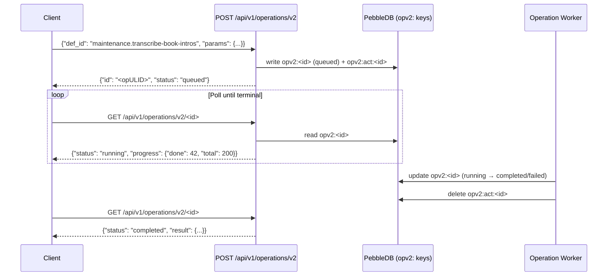

<!-- file: docs/system/api.md -->
<!-- version: 1.23.1 -->
<!-- guid: d4e5f6a7-b8c9-0123-def0-123456789012 -->
<!-- last-edited: 2026-10-30 -->

# HTTP API

The Audiobook Organizer backend exposes a JSON REST API under `/api/v1/`. All endpoints require authentication except `/api/v1/auth/bootstrap` (first-run setup) and `/api/v1/auth/status`.

## Authentication

**All API calls must include:**
```
Authorization: Bearer <token>
```

Token types:
- `abk_…` prefix — API key (persistent, programmatic access). Routed through API key validation.
- Session token — short-lived cookie-backed token from browser login. Also accepted in `Authorization: Bearer`.

**Never use `X-API-Key` header** — it is not supported.

To obtain an API key:
1. Bootstrap admin via `POST /api/v1/auth/bootstrap` (first-run only). Response: `{ "data": { "api_key": "abk_…" } }`
2. Or: log in via browser, then `POST /api/v1/auth/api-keys` to create a persistent key.

## Endpoint Reference

### Library / Audiobooks

| Method | Path | Description |
|---|---|---|
| `GET` | `/api/v1/audiobooks` | List books with filtering and pagination |
| `GET` | `/api/v1/audiobooks/:id` | Get single book with enrichment |
| `PUT` | `/api/v1/audiobooks/:id` | Update book metadata |
| `DELETE` | `/api/v1/audiobooks/:id` | Soft-delete book |
| `POST` | `/api/v1/audiobooks/batch-operations` | Per-item update / delete / restore |
| `GET` | `/api/v1/audiobooks/:id/files` | List book file segments |
| `GET` | `/api/v1/audiobooks/:id/cover` | Get cover art image |
| `GET` | `/api/v1/audiobooks/:id/cover-text` | Vision-extracted cover text |
| `GET` | `/api/v1/audiobooks/:id/changelog` | Metadata changelog |
| `GET` | `/api/v1/audiobooks/:id/metadata-history` | Per-field metadata history (`/:field`, `/:field/undo`) |
| `POST` | `/api/v1/audiobooks/:id/reconcile-files` | Reconcile the book's files against disk (`/force-rescan` re-reads tags) |

#### Library List Query Parameters

| Parameter | Type | Default | Notes |
|---|---|---|---|
| `limit` | int | 20 | Max 1000 |
| `offset` | int | 0 | Pagination offset |
| `sort_by` | string | `title` | `title`, `author`, `duration`, `created_at`, `updated_at` |
| `sort_order` | string | `asc` | `asc` or `desc` |
| `is_primary_version` | bool | — | Filter to primary versions only |
| `show_quarantined` | bool | false | Include quarantined books |
| `author_id` | string | — | Filter by author ULID |
| `series_id` | string | — | Filter by series ULID |
| `search` | string | — | Full-text search query |
| `review_status` | string | — | `matched`, `no_match`, `audio_confirmed` |
| `has_cover` | bool | — | Filter by cover art presence |
| `fingerprint_status` | string | — | `has_fingerprint`, `no_fingerprint` |

### Authors and Series

| Method | Path | Description |
|---|---|---|
| `GET` | `/api/v1/authors` | List authors |
| `GET` | `/api/v1/authors/:id` | Get author (`/books`, `/aliases`) |
| `PUT` | `/api/v1/authors/:id/name` | Rename author |
| `POST` | `/api/v1/authors/:id/split` · `/reclassify-as-narrator` · `/resolve-production` | Author repairs |
| `POST` | `/api/v1/authors/merge` | Merge authors |
| `DELETE` | `/api/v1/authors/:id` | Delete author (`POST /authors/bulk-delete` for many) |
| `GET` | `/api/v1/series` | List series |
| `PATCH` | `/api/v1/series/:id` | Update series name (`PUT /series/:id/name`, `/split`, `DELETE` empty series) |
| `GET` | `/api/v1/series/duplicates` · `/prune/preview` | Series dedup / prune previews (POST applies). Series normalize runs only as the `dedup.series-normalize` op; its HTTP preview/apply routes were removed |

### Metadata

| Method | Path | Description |
|---|---|---|
| `POST` | `/api/v1/audiobooks/:id/fetch-metadata` | Trigger metadata fetch for a book |
| `POST` | `/api/v1/audiobooks/:id/apply-metadata` | Apply fetched metadata |
| `GET` | `/api/v1/audiobooks/:id/metadata-rejections` | Candidates a human rejected for this book |
| `POST` | `/api/v1/metadata/bulk-fetch` | Retired (BULK-FETCH-NO-GATE): answers `410 Gone` for one release. It applied each book's top candidate with no apply gate. Fetch candidates with `POST /api/v1/operations/v2` `{"def_id":"library.bulk-metadata-fetch"}` and apply them with `{"def_id":"metadata.batch-apply-cached"}`, which runs every candidate through the apply gate |
| `GET` | `/api/v1/metadata/search` · `/fields` | Provider search; known metadata fields |
| `GET` | `/api/v1/metadata/providers/throttles` | Provider throttle state (read-only). The `DELETE /metadata/providers/throttles` and `/throttles/:id` resets were retired (01-P81f) and answer 410 Gone for one release |

### Deduplication

| Method | Path | Description |
|---|---|---|
| `GET` | `/api/v1/dedup/candidates` | List dedup candidate pairs (`/export`, `/:id/breakdown`) |
| `POST` | `/api/v1/dedup/candidates/:id/link` | Link a candidate pair; `/:id/reject` rejects it. The old `/merge` and `/dismiss` verb aliases were removed |
| `POST` | `/api/v1/dedup/candidates/bulk-link` · `/bulk-count` · `/bulk-reject` · `/bulk-reject/revert` · `/link-cluster` · `/reject-cluster` | Bulk and cluster forms of link/reject |
| `POST` | `/api/v1/dedup/scan` · `/scan-llm` · `/scan-acoustid` · `/split-book-scan` | Trigger the dedup scans (each enqueues a v2 op). The book-signature scan runs only as the `dedup.book-signature-scan` op (`POST /operations/v2`) |
| `GET` | `/api/v1/dedup/stats` | Dedup statistics |

### Review Queue

The producer-agnostic review queue behind the `/review` workspace's **Review queue** lane (`internal/server/handlers/review`). Reads need `library.view`; mutations need `library.edit-metadata`.

| Method | Path | Description |
|---|---|---|
| `GET` | `/api/v1/review/count` | Pending item count (`count`, `by_kind`), plus `applying`: items held by an apply claim (running, applied but unrecorded, or interrupted), and `needs_attention`: items whose interrupted apply was abandoned. Neither is in any pending list; list them with `GET /api/v1/review/items?status=applying` or `?status=needs_attention` |
| `GET` | `/api/v1/review/items` | List review items. Responses never carry the apply claim's token or process instance; `apply_claim_action` (and `apply_claim_rerun`) show on held items, `apply_abandoned_action` on `needs_attention` ones |
| `POST` | `/api/v1/review/items/:id/approve` | Approve; dispatches the chosen action to its apply handler only while `review_apply_enabled` is on, otherwise records `approved`. The apply runs under a claim (status `applying`). Optional body `{action, if_updated_at}`: `if_updated_at` is the item's `updated_at` as the caller rendered it, and the approve is refused with `REVIEW_ITEM_CHANGED` unless the item is still that record (without it the check covers only changes after the request arrived). 409s: `REVIEW_ALREADY_APPLIED`; `REVIEW_APPLY_IN_PROGRESS` (an apply in this server process holds the claim; it is never taken over); `REVIEW_APPLY_INTERRUPTED` (no running process holds the claim: a previous server process left it, a first run of it failed after it may have written, or a re-run of it failed. Approve again with no action, or the same action, to take it over and re-run the apply. The re-run skips work already done, but it does not redo an incomplete multidisc renumbering, and a `duplicate-of` re-run can fail after a partial merge. No other decision is accepted until it finishes; if it cannot be finished, or its action has no apply handler, use `abandon-apply`); `REVIEW_RERUN_FAILED` (this request's re-run of an interrupted apply failed, for any reason including the iTunes guard; the item stays held as interrupted, it does not go back to the queue); `REVIEW_APPLY_PARTIAL` (this request's FIRST run of the apply failed and may already have changed the library, so the item stays `applying`, held by no process, exactly as after a failed re-run: it is in no pending list and refuses every other decision as `REVIEW_APPLY_INTERRUPTED` until you approve it again to retry or `abandon-apply` it; only a first-run failure the apply function reports as having written nothing is handed back instead, and a failure that cannot say, including a panic, is held); `REVIEW_ITUNES_PROTECTED` (a FIRST run was refused, before any write, because a member has a file under the active iTunes library; the item is handed back to the status it was claimed from: pending, approved, rejected or needs_attention); `REVIEW_APPLY_DISABLED` (the item is `needs_attention` and `review_apply_enabled` is off: approving it means re-running an abandoned, possibly half-done apply, so it can be rejected but not approved until apply is on); `REVIEW_NO_APPLY_HANDLER` (the item is `needs_attention` and the chosen action has no apply handler, so approving it would run nothing and erase the abandoned-action note; reject it instead); `REVIEW_SEPARATE_NEEDS_ATTENTION` (the item is `needs_attention` and the chosen action is `separate`, refused whether apply is on or off: separate runs nothing, so it cannot confirm the library is fine after a partial apply; check the library, then reject the item); `REVIEW_ITEM_CHANGED` (the item changed since it was read; reload and decide again); `REVIEW_CONFLICT` (any other store refusal). With no `action` an item under a claim resolves to the claim's own action. 500 `REVIEW_APPLIED_UNRECORDED`: the apply ran but its status write failed; approving again records it without re-running the apply while the server keeps running (a request that loses the race to record it answers `REVIEW_ALREADY_APPLIED`), and re-runs it after a restart. 500 `REVIEW_CLAIM_UNAVAILABLE`: the store cannot claim, so no review write is made |
| `POST` | `/api/v1/review/items/:id/reject` | Reject. Optional body `{if_updated_at}`, as for approve. 409 for an applied item or one under an apply claim, with the same codes as approve |
| `POST` | `/api/v1/review/items/:id/abandon-apply` | Moves an item held by an interrupted apply (`REVIEW_APPLY_INTERRUPTED`, including one a failed first run left: `REVIEW_APPLY_PARTIAL`) to `needs_attention`, recording the abandoned action in `apply_abandoned_action`. Nothing in the library is touched or undone: check what the apply changed, then approve or reject the item (both accept `needs_attention` items; an approve runs its action from the start, and with no `action` it runs the abandoned one: `chosen_action` is set to it, not to the payload's recommendation; an approve needs `review_apply_enabled` on and an apply handler for the action, `REVIEW_APPLY_DISABLED` or `REVIEW_NO_APPLY_HANDLER` otherwise, and `separate` is always refused with `REVIEW_SEPARATE_NEEDS_ATTENTION`). 409s: `REVIEW_APPLY_IN_PROGRESS` (a running apply holds it), `REVIEW_ALREADY_APPLIED` (including an apply whose result is waiting to be recorded), `REVIEW_APPLY_NOT_INTERRUPTED` (no claim) |
| `POST` | `/api/v1/review/bulk` | Bulk approve/reject. Approving by `ids` also executes items that were approved while apply was off, once `review_apply_enabled` is on (list them with `GET /api/v1/review/items?status=approved`). Per-item apply errors do not stop the batch: an error that wrote nothing comes back in `failed` (`{id, reason}`) and the item keeps its status, so resending its id retries it. A failure that may already have changed the library is not in `failed`: the item is held `applying` and is in `skipped` with `code` `REVIEW_APPLY_PARTIAL` (approve it again to retry, or abandon the apply). `applied_unrecorded` (`{id, reason}`) is the opposite case: the apply ran but the `applied` status write failed after retries, so the item is held `applying`. Approving it again records the result without re-running the apply while the server keeps running; after a restart, approving it again re-runs the apply, which skips work already done. Items that are applied or held by an apply claim are `skipped`, each with the `code` a single-item route would answer (`REVIEW_ALREADY_APPLIED`, `REVIEW_APPLY_IN_PROGRESS`, `REVIEW_APPLY_INTERRUPTED`, `REVIEW_APPLY_PARTIAL`, `REVIEW_RERUN_FAILED`, ...). With `ids`, an optional `if_updated_at` map (`{id: updated_at}`) skips each listed item that changed since with `REVIEW_ITEM_CHANGED`; it is refused (400) with `kind`. `apply_disabled: true` means apply is off and nothing was applied |
| `POST` | `/api/v1/review/replay-approved` | Retired (01-P81j): answers `410 Gone` for one release; use `POST /api/v1/review/bulk` with `ids` as above |

### Repairs Lane

Library fixers built on `internal/repairs`; the **Repairs** lane of `/review` calls these (`internal/server/wire_repairs_routes.go`, handler `internal/server/handlers/repairs`).

| Method | Path | Description |
|---|---|---|
| `GET` | `/api/v1/repairs` | List fixers: `{fixers: [{id, title, description, last_plan, last_apply}]}` |
| `POST` | `/api/v1/repairs/:fixer/plan` | Enqueue a `repairs.plan` run (a "trial"); 202 with `operation_id`; an identical queued/running request is deduped |
| `GET` | `/api/v1/repairs/:fixer/plan/:op_id/rows` | Page the stored plan's rows: `?filter=`, `?class=`, `?offset=`, `?limit=` |
| `POST` | `/api/v1/repairs/:fixer/apply` | Enqueue `repairs.apply` for `{plan_op_id, row_ids, dry_run}`; only an explicit `dry_run: false` writes, omitted means preview |

Registered fixers: `duplicate-copies`, `folder-books`, `fragment-consolidation`, `maintenance.normalize-letter-l-ordinals`, `maintenance.repair-junk-authors`, `maintenance.repair-junk-titles`, `version-group-primary-repair`. Apply re-plans each selected row and refuses one whose fingerprint changed (`changed_since_plan`); rows under `books/itunes/**` or Doctor Who / Big Finish / Torchwood are skipped at plan time and refused at apply time; nothing is deleted through the lane.

### Operations (v2)

| Method | Path | Description |
|---|---|---|
| `POST` | `/api/v1/operations/v2` | Launch an operation by def_id |
| `GET` | `/api/v1/operations/v2` | List all operations (recent) |
| `GET` | `/api/v1/operations/v2/:id` | Poll operation status |
| `DELETE` | `/api/v1/operations/v2/:id` | Cancel operation |
| `POST` | `/api/v1/operations/v2/:id/retry` | Re-run a finished operation as a new run (202) |
| `DELETE` | `/api/v1/operations/v2/:id/record` | Discard: delete the persisted record of a finished or interrupted run (204; 409 while queued/running) |

Retired 2026-09-11: `DELETE /api/v1/operations/history?status=…` now answers 404.
It deleted from the legacy v1 `operation:` keyspace by status and reported the
count as success, while the rows the Activity page shows (v2) were untouched.
Remove finished runs one at a time with `DELETE /api/v1/operations/v2/:id/record`.

### Maintenance / Admin

| Method | Path | Description |
|---|---|---|
| `POST` | `/api/v1/operations/v2` `{"def_id":"library.scan"}` | Trigger a library scan (there is no separate scan route) |
| `POST` | `/api/v1/operations/v2` `{"def_id":"maintenance.recompact-activity-digests"}` | Re-derive legacy digest items on every activity backend (the retired `POST /api/v1/admin/recompact-digests` answers 410 Gone for one release and points here); 202 with the op id |
| `POST` | `/api/v1/diagnostics/export` | Diagnostic ZIP export (`GET /diagnostics/export/:operationId/download`; `/diagnostics/db-health`) |
| `GET` | `/api/v1/diagnostics/traces` · `/diagnostics/traces/:name` | Admin-only (`settings.manage`): list the runtime flight recorder's snapshot files (`{"data": {"traces": [{name, size, modified}]}}`, newest first; each snapshot is a `.trace` plus a `.goroutines.txt`) and download one as an attachment; an unknown name is a 404 `trace not found` |
| `POST` | `/api/v1/backup/create` | Create PebbleDB backup (checkpoint) |
| `POST` | `/api/v1/system/reset` · `/system/factory-reset` | Admin-only resets |

### Collections

Reads need `library.view`; every write needs `collections.manage`.

| Method | Path | Description |
|---|---|---|
| `GET` | `/api/v1/collections` · `/collections/:id` | List collections / get one. A dynamic collection's members are `materialized_book_ids` (a static one's are `book_ids`); `GET /collections/:id` re-evaluates a dynamic collection first and stores the result when it changed, the list does not. A collection whose query uses a per-user field is evaluated for the caller on every read and nothing is stored (see below) |
| `POST` | `/api/v1/collections` | Create a static or dynamic collection; the caller is stored as its creator (`created_by_user_id`, attribution only) |
| `PUT` | `/api/v1/collections/:id` | Update name, description, query (dynamic) or the whole book list (static; `book_ids` requires the `version` you read, see below) |
| `DELETE` | `/api/v1/collections/:id` | Delete a collection |
| `POST` | `/api/v1/collections/:id/materialize` | Re-evaluate a dynamic collection and store the members (a per-user collection stores nothing: the response is the caller's own members) |
| `POST` | `/api/v1/collections/:id/books` `{"book_ids":[...]}` | Add books to a static collection (atomic; duplicates ignored; `404` unknown collection, `409` not static) |
| `DELETE` | `/api/v1/collections/:id/books/:bookId` | Remove one book from a static collection (`404` when it is not a member) |

A dynamic collection whose query uses a per-user field (`read_status`,
`progress_pct`, `last_played`) is evaluated for the VIEWER: the signed-in caller on
the native API and on the Audiobookshelf surface. Two users see different members of
the same collection, a collection's creator never decides what anyone else sees, and
nobody can infer another user's listening state from a collection's membership. This
holds for admins too; reading another user's listening state needs `users.manage` and
its own tooling, and no collection route takes an "as user" parameter. The members
are returned in the response (`materialized_book_ids` on `GET /collections/:id`, on
each row of `GET /collections`, and on the create, update and materialize responses)
and are never stored: the stored row's `materialized_book_ids` is empty. Rows written
before 2026-10-25 held the creator's answer; they are cleared at start (the
`collection-peruser-purge` step, logged to the system activity log) and the read
paths never serve a leftover list, and the store itself drops the list of such a
collection on every create and update, whichever route writes it. A query that no
longer parses counts as per-viewer (nobody can say it reads no per-user state), so a
list it holds is never served either; that includes a collection that never used a
per-user field but whose query has since stopped parsing, whose stored list the start-up
step and the store's writes drop along with the rest. An evaluation that cannot run (the search index
is closed or rebuilding, the query no longer parses, or the caller's state could not
be read) answers no members, never the stored list, and says so: the collection in the
response carries `members_unavailable: true` and a `members_unavailable_message`
(`GET /collections/:id`, each row of `GET /collections`, and the create, update and
materialize responses), so "could not be worked out" is told apart from "nothing
matches". The cause is logged once per kind per minute. A `PUT` on a per-viewer
collection always answers with the caller's own members, including a rename-only one.
The caller's listening state is read once per request and shared by every per-viewer
collection on the page, and the evaluation has no result window: a library of any size
is evaluated in full, but a list is then cut to 10,000 members (see below). A request
that is cancelled while it waits for an evaluation slot is dropped (`499`), not
reported as an unavailable collection and not logged; the same holds for a refresh or a
search whose request is cancelled, which stops at its next check and is neither a failure
nor a log line. A per-user term that cannot be evaluated as written is refused with a
`400` on create and update (and for a smart playlist, and for the library search, see
below): under an `OR` with another term, under a `NOT` over a group (a double `NOT` of a
group is fine), a `read_status` that is not one of its four statuses, a pattern on any
per-user field, a `progress_pct` or `last_played` value that does not parse, or a field
name written with capitals. The message names what is valid, and a stored query of such a
shape reads as unavailable with that same message; see `docs/search-syntax.md`. A
changed `sort_json` is checked too (create, and update when it changed): it must be a
JSON array of `{"field", "direction"}` objects, or the request is a `400`. Only a failure
to read the viewer's own state is logged by class alone (its text names the user and a
book, and the activity log is readable with `library.view`); every other failure is
logged with its text, which names neither.
On the Audiobookshelf surface such a collection has no flag to carry, so on the list
routes it shows no books when its members could not be worked out (the failure is
logged), and `GET /api/collections/:id` answers `503` for it instead of an empty
collection, so a client can retry and does not cache an empty list as the answer. A
request whose client has gone away answers `499` on every collection route, not a page
of empty collections. The `lastUpdate` of a collection that evaluated is the time of the
request (its members move with the viewer's state and the library, none of which touches
the row), which makes a client that caches by `lastUpdate` refetch it every time; on a
list, an unavailable collection carries the same `lastUpdate`, so a list client cannot
tell a failed evaluation from an empty one, which is why the detail route does. The `503`
has precedent on this surface (`play`, `progress` and the playlist writes answer it with
`{"error": ...}`), but no real client has been checked against it: one that treats any
non-2xx answer as fatal shows an error instead of an empty shelf, and it is reachable only
for a per-viewer collection while the index rebuilds or with a stored query that is now
refused (there is a manual AudioBooth check in `todo.d`). The collection mutation routes
(create, rename, add and remove books) answer with the change that was committed and no
books when the members could not be worked out, where the detail route answers `503`, and
a `499` on them means the client went away after the write: the change was kept.

A smart playlist follows the same rules. `GET /playlists/:id` of a smart playlist whose
stored query is refused (saved before the check) answers `200` with `book_ids: []`,
`members_unavailable: true` and a `members_unavailable_message` (it is not a `400`: the
playlist is fine, its answer is not available), and drops the member list the last
evaluation cached, so the Audiobookshelf surface, which serves that cache, stops
answering the old way. A query that does not parse at all, an empty query and an unusable `sort_json` read the
same way, because each is the stored definition's fault; a failure that is the server's
(the viewer's listening state could not be read) is a `500` with a generic message and is
logged, the search index not being ready is a `503`, and a client that went away is
dropped, so only a problem the person can fix is shown as "unavailable". On
`POST /playlists/:id/materialize` a definition problem is a `400` and a server failure a
`500`.
`POST /playlists/:id/materialize` cuts the snapshot at 10,000 books like every other
member list: the new static playlist carries `materialized_total` with the real count and
a description that says so. `GET /playlists/:id` of that static copy reports the count as
`book_ids_total` only while its list is still the cut one (10,000 ids and a larger total).
The store drops the total when the books the snapshot holds change, whichever route writes
it (an add followed by a remove, which brings the length back to 10,000, drops it too; a
reorder keeps it), so the page then shows the real length of the list, and the description
keeps saying the snapshot was cut.
On the Audiobookshelf surface a smart playlist that is refused or whose members could not
be worked out has no books and no signal that says why (a list row has nowhere to carry
the reason), the same as the collection list routes. `PUT /playlists/:id` checks the query only when it changed,
so a rename that resends the stored query is not refused for it.

A per-user term in the library list is judged against the caller's own state and combines
with the other terms as written, `OR` and `NOT` over a group included (see
`docs/search-syntax.md`). The values a per-user term can take are checked on both ways a
query reaches the list:

- `GET /audiobooks?search=` answers `400` `invalid search: <message>` for a value the matcher
  cannot evaluate (a `read_status` that is not one of its four statuses, a pattern, a number
  or date that does not parse), wherever the term sits in the query.
- The `filters=` JSON, which is what the web search box sends for `field:value` terms,
  answers `400` `invalid filter value: <message>` for a value the matcher cannot evaluate:
  a `read_status` that is not one of its four statuses, a pattern on any per-user field, a
  `progress_pct` value with `!=`, `==` or an open end such as `[* TO 50]`, an alternation
  that lists nothing (`()`) or holds a comparison (`(>50|<10)`). `read_status:(finished|in_progress)`
  works there too, as one filter that matches either status. A filter cannot carry an `OR` or
  a group, so the web box sends any query with boolean structure whole as `search=`, with no
  filters or `tags[]` of its own for it, and shows the server's message in the library page.
  Boolean structure is an `OR`, `||` or `|` next to a field term, a field term
  inside a group opened by `(`, a `-` or `NOT` before a `tag:` term, or a `tag:` value that is
  not one whole name (`tag:noir*`); a per-user field's own `(a|b)` list is not. Structure among
  free words alone (`title:bat NOT robin`, `title:bat Batman (1987)`), and an `AND` or `&&`
  (which the split already means), is not: the field term stays
  in `filters=` and the rest is `search=`, which the server reads. This does not depend on the
  query naming a per-user field: `Batman -tag:"to-read"` and `tag:noir OR tag:gotham` reach
  the server whole and answer 400. Structure is read from the terms, not the raw text: the
  parentheses, pipes and spaces inside a `/regex/`, a quoted value or a plain value
  (`title:/^(the|a) /`, `title:"Year (One)"`, `title:Batman(1989)`) are not structure, and that
  term stays in `filters=`. A boost after a tag (`tag:noir ^2`) is structure. A negated field
  other than `tag` (`-title:x`, `NOT narrator:y`, `-metadata:applied`) stays in `filters=`,
  because a filter matches by substring, glob or regex and the index by whole words, not because
  of which fields the index holds. The rest
  of such a query is then judged by the rules of `search=`: a `duration:` term is
  held by the index and is answered with the query, a `tag:` term is an exact tag filter
  (see below), the per-user shapes get their own message first,
  and a field the index does not hold (`metadata`, `review`, `has_duration`) is refused with the
  search parameter's message that points at `filters=`, which the box cannot act on: take that
  term out of the query.

`tag:` in `search=` (and in a dynamic collection's or smart playlist's query) is an
EXACT tag filter: the whole tag, case-folded, the same match as the `tags[]` parameter and
the tag chips (`tag:"to-read"` does not find a book tagged only "read", `tag:knight` does
not find "dark-knight"). It is applied outside the search index, which holds a tag as
words, by looking up the books that carry each tag and ANDing them with the rest of the
query. That is possible only where the term is a conjunct of the whole query: at the top
level, or in a group that is only ANDed (`read_status:finished AND tag:noir`,
`(read_status:finished tag:noir)`). A `tag:` term inside an `OR`, inside an alternation
(`tag:(a|b)`), under `NOT` or `-`, or with `*`, `~` or `^` in an unquoted value (`tag:no*`,
`tag:noir~1`, `tag:noir^2`, or a boost or fuzzy marker after a quoted value, `tag:"noir"^2`) is
refused with a 400 (`invalid search: tag: cannot be used inside an OR group ...`) by the
list, and on create and update of a collection or smart playlist; a stored query of that
shape reads as `members_unavailable` until it is edited. A `/regex/` field value in `search=` (or in a collection or smart playlist query) answers 400
(`invalid search: a /regex/ value cannot be used in the search parameter ...`), whether the text
parses or not: the index has no regular expressions, and the value used to be read as the words
between the slashes or fall to a substring match. A regex is a `filters=` term. See
`docs/search-syntax.md` for how the per-user pass reads the viewer's state (point reads up to 256
candidates, one scan above, an unreadable row judged unstarted).
A quoted value is a literal name, so `tag:"c++*"` is accepted. A stop word or punctuation
left next to a tag term (`the tag:noir`, `- tag:noir`) is dropped as next to any term. Several `tag:` terms are all
required. The web box sends the `tag:` terms that narrow the whole query as `tags[]` as
well as in `search=` (the same filter twice), so a tag chip stays exact however the rest
of the box is written. A background operation's saved search text goes through the same
path. Allowing `tag:` inside groups needs the index's `tags` field mapped as a keyword and
a full reindex; it is tracked in `todo.d`. The `tags:` field name is the index field
itself and still matches by word.

The refusal applies to every caller of the search, not only the HTTP list: the substring
fallback the search uses while the index is not built or is rebuilding checks the query
first too, and a background metadata operation whose saved filter holds a per-user term
(in its search text or in its field filters) is refused before it resolves, because an
operation has no viewer to read the term for: it used to drop a per-user field filter and
resolve the whole library, and the search path skipped the term. Text that the query parser
rejects but that writes a per-user term (`read_status:finished OR`, an unclosed `(` while
the person is still typing) is refused the same way, `400` `invalid search: this search
could not be read (...)`, where it used to fall to a substring match over title and author
that showed no rows and said nothing; unparsable text with no per-user term keeps that
fallback. Forms the old matcher accepted without a word are refused as
well: `read_status:finished*`, `read_status:*finished`, `read_status:finished~` and
`read_status:>finished` (all matched finished books), `progress_pct:50*` and
`progress_pct:<inf` (the second matched every book), and `last_played:2026-01-01*`
(matched that day).

A dynamic collection or smart playlist carries at most 10,000 member ids: in the
stored `materialized_book_ids`, in every native response, and in the library items the
Audiobookshelf surface expands. When the query matches more, `materialized_total`
(`book_ids_total` on `GET /playlists/:id`) holds the real count and the list is the
first 10,000 in sort order; on the Audiobookshelf collection row `numBooks` stays the
number of books served and `totalBooks` (present only when the list was cut) is the
real count. The stored row is rewritten only when the cut list or the total changes.
With no sort, the list is in ascending book id, oldest first (ids are ULIDs). The server
logs a collection's cut once a minute per collection; a smart playlist's cut is reported
in its answer and is not logged.
A static collection's list is not cut. A background or
system evaluation with no viewer matches nothing for a per-user rule, and never falls
back to the creator or an admin. With authentication off the one viewer is the
synthetic `_local` user. A query with no per-user field is unchanged: evaluated with
no user, stored, and the same for everyone.

A static collection's whole-list replace (`PUT` with `book_ids`) requires `version`,
the `version` of the collection you read: a missing one is `400` (`version is required
with book_ids`) and a stale one is `409` with `current_version`, so a book added
atomically through `POST /collections/:id/books` since your read is never silently
dropped. The web UI does not call this route; the Audiobookshelf-compatible routes
use the atomic add and remove.

Dynamic collections whose query has a relative date and no per-user field
(`date_added:>-7d`) are refreshed hourly by the scheduled op
`collections.refresh-relative-dynamic`, so the members the Audiobookshelf surface
serves follow the clock without anyone opening the collection. A collection with a
per-user field (`last_played:>-30d`) is not refreshed: it stores no member list and
the job has no viewer. The job skips a collection edited while the run was in flight
(picked up next hour), and stores a member list only when it changed. The hourly task
enqueues the op only when such a collection exists and the search index is open
(there is no collections-disabled config switch), and a run that still finds the index
closed finishes as a clean no-op with one log line. Launched by hand
(`POST /operations/v2`) it is a preview unless `dry_run` is `false`; the hourly run
sends `dry_run: false`.

Because every viewer is evaluated as themselves, anyone with `collections.manage` may
write a per-user field into a query: it can only ever read their own state. A query
that cannot be parsed or translated, such as a malformed date on one of them
(`last_played:>30d`, missing the sign), is a `400` at create time and when the query is
changed (the message names the parse or translate error and nothing is stored), not a
collection that silently matches nothing; a closed search index does not block saving a
good query. The earlier owner gate (`403 COLLECTION_PER_USER_QUERY_OWNER_ONLY`), the
`adopt_owner` flag and the `evaluation_blocked` / `409 COLLECTION_OWNER_MISSING_PER_USER_QUERY`
answers are gone: they existed only to protect owner evaluation.

### Authentication

| Method | Path | Description |
|---|---|---|
| `POST` | `/api/v1/auth/bootstrap` | First-run admin setup |
| `GET` | `/api/v1/auth/status` | Session status (unauthenticated OK) |
| `POST` | `/api/v1/auth/login` | Login with username/password |
| `POST` | `/api/v1/auth/logout` | Invalidate session |
| `POST` | `/api/v1/auth/api-keys` | Create API key |
| `GET` | `/api/v1/auth/api-keys` | List API keys |
| `GET` | `/api/v1/auth/api-keys/:id` | Get API key |
| `PATCH` | `/api/v1/auth/api-keys/:id` | Enable/disable key |
| `DELETE` | `/api/v1/auth/api-keys/:id` | Revoke key |

## Operations v2 Lifecycle

Operations are long-running jobs (scan, transcription, dedup, organize, etc.) that run in the background with real-time progress reporting.



### Known def_ids

| def_id | Description |
|---|---|
| `maintenance.transcribe-book-intros` | Whisper intro transcription (`reparse_only` param supported) |
| `maintenance.transcribe-book-intros` (reparse_only) | Re-parse stored transcripts only (no GPU/ffmpeg) |
| `maintenance.dedup-exact-triage` | Classify dedup candidates (read-only, dry-run) |
| `dedup.purge-stale` | Cleanup stale dedup candidates (manual) |
| `repairs.plan` / `repairs.apply` | Repairs lane plan ("trial") and apply runs; launched via `/api/v1/repairs/:fixer/*` |
| `maintenance.version-group-primary-repair` | Elect exactly one primary per version group (also the `version-group-primary-repair` fixer) |
| `maintenance.purge-empty-authors` / `maintenance.purge-empty-narrators` | Purge author/narrator rows with no books (fail-closed ref counts) |
| `maintenance.credit-census` / `maintenance.credits-backfill` | Count books whose author/narrator credit lists disagree with the flat fields (read-only), then fill and renumber the lists (`{}` previews; `apply: true` writes, journaled as `credits_backfill` and revertable; `book_ids` (the run still reads and plans the whole library, and reports and writes only those books, so it is no cheaper than a full dry run); `limit` caps the cohort to the first N eligible books by id in both modes, so a dry run with the same `limit` shows what the apply would write; `allow`: `narrator_new_from_split`, `narrator_self_read`, `itunes`; the result adds `books_eligible` and `books_to_reidentify`, the books whose search identity changes and so spend Google Books quota at their next metadata run, `narrators_created_unused` with `unused_narrator_names` (records the run created that no written book credits; the apply deletes each one again that this run made and no book links, and says which: `unused_narrators_deleted`, `deleted_unused_narrator_names`, `unused_narrators_kept`, each entry `name (id N, reason)`; an apply also finds the unlinked records earlier attempts created, from the journal rows of this operation and of every other `maintenance.credits-backfill` operation whose status is not `completed` (a crashed one that was never resumed), and treats them the same way, because every create is preceded by a `narrator_create_intent` row. A record counts as an operation's leftover only if it was created inside that operation's own window: from its first journal row (from the intent row itself, for a record named by an intent) to the naming row plus 30 seconds, and never after the operation's `completed_at` plus 30 seconds; a same-named record made later by anything else is an ordinary preexisting one. The `narrator_delete` row of such a record carries `source_op=<operation id>` in its new value. An operation whose leftovers an apply has settled is marked judged and is not read again until its row changes (a resume or retry). The apply reads the operation list once, and refuses to start, writing nothing, if the store cannot list operations or read the marker, if an operation's journal cannot be read, if one of its rows has an id that is not a ULID or a `credits_backfill` row that does not decode, or if a record named by an intent row cannot be looked up: a row the apply cannot read blocks applies until it is repaired. A discarded operation is not listed, and neither is a completed one that was reverted afterwards, so a record only their journals name is not found; the dry run does not predict leftovers. Reverting the operation reports its `narrator_delete` and `narrator_create_intent` rows under `not_restorable_types` while its book rows are still reverted), `canceled_not_written` (informational: an apply that was canceled, or lost the scan stand-down, lists the books it had not reached when the run stopped, so every planned book is in a class), and `out_of_scope_read_errors` (books outside a `book_ids` run that could not be read: listed under no class, but the run is incomplete); a split-credit book whose new narrator records another book creates is written only in the cohort that contains that book, and only after it: with a `limit` it takes one of the places the plain books leave (in sorted order) or is `limit_reached`, and when the creating book is not in the cohort it is listed under `narrator_waiting_on_creator` and takes no place; the backfill's result keeps each class's count and before/after samples, and a class's book ids are paged from `GET /api/v1/operations/:id/class-lists/:class?offset=&limit=` (default 100, at most 1000; 404 for an operation with no stored class lists, 409 `OPERATION_CLASS_LISTS_NEED_RERUN` when the stored lists do not match its result, which only a new run fixes. The lists are rows of their own beside the operation's result, tagged with the run that wrote them, and stay until the operation is discarded: nothing prunes them by age, so each run's lists, limited runs included, keep their 5 to 12 MB until then). The census still returns its lists inside `GET /operations/:id/result`) |
| `library.scan` | Library scan (per-book scan lock since #3635, so repairs may apply during a scan) |
| `itunes.heal` | Heal stale iTunes file paths after organize (former ID `maintenance.itunes-heal` still resolves) |
| `reconcile.scan` | Reconcile library paths vs. filesystem; also the nightly `reconcile_scan` task. The generic operations endpoint requires `settings.manage`; `POST /api/v1/operations/reconcile/scan` still admits `scan.trigger`. `GET /api/v1/operations/reconcile/scan/latest` answers `{operation, preview, latest_attempt}`: `operation` and `preview` are the newest scan that completed with a readable result, whichever ID it was stored under, and `latest_attempt` is the newest run when it is a different one (still running or queued, canceled, failed, interrupted, or completed with an unreadable result), else `null`. A newer failed or canceled run never hides the last good preview. With no usable scan, `operation` is the newest run, `preview` is `null` and `latest_attempt` is `null`. Former ID `maintenance.reconcile-scan` still resolves |
| `dedup.author-scan` | Scan for author near-duplicates (former ID `maintenance.author-dedup-scan` still resolves) |
| `dedup.llm-review` | LLM review of ambiguous dedup candidates. The generic operations endpoint requires `settings.manage`; `POST /api/v1/dedup/scan-llm` still admits `scan.trigger`. Former IDs `maintenance.dedup-llm-review` and `scheduler.dedup-llm-review` still resolve |
| `maintenance.window` | Nightly maintenance window (dispatches sub-ops) |
| `library.bulk-write-back` | Bulk tag write-back to audio files |
| `ai.author-review` | AI-assisted author dedup review |
| `ai.author-merge-apply` | Apply AI author merge recommendations |
| `ai.author-scan-apply` | Merge the authors of selected AI scan results (`POST /ai/scans/:id/apply` queues it with `dry_run=false`; omitted `dry_run` is a preview). Honours `author_name` locks, marks only results whose merge succeeded |

**Renamed def_ids.** A renamed op keeps its old ID as an alias
(`OperationDef.FormerIDs`). The old ID is accepted by `POST /operations/v2`,
`?def_id=` timeline filters, resume and retry, and it resolves to the new op.
Stored rows keep the ID they were written under. The metric
`audiobook_organizer_operation_deprecated_def_id_total{alias,entry}` counts
how often each old ID is still used. The 2026-09-25 renames are
`maintenance.itunes-{regroup,playlist-import,heal,clone-into-library}` →
`itunes.{regroup,playlist-import,heal,clone-into-library}`, `library.optimize`
→ `maintenance.library-optimize`, and `maintenance.dedup-llm-review` →
`dedup.llm-review`. `scheduler.dedup-llm-review` → `dedup.llm-review` followed on
2026-10-14 (04-P14b), and `maintenance.reconcile-scan` → `reconcile.scan` the same day (04-P14c).

## Response Conventions

All responses use the envelope format:
```json
{
  "data": { ... },
  "error": null
}
```

Errors:
```json
{
  "data": null,
  "error": "human-readable error message"
}
```

Pagination responses include `total` alongside `data`:
```json
{
  "data": [...],
  "total": 10891,
  "limit": 20,
  "offset": 0
}
```

## Cross-references

- Architecture (handler wiring): [architecture.md](architecture.md)
- Pipelines (operation internals): [pipelines.md](pipelines.md)
- Runbooks (deploy and ops): [runbooks.md](runbooks.md)
