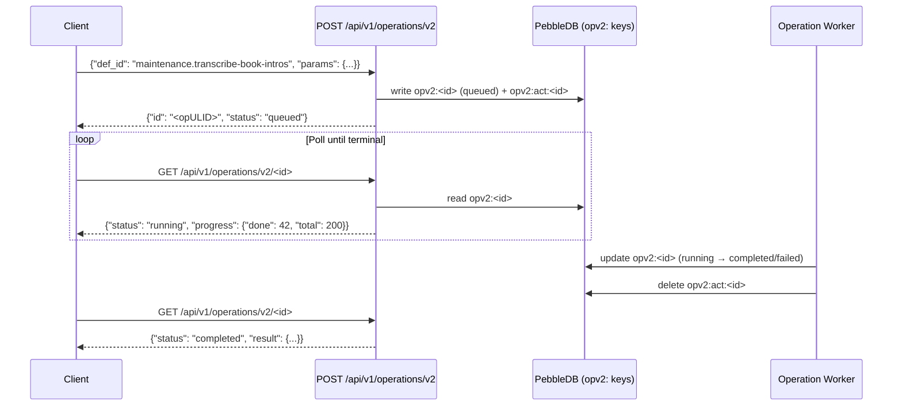

<!-- file: docs/system/api.md -->
<!-- version: 1.16.0 -->
<!-- guid: d4e5f6a7-b8c9-0123-def0-123456789012 -->
<!-- last-edited: 2026-10-18 -->

# HTTP API

The Audiobook Organizer backend exposes a JSON REST API under `/api/v1/`. All endpoints require authentication except `/api/v1/auth/bootstrap` (first-run setup) and `/api/v1/auth/status`.

## Authentication

**All API calls must include:**
```
Authorization: Bearer <token>
```

Token types:
- `abk_…` prefix — API key (persistent, programmatic access). Routed through API key validation.
- Session token — short-lived cookie-backed token from browser login. Also accepted in `Authorization: Bearer`.

**Never use `X-API-Key` header** — it is not supported.

To obtain an API key:
1. Bootstrap admin via `POST /api/v1/auth/bootstrap` (first-run only). Response: `{ "data": { "api_key": "abk_…" } }`
2. Or: log in via browser, then `POST /api/v1/auth/api-keys` to create a persistent key.

## Endpoint Reference

### Library / Audiobooks

| Method | Path | Description |
|---|---|---|
| `GET` | `/api/v1/audiobooks` | List books with filtering and pagination |
| `GET` | `/api/v1/audiobooks/:id` | Get single book with enrichment |
| `PUT` | `/api/v1/audiobooks/:id` | Update book metadata |
| `DELETE` | `/api/v1/audiobooks/:id` | Soft-delete book |
| `POST` | `/api/v1/audiobooks/batch-operations` | Per-item update / delete / restore |
| `GET` | `/api/v1/audiobooks/:id/files` | List book file segments |
| `GET` | `/api/v1/audiobooks/:id/cover` | Get cover art image |
| `GET` | `/api/v1/audiobooks/:id/cover-text` | Vision-extracted cover text |
| `GET` | `/api/v1/audiobooks/:id/changelog` | Metadata changelog |
| `GET` | `/api/v1/audiobooks/:id/metadata-history` | Per-field metadata history (`/:field`, `/:field/undo`) |
| `POST` | `/api/v1/audiobooks/:id/reconcile-files` | Reconcile the book's files against disk (`/force-rescan` re-reads tags) |

#### Library List Query Parameters

| Parameter | Type | Default | Notes |
|---|---|---|---|
| `limit` | int | 20 | Max 1000 |
| `offset` | int | 0 | Pagination offset |
| `sort_by` | string | `title` | `title`, `author`, `duration`, `created_at`, `updated_at` |
| `sort_order` | string | `asc` | `asc` or `desc` |
| `is_primary_version` | bool | — | Filter to primary versions only |
| `show_quarantined` | bool | false | Include quarantined books |
| `author_id` | string | — | Filter by author ULID |
| `series_id` | string | — | Filter by series ULID |
| `search` | string | — | Full-text search query |
| `review_status` | string | — | `matched`, `no_match`, `audio_confirmed` |
| `has_cover` | bool | — | Filter by cover art presence |
| `fingerprint_status` | string | — | `has_fingerprint`, `no_fingerprint` |

### Authors and Series

| Method | Path | Description |
|---|---|---|
| `GET` | `/api/v1/authors` | List authors |
| `GET` | `/api/v1/authors/:id` | Get author (`/books`, `/aliases`) |
| `PUT` | `/api/v1/authors/:id/name` | Rename author |
| `POST` | `/api/v1/authors/:id/split` · `/reclassify-as-narrator` · `/resolve-production` | Author repairs |
| `POST` | `/api/v1/authors/merge` | Merge authors |
| `DELETE` | `/api/v1/authors/:id` | Delete author (`POST /authors/bulk-delete` for many) |
| `GET` | `/api/v1/series` | List series |
| `PATCH` | `/api/v1/series/:id` | Update series name (`PUT /series/:id/name`, `/split`, `DELETE` empty series) |
| `GET` | `/api/v1/series/duplicates` · `/prune/preview` | Series dedup / prune previews (POST applies). Series normalize runs only as the `dedup.series-normalize` op; its HTTP preview/apply routes were removed |

### Metadata

| Method | Path | Description |
|---|---|---|
| `POST` | `/api/v1/audiobooks/:id/fetch-metadata` | Trigger metadata fetch for a book |
| `POST` | `/api/v1/audiobooks/:id/apply-metadata` | Apply fetched metadata |
| `GET` | `/api/v1/audiobooks/:id/metadata-rejections` | Candidates a human rejected for this book |
| `POST` | `/api/v1/metadata/bulk-fetch` | Queue bulk metadata fetch |
| `GET` | `/api/v1/metadata/search` · `/fields` | Provider search; known metadata fields |
| `GET` | `/api/v1/metadata/providers/throttles` | Provider throttle state (read-only). The `DELETE /metadata/providers/throttles` and `/throttles/:id` resets were retired (01-P81f) and answer 410 Gone for one release |

### Deduplication

| Method | Path | Description |
|---|---|---|
| `GET` | `/api/v1/dedup/candidates` | List dedup candidate pairs (`/export`, `/:id/breakdown`) |
| `POST` | `/api/v1/dedup/candidates/:id/link` | Link a candidate pair; `/:id/reject` rejects it. The old `/merge` and `/dismiss` verb aliases were removed |
| `POST` | `/api/v1/dedup/candidates/bulk-link` · `/bulk-count` · `/bulk-reject` · `/bulk-reject/revert` · `/link-cluster` · `/reject-cluster` | Bulk and cluster forms of link/reject |
| `POST` | `/api/v1/dedup/scan` · `/scan-llm` · `/scan-acoustid` · `/split-book-scan` | Trigger the dedup scans (each enqueues a v2 op). The book-signature scan runs only as the `dedup.book-signature-scan` op (`POST /operations/v2`) |
| `GET` | `/api/v1/dedup/stats` | Dedup statistics |

### Review Queue

The producer-agnostic review queue behind the `/review` workspace's **Review queue** lane (`internal/server/handlers/review`). Reads need `library.view`; mutations need `library.edit-metadata`.

| Method | Path | Description |
|---|---|---|
| `GET` | `/api/v1/review/count` | Pending item count (`count`, `by_kind`), plus `applying`: items held by an apply claim (running, applied but unrecorded, or interrupted), and `needs_attention`: items whose interrupted apply was abandoned. Neither is in any pending list; list them with `GET /api/v1/review/items?status=applying` or `?status=needs_attention` |
| `GET` | `/api/v1/review/items` | List review items. Responses never carry the apply claim's token or process instance; `apply_claim_action` (and `apply_claim_rerun`) show on held items, `apply_abandoned_action` on `needs_attention` ones |
| `POST` | `/api/v1/review/items/:id/approve` | Approve; dispatches the chosen action to its apply handler only while `review_apply_enabled` is on, otherwise records `approved`. The apply runs under a claim (status `applying`). Optional body `{action, if_updated_at}`: `if_updated_at` is the item's `updated_at` as the caller rendered it, and the approve is refused with `REVIEW_ITEM_CHANGED` unless the item is still that record (without it the check covers only changes after the request arrived). 409s: `REVIEW_ALREADY_APPLIED`; `REVIEW_APPLY_IN_PROGRESS` (an apply in this server process holds the claim; it is never taken over); `REVIEW_APPLY_INTERRUPTED` (no running process holds the claim: a previous server process left it, a first run of it failed after it may have written, or a re-run of it failed. Approve again with no action, or the same action, to take it over and re-run the apply. The re-run skips work already done, but it does not redo an incomplete multidisc renumbering, and a `duplicate-of` re-run can fail after a partial merge. No other decision is accepted until it finishes; if it cannot be finished, or its action has no apply handler, use `abandon-apply`); `REVIEW_RERUN_FAILED` (this request's re-run of an interrupted apply failed, for any reason including the iTunes guard; the item stays held as interrupted, it does not go back to the queue); `REVIEW_APPLY_PARTIAL` (this request's FIRST run of the apply failed and may already have changed the library, so the item stays `applying`, held by no process, exactly as after a failed re-run: it is in no pending list and refuses every other decision as `REVIEW_APPLY_INTERRUPTED` until you approve it again to retry or `abandon-apply` it; only a first-run failure the apply function reports as having written nothing is handed back instead, and a failure that cannot say, including a panic, is held); `REVIEW_ITUNES_PROTECTED` (a FIRST run was refused, before any write, because a member has a file under the active iTunes library; the item is handed back to the status it was claimed from: pending, approved, rejected or needs_attention); `REVIEW_APPLY_DISABLED` (the item is `needs_attention` and `review_apply_enabled` is off: approving it means re-running an abandoned, possibly half-done apply, so it can be rejected but not approved until apply is on); `REVIEW_NO_APPLY_HANDLER` (the item is `needs_attention` and the chosen action has no apply handler, so approving it would run nothing and erase the abandoned-action note; reject it instead); `REVIEW_SEPARATE_NEEDS_ATTENTION` (the item is `needs_attention` and the chosen action is `separate`, refused whether apply is on or off: separate runs nothing, so it cannot confirm the library is fine after a partial apply; check the library, then reject the item); `REVIEW_ITEM_CHANGED` (the item changed since it was read; reload and decide again); `REVIEW_CONFLICT` (any other store refusal). With no `action` an item under a claim resolves to the claim's own action. 500 `REVIEW_APPLIED_UNRECORDED`: the apply ran but its status write failed; approving again records it without re-running the apply while the server keeps running (a request that loses the race to record it answers `REVIEW_ALREADY_APPLIED`), and re-runs it after a restart. 500 `REVIEW_CLAIM_UNAVAILABLE`: the store cannot claim, so no review write is made |
| `POST` | `/api/v1/review/items/:id/reject` | Reject. Optional body `{if_updated_at}`, as for approve. 409 for an applied item or one under an apply claim, with the same codes as approve |
| `POST` | `/api/v1/review/items/:id/abandon-apply` | Moves an item held by an interrupted apply (`REVIEW_APPLY_INTERRUPTED`, including one a failed first run left: `REVIEW_APPLY_PARTIAL`) to `needs_attention`, recording the abandoned action in `apply_abandoned_action`. Nothing in the library is touched or undone: check what the apply changed, then approve or reject the item (both accept `needs_attention` items; an approve runs its action from the start, and with no `action` it runs the abandoned one: `chosen_action` is set to it, not to the payload's recommendation; an approve needs `review_apply_enabled` on and an apply handler for the action, `REVIEW_APPLY_DISABLED` or `REVIEW_NO_APPLY_HANDLER` otherwise, and `separate` is always refused with `REVIEW_SEPARATE_NEEDS_ATTENTION`). 409s: `REVIEW_APPLY_IN_PROGRESS` (a running apply holds it), `REVIEW_ALREADY_APPLIED` (including an apply whose result is waiting to be recorded), `REVIEW_APPLY_NOT_INTERRUPTED` (no claim) |
| `POST` | `/api/v1/review/bulk` | Bulk approve/reject. Approving by `ids` also executes items that were approved while apply was off, once `review_apply_enabled` is on (list them with `GET /api/v1/review/items?status=approved`). Per-item apply errors do not stop the batch: an error that wrote nothing comes back in `failed` (`{id, reason}`) and the item keeps its status, so resending its id retries it. A failure that may already have changed the library is not in `failed`: the item is held `applying` and is in `skipped` with `code` `REVIEW_APPLY_PARTIAL` (approve it again to retry, or abandon the apply). `applied_unrecorded` (`{id, reason}`) is the opposite case: the apply ran but the `applied` status write failed after retries, so the item is held `applying`. Approving it again records the result without re-running the apply while the server keeps running; after a restart, approving it again re-runs the apply, which skips work already done. Items that are applied or held by an apply claim are `skipped`, each with the `code` a single-item route would answer (`REVIEW_ALREADY_APPLIED`, `REVIEW_APPLY_IN_PROGRESS`, `REVIEW_APPLY_INTERRUPTED`, `REVIEW_APPLY_PARTIAL`, `REVIEW_RERUN_FAILED`, ...). With `ids`, an optional `if_updated_at` map (`{id: updated_at}`) skips each listed item that changed since with `REVIEW_ITEM_CHANGED`; it is refused (400) with `kind`. `apply_disabled: true` means apply is off and nothing was applied |
| `POST` | `/api/v1/review/replay-approved` | Retired (01-P81j): answers `410 Gone` for one release; use `POST /api/v1/review/bulk` with `ids` as above |

### Repairs Lane

Library fixers built on `internal/repairs`; the **Repairs** lane of `/review` calls these (`internal/server/wire_repairs_routes.go`, handler `internal/server/handlers/repairs`).

| Method | Path | Description |
|---|---|---|
| `GET` | `/api/v1/repairs` | List fixers: `{fixers: [{id, title, description, last_plan, last_apply}]}` |
| `POST` | `/api/v1/repairs/:fixer/plan` | Enqueue a `repairs.plan` run (a "trial"); 202 with `operation_id`; an identical queued/running request is deduped |
| `GET` | `/api/v1/repairs/:fixer/plan/:op_id/rows` | Page the stored plan's rows: `?filter=`, `?class=`, `?offset=`, `?limit=` |
| `POST` | `/api/v1/repairs/:fixer/apply` | Enqueue `repairs.apply` for `{plan_op_id, row_ids, dry_run}`; only an explicit `dry_run: false` writes, omitted means preview |

Registered fixers: `duplicate-copies`, `folder-books`, `fragment-consolidation`, `maintenance.normalize-letter-l-ordinals`, `maintenance.repair-junk-authors`, `maintenance.repair-junk-titles`, `version-group-primary-repair`. Apply re-plans each selected row and refuses one whose fingerprint changed (`changed_since_plan`); rows under `books/itunes/**` or Doctor Who / Big Finish / Torchwood are skipped at plan time and refused at apply time; nothing is deleted through the lane.

### Operations (v2)

| Method | Path | Description |
|---|---|---|
| `POST` | `/api/v1/operations/v2` | Launch an operation by def_id |
| `GET` | `/api/v1/operations/v2` | List all operations (recent) |
| `GET` | `/api/v1/operations/v2/:id` | Poll operation status |
| `DELETE` | `/api/v1/operations/v2/:id` | Cancel operation |
| `POST` | `/api/v1/operations/v2/:id/retry` | Re-run a finished operation as a new run (202) |
| `DELETE` | `/api/v1/operations/v2/:id/record` | Discard: delete the persisted record of a finished or interrupted run (204; 409 while queued/running) |

Retired 2026-09-11: `DELETE /api/v1/operations/history?status=…` now answers 404.
It deleted from the legacy v1 `operation:` keyspace by status and reported the
count as success, while the rows the Activity page shows (v2) were untouched.
Remove finished runs one at a time with `DELETE /api/v1/operations/v2/:id/record`.

### Maintenance / Admin

| Method | Path | Description |
|---|---|---|
| `POST` | `/api/v1/operations/v2` `{"def_id":"library.scan"}` | Trigger a library scan (there is no separate scan route) |
| `POST` | `/api/v1/operations/v2` `{"def_id":"maintenance.recompact-activity-digests"}` | Re-derive legacy digest items on every activity backend (the retired `POST /api/v1/admin/recompact-digests` answers 410 Gone for one release and points here); 202 with the op id |
| `POST` | `/api/v1/diagnostics/export` | Diagnostic ZIP export (`GET /diagnostics/export/:operationId/download`; `/diagnostics/db-health`) |
| `GET` | `/api/v1/diagnostics/traces` · `/diagnostics/traces/:name` | Admin-only (`settings.manage`): list the runtime flight recorder's snapshot files (`{"data": {"traces": [{name, size, modified}]}}`, newest first; each snapshot is a `.trace` plus a `.goroutines.txt`) and download one as an attachment; an unknown name is a 404 `trace not found` |
| `POST` | `/api/v1/backup/create` | Create PebbleDB backup (checkpoint) |
| `POST` | `/api/v1/system/reset` · `/system/factory-reset` | Admin-only resets |

### Collections

Reads need `library.view`; every write needs `collections.manage`.

| Method | Path | Description |
|---|---|---|
| `GET` | `/api/v1/collections` · `/collections/:id` | List collections / get one. A dynamic collection's members are `materialized_book_ids` (a static one's are `book_ids`); `GET /collections/:id` re-evaluates a dynamic collection first and stores the result when it changed, the list does not |
| `POST` | `/api/v1/collections` | Create a static or dynamic collection; the caller is stored as its owner (`created_by_user_id`) |
| `PUT` | `/api/v1/collections/:id` | Update name, description, query (dynamic) or the whole book list (static; `book_ids` requires the `version` you read, see below) |
| `DELETE` | `/api/v1/collections/:id` | Delete a collection |
| `POST` | `/api/v1/collections/:id/materialize` | Re-evaluate a dynamic collection and store the members |
| `POST` | `/api/v1/collections/:id/books` `{"book_ids":[...]}` | Add books to a static collection (atomic; duplicates ignored; `404` unknown collection, `409` not static) |
| `DELETE` | `/api/v1/collections/:id/books/:bookId` | Remove one book from a static collection (`404` when it is not a member) |

A dynamic collection is evaluated as its owner: the user who created it, or the
first active admin when that user no longer exists (`503` when there is neither).
The result is stored and served to everyone. With authentication off the evaluator
and owner is the synthetic `_local` user. The evaluator is only resolved when the
query uses a per-user field, so a query without one is evaluated with no user at all
and never answers `503`.

A static collection's whole-list replace (`PUT` with `book_ids`) requires `version`,
the `version` of the collection you read: a missing one is `400` (`version is required
with book_ids`) and a stale one is `409` with `current_version`, so a book added
atomically through `POST /collections/:id/books` since your read is never silently
dropped. The web UI does not call this route; the Audiobookshelf-compatible routes
use the atomic add and remove.

Dynamic collections whose query has a relative date (`last_played:>-30d`,
`date_added:>-7d`) are refreshed hourly by the scheduled op
`collections.refresh-relative-dynamic`, so the members the Audiobookshelf surface
serves follow the clock without anyone opening the collection. It evaluates each as
its owner, skips and counts a per-user query whose owner is gone, skips a collection
edited while the run was in flight (picked up next hour), and stores a member list
only when it changed. The hourly task enqueues the op only when such a collection
exists and the search index is open (there is no collections-disabled config switch),
and a run that still finds the index closed finishes as a clean no-op with one log
line. Launched by hand (`POST /operations/v2`) it is a preview unless
`dry_run` is `false`; the hourly run sends `dry_run: false`.

Per-user fields in a query (`read_status`, `progress_pct`, `last_played`) read the
evaluating user's own listening state. A query that cannot be parsed or
translated, such as a malformed date on one of them (`last_played:>30d`, missing the
sign), is a `400` at create time and when the query is changed (the message names the
parse or translate error and nothing is stored), not a collection that silently
matches nothing; a closed search index does not block saving a good query. To stop anyone with `collections.manage`
from reading the owner's state back out of the members, only the evaluating user
may write one into a query. `POST /collections` (dynamic) and `PUT
/collections/:id` answer `403` with code `COLLECTION_PER_USER_QUERY_OWNER_ONLY`
(`only the collection's owner can use per-user fields (last_played, progress_pct,
read_status) in its query`) when anyone else sends a query that uses one. The query and the stored members
are left unchanged. A query with no per-user field, a rename, or re-sending the
unchanged query is allowed to any caller with the permission. A collection that
falls back to the first admin can have per-user fields set only by that admin. The
Audiobookshelf-compatible routes cannot set a query (their create is static only
and their PATCH touches name, description and books), so they have no path to it.

A stand-in admin never evaluates a per-user query. When the owner row is gone (or
the stored owner is empty or `_local`) the collection falls back to the first
active admin only if its query has no per-user field. With one, the collection is
not evaluated at all and keeps its stored members: `POST /collections/:id/materialize`
answers `409` with code `COLLECTION_OWNER_MISSING_PER_USER_QUERY`, and `GET
/collections/:id` answers `200` with the stored collection plus
`evaluation_blocked` (the same code) and `evaluation_blocked_message` (a read has
always served the last known members rather than failing). The first active admin
takes such a collection over by saving its query again with `"adopt_owner": true`
(`PUT /collections/:id` with `query` and `adopt_owner`), which records that admin as
`created_by_user_id`. The flag is required: re-sending a query without it never
adopts, whatever the query, so an admin who edits for another reason cannot become
the evaluator of per-user state they did not mean to claim. `adopt_owner` is a
constraint on any client (07-F5b's UI included): it must be sent explicitly, by the
first active admin, with a query that uses a per-user field, on a collection that has
no owner; anything else is `400`, `403` or `409` and nothing is stored. A `PUT` that
changes only `sort_json` or `limit` on a blocked collection answers `200` with the
same `evaluation_blocked` flag as the read. The
startup owner backfill leaves these collections ownerless and lists their ids and
names in one warning, written to the system activity log under the source
`collection-owner-backfill`, on every start until they are resolved. Queries
written before the 403 gate existed by someone other than the owner cannot be
detected (there is no authorship history); the gate prevents new ones.

### Authentication

| Method | Path | Description |
|---|---|---|
| `POST` | `/api/v1/auth/bootstrap` | First-run admin setup |
| `GET` | `/api/v1/auth/status` | Session status (unauthenticated OK) |
| `POST` | `/api/v1/auth/login` | Login with username/password |
| `POST` | `/api/v1/auth/logout` | Invalidate session |
| `POST` | `/api/v1/auth/api-keys` | Create API key |
| `GET` | `/api/v1/auth/api-keys` | List API keys |
| `GET` | `/api/v1/auth/api-keys/:id` | Get API key |
| `PATCH` | `/api/v1/auth/api-keys/:id` | Enable/disable key |
| `DELETE` | `/api/v1/auth/api-keys/:id` | Revoke key |

## Operations v2 Lifecycle

Operations are long-running jobs (scan, transcription, dedup, organize, etc.) that run in the background with real-time progress reporting.



### Known def_ids

| def_id | Description |
|---|---|
| `maintenance.transcribe-book-intros` | Whisper intro transcription (`reparse_only` param supported) |
| `maintenance.transcribe-book-intros` (reparse_only) | Re-parse stored transcripts only (no GPU/ffmpeg) |
| `maintenance.dedup-exact-triage` | Classify dedup candidates (read-only, dry-run) |
| `dedup.purge-stale` | Cleanup stale dedup candidates (manual) |
| `repairs.plan` / `repairs.apply` | Repairs lane plan ("trial") and apply runs; launched via `/api/v1/repairs/:fixer/*` |
| `maintenance.version-group-primary-repair` | Elect exactly one primary per version group (also the `version-group-primary-repair` fixer) |
| `maintenance.purge-empty-authors` / `maintenance.purge-empty-narrators` | Purge author/narrator rows with no books (fail-closed ref counts) |
| `library.scan` | Library scan (per-book scan lock since #3635, so repairs may apply during a scan) |
| `itunes.heal` | Heal stale iTunes file paths after organize (former ID `maintenance.itunes-heal` still resolves) |
| `reconcile.scan` | Reconcile library paths vs. filesystem; also the nightly `reconcile_scan` task. The generic operations endpoint requires `settings.manage`; `POST /api/v1/operations/reconcile/scan` still admits `scan.trigger`. `GET /api/v1/operations/reconcile/scan/latest` answers `{operation, preview, latest_attempt}`: `operation` and `preview` are the newest scan that completed with a readable result, whichever ID it was stored under, and `latest_attempt` is the newest run when it is a different one (still running or queued, canceled, failed, interrupted, or completed with an unreadable result), else `null`. A newer failed or canceled run never hides the last good preview. With no usable scan, `operation` is the newest run, `preview` is `null` and `latest_attempt` is `null`. Former ID `maintenance.reconcile-scan` still resolves |
| `dedup.author-scan` | Scan for author near-duplicates (former ID `maintenance.author-dedup-scan` still resolves) |
| `dedup.llm-review` | LLM review of ambiguous dedup candidates. The generic operations endpoint requires `settings.manage`; `POST /api/v1/dedup/scan-llm` still admits `scan.trigger`. Former IDs `maintenance.dedup-llm-review` and `scheduler.dedup-llm-review` still resolve |
| `maintenance.window` | Nightly maintenance window (dispatches sub-ops) |
| `library.bulk-write-back` | Bulk tag write-back to audio files |
| `ai.author-review` | AI-assisted author dedup review |
| `ai.author-merge-apply` | Apply AI author merge recommendations |
| `ai.author-scan-apply` | Merge the authors of selected AI scan results (`POST /ai/scans/:id/apply` queues it with `dry_run=false`; omitted `dry_run` is a preview). Honours `author_name` locks, marks only results whose merge succeeded |

**Renamed def_ids.** A renamed op keeps its old ID as an alias
(`OperationDef.FormerIDs`). The old ID is accepted by `POST /operations/v2`,
`?def_id=` timeline filters, resume and retry, and it resolves to the new op.
Stored rows keep the ID they were written under. The metric
`audiobook_organizer_operation_deprecated_def_id_total{alias,entry}` counts
how often each old ID is still used. The 2026-09-25 renames are
`maintenance.itunes-{regroup,playlist-import,heal,clone-into-library}` →
`itunes.{regroup,playlist-import,heal,clone-into-library}`, `library.optimize`
→ `maintenance.library-optimize`, and `maintenance.dedup-llm-review` →
`dedup.llm-review`. `scheduler.dedup-llm-review` → `dedup.llm-review` followed on
2026-10-14 (04-P14b), and `maintenance.reconcile-scan` → `reconcile.scan` the same day (04-P14c).

## Response Conventions

All responses use the envelope format:
```json
{
  "data": { ... },
  "error": null
}
```

Errors:
```json
{
  "data": null,
  "error": "human-readable error message"
}
```

Pagination responses include `total` alongside `data`:
```json
{
  "data": [...],
  "total": 10891,
  "limit": 20,
  "offset": 0
}
```

## Cross-references

- Architecture (handler wiring): [architecture.md](architecture.md)
- Pipelines (operation internals): [pipelines.md](pipelines.md)
- Runbooks (deploy and ops): [runbooks.md](runbooks.md)
